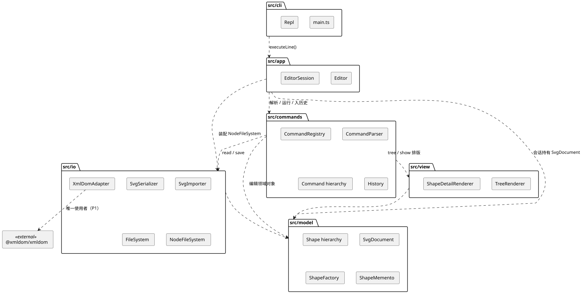
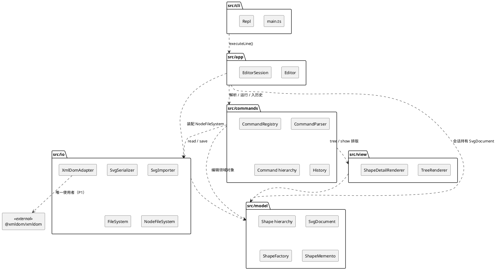
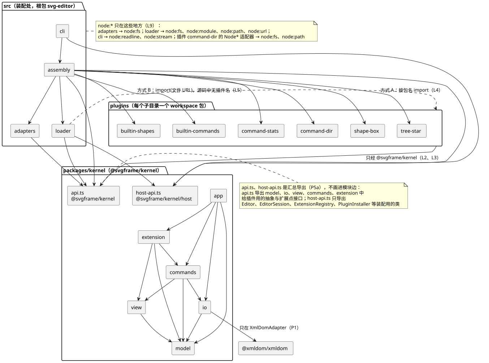
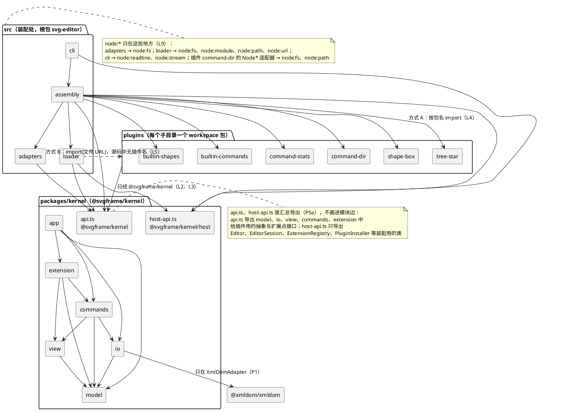
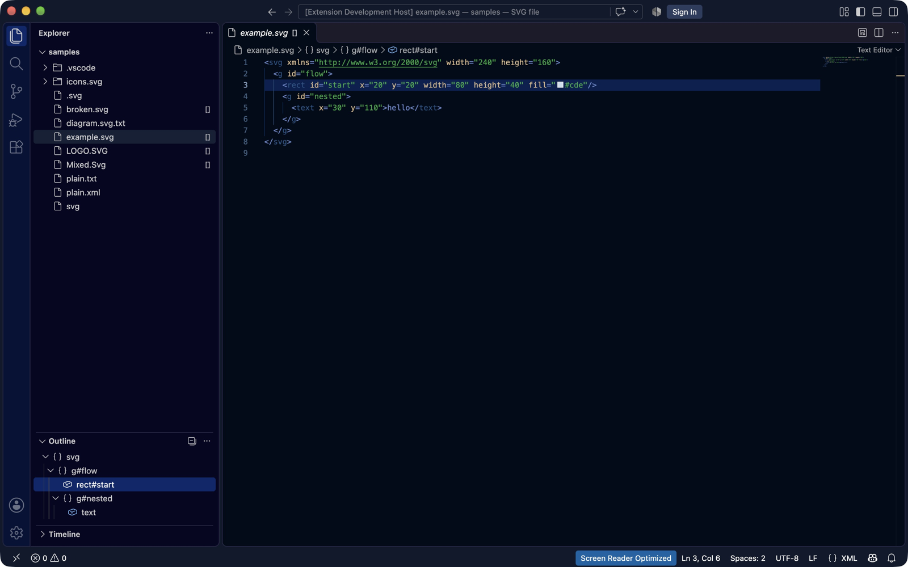
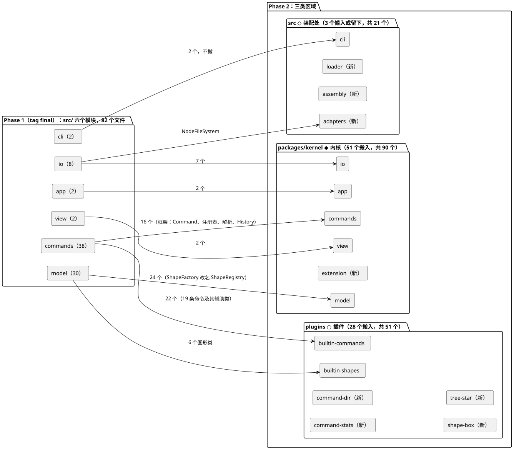
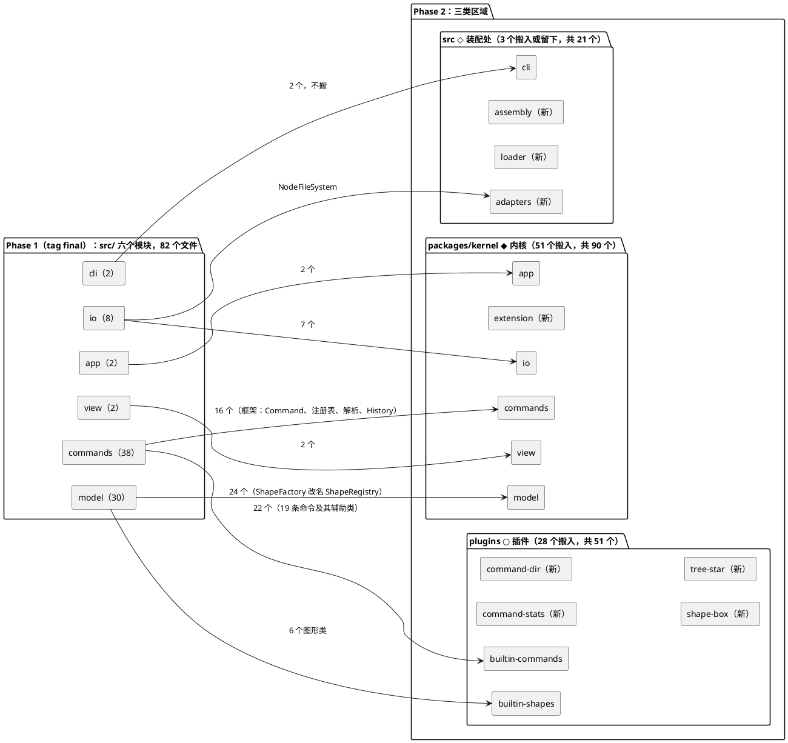

# SVG 编辑器（CLI）· Phase 2 交付说明

本文是 Phase 2（规格 [`spec/phase_cli_2.md`](spec/phase_cli_2.md)，下称“规格”）的交付说明，对应规格 §7 第 3 项的 `doc/README.md`：规格 §7 要的每一样东西，都能从本文找到，或者从本文的链接直接找到。

**三份文件的关系**

| 文件 | 内容 | 什么时候读 |
|---|---|---|
| 本文 `doc/README.md` | Phase 2 实际做成的样子：扩展点、两种装配、依赖规则、依赖图、插件、ADR、局限、度量、过程、迭代报告、自查与验收证据 | 先读它 |
| [`design-phase2.md`](design-phase2.md)（下称“设计”） | Phase 2 的设计依据（S4 写成，S5–S15 逐步修订）：接口签名、契约的论证、失败文案的全集、接入演练、缺口记录、规格追溯表 | 想看某个结论的完整论证时，顺着本文的链接去 |
| [`phase1-architecture.md`](phase1-architecture.md)（下称“Phase 1 方案”） | Phase 1 的架构方案，内容与 tag `final` 上的 `doc/README.md` 相同（只改了 V1 的列号笔误） | 想看 Phase 1 的模块、模式、约定补充时 |

**编号在哪里**

| 编号 | 含义 | 定义在 |
|---|---|---|
| R/F/E/U/V | Phase 1 的约定补充（输入、文件、编辑、undo、显示） | [Phase 1 方案「附：约定补充」](phase1-architecture.md#附约定补充) |
| D1–D8、P1–P9 | Phase 1 的依赖规则与范式规则（Phase 2 的延续见本文[第 5 节](#5-依赖规则)） | [Phase 1 方案 §3](phase1-architecture.md#3-依赖方向规则) |
| K1–K6 | Phase 1 的已知偏差（Phase 2 中的去向见本文 [9.3](#93-phase-1-的-k1k6-在-phase-2-的去向)） | [Phase 1 方案 §5](phase1-architecture.md#5-已知偏差--待重构) |
| X1–X30 | 决策 | [设计 §5.1–5.2](design-phase2.md#5-决定约定补充与已知偏差) |
| L1–L10、P5a、P5b、P10 | Phase 2 新增的分层规则与范式规则的例外 / 新规则 | [设计 §1.2](design-phase2.md#12-依赖规则与强制手段)；本文第 5 节 |
| N1–N19、T1–T4 | 约定补充（对规格的解释）、已知偏差（对规格的偏离） | [设计 §5.5](design-phase2.md#55-约定补充-n1n19对规格的解释n17-为-s8-修订n18n19-为-s9-修订)、[§5.6](design-phase2.md#56-已知偏差-t1t4对规格的偏离)；本文第 9 节 |
| G1–G50 | 设计与实现过程中发现、已补进设计的缺口 | [设计 §8.5](design-phase2.md#85-缺口回填记录) |
| ADR-1–ADR-6 | 架构决策记录 | 本文[第 8 节](#8-adr)（定稿）；草稿在[设计第 6 部分](design-phase2.md#6-adr-草稿) |
| TR-001… | 规格追溯表的行 | [设计第 7 部分](design-phase2.md#7-规格追溯表) |
| VA1–VA22 | VSCode 扩展的决定 | [`vscode-svg/README.md`](../vscode-svg/README.md#决定va-编号供-s3-引用) |

代码注释与测试里写的 “README §n”“V1”“K1” 等，**都指 Phase 1 方案**（`phase1-architecture.md`），不指本文。运行代码在 Phase 2 收尾时不改，所以这些注释保留原样。

## 目录

- [1 快速开始](#1-快速开始)
- [2 目录与三类区域](#2-目录与三类区域)
- [3 扩展点清单](#3-扩展点清单)
- [4 两种装配方式与配置文件](#4-两种装配方式与配置文件)
- [5 依赖规则](#5-依赖规则)
- [6 模块依赖图：重构前后](#6-模块依赖图重构前后)
- [7 插件](#7-插件)
- [8 ADR](#8-adr)
- [9 约定补充、已知偏差与 K1–K6 的去向](#9-约定补充已知偏差与-k1k6-的去向)
- [10 已知局限](#10-已知局限)
- [11 第一部分：VSCode 扩展（A.3）](#11-第一部分vscode-扩展a3)
- [12 度量](#12-度量)
- [13 过程记录（Phase 2）](#13-过程记录phase-2)
- [14 迭代报告：Phase 1 → Phase 2](#14-迭代报告phase-1--phase-2)
- [15 一致性自查（Phase 2）](#15-一致性自查phase-2)
- [16 验收清单与证据](#16-验收清单与证据)
- [17 测试与质量保证（Phase 2）](#17-测试与质量保证phase-2)
- [18 修订记录](#18-修订记录)

---

## 1 快速开始

需要 Node.js 22 或更高版本。所有命令都在仓库根目录运行。

```bash
npm ci
```

**启动编辑器**：`npm run cli` 后面加 `--` 再写启动参数。三个参数互斥，不带参数等于 full：

| 命令 | 装配配置 | 装哪些插件 |
|---|---|---|
| `npm run cli` | full（方式 A） | 内置插件 + 组合根 `CompositionRoot.optional()` 里的全部可选插件（`stats`、`dir`、`box`、`modified-star`） |
| `npm run cli -- --bare` | bare | 只有内置插件：Phase 1 的 19 条命令与 6 种图形，输出与 `final` 逐字节相同 |
| `npm run cli -- --only @svgframe/plugin-shape-box` | only（方式 A 的子集） | 内置 + `optional()` 中列出的包（`--only` 可重复，安装顺序仍按 `optional()`） |
| `npm run cli -- --config plugins.config.json` | config（方式 B） | 内置 + 配置文件中 `enabled` 不为 `false` 的项，按数组顺序 |

用法错误（两个选项同时出现、未知参数、`--config` / `--only` 缺少值等）：stderr 输出 `usage: svg-editor [--bare | --only <plugin>… | --config <file>]`，退出码 2，不打印 banner。`--only` 给了 `optional()` 里没有的包名：stderr `error: --only: no such plugin in the code assembly: <name>`，退出码 2。插件加载失败不属于用法错误：错误行写在 stdout 的 banner 之后，编辑器照常启动（[4.5](#45-失败文案与退出码)）。

**四项检查**（每一步结束都要全部通过，CI 也跑这四项）：

```bash
npm run typecheck
```

```bash
npm run typecheck:scripts
```

```bash
npm test
```

```bash
npm run baseline
```

`npm test` 当前是 120 个文件、1831 个测试；`npm run baseline` 的最后一行是 `baseline: 6 sessions, 0 differences (entry src/cli/main.ts; 14 runs)`。

**工具脚本**：

| 命令 | 作用 |
|---|---|
| `npm run metrics -- <提交>` | 从 git 历史生成 `docs/metrics/metrics.md` 与 `metrics.json`（对比 `final` 与给定提交，[第 12 节](#12-度量)） |
| `npm run plugin-diff -- <C> plugins/<新目录> --mode A\|B` | 对接入提交 `C` 检查规格 §6 的差异判据（[4.7](#47-差异判据与-npm-run-plugin-diff)） |
| `npm run baseline -- --update <会话>` | 重写某个会话的期望输出。**只有在明确同意之后才能用**，比对出现差异时按回归处理 |

**VSCode 扩展**（第一部分）是独立工程，在 `vscode-svg/` 里单独安装、构建、测试：`cd vscode-svg && npm ci && npm run build`，F5 运行、集成测试与打包见 [`vscode-svg/README.md`](../vscode-svg/README.md#命令)。

---

## 2 目录与三类区域

### 2.1 目录树

```text
仓库根/
├── package.json              根包 svg-editor：装配处 + 全仓脚本；"workspaces": ["packages/*", "plugins/*"]
├── package-lock.json
├── tsconfig.json             类型检查范围（include 为 glob）；paths 与内核 exports 一一对应
├── vitest.config.ts          测试范围（tests/、packages/*/tests/、plugins/*/tests/）
├── plugins.config.json       方式 B 的配置（四个可选插件）
├── packages/
│   └── kernel/               ◆ 内核 @svgframe/kernel（90 个 .ts）
│       ├── package.json      "exports": { ".": "./src/api.ts", "./host": "./src/host-api.ts" }
│       ├── src/api.ts        公开入口：给插件（P5a）
│       ├── src/host-api.ts   公开入口：只给装配处（P5a）
│       ├── src/model/        领域模型 + 图形扩展点 + 属性扩展点（42）
│       ├── src/io/           SVG 序列化 / 读回分派 / XML 适配 / FileSystem 端口（8）
│       ├── src/view/         tree / show 排版 + 树标签扩展点（5）
│       ├── src/commands/     命令框架：抽象类、注册表、解析、History（18）
│       ├── src/extension/    插件接口、上下文、事务式安装器、清单、事件订阅（12）
│       ├── src/app/          Editor（Invoker）、EditorSession、DocumentEvents（3）
│       └── tests/            内核契约测试（只用测试替身，不依赖任何插件）
├── src/                      ◇ 装配处（根包，21 个 .ts）
│   ├── cli/                  main.ts（进程入口）、Repl、CliArguments（3）
│   ├── assembly/             CompositionRoot（方式 A 唯一要改的文件）、EditorAssembler、四种装配配置等（9）
│   ├── loader/               方式 B 的加载器，独占一个目录：PluginConfig、ModuleLocator、PluginLoader 等（8）
│   └── adapters/             NodeFileSystem（1）
├── plugins/                  ○ 插件（每个子目录一个 workspace 包）
│   ├── builtin-shapes/       内置：rect circle ellipse line text g（7）
│   ├── builtin-commands/     内置：Phase 1 的 19 条命令（23）
│   ├── command-stats/        可选：stats（3）
│   ├── command-dir/          可选：dir，带目录访问适配器（8）
│   ├── shape-box/            可选：box 图形、属性处理器、(box) 标签（7）
│   └── tree-star/            可选：modified-star 树标签（3）
├── tests/                    根测试：Phase 1 的单元与系统测试、装配处测试、architecture test、
│                             Phase 2 系统测试、工具脚本测试、加载器夹具 tests/fixtures/plugins/
├── scripts/
│   ├── baseline/             基线比对 npm run baseline（会话、运行组、比对）
│   ├── metrics/              npm run metrics（文件清单、行数、圈复杂度）
│   ├── plugin-diff/          npm run plugin-diff（规格 §6 的差异判据）
│   └── shared/               GitRepository（以上脚本共用的 git 调用）
├── doc/
│   ├── README.md             本文
│   ├── design-phase2.md      Phase 2 设计
│   ├── phase1-architecture.md Phase 1 方案
│   ├── process-log.md        逐条过程记录
│   ├── diagrams/             渲染好的 PlantUML 图（Phase 1 三张 + 本文两张）
│   ├── spec/                 规格、Phase 1 规格、分析、计划副本
│   └── transcript/           基线会话：输入、运行组、配置、夹具、期望输出
├── docs/metrics/             metrics.md、metrics.json（只由 npm run metrics 生成）
└── vscode-svg/               VSCode 扩展（第一部分）：独立 package.json 与锁文件，不进 workspaces、tsconfig、vitest 与 CLI 的度量
```

括号里是 `src/` 下 `.ts` 文件的个数，由脚本数出（[15.1](#151-实际目录与设计一致)）。

### 2.2 三类区域

| 区域 | 位置 | 职责 | 可以 import |
|---|---|---|---|
| ◆ 内核 | `packages/kernel/src/` | 领域模型、命令框架、序列化与读回、显示，以及四个扩展点和插件安装机制。**不认识任何具体的图形类型或命令** | 自己的相对路径；`@xmldom/xmldom`（只在 `io/XmlDomAdapter.ts`） |
| ◇ 装配处 | 根包 `src/` | 进程入口、命令行参数、决定装哪些插件（方式 A 的组合根、方式 B 的加载器）、平台适配器 | `@svgframe/kernel`、`@svgframe/kernel/host`、`node:*`（按 L9 限定位置）；只有 `CompositionRoot.ts` 可以 import 插件包 |
| ○ 插件 | `plugins/*/src/` | 用扩展点提供具体能力；内置能力与可选能力同一种形状 | 只有 `@svgframe/kernel`（裸名）、本包内的相对路径、`node:*`（只在 `Node*` 适配器类里） |

**内核各模块**

| 模块 | 职责 | 主要的类与接口 |
|---|---|---|
| `model` | 图形与文档、属性与样式、快照；图形扩展点与属性扩展点 | `Shape`、`LeafShape`、`ContainerShape`、`SvgDocument`、`ShapeMemento`；`ShapeProvider`、`StaticShapeProvider`、`ShapeRegistry`、`ShapeCatalog`、`ShapeKit`；`AttributeHandler`、`AttributeTarget`、`AttributeChange`、`AttributeDispatcher`；只读视图 `ShapeView`、`DocumentView`、`ElementView` |
| `io` | 写出 SVG；读入 SVG 并按 `matchScore` 分派给图形提供者；隔离 xmldom；文件系统端口 | `SvgSerializer`、`SvgImporter`、`ImportSession`（实现 `ShapeReader`）、`IdAllocator`、`XmlDomAdapter`、`XmlElement`、`FileSystem` |
| `view` | `tree` / `show` 的排版；树标签扩展点 | `TreeRenderer`、`ShapeDetailRenderer`、`TreeDecorator`、`TreeRowView` |
| `commands` | 命令的抽象类层次、分词与解析、注册表、历史 | `Command`、`EditCommand`、`QueryCommand`、`DocumentCommand`、`HistoryCommand`、`CommandType`、`CommandRegistry`、`CommandParser`、`History` |
| `extension` | 插件接口与上下文、事务式安装、清单、文档事件订阅 | `Plugin`、`PluginContext`、`StagingContext`、`PluginInstaller`、`PluginManifest`、`PluginCandidate`、`ExtensionRegistry`、`DocumentListener` |
| `app` | 一行输入 → 输出行（Invoker）；会话状态；事件缓冲 | `Editor`、`EditorSession`、`DocumentEvents` |

**装配处各目录**：`cli` 解析命令行（`CliArguments`）、运行 REPL（`Repl`）、捕获拒绝启动（`main.ts`）；`assembly` 是组合根 `CompositionRoot`（方式 A 的插件表）、装配器 `EditorAssembler`（先装内置、再按装配配置装可选插件、造 `Editor`）与四种装配配置 `BareProfile`、`FullProfile`、`OnlyProfile`、`ConfigProfile`；`loader` 读配置、解析模块、`import(文件 URL)`；`adapters` 是 `NodeFileSystem`。

**六个插件包**

| 包名 | 目录 | `contributes` | 入口 | 类别 |
|---|---|---|---|---|
| `@svgframe/plugin-builtin-shapes` | `plugins/builtin-shapes` | `shapes`: `rect`、`circle`、`ellipse`、`line`、`text`、`g` | `BuiltinShapesPlugin` | 内置（每种装配都先装） |
| `@svgframe/plugin-builtin-commands` | `plugins/builtin-commands` | `commands`: Phase 1 的 19 条 | `BuiltinCommandsPlugin` | 内置 |
| `@svgframe/plugin-command-stats` | `plugins/command-stats` | `commands`: `stats` | `StatsPlugin` | 可选 |
| `@svgframe/plugin-command-dir` | `plugins/command-dir` | `commands`: `dir` | `DirPlugin` | 可选 |
| `@svgframe/plugin-shape-box` | `plugins/shape-box` | `shapes`: `box`；`attributes`: `box-attributes`；`decorators`: `box-type-label` | `BoxPlugin` | 可选 |
| `@svgframe/plugin-tree-star` | `plugins/tree-star` | `decorators`: `modified-star` | `TreeStarPlugin` | 可选 |

内置插件与可选插件同格式（都有 `package.json` 与 `contributes`），走同一条安装路径；区别只是内置插件在每一种装配配置里都装，而且最先装（先图形后命令）。

---

## 3 扩展点清单

四个扩展点都在内核 `packages/kernel/src/` 中声明，经 `api.ts`（`@svgframe/kernel`）公开。插件只能经 `PluginContext` 的 `register*` 注册，并在 `package.json` 的 `contributes` 中声明注册名；内置插件与可选插件都由 `PluginInstaller.install` 事务式安装（[设计 §3.3](design-phase2.md#33-事务式注册)）。“调用位置”按当前代码用 `rg` 核对，并注明调用方所在的区域：**内核**（`packages/kernel/src/`）或**内置命令插件**（`plugins/builtin-commands/src/`）。“违约时的报错”中的文案都出自 `packages/` 或 `plugins/` 的源码，`<…>` 是代码里 `${…}` 的部分（`cannot parse file: <path> (<detail>)` 的 `<detail>` 来自另一段模板，例如 `shape provider <type> failed: <reason>`，两段都在 `packages/kernel/src/io/ImportSession.ts` 中）；面向用户的那几条由 `Editor` 加上 `error: ` 前缀。“禁用时的行为”指不装提供这项扩展的可选插件（例如 `--bare`）。

| 接口名 | 职责 | 调用位置（文件 + 函数） | 已有实现 | 禁用时的行为 | 违约时的报错 |
|---|---|---|---|---|---|
| `ShapeProvider`（`packages/kernel/src/model/ShapeProvider.ts`；`PluginContext.registerShape`；`contributes.shapes`） | 一种图形类型：`create` 的参数（`params`）与构造（`create`）、占用的全部 id（`claimedIds`）、创建回显的附加文字（`creationDetail`）、读回时对元素的认领分数（`matchScore`）与读取（`read`） | **内置命令插件** `CreateCommand.ts` 的 `prepare`：`context.shapes().lookup(type)`（内核 `ShapeRegistry.lookup`）之后依次调 `claimedIds`（经私有方法 `claimedIds`）、`create`、`creationDetail`；`usageOf` 读 `params`。**内置命令插件** `GroupCommand.ts` 的 `newContainer`：`lookup("g").create(…)`。**内核** `io/ImportSession.ts` 的 `dispatch` → `readWithNext` → `choose` → `scoreOf`（`matchScore`）与 `readWith`（`read`），由 `io/SvgImporter.ts` 的 `read` 驱动，后者由**内置命令插件** `ReadCommand.ts` 的 `execute` 调用。**内核** `model/ShapeRegistry.ts` 的 `build`（`ShapeKit`，组合图形在自己的 `create` 中按类型名造部件）→ `create` | 内置插件 `@svgframe/plugin-builtin-shapes`：`rect`、`circle`、`ellipse`、`line`、`text`、`g`，六个图形类各由 `StaticShapeProvider` 适配（`BuiltinShapesPlugin.activate`）；可选插件 `@svgframe/plugin-shape-box`：`box`（`BoxPlugin.activate` 注册 `BoxProvider`，`rect`、`text` 未注册时拒绝激活；`claimedIds` 为 `<id>`、`<id>-rect`、`<id>-label`，`create` 经 `ShapeKit` 按类型名造出 `rect` 与 `text`，`creationDetail` 为 ` (g#n1 + rect#n1-rect + text#n1-label)`；`matchScore` 对 `<g data-kind="box">` 为 2，胜过 `g` 的 1；没有 id 或部件不全时警告并降级为 `g`，涉及三个 id 的重复拒绝整个读入） | `create <type> …` → `unknown shape type: <type> (is the plugin loaded?)`；读回时没有提供者认领（分数全为 0）的元素连同子树被跳过，警告 `skipped unsupported element <name>`（F6）；`<g data-kind="box">` 由 `g` 认领，读成普通 `g`，`data-kind` 作为透传属性原样写回 | `claimedIds` / `create` / `creationDetail` 抛出非 `EditorError` 或后置条件不成立（包括实际 id 有重复）→ `shape provider failed: <type> (<reason>)`，文档不变；`read` 抛出 `EditorError`（插件自己的领域错误，例如 `reader.reject(<detail>)` 得到的 `cannot parse file: <path> (<detail>)`）→ 原样报出，读入失败、原文档不变；`matchScore` 抛错、`read` 抛出其他异常，或二者返回非法值 → `cannot parse file: <path> (shape provider <type> failed: <reason>)`，原文档不变；最高分并列 → `cannot parse file: <path> (ambiguous shape providers for <tag>: <a>, <b>)`；注册参数形状不对 → `plugin failed to activate: <name> (<reason>)`；重名 → `duplicate registration: shapes/<name>` |
| `Command`：注册对象是命令类的静态侧 `CommandType`（`packages/kernel/src/commands/CommandType.ts`），或实现它的实例；它造出的命令对象是 `Command`（`commands/Command.ts`）；`PluginContext.registerCommand`；`contributes.commands` | 一条命令：名字、用法、一句说明、类别、是否需要文档；`parse` 只检查语法并造出命令对象，`execute` 执行；对历史的影响由子类决定：`EditCommand` 入 undo 栈，`DocumentCommand` 清栈并加 io 锁，`QueryCommand`、`HistoryCommand` 什么也不做 | **内核** `commands/CommandParser.ts` 的 `resolve`：`CommandRegistry.lookup` 按名查找，以 `usage` 构造 `ArgList`；**内核** `app/Editor.ts` 的 `run`：检查 `requiresDocument` → `CommandLine.parse()`（即 `type.parse(args)`）→ `command.execute(session)` → `command.recordIn(session.history())`；**内置命令插件** `HelpCommand.ts` 的 `execute`：经 `context.commands().commandTypes()` 读 `usage`、`summary`、`category` | 内置插件 `@svgframe/plugin-builtin-commands`：Phase 1 的 19 条命令（`BuiltinCommandsPlugin.activate`）；可选插件 `@svgframe/plugin-command-stats`：`stats`（`StatsCommand` 是 `QueryCommand` 的子类，需要文档，在 `help` 的 `Display:` 组末尾）；可选插件 `@svgframe/plugin-command-dir`：`dir`（`DirPlugin.activate` 注册一个 `DirCommandType` **实例**，实例持有两个目录访问接口，`parse` 把它们交给每个 `DirCommand`；`requiresDocument = false`；`DirCommand` 是 `QueryCommand` 的子类；在 `Display:` 组 `stats` 之后） | 输入这条命令 → `unknown command: <name>`；`help` 不列出它 | 注册参数形状不对（如名字含大写或空白、类别不是四个常量之一）→ `plugin failed to activate: <name> (<reason>)`；重名 → `duplicate registration: commands/<name>`；`execute` 抛出非 `EditorError` 是程序错误：`Editor.executeLine` 不捕获，进程以退出码 1 结束（stderr 由装配处 `src/cli/Repl.ts` 写出，[设计 §3.9](design-phase2.md#39-违约处理总则)） |
| `TreeDecorator`（`packages/kernel/src/view/TreeDecorator.ts`；`PluginContext.registerTreeDecorator`；`contributes.decorators`） | 结构树每一行行尾的标签（`tagFor`） | **内核** `view/TreeRenderer.ts` 的 `alignAndDecorate` → `decorate` → `tagOf`（`tagFor`），由 `renderDocument` / `renderSubtree` 对每一行调用；调用方是**内置命令插件** `TreeCommand.ts` 的 `execute`（`new TreeRenderer(context.treeDecorators())`） | 内置插件不注册树标签；可选插件 `@svgframe/plugin-shape-box`：`box-type-label`（`BoxTypeLabel`，只对 box 的行答 `(box)`，即 `g#n1 (box)`，对根行、普通 `g` 与叶子答 `null`）；可选插件 `@svgframe/plugin-tree-star`：`modified-star`（`TreeStarPlugin.activate` 新建一个 `ModifiedStar`，同一个对象既注册为标签又订阅为监听器；内容与最近一次 `init` / `read` / `save` 不同的行答 `*`：根行比较整份序列化，图形行比较自身的指纹，不向祖先传播；还没有保存点时一律答 `null`；box 先装，所以同一行是 `g#n1 (box) *`） | 没有标签，或全部答 `null` / `""`：`tree` 的输出与 `final` 逐字节相同 | `tagFor` 抛错，或答案不是字符串 / `null`、含换行、首尾有空白 → `tree decorator failed: <name> (<reason>)`，这次 `tree` 不输出其他行，文档与历史不受影响；注册参数形状不对 → `plugin failed to activate: <name> (<reason>)`；重名 → `duplicate registration: decorators/<name>` |
| `AttributeHandler`（`packages/kernel/src/model/AttributeHandler.ts`；`PluginContext.registerAttributeHandler`；`contributes.attributes`） | 某个属性在某种图形上的语义：`handles` 判断是否负责（只拿到只读视图），`apply` 经 `AttributeTarget` 只改属性，返回带两条文案的 `AttributeChange`；`priority` 裁决冲突 | **内置命令插件** `SetCommand.ts` 的 `prepare` 调 `context.attributeEdits().plan(…)`（`CommandContext.attributeEdits()`，由内核 `EditorSession` 实现）→ **内核** `model/AttributeDispatcher.ts` 的 `plan` → `asks`（`handles`）→ `tryOut`（`apply`，再取 `AttributeChange.appliedMessage`、`undoneMessage`，然后检查结构） | 内置插件不注册属性处理器；可选插件 `@svgframe/plugin-shape-box`：`box-attributes`（`BoxAttributeHandler`，只负责 box 的 `fill` 与 `label`：`fill` 改 `<id>-rect`，`label` 改 `<id>-label` 的文本，各是一个 undo 单元；回显由 `BoxFillChange`、`BoxLabelChange` 给出） | `plan` 答 `null`，`set` 走 Phase 1 的属性白名单（不在白名单 → `unknown attribute: <name>`） | `handles` / `apply` 抛出非 `EditorError` 或返回值违约 → `attribute handler failed: <name> (<reason>)`，已回滚，历史不变；最高 `priority` 并列 → `ambiguous attribute handlers for <attr> on <id>: <a>, <b>`；值不合法时处理器自己的 `EditorError` 原样报出；绕过接口改了子树结构（在 `apply` 或文案方法里）是程序错误：普通 `Error` `attribute handler <name> changed the structure of <label>`，不包装、不还原；注册参数形状不对（如 `priority` 不是整数）→ `plugin failed to activate: <name> (<reason>)`；重名 → `duplicate registration: attributes/<name>` |

插件框架的另外两个钩子不是规格 §1 的扩展点，但 `box` 与 `modified-star` 依赖它们，一并列出：

| 钩子 | 职责 | 调用位置（文件 + 函数） | 已有实现 | 不提供时的行为 | 违约时的报错 |
|---|---|---|---|---|---|
| `DocumentListener`（`packages/kernel/src/extension/DocumentListener.ts`；`PluginContext.subscribe`；不进 `contributes`） | 文档事件：`documentReplaced`（`init` / `read`）、`documentSaved`（`save`）、`documentEdited`（编辑命令、`undo` / `redo`） | **内核** `app/DocumentEvents.ts` 的 `flush`，由 `app/EditorSession.ts` 的 `flushEvents` 在 `app/Editor.ts` 的 `executeLine` 中、命令成功之后调用；命令失败时 `discardEvents` 丢弃缓冲 | 可选插件 `@svgframe/plugin-tree-star`：`modified-star`（注册为树标签的同一个 `ModifiedStar` 用 `subscribe` 订阅；`documentReplaced`、`documentSaved` 记录保存点（每个图形的指纹与整份序列化），`documentEdited` 什么都不做；失败的 `save` / `read` 不派发事件，所以不算保存点） | 事件照常缓冲与丢弃，没有订阅者 | 监听器抛错是程序错误：命令已成功、无法回滚，异常离开 `Editor.executeLine`，进程以退出码 1 结束；注册参数形状不对 → `plugin failed to activate: <name> (<reason>)` |
| `ShapeContainer.canRelease`（`packages/kernel/src/model/ShapeContainer.ts`；组合图形在 `ContainerShape` 的子类中覆盖） | 保护必要子部件：能否把某个子节点移出容器 | **内核** `commands/EditCommand.ts` 的 `checkReleasable`；调用方是**内置命令插件** `DeleteCommand.ts`、`AddToCommand.ts`、`GroupCommand.ts`、`UngroupCommand.ts` 的 `prepare` | `ContainerShape.canRelease` 与 `SvgDocument.canRelease` 都答 `true`；`BoxShape` 对自己的两个部件答 `false` | 一律允许，与 Phase 1 相同 | 答 `false` → `cannot detach required part of composite shape: <id>`，状态完全不变 |

接口签名与每条契约的论证见[设计第 2 部分](design-phase2.md#2-四个扩展点的接口与契约)与[第 3 部分](design-phase2.md#3-支撑设施的接口)；四个扩展点的类图见[设计 §3.11.2](design-phase2.md#3112-四个扩展点)。

---

## 4 两种装配方式与配置文件

### 4.1 一条路径，两种得到插件的方式

规格 §6 示例里的 `shapeBox.activate(ctx)` 只是示意。两种方式只在**怎样得到 `PluginCandidate`（插件类 + 清单 + options）**上不同，之后都交给同一个 `PluginInstaller.install`：构造 → 激活（写进暂存区）→ 查重 → 清单比对 → 提交，任何一步失败都丢弃暂存区（[ADR-4](#adr-4-配置清单的校验时机)）。

| | 方式 A（组合根，改代码） | 方式 B（加载器，改配置） |
|---|---|---|
| 接入一个插件要改的文件 | `src/assembly/CompositionRoot.ts`：文件头两行 import（插件类与它的 `package.json`），`optional()` 里加一项 | `plugins.config.json`：`plugins` 数组里加一项 |
| 谁决定装哪些 | `CompositionRoot.optional()` 中的列表 | `plugins.config.json` 的 `plugins` 数组 |
| 谁得到插件类 | 静态 `import XxxPlugin from "@svgframe/plugin-xxx"` | `ModuleLocator` 解析 → `import(文件 URL)` → `default` |
| 谁得到清单 | 静态 `import manifest from "@svgframe/plugin-xxx/package.json" with { type: "json" }` | `ModuleLocator` 读同一个 `package.json` |
| options | 组合根里写 `PluginOptions.of({...})` | 配置项的 `options`（深拷贝并冻结后包成 `PluginOptions`） |
| 之后 | `PluginInstaller.install(candidate)` | **同左** |

两种方式读的是同一份 `package.json`，所以 `contributes` 只写一次；插件最后都是 `new <默认导出的类>(options)`，类来自同一个包。两种方式都需要新插件是一个 workspace 包（`npm install` 会在锁文件里加一段，在 `node_modules/@svgframe/` 下建软链接）。完整时序图见[设计 §4.1](design-phase2.md#41-一条路径)。

### 4.2 四种装配配置

| 装配配置 | 命令行 | 安装的插件（按顺序） | 用途 |
|---|---|---|---|
| bare | `--bare` | 内置图形、内置命令 | 规格 §1“禁用任何插件框架仍能启动”（N14）；基线兼容（与 `final` 逐字节相同） |
| full（方式 A） | 不带参数 | 内置 + `optional()` 全部 | 日常使用；规格 §6 的 `<启动入口> < cli-1.txt  # 方式 A` |
| only（方式 A 的子集） | `--only <包名>`（可重复） | 内置 + `optional()` 中包名在集合里的（顺序按 `optional()`） | 需要部分可选插件的方式 A 运行，例如 §6.1B 要 box、不要 `modified-star` |
| config（方式 B） | `--config <file>` | 内置 + 配置中 `enabled` 不为 `false` 的项（按数组顺序） | 方式 B；空列表等价于 bare |

`--config` 表示“内置能力 + 配置里的插件”，不包含组合根的可选插件，否则同一插件既在组合根又在配置里时会被装两次。配置不合法时“以默认内置能力启动”指 bare。

### 4.3 配置文件格式与严格校验

```json
{
  "plugins": [
    { "module": "@svgframe/plugin-shape-box" },
    { "module": "./plugins/tree-star" },
    { "module": "@svgframe/plugin-shape-diamond", "options": { "fill": "#f5a623" } },
    { "module": "@svgframe/plugin-export-png", "enabled": false }
  ]
}
```

| 项 | 规则 | 违反时 |
|---|---|---|
| 文件 | 能读取（指向目录也算读不到） | `error: cannot read plugin config: <path>`（`<path>` 为命令行原样给出的字符串），以 bare 启动 |
| 语法与顶层 | 合法 JSON；顶层是对象，**只有** `plugins` 一个键，值是数组 | `error: invalid plugin config`，以 bare 启动 |
| 每一项 | 对象，键只能是 `module`、`enabled`、`options`；`module` 是非空字符串；`enabled` 若有必须是布尔；`options` 若有必须是对象（不是数组、不是 `null`） | 同上：**任何一项不合法，整个配置都不用**，不做部分加载（决策 X29、N11） |
| `enabled: false` | 完全跳过：不解析、不导入、不输出；但这一项同样要通过上一行的校验（N17） | — |
| 顺序 | 按数组顺序加载与安装，启动消息也按这个顺序 | — |
| 重复的 `module` | 不在配置层检查；第二次安装时报 `duplicate registration` | — |
| `module` 的解析 | 相对路径（`.`、`..`，或以 `./`、`../` 开头）与绝对路径：**以配置文件所在目录为基准**；包名：从配置文件所在目录按 Node 规则向上找 `node_modules` | 见 4.4、4.5 |
| `options` | 缺省为 `{}`；深拷贝、冻结后作为插件构造函数的唯一参数 | — |

插件包自己的 `package.json` 也有固定形状（L7，architecture test 检查）：`name` 以 `@svgframe/plugin-` 开头、`"type": "module"`、`exports` 恰为 `{ ".": "<入口>", "./package.json": "./package.json" }`、`contributes` 只用 `shapes`、`commands`、`decorators`、`attributes` 四个键（缺省为空），入口文件存在。

### 4.4 模块名先解析，后导入

“模块不存在”与“模块存在但它自己的依赖缺失”在 Node 中抛同一个错误码 `ERR_MODULE_NOT_FOUND`，只看错误分不开。所以加载分两个阶段，**阶段决定文案**（[设计 §4.6](design-phase2.md#46-模块名解析先解析后导入)）：

| 阶段 | 做什么 | 这一阶段的任何失败报 |
|---|---|---|
| 1 解析（`ModuleLocator.locate`） | 相对 / 绝对路径解析成目录，要求含 `package.json`；包名用 `createRequire(<配置文件路径>).resolve("<包名>/package.json")`；读 `package.json`，从 `exports["."]` 拼出入口文件并确认它是文件 | `plugin not found: <module>` |
| 2 导入 | `import(pathToFileURL(入口).href)` | `plugin failed to load: <module> (<reason>)` |
| 3 检查默认导出 | 不存在或为 `undefined` → `plugin has no default export: <module>`；不是函数 → `plugin failed to load: <module> (default export must be a class, got <kind>)` | 见 4.5 |

只用 `createRequire` 定位 `package.json`、入口由加载器自己从 `exports["."]` 取，是因为 `createRequire().resolve` 走 CJS 条件，`exports` 只写了 `import` 条件的包会被误判为找不到。

### 4.5 失败文案与退出码

加载失败全部写到 **stdout**，每条一行，以 `error: ` 开头，位置在 banner 之后、第一条命令的输出之前，按配置数组顺序（方式 A 按 `optional()` 顺序），每个插件至多一行（N13）。出错后**继续启动**，进程退出码不受影响。

| # | 情况 | 文案 | 来源 | 规格 |
|---|---|---|---|---|
| 1 | 模块找不到 | `error: plugin not found: <module>` | `PluginLoader` | 规格给出 |
| 2 | 没有默认导出 | `error: plugin has no default export: <module>` | `PluginLoader` | 规格给出 |
| 3 | 模块存在但求值失败（含插件自身的依赖缺失），或默认导出不是函数 | `error: plugin failed to load: <module> (<reason>)` | `PluginLoader` | 本设计决定（X14） |
| 4 | 清单不合法 | `error: invalid plugin manifest: <module> (<reason>)` | `PluginInstaller` 第 0 步 | 本设计决定 |
| 5 | 构造或 `activate` 抛错 | `error: plugin failed to activate: <name> (<reason>)` | `PluginInstaller` 第 1 步 | 规格给出 |
| 6 | 重复注册 | `error: duplicate registration: <category>/<name>` | `PluginInstaller` 第 2 步 | 规格给出 |
| 7 | 清单与注册不一致 | `error: plugin manifest mismatch: <name> (declared: …, registered: …)` | `PluginInstaller` 第 3 步 | 规格给出（列表格式本设计决定） |
| 8 | 配置语法或结构不合法 | `error: invalid plugin config` | `PluginConfig` | 规格给出 |
| 9 | `--config` 指向的文件读不了 | `error: cannot read plugin config: <path>` | `PluginConfig` | 本设计决定 |
| — | 命令行用法错误 | stderr `usage: …`，退出码 2，无 banner | `CliArguments` | 本设计决定 |
| — | 内置插件安装失败 | stderr `internal error: …`，退出码 1 | `EditorAssembler` 抛 `Error` | 程序错误 |

`<reason>` 取异常消息的第一行；Node 的模块错误消息里有绝对路径，所以换一台机器文案会不同（偏差 T4）。示例（配置里依次是一个找不到的包、一个正常的 box）：

```text
svg-editor 0.1 — type 'help' for commands
error: plugin not found: @svgframe/plugin-nope
canvas 800x600 created
```

### 4.6 两种装配的一致性怎样保证

| 保证 | 机制 |
|---|---|
| 同一插件实现、同一注册与校验路径 | 两种方式都是 `new <默认导出的类>(options)`，都交给 `PluginInstaller.install`（4.1） |
| 插件集合、顺序、options 相同 | 系统测试 `tests/system/assemblyConsistency.test.ts`：配置启用项的 `module` 序列 = `optional()` 的 `label()` 序列（按序列比较，顺序不同即失败）；options 逐项相等；`PluginLoader.load` 读同一份配置，每一项的 `pluginClass()` 与组合根的是同一个对象（`===`）、清单深相等。文件里不出现任何插件包名，也不写个数，接入新插件时测试不改 |
| 输出逐字节相同 | 基线工具的运行组（`doc/transcript/<会话>.runs.json`）：同一会话在两种装配下各跑一次，组内两两逐字节比较，有期望输出的组再与期望输出比较；CI 的 `test` job 跑 `npm run baseline` |

基线的双装配运行组（[设计 §4.7](design-phase2.md#47-会话与装配配置的对照矩阵)，会话说明见 [`transcript/README.md`](transcript/README.md)）：

| 会话 | 方式 A 的参数 | 方式 B 的参数 | 比较对象 |
|---|---|---|---|
| `cli-1`、`cli-1-1a`、`regression`（基线兼容） | `--bare` | `--config {transcript}/configs/empty.json` | `final` 的输出（`expected/<会话>/`），两次运行都要相同 |
| `cli-1`（第二组：Phase 1 §6 基础会话） | 不带参数（full） | `--config {repo}/plugins.config.json` | 两次运行互相比较（full 的 `tree` 带 `*`，不能与 `final` 比） |
| `cli-1-1b`（Phase 1 §6.1 版本 B，box） | `--only @svgframe/plugin-shape-box` | `--config {transcript}/configs/box.json` | `expected/cli-1-1b/` + 两次互相比较 |
| `cli-2`（`stats`、`dir`、`help`） | 不带参数（full） | `--config {repo}/plugins.config.json` | `expected/cli-2/` + 两次互相比较；`dir` 在只含 git 跟踪夹具的临时目录里运行，输出不写进这个目录 |
| `cli-2-star`（规格 §5 的树） | 不带参数（full） | `--config {repo}/plugins.config.json` | `expected/cli-2-star/` + 两次互相比较 |

### 4.7 差异判据与 `npm run plugin-diff`

规格 §6 的三处尖括号在本仓库的取值（[设计 §1.5](design-phase2.md#15-差异判据的真实路径)）：`<内核目录>` = `packages/kernel`，`<既有插件目录>` = `plugins`（用 exclude 排除新插件），`<加载器目录>` = `src/loader`，方式 A 的“一个顶层装配文件” = `src/assembly/CompositionRoot.ts`，方式 B 的配置 = `plugins.config.json`。

```bash
npm run plugin-diff -- <C> plugins/<新目录> --mode A|B
```

它从 git 对象（`C` 与 `C^`）读取，不看工作区，依次输出：

1. **路径存在性**：`packages/kernel`、`src/loader`、`plugins`、`src/assembly/CompositionRoot.ts`、`plugins.config.json` 在 `C^` 与 `C` 中都存在；新插件目录在 `C` 中存在、在 `C^` 中不存在（`git diff -- <不存在的路径>` 返回空，空输出本身不能证明合规）。
2. **文件清单**：`git diff --name-status --no-renames C^ C`；`packages/`、`src/`、`plugins/` 以外的文件（锁文件、文档、根 `tests/` 等）另列为“需要在 PR 中逐项说明”（N18）。
3. **共同判据**：`git diff C^ C -- packages/kernel src/loader plugins ':(exclude)plugins/<新目录>'` 为空。
4. **方式 A**：排除新插件目录后，`packages src plugins` 下的改动恰好是 `M src/assembly/CompositionRoot.ts`，且 `plugins.config.json` 没有改动。**方式 B**：排除新插件目录后，`packages src plugins` 下没有任何改动，且 `plugins.config.json` 有改动。
5. **加载器独立性**（只打印、不参与判定）：`git grep -n -E "import|require|switch" C -- src/loader`，与在 `C` 的检出上运行 `rg -n "import|require|switch" src/loader --sort path` 逐字节相同。

最后一行是 `plugin-diff: PASS`（退出码 0）或 `plugin-diff: FAIL (<原因>; …)`（退出码 1）；用法错误或 git 失败退出码 2。五个接入提交的结果见 [15.5](#155-五个接入提交的差异判据)。

---

## 5 依赖规则

记号：`X → Y` 表示 X 中的文件可以 `import` Y。每条规则由 `tests/unit/architecture.test.ts` 机械检查（186 个测试全部通过），每条规则都另有一组“合成违规源码 → 必须报错”的用例，证明规则不是空转；扫描范围由 glob 决定（`packages/kernel/src/**`、`src/**`、`plugins/*/src/**`），插件名单、包名、注册名都从 `plugins/*/package.json` 读出，接入新插件时测试不改（[设计 §1.2.3](design-phase2.md#123-架构测试怎样按-glob-生效)）。

### 5.1 内核内部：D1–D8

Phase 1 的依赖规则 D1–D8 按“内核内部的一级目录”继续生效，多了一个模块 `extension`：

```text
src/cli → src/assembly →（@svgframe/kernel/host）→ app → extension → commands → {view, io} → model
```

| 规则 | 现在的含义 | 检查它的测试（`architecture.test.ts`） |
|---|---|---|
| D1 | `model` 不依赖任何其他模块 | “%s: kernel module %s depends only on its allowed modules”（`it.each`，取 `D1`、`model`） |
| D2 | `io` 只依赖 `model` | “%s: kernel module %s depends only on its allowed modules”（`it.each`，取 `D2`、`io`） |
| D3 | `view` 只依赖 `model` | “%s: kernel module %s depends only on its allowed modules”（`it.each`，取 `D3`、`view`） |
| D4 | `commands` 只依赖 `model`、`view`、`io` | “%s: kernel module %s depends only on its allowed modules”（`it.each`，取 `D4`、`commands`） |
| D5 | 插件从内核的 `io` 只拿 `FileSystem`、`SvgSerializer`、`SvgImporter`（`ReadCommand`、`SaveCommand` 已进内置命令插件，`api.ts` 只导出这三个 io 类） | “D5: plugins get only FileSystem, SvgSerializer, SvgImporter from the kernel's io” |
| D6 | `app` 可依赖 `extension`、`commands`、`model`、`io`（`app → NodeFileSystem` 这条边已删除，`Editor.createDefault` 移到装配处） | “%s: kernel module %s depends only on its allowed modules”（`it.each`，取 `D6`、`app`） |
| D7 | `src/cli` 只依赖 `src/assembly`、内核包 | “D7: src/cli depends only on src/assembly and the kernel package” |
| D8 | 内核内部模块无环；`extension` 依赖 `commands`、`view`、`model`，被 `app` 依赖 | “D8: the kernel's modules are acyclic”；“%s: kernel module %s depends only on its allowed modules”（取 `D8 (extension)`、`extension`） |

### 5.2 区域之间：L1–L10

| # | 规则 | 理由 | 检查它的测试（`architecture.test.ts`） |
|---|---|---|---|
| L1 | 内核只能 import 内核内部的相对路径与 `@xmldom/xmldom`（仅 `io/XmlDomAdapter.ts`）；不得 import `@svgframe/*`、`src/**`、`plugins/**` 与平台模块，内部也不 import 自己的 `api.ts` / `host-api.ts` | 规格 §1“内核只依赖接口，不依赖任何实现” | “L1: the kernel imports only its own files and @xmldom/xmldom”、“L1: kernel files never import the kernel's entry files (api.ts, host-api.ts)” |
| L2 | 插件只能 import `@svgframe/kernel`（裸名）、本包内的相对路径、`node:*`；插件的测试另可 import `@svgframe/kernel/host` 与 `vitest` | 规格 §1“不得依赖其内部实现或宿主装配模块” | “L2: plugin source imports only @svgframe/kernel, its own files and node:*”、“L2: plugin tests import only @svgframe/kernel(/host), vitest, their own package and node:*” |
| L3 | 插件之间不得互相 import（源码与测试） | 规格 §4“插件测试不依赖其他插件” | “L3: plugins do not import each other (source and tests)” |
| L4 | 装配处可以 import 内核的两个入口；**只有** `src/assembly/CompositionRoot.ts` 可以 import 插件包 | 方式 A 只改这一个文件 | “L4: the host imports the kernel's two entries; only the composition root imports plugins” |
| L5 | 加载器不 import 任何插件包，源码中不出现任何插件包名或注册名，没有 `switch` | 规格 §6 加载器独立性 | “L5: the loader imports no plugin and names no plugin package, no registration name, and has no switch” |
| L6 | 内核中不出现任何注册名的字符串字面量（图形类型名、命令名、标签名、处理器名） | 规格 §7“内核不按名字枚举” | “L6: no registration name appears as a string literal in the kernel” |
| L7 | 每个 `plugins/*/package.json` 的形状（4.3 末尾）且入口文件存在 | 两种装配都依赖这一形状 | “L7: every plugin package.json has the required shape and its entry file exists” |
| L8 | 内核与插件的源文件顶层只有 `import`、`export`、类 / 接口 / 类型声明 | 模块级状态会在同一进程的多个 `Editor` 之间共享；`activate` 不能有绕过回滚的副作用 | “L8: kernel and plugin files have no top-level statements” |
| L9 | `node:fs`、`node:module` 只在 `src/adapters/**`、`src/loader/**` 与插件中文件名以 `Node` 开头的适配器类；`node:readline`、`console.*`、`process.std*` 只在 `src/cli/**` | IO 隔离：内核与插件逻辑都能在内存里测 | “P1 / L9: node:fs, node:module, @xmldom/xmldom, node:readline, console, process.std* only where allowed” |
| L10 | 区域之间无环：`plugins/* → kernel`、`src → kernel`、`src/assembly → plugins/*` | 同 D8 | “L10: the regions depend on each other without cycles” |

另有两条配套检查：内核的两个入口不导出[设计 §3.10](design-phase2.md#310-内核公开-api)列出的内部类（“the kernel's entry files export none of the internals of design §3.10, and no name twice”），`tsconfig.json` 的 `paths` 与内核 `exports` 一一对应（“tsconfig.json paths mirror the kernel's package.json exports one to one (design §1.4)”）。

### 5.3 范式规则在三个区域里的适用范围

Phase 1 的范式规则不分区域照搬，会挡住插件的本职工作（例如 box 必须比较 `"g"` 与 `data-kind` 才能认出自己的元素）。所以每条规则按区域定范围（[设计 §1.2.4](design-phase2.md#124-范式规则-p1p10-在三个区域中的适用范围)）：

| 规则 | 内核 | 装配处 | 插件 | 检查它的测试（`architecture.test.ts`） |
|---|---|---|---|---|
| P1 IO 隔离 | 适用；`@xmldom/xmldom` 只在 `io/XmlDomAdapter.ts` | 适用，按 L9 的位置 | 适用：`node:fs` 只在 `Node*` 适配器类；不得用 xmldom、`node:readline`、`console.*`、`process.std*` | “P1 / L9: node:fs, node:module, @xmldom/xmldom, node:readline, console, process.std* only where allowed” |
| P2 按名字查实现的 `Map` | 只允许在 `ShapeRegistry`、`CommandRegistry`；值为函数的 `Map` / `Record` 一律不允许 | 适用，无例外 | 适用，无例外 | “P2: Map<string, ShapeProvider \| ShapeType \| CommandType> only in ShapeRegistry / CommandRegistry”、“P2: no Map from names to functions outside ShapeRegistry / CommandRegistry” |
| P3a 不用 `switch` | 适用 | 适用 | 适用 | “P3a: no switch” |
| P3b 不对 `Shape` 子类用 `instanceof` | 适用 | 适用 | 适用（插件识别自己的图形用 `kindName()`） | “P3b: no instanceof on shape classes” |
| P3c 不与图形类型名的字面量比较 | 适用（另有更严的 L6） | 适用 | **不适用**：插件认出自己的元素、子部件和属性是本职 | “P3c: no comparisons against shape type names in the kernel and the host” |
| P4 不在运行时 import 自己的子类；具体图形类不 import 图形注册表 | 适用 | 适用 | 适用 | “P4: no class file imports its own subclasses at run time”、“P4: concrete shape classes do not import ShapeRegistry” |
| P5 一类一文件、文件名 = 类名、只用具名导出 | 适用；**例外 P5a** | 适用；`src/cli/main.ts` 是进程入口，例外 | 适用；**例外 P5b** | “P5: one exported class or interface per file, named like the file” |
| P5a | `exports` 所指的 `api.ts`、`host-api.ts`：只允许单个名字的 `export { X } from "./…/X.js"` / `export type { … }`，名字等于源文件名；不得有声明、默认导出、`export *` | — | — | “P5a: the kernel's entry files are single named re-exports” |
| P5b | — | — | 每个插件 `exports["."]` 所指的入口文件恰好一条 `export default class <文件名>`（规格要求默认导出） | “P5b: every plugin entry file is one `export default class`” |
| P6 字段私有、不导出自由函数 | 适用 | 适用 | 适用 | “不导出自由函数”由 P5 的扫描覆盖；字段私有由代码审查保证（与 Phase 1 相同） |
| P7 用户错误一律 `EditorError`；`error:` 前缀只在一处加 | 适用（`Editor`） | 适用（启动时由 `EditorAssembler` 加） | 适用：插件只抛 `EditorError` | “P7: only Editor and EditorAssembler add the error: prefix”（检查字符串字面量与模板字符串的静态部分） |
| P8 只有 `ChildList` 调 `attachTo` / `detach` | 适用 | 适用 | 适用（插件组装子树用 `ContainerShape.insertAt`） | “P8: only ChildList calls .attachTo( / .detach(” |
| P9 `view/` 不调用模型的变更方法 | 适用于 `packages/kernel/src/view/**` | 不涉及 | 不按目录适用（标签与处理器的 `handles` 只拿到只读视图，由 P10 防止强转） | “P9: the kernel's view calls no mutating model method” |
| **P10** 插件中不得出现 `as Shape`、`as SvgDocument`、`as ContainerShape` | 不涉及 | 不涉及 | 适用：只读视图只能靠接口形状保证，强转是故意违约 | “P10: plugin source never casts to Shape, SvgDocument or ContainerShape” |

---

## 6 模块依赖图：重构前后

两张图都用 PlantUML **1.2024.7** + Graphviz 渲染成 SVG，放在 [`diagrams/`](diagrams/)；源码在图下的 `<details>` 里。

### 6.1 重构前（tag `final`）

Phase 1 的 `src/` 六个模块，图与源码原样取自 [Phase 1 方案 §1.3](phase1-architecture.md#13-模块依赖图)。



<details>
<summary>PlantUML 源码（modules）</summary>



</details>

重构前，`model/ShapeFactory` 与 `commands/CommandRegistry` 在构造函数里写死六种图形与 19 条命令（K1、K2），`app` 直接装配 `NodeFileSystem`：新增一种图形或一条命令都要改这两处。

### 6.2 重构后（`p2`）



<details>
<summary>PlantUML 源码（p2-modules）</summary>



</details>

**图与代码一致的证据。** 内核内部的边是下面这条命令从源码统计出来的（每个模块 import 了哪些兄弟模块），图里内核的 12 条边与输出逐条对应：

```bash
cd packages/kernel/src && for d in app commands extension io model view; do echo "$d -> $(grep -rhoE 'from "\.\./[a-z]+/' $d | sed -E 's|from "\.\./||; s|/||' | sort -u | tr '\n' ' ')"; done
```

```text
app -> commands extension io model
commands -> io model view
extension -> commands model view
io -> model
model ->
view -> model
```

区域之间的边按同样的方法统计（`grep -rhoE 'from "[^.][^"]*"' <目录> | sort -u`，`src/*` 另列出相对路径）：六个插件的 `src/` 只 import `@svgframe/kernel`（`command-dir` 另有 `node:fs`、`node:path`）；`src/adapters` → `@svgframe/kernel`、`node:fs`；`src/loader` → `@svgframe/kernel`、`@svgframe/kernel/host`、`node:fs`、`node:module`、`node:path`、`node:url`；`src/cli` → `../assembly/…`、`@svgframe/kernel/host`、`node:readline`、`node:stream`；`src/assembly` → `../adapters`、`../loader`、`@svgframe/kernel`、`@svgframe/kernel/host` 与六个插件包（含 `<包名>/package.json`）。加载器唯一的 `import(…)` 是 `src/loader/PluginLoader.ts:60` 的 `import(pathToFileURL(located.entryFile()).href)`，对应图中的虚线。内核只 import `@xmldom/xmldom` 这一个外部模块（`grep -rhoE 'from "[^.][^"]*"' packages/kernel/src` 只有它）。

**结构上变了什么**：重构前的两处“按名字分派”（`ShapeFactory`、`CommandRegistry` 的构造函数）变成了空的注册表，由插件经 `PluginInstaller` 填充；四个扩展点的接口都在内核里；`NodeFileSystem` 与“装哪些能力”移到装配处；内核新增 `extension` 模块（插件接口、上下文、事务式安装），被 `app` 依赖。迭代对比见[第 14 节](#14-迭代报告phase-1--phase-2)。

---

## 7 插件

四个可选插件各自的测试都只依赖内核、本插件与本插件 `tests/doubles/` 里的替身（L2、L3），经真实的 `PluginInstaller` 以本包 `package.json` 为清单安装。每个插件的接入都是“接入提交 C（插件目录 + 组合根 + 锁文件，满足方式 A）→ 配置提交 C′（`plugins.config.json` + 会话数据）”两个提交（决策 X24），文档另起提交。

| 插件 | 接入提交 C | 判据 | 配置提交 C′ | 插件自己的测试 |
|---|---|---|---|---|
| `stats` | `8dc2c43` | `--mode A`：PASS | `83e44e8` | 3 个文件、21 个 |
| `dir` | `2977cb5` | `--mode A`：PASS | `07bb3ea` | 5 个文件、42 个 |
| `box` | C_A = `f999fd1`；C_B = `077bd88`（`demo/box-config`） | `--mode A`：PASS；`--mode B`：PASS | `9997e35` | 6 个文件、58 个，另有根 `tests/system/boxInEditor.test.ts` 25 个 |
| `modified-star` | `1ac5f82`（父提交 T = `50011e6`） | `--mode A`：PASS | `b14e07c` | 5 个文件、49 个，另有根 `tests/system/starInEditor.test.ts` 37 个 |

### 7.1 `stats`

- **提供什么**：命令 `stats`。从画布子节点按当前顺序深度优先遍历，叶子按 `kindName()` 计数（类型按首次出现的顺序），普通 `g` 与 box 只计入 containers，根不计；空文档输出 `(total 0, containers 0)`（N16）；没有文档时报 `no document`（N6）。`StatsCommand` 是 `QueryCommand` 的子类：不进 undo 栈、不碰 io 锁；在 `help` 的 `Display:` 组末尾。
- **接入**：`8dc2c43`（C 之前的 `2dc394b` 只改两个装配处测试，去掉“`optional()` 为空”的写死断言，G34）。
- **测试**：`plugins/command-stats/tests/` 的 `ShapeTally.test.ts`（10）、`StatsCommand.test.ts`（7）、`StatsPlugin.test.ts`（4），共 21 个；装配契约测试自动多出 `@svgframe/plugin-command-stats` 一行。
- **要点**：替身 `History` 在类型上不可能（`History` 有私有字段），所以“不改变历史”经真实 `EditorSession` + `Editor` 比较前后的栈深度与锁（G35）。详见[设计 §8.1](design-phase2.md#81-statss10)。

### 7.2 `dir`（适配器模式）

- **提供什么**：命令 `dir`，列出 CLI 进程当前工作目录的直接子项：目录在前、文件在后，组内按 UTF-16 码元升序；`[DIR]  name` / `[FILE] name`（名字都从第 7 列开始，T2）；包含隐藏项，不含 `.`、`..`；符号链接按 `stat` 得到的最终目标分类（链接的链会一直走到底）：最终目标是目录 → `[DIR]`，其余（含断链、循环链接）→ `[FILE]`；不列出目标里的内容（N3）；空目录 `(empty directory)`；读取失败 `error: cannot read directory: <当前目录的绝对路径>`（N7），之后照常可用。不需要文档；不改变文档、dirty 状态、工作目录与 undo / redo 历史。
- **接入**：`2977cb5`；会话 `cli-2` 在两种装配下的输出都等于 `expected/cli-2/`。
- **测试**：`plugins/command-dir/tests/` 的 `DirCommand.test.ts`（14，替身 + 每个方法都抛错的 `UntouchableContext`）、`NodeDirectoryLister.test.ts`（6，真实临时目录）、`DirOnRealFileSystem.test.ts`（4，命令 + 真实适配器）、`DirInEditor.test.ts`（14，经最小编辑器验证状态不变）、`DirPlugin.test.ts`（4），共 42 个。

规格 §2.2“设计要求”：`dir` 须用适配器模式访问文件系统。各接口和类的角色如下（[设计 §8.2](design-phase2.md#82-dirs11)）；文件路径相对于 `plugins/command-dir/`。

| 接口 / 类 | 角色 | 职责 | 文件 |
|---|---|---|---|
| `DirectoryLister` | Target（目标接口） | 列出一个目录的直接子项：`list(path): DirectoryEntry[]`，包含隐藏项，不含 `.`、`..`，顺序不限；读不了就抛异常 | `src/DirectoryLister.ts` |
| `DirectoryEntry` | Target 的数据 | 值对象：`name()`、`isDirectory()`；符号链接算不算目录，由 Adapter 构造它时决定 | `src/DirectoryEntry.ts` |
| `WorkingDirectory` | Target（第二个目标接口） | 当前工作目录的绝对路径：`current()` | `src/WorkingDirectory.ts` |
| `NodeDirectoryLister` | Adapter | 把 `readdirSync(path, { withFileTypes: true })` 返回的 `Dirent` 转成 `DirectoryEntry`；符号链接用 `statSync` 按 `stat` 得到的最终目标分类（链接的链会一直走到底）：最终目标是目录 → 目录，其余（含断链、循环链接）→ 文件；不列出目标里的内容（N3） | `src/NodeDirectoryLister.ts` |
| `NodeWorkingDirectory` | Adapter | 返回 `process.cwd()` | `src/NodeWorkingDirectory.ts` |
| `node:fs` 的 `readdirSync`、`Dirent`、`statSync`，以及 `process.cwd()` | Adaptee（被适配者） | Node 自带的接口，形状与 Target 不同：`Dirent` 把符号链接单独区分、要另外 `stat` 才知道目标是什么；出错时抛 Node 自己的 `ENOENT`、`ENOTDIR` 等 | Node 内置 |
| `DirCommand` | Client | 只依赖两个 Target：取当前目录、列出子项，排序、格式化，空目录输出 `(empty directory)`，读取失败抛 `EditorError("cannot read directory: <path>")`；不 import `node:*`，不调用 `CommandContext` 的任何方法 | `src/DirCommand.ts` |
| `DirCommandType` | Client 的工厂（注册对象） | 实现 `CommandType`：持有两个 Target 的实现，`parse` 时交给新的 `DirCommand`；以实例注册（[设计 §2.2.1](design-phase2.md#221-注册形式)） | `src/DirCommandType.ts` |
| `DirPlugin` | 装配者 | 插件入口：构造时创建两个 Adapter，`activate` 时注册 `new DirCommandType(lister, workingDirectory)` | `src/DirPlugin.ts` |
| `FakeDirectoryLister`、`FakeWorkingDirectory` | 测试替身（Target 的另一组实现） | 内存里的子项列表，或像读不了的目录那样抛错；固定的路径 | `tests/doubles/` |

这样分，是为了让命令逻辑能用替身测试（规格 §2.3）：排序、格式、空目录和读取失败的规则全在 `DirCommand` 里，而它只认识 Target，换上替身就能覆盖混合文件与子目录、空目录、隐藏项、读取失败和稳定排序，不碰磁盘。真正碰文件系统的只有两个很薄的 Adapter，它们用临时目录单独测（包括指向目录、指向文件的符号链接与断链），再把命令和真实 Adapter 放在一起在临时目录上跑一次组合测试。IO 也因此只出现在文件名以 `Node` 开头的两个类里（L9）。

两种装配用的是同一个实现、同一个接口：方式 A（组合根）和方式 B（`plugins.config.json`）最后都由 `PluginInstaller` 执行 `new DirPlugin(options)`，注册的都是 `DirCommandType` **这同一个类，每次安装各 `new` 一个实例**，命令都经 `DirectoryLister` 读目录；`cli-2` 会话在两种装配下的输出逐字节相同。注册实例而不是命令类，是因为命令要带着注入的 Target，而命令类的静态侧只能用静态字段保存它们，那是模块级状态，同一进程里的两个编辑器会共用它（L8 禁止，G11）。

### 7.3 `box`（两种装配各接入一次）

- **提供什么**：图形 `box`（`BoxProvider`、`BoxShape`）：`create box n1 120 100 160 60 "开始"` 造出 `g#n1 + rect#n1-rect + text#n1-label`，回显 `box#n1 created (g#n1 + rect#n1-rect + text#n1-label)`；是容器，支持 `in`、整体 `move`、嵌套，`ungroup` 拒绝；三个 id 一次查重，冲突则整条命令失败、不留下任何东西；`delete` / `addto` / `group` 移走必要部件被拒绝（`canRelease`）。属性处理器 `box-attributes`：`set n1 fill …` 改内部矩形，`set n1 label …` 改内部文字，各是一个 undo 单元（[ADR-1](#adr-1-属性扩展点的契约)）。树标签 `box-type-label`：`g#n1 (box)`。序列化带 `data-kind="box"`；读回见 [ADR-2](#adr-2-读回选提供者与降级)。
- **测试**：`plugins/shape-box/tests/` 的 `BoxShape.test.ts`（6）、`BoxProvider.test.ts`（11）、`BoxReadBack.test.ts`（20）、`BoxAttributeHandler.test.ts`（8）、`BoxTypeLabel.test.ts`（4）、`BoxPlugin.test.ts`（9），共 58 个。用到 `create`、`move`、`set` 等真实命令的行为在根 `tests/system/boxInEditor.test.ts`（25 个）：内置命令在内置命令插件里，插件测试不能 import（L3，G41）。
- **要点**：Phase 1 §6.1 版本 B 的会话 `cli-1-1b` 在两种装配下复现，与规格原文只差树里三处摘要前的空格（N4、T3）。详见[设计 §8.3](design-phase2.md#83-boxs12)。

规格 §6 的判据：同一个插件用两种装配方式各接入一次。`@svgframe/plugin-shape-box` 的两次接入从同一个父提交 P 出发，插件目录逐字节相同。方式 A 的提交在主线上；方式 B 的提交在演示分支 `demo/box-config` 上，**永久保留**、不合并、不再改动。

| 提交 | 分支 | 父提交 | `git diff --name-status <父提交> <提交>` | `plugin-diff` |
|---|---|---|---|---|
| P = `3c87ebe` | `feat/plugin-box` | `e287111`（S11 合并后的 `main`） | `M doc/spec/phase2-plan.md`（刷新计划副本） | 不适用 |
| C_A = `f999fd1` | `feat/plugin-box` | P | `M package-lock.json`；`A plugins/shape-box/…`（22 个文件：`package.json`、`src/` 7 个、`tests/` 6 个测试与 8 个替身）；`M src/assembly/CompositionRoot.ts` | `--mode A`：PASS |
| C_B = `077bd88` | `demo/box-config` | P | `M package-lock.json`；`A plugins/shape-box/…`（与 C_A 相同的 22 个文件）；`M plugins.config.json` | `--mode B`：PASS |
| C_A2 = `9997e35` | `feat/plugin-box` | C_A | `M plugins.config.json`（与 C_B 的改动相同）；`A doc/transcript/cli-1-1b.txt`、`cli-1-1b.runs.json`、`configs/box.json`、`expected/cli-1-1b/`（3 个文件）；`M doc/transcript/README.md` | 不跑：插件目录在父提交里已经存在，脚本按规则判 FAIL（`not a new plugin`） |

- 方式 A 只改组合根：两行 import 与 `optional()` 里的一项。方式 B 只改配置：`plugins.config.json` 里追加 `{ "module": "@svgframe/plugin-shape-box" }`。两次的锁文件改动相同（新 workspace 包，`npm install` 生成，多 11 行）。
- 交叉检验：对 C_A 跑 `--mode B` 失败（`plugin-diff: FAIL (way B: run code changed: src/assembly/CompositionRoot.ts; way B: plugins.config.json not changed)`），对 C_B 跑 `--mode A` 失败（`plugin-diff: FAIL (way A: src/assembly/CompositionRoot.ts not modified; way A: plugins.config.json changed)`），说明两个提交各自只满足自己那种方式。
- 主线随后的 C_A2 把 box 也加进配置，并加入会话 `cli-1-1b`，它在两种装配下运行（`--only @svgframe/plugin-shape-box` 与 `--config doc/transcript/configs/box.json`），输出逐字节相同。

复核命令（在仓库根运行；`demo/box-config` 需先 `git fetch origin demo/box-config`）：

```bash
npm run plugin-diff -- f999fd1 plugins/shape-box --mode A   # 最后一行：plugin-diff: PASS
npm run plugin-diff -- 077bd88 plugins/shape-box --mode B   # 最后一行：plugin-diff: PASS
git diff f999fd1 077bd88 -- plugins/shape-box               # 无输出：两次接入的插件目录相同
```

### 7.4 `modified-star`

- **提供什么**：树标签 `modified-star`。`ModifiedStar` 一个对象同时是树标签和文档事件监听器，状态（保存点：每个图形的指纹与整份序列化）封装在它的字段里，不用模块级变量。内容与最近一次 `init` / `read` / `save` 不同的行答 `*`；新建节点立即标 `*`；`init` 之后以空画布为保存点（N15）；不向祖先传播（[ADR-3](#adr-3-modified-star-的-dirty-语义祖先传播与拼接顺序)）。
- **与 `(box)` 并存**：两个标签互不感知，按注册顺序拼接。组合根与配置里 box 都在 star 之前，所以同一行是 `g#n1 (box) *`；顺序反过来就是 `g#n1 * (box)`（插件测试 `TagOrder.test.ts`）。
- **接入**：`1ac5f82`。它之前单独一个只改测试的提交 T = `50011e6`：`tests/unit/cli/main.test.ts` 里不带参数（full）运行 Phase 1 §6 会话的一处加上 `--bare`，否则组合根一加 star，`tree` 多出 `*`，而 C 不能碰测试（G44）。
- **规格 §5 的复现**：会话 `cli-2-star` 的第一次 `tree` 与规格 §5 的示例树逐字节相同；`undo` 回到保存点之后的 `tree` 没有任何 `*`。两种装配下都等于 `expected/cli-2-star/`。
- **测试**：`plugins/tree-star/tests/` 的 `SaveBaseline.test.ts`（18）、`ModifiedStar.test.ts`（17）、`TagOrder.test.ts`（4）、`EventPipeline.test.ts`（5）、`TreeStarPlugin.test.ts`（5），共 49 个；真实命令下的状态机表在根 `tests/system/starInEditor.test.ts`（37 个，G45）。详见[设计 §8.4](design-phase2.md#84-modified-stars13)。

---

## 8 ADR

六条 ADR，前四条对应规格 §7 第 5 项点名的四个主题（属性扩展点契约、读回降级、dirty 语义与祖先传播、配置清单校验时机）。全部已实施；草稿与更长的论证在[设计第 6 部分](design-phase2.md#6-adr-草稿)。

### ADR-1 属性扩展点的契约

- **状态**：已实施（S7；box 在 S12 首次使用）。
- **背景**：规格 §3.3 的初始接口只传 `shapeId`，处理器拿不到文档；没有冲突规则；修改多个子部件时怎样成为一个 undo 单元、部分修改后抛错怎样恢复，都没有定义。Phase 1 的容器在子节点数不一致时无法恢复快照，处理器一旦改了结构，回滚本身就会失败。
- **决定**：内核定位目标；`handles(view, attr)` 只拿到只读视图；`apply(target, attr, value)` 拿到 `AttributeTarget`，只能 `part(id)`（目标子树内）与 `setAttribute`，返回带回显文案的 `AttributeChange`。内核在 `apply` 前后对**目标子树**取 `ShapeMemento`，`set` 的 undo / redo 就是恢复这两个快照。`apply`（或文案方法）抛错立即恢复：`EditorError` 原样报出，其他异常包成 `attribute handler failed`，**不回退到白名单**；`Editor` 只在命令成功后才 `recordIn`，所以历史与 io 锁都不变。多个处理器命中时取 `priority` 最大者，最大值并列就拒绝（`ambiguous attribute handlers …`），不组合执行。没有处理器命中时走 Phase 1 白名单。处理器绕过接口改了结构是程序错误，不包装、不还原（回滚不可信）。
- **考虑过的其他做法**：处理器自己返回 undo 闭包（回滚要靠插件写对）；处理器注册成独立命令（`set` 要按属性名分派）。冲突：先注册者胜（结果依赖装配顺序）；全部组合执行（多个处理器改同一部件时覆盖不确定）。
- **后果**：一次 `set` 天然是一个 undo 单元，与改了几个部件无关；回滚不依赖处理器写对撤销逻辑；处理器不能做结构性修改，需要结构修改的语义只能做成命令；透传属性不能经处理器修改。
- **怎样验证**：`packages/kernel/tests/model/AttributeDispatcher.test.ts`（31 个，例如 “one plan changing two parts: undo and redo each restore the whole subtree once; no plugin code runs again”、“apply throws Error after a partial change”（`it.each` 的一项，生成的测试名后面接 “; the document is restored”）、“a tie at the top is refused, naming the tied handlers in registration order; nothing is applied”）；`plugins/builtin-commands/tests/SetCommand.test.ts`（“after save, a failing set does not lift the io lock and keeps the stacks empty”、“the whitelist would have accepted fill on the g, but a failing handler is not bypassed”）；`tests/system/boxInEditor.test.ts`（“set fill: one undo unit, undone and redone once”、“set label: one undo unit, undone and redone once”）。

### ADR-2 读回：选提供者与降级

- **状态**：已实施（S6 读回分派；box 在 S12）。
- **背景**：box 的元素也是 `<g>`，按标签名分派分不出来；没装 box 时要自然降级为 `g`，而内核里不能出现 `data-kind`；装了 box 但元素不完整怎么办；规格要求重复 id 拒绝整个读入，不能靠降级消除。
- **决定**：每个提供者给 `matchScore`：0 = 不认识，1 = 标签名，2 = 标签名 + 区分属性；最高分者读，最高分并列拒绝整个读入，全为 0 时跳过（F6）。box 的 `read` 先对自己的三个 id 调 `reader.requireUnique`（**无论随后是否降级都声明**），读入结束时若其中任何一个在被导入的元素中出现不止一次，拒绝整个读入。接着只看 XML 元素检查结构：不完整（缺显式 id、缺 `<id>-rect` 或 `<id>-label`、部件标签不符）→ 警告 `box <id> read as plain g: <原因>` 并交给下一个提供者（`readWithNext`，即 `g`）；都通过才构造 `BoxShape`。不完整时选择**警告并降级**，不选拒绝。部件 id 固定为 `<id>-rect`、`<id>-label`（P1 规格 §4.4）；`create` 前由 `claimedIds` 对三个 id 一次查重，冲突则整条命令失败、不留下任何东西；读回时按派生 id 识别部件（决策 X7）。
- **考虑过的其他做法**：内核先查 `data-kind` 再查标签名（内核出现插件知识，违反规格 §4 的“内核改动为 0”）；不完整时拒绝整个读入（装了插件反而打不开原来能打开的文件）。
- **后果**：未装插件时降级是分数规则的自然结果，内核零特例；降级后的 `g` 带着 `data-kind="box"` 透传属性，保存再读结果相同；预检查只能基于 XML 元素，必须在任何副作用之前完成；两个插件同时认领一类元素时，用户得到明确的读入错误而不是随机结果。重复 id 的拒绝只针对涉及 box 的 id，其余仍按 Phase 1 F14 改名（偏差 T1）。首次读写的一个不幂等情形见[已知局限 10.1](#101-g43box-首次读写不幂等)。
- **怎样验证**：`plugins/shape-box/tests/BoxReadBack.test.ts`（20 个：9 种不完整、重复 id 拒绝与照常读入、“without box the same file is read as plain g and written back byte for byte, data-kind included”）；`packages/kernel/tests/io/SvgImporter.test.ts`（“the highest score wins: the composite (2) over the tag-name match (1), whatever the registration order”、“a tie at the top score rejects the whole read, naming the providers in registration order”、“degradation does not exempt: the declarations made before readWithNext still hold”）；`tests/system/boxInEditor.test.ts`（“without the plugin (--bare) a box file is read as plain g and written back unchanged; with box it is a box again”；`create` 时的 id 冲突：“a taken id (%s) refuses the whole box: nothing is left behind”，`it.each` 的三项，`%s` 取 `the frame id`、`the title id`、`the box id`，期望 `error: id already exists: <id>`）。

### ADR-3 `modified-star` 的 dirty 语义、祖先传播与拼接顺序

- **状态**：已实施（S13）。
- **背景**：规格 §5 要求在 ADR 中说明三处取舍（dirty 判定、祖先传播、多个标签的拼接顺序），并说明新建节点是否立即标记；状态必须封装在标签实例的字段里。
- **决定**：
  - **dirty = 内容与上次保存不一致**。`ModifiedStar` 在 `documentReplaced`（`init` / `read`）、`documentSaved`（`save`）时记录保存点：每个图形的指纹（`tagName`、全部 `svgAttributes()`、`textContent()`、父 id）与整份文档的序列化文本。图形行的指纹与保存点不同、或保存点里没有这个 id → `*`；根行的序列化文本与保存点不同 → `*`。`init` 的保存点是空画布；新建节点立即标 `*`（N15）。
  - **不向祖先传播**：只标改动的节点和根行。
  - **拼接顺序 = 注册顺序**。
- **考虑过的其他做法**：dirty 按“发生过编辑命令”判定（`undo` 回到保存点后 `*` 不消失）；子图形改了所有祖先容器行都标；按标签名字母序或每个标签自带权重排序。
- **后果与实测**：
  - `undo` 回到保存点时 `*` 全部消失，`redo` 又出现；手工改回原值时 `*` 也会消失（比较的是内容）。
  - **Phase 1 的 io 屏障使 `undo` 越不过保存点**：`save` / `read` 成功之后 `undo`、`redo` 都被拒绝，之后的编辑最多撤回到保存点。所以“越过保存点”“保存后 `redo`”在真实编辑器里到不了，只在插件测试里直接驱动回调验证。
  - 删除节点、调整 z-order 只体现在根行（根行比较整份序列化）；父容器不因子节点改动而带 `*`，与规格 §5 示例一致（`rect#n1-rect` 有 `*`，`g#n1` 没有）。
  - 两种注册顺序实测：box 先装 → `g#n1 (box) *`；star 先装 → `g#n1 * (box)`（`TagOrder.test.ts`）。组合根与配置的顺序由 4.6 的一致性测试保证相同。
  - 会话 `cli-2-star` 的第一次 `tree` 与规格 §5 的示例树逐字节相同，`undo` 回到保存点后的 `tree` 没有任何 `*`。
  - 只依赖两个事件，不需要命令上报改了哪些 id；代价是每次 `tree` 序列化一次文档。
- **怎样验证**：`plugins/tree-star/tests/ModifiedStar.test.ts`（“edit → save → edit again → undo back to the save point (spec §5): * appears, goes, comes back, goes”、“undo past the save point (not reachable in the editor): the earlier content is dirty too”、“no propagation to ancestors: a changed leaf deep down tags only itself and the root line”）、`SaveBaseline.test.ts`、`TagOrder.test.ts`（“box tag installed first, star second: g#n1 (box) *”、“star installed first, box tag second: g#n1 * (box)”）；`tests/system/starInEditor.test.ts`（“edits after a save: undo reaches back exactly to the save point, and no further”、“the spec §5 tree, line by line (the cli-2-star session)”）；基线会话 `cli-2-star`。

### ADR-4 配置清单的校验时机

- **状态**：已实施（S6 安装器；S8 加载器沿用）。
- **背景**：`contributes` 声明与实际注册可能不一致；规格要求不一致、激活失败、重复注册时撤销该插件的全部暂存注册，保留已成功的插件，继续加载后续插件。
- **决定**：`PluginInstaller.install` 的顺序固定为：0 清单解析 → 1 构造并激活（注册写进暂存区 `StagingContext`，`activate` 返回后封存，之后再注册抛错）→ 2 查重（暂存区内部、暂存区与已提交的注册）→ 3 清单比对（按类别比较名称集合）→ 4 提交。只报第一条失败。内置插件、方式 A、方式 B 用同一个安装器。
- **考虑过的其他做法**：激活**前**只看清单查重、激活后再比对（清单写错会漏查）；不暂存，直接写进注册表，失败时逐项撤销（容易撤销不全）。
- **后果**：查重以实际注册为准；提交前任何一步失败都只需丢弃暂存区，不存在“提交了一半”；同时违反两条的插件报的是重复注册（更能说明冲突在哪）；插件激活时能做的事必须全部经过上下文，所以 `activate` 不能有其他副作用，L8 做静态检查。
- **怎样验证**：`packages/kernel/tests/extension/PluginInstaller.test.ts`（35 个，例如 “invalid manifest beats a failing activate”、“a failing activate beats duplicates and a mismatch”、“a duplicate beats a mismatch”、“later plugins install normally and earlier ones stay”、“the context is sealed when activate returns: a kept context throws and changes nothing”）；`tests/unit/host/PluginLoader.test.ts`（“after a rollback, later plugins load and work; the rolled-back one left nothing behind”）。

### ADR-5 内核做成 workspace 包，用 `exports` 划定公开 API

- **状态**：已实施（S5 workspace；S6 `exports`、`api.ts`、`host-api.ts`）。
- **背景**：规格 §1 要求插件只依赖内核公开的抽象，§6 要求包名按 Node 规则解析；判据 `git diff -- <内核目录>` 需要清楚的目录边界。
- **决定**：内核是 `packages/kernel`（`@svgframe/kernel`），`exports` 只有 `.`（`api.ts`，给插件）与 `./host`（`host-api.ts`，给装配处）；插件只写裸名 import；P5 为这两个汇总文件开受控例外 P5a。`tsconfig.json` 的 `paths` 把两个入口映射到源文件，避免经符号链接路径打开仓库时内核被加载两次。
- **考虑过的其他做法**：内核留在根包的 `src/kernel/`，只靠 architecture test；内核、装配处都做成 workspace 包（`src/cli/main.ts` 的路径与基线工具都要改）。
- **后果**：深层 import 在 `tsc` 与运行时都会失败，architecture test 只需兜底相对路径；新增内核公开类型要改 `api.ts`（这是内核改动，接入插件时不应发生）；根测试仍可用相对路径测内部类；`npm ci` 会在 `node_modules/@svgframe/` 下建软链接。
- **怎样验证**：`tests/unit/architecture.test.ts` 的 “L2: plugin source imports only @svgframe/kernel, its own files and node:*”、“P5a: the kernel's entry files are single named re-exports”、“tsconfig.json paths mirror the kernel's package.json exports one to one (design §1.4)”；CI 的 `test` job 另经符号链接路径跑一次 `npm run typecheck`。

### ADR-6 命令接口保持同步

- **状态**：已实施（未改动 Phase 1 的命令接口）。
- **背景**：`dir` 要读文件系统；`Editor.executeLine` 是同步的，`Repl` 逐行同步调用它。
- **决定**：命令接口保持同步，`dir` 用 `readdirSync`。只有启动（动态 `import()` 插件）是异步的：装配完成之后才读第一行输入。
- **考虑过的其他做法**：命令支持异步（`execute` 返回 `Promise`），内核、`Repl` 与全部测试都要改。
- **后果**：内核、`Repl` 与现有测试不变；将来真正需要异步的插件（网络、长耗时导出）无法接入，需要另起内核版本；读一个目录的阻塞时间对交互式 CLI 可以忽略。
- **怎样验证**：`Command.execute` 的返回类型是 `CommandResult`（`packages/kernel/src/commands/Command.ts`，由 `npm run typecheck` 检查）；`plugins/command-dir/tests/DirOnRealFileSystem.test.ts`（“lists a real directory: hidden entries, links, upper case first by code unit”）在同步调用下读真实目录。

---

## 9 约定补充、已知偏差与 K1–K6 的去向

### 9.1 约定补充 N1–N19（对规格的解释）

完整的“规格的不清之处 / 约定 / 理由”见[设计 §5.5](design-phase2.md#55-约定补充-n1n19对规格的解释n17-为-s8-修订n18n19-为-s9-修订)。

| # | 约定（摘要） |
|---|---|
| N1 | `in` 与 `addto` 的目标可以是任何容器（`g`、box） |
| N2 | `dir` 的名字从第 7 列对齐：`[DIR]` 后两个空格、`[FILE]` 后一个（按示例，T2） |
| N3 | `dir` 对符号链接按 `stat` 得到的最终目标分类（链接的链会一直走到底）：最终目标是目录 → `[DIR]`，其余（含断链、循环链接）→ `[FILE]`；不列出目标里的内容；不递归 |
| N4 | §6.1B 树的对齐按 V1：3/2/8 个空格（T3） |
| N5 | `create box … in` 的回显：`box#n3 created (g#n3 + rect#n3-rect + text#n3-label) in box#n1` |
| N6 | 没有文档时 `stats` 报 `no document` |
| N7 | `dir` 读取失败时的 `<path>` 是当前工作目录的绝对路径 |
| N8 | box 上 `fill`、`label` 以外的属性走白名单，设在 `<g>` 上 |
| N9 | box 在 `show` 中叫 `box#n1`，部件的 `parent=box#n1` |
| N10 | box `fill` 的 undo 回显：`box#n2 fill restored on n2-rect` |
| N11 | `contributes` 与配置里的未知键都不合法 |
| N12 | 规格没给格式的失败文案（`plugin failed to load`、`invalid plugin manifest`、`attribute handler failed` 等）统一为 `<描述>: <对象> (<附加信息>)` 风格 |
| N13 | 加载失败消息写 stdout，banner 之后、第一条命令之前 |
| N14 | 内置能力也经注册机制装配；`--bare` = 禁用全部可选扩展 |
| N15 | `modified-star`：新建节点立即标 `*`；`init` 之后以空画布为保存点 |
| N16 | `stats` 按 `kindName()` 计数；空文档恰为 `(total 0, containers 0)` |
| N17 | `enabled: false` 的项同样要通过格式校验 |
| N18 | `plugin-diff` 把 `packages/`、`src/`、`plugins/` 以外的改动列为“需要在 PR 中逐项说明”，不判失败 |
| N19 | metrics 只读 git 跟踪的 `.ts` 文件，依赖包与构建产物自然排除；`tests/fixtures/` 下的假插件计入测试 |

### 9.2 已知偏差 T1–T4（对规格的偏离）

完整的原文、原因与核验方式见[设计 §5.6](design-phase2.md#56-已知偏差-t1t4对规格的偏离)。

| # | 偏离（摘要） | 使用者能看到的影响 |
|---|---|---|
| T1 | 只有涉及 box 的重复 id 才拒绝整个读入；其余重复 id 沿用 Phase 1 F14（保留第一个，后续改名并警告）。理由见表后 | 不含 box 的文件里有重复 id 时照常读入，并有 `duplicate id …, reassigned to …` 警告 |
| T2 | `dir` 的 `[FILE]` 后只有一个空格（与规格示例逐字节一致，与正文“两个空格”不同） | 名字都从第 7 列开始 |
| T3 | Phase 1 §6.1B 树的三处摘要前是 3/2/8 个空格（规格原文是 2/1/7） | 与规格原文差一列；与规格 §5 的示例一致 |
| T4 | 加载失败的 `<reason>` 取 Node 原始消息的第一行，其中可能有绝对路径 | 同一插件在不同机器上的失败文案可能不同 |

**T1 的理由**（决策 X28）：规格“重复 id 违反全局唯一性，不能仅靠降级消除，必须拒绝整个读入”这句话在 §4 `box` 的“边界”一节里，与“明确拒绝整个读入，或警告并降级为普通分组”在同一条、紧接其后，说的是不能靠把 box 降级成普通 `g` 来消除重复 id。如果改成任何重复 id 都拒绝，就会改变 Phase 1 的读入行为（F14：保留第一个、后续改名并警告），违反规格 §1“行为与输出保持不变”和基线兼容。

### 9.3 Phase 1 的 K1–K6 在 Phase 2 的去向

| # | Phase 1 的偏差 | Phase 2 中 |
|---|---|---|
| K1 | `ShapeFactory` 构造函数写死六种图形 | **消除**（S6）：改名 `ShapeRegistry`，构造函数为空；六种图形由 `BuiltinShapesPlugin` 经 `PluginInstaller` 注册 |
| K2 | `CommandRegistry` 构造函数写死 19 条命令 | **消除**（S6）：由 `BuiltinCommandsPlugin` 注册；命令名冲突由安装器报 `duplicate registration: commands/<name>` |
| K3 | `help` 的排版在 `HelpCommand` 里 | 保留：`HelpCommand` 进入内置命令插件，排版跟着它走；移进内核的 view 要新增内核接口，不属于本阶段目标 |
| K4 | `SetCommand` 用“试赋值”校验 | 保留并推广：处理器路径同样“试做 → 快照 → 还原”，成为 `set` 事务的设计（ADR-1），不再视为偏差 |
| K5 | `warning:` 前缀在两个类里加 | 保留：box 的读回警告走同一个 `ImportResult`，没有新增第三处 |
| K6 | `create` 的检查顺序 | 保留：顺序变为“类型 → 个数 → 全部 `claimedIds` 的 id 检查 → 容器 → 取值”，K6 描述的现象不变 |

---

## 10 已知局限

### 10.1 G43：box 首次读写不幂等

- **现象**：box 里有两个 id 都是 `n1-rect` 的子元素，其中一个是不支持的元素（如 `<path>`）、因此被跳过时，读入成功，box 的结构检查看到“2 children with id n1-rect”，降级为 `g`。`save` 之后 `<path>` 没了、`data-kind` 还在，再读就是 box。所以第一次读 → 存 → 读的结果不同。
- **为什么不改**：更一致的写法是只看标签对得上的同 id 子元素，但这要改 `plugins/shape-box/`，而 C_A、C_B 是规格 §6 判据的快照；触发条件需要一个手写的、自相矛盾的文件。S14 决定不改（设计 G43）。
- **怎样绕开**：不要在 box 里放与部件同 id 的其他元素；遇到这种文件，读入后先 `save` 再 `read` 一次，之后的读写就稳定了。

### 10.2 `shapeTypes()`、`shapes()` 返回真实注册表

- **现象**：`PluginContext.shapeTypes()`、`CommandContext.shapes()` 的类型是只读接口 `ShapeCatalog`，但运行时返回的是真实的 `ShapeRegistry`。插件用 `as any` 强转后可以直接调用 `register`，绕过安装器的暂存、查重与回滚。
- **为什么不改**：TypeScript 的强制转换总能绕过类型，这属于故意违约，不在契约保护范围内（[设计 §2.3.5](design-phase2.md#235-行视图暴露什么)）；包一层只读代理要改内核，收益只是挡住故意的违约。
- **怎样绕开**：插件不要强转内核给的对象。P10 已经禁止 `as Shape`、`as SvgDocument`、`as ContainerShape`；`as any` 由代码审查把关。

### 10.3 G39：`process.cwd()` 本身抛错时 `dir` 以退出码 1 结束

- **现象**：进程启动前工作目录就已被删除时，`process.cwd()` 抛 `ENOENT`；`NodeWorkingDirectory.current()` 抛出的不是 `EditorError`，按程序错误处理，CLI 写 `internal error: …` 并以退出码 1 结束。（运行中的 CLI 里目录被删除时，`process.cwd()` 返回缓存的路径，`dir` 正常报 `error: cannot read directory: <path>`，之后照常可用。）
- **为什么不改**：要在适配器里区分“当前目录不存在”与其他程序错误，并为它定一条规格没有的文案；情形是进程外部造成的。
- **怎样绕开**：在一个存在的目录里启动 CLI。

### 10.4 夹具全部没有被 git 跟踪时，会话静默地在空目录里运行

- **现象**：S14 起基线工具只复制 git 跟踪的夹具（G38）。如果某个会话的 `fixtures/<会话>/` 里的文件全都还没 `git add`，`git ls-files` 列出的是空列表，会话就在空的临时目录里运行，不报错。
- **为什么不改**：`SessionRunner` 无法区分“故意没有夹具”与“忘了 `git add`”；对已跟踪但工作区里删掉的夹具，它已经报错。
- **怎样绕开**：新加夹具后先 `git add`，再运行或 `--update`（[`transcript/README.md`](transcript/README.md) 的 `cli-2` 说明已写明）；`git status --short doc/transcript/fixtures` 里的 `??` 不会被复制。

### 10.5 一致性测试的 `pluginClass() ===` 依赖同一个模块实例

- **现象**：`tests/system/assemblyConsistency.test.ts` 断言组合根静态 import 的插件类与 `PluginLoader` 动态 `import(文件 URL)` 得到的是同一个对象。这在 Node + tsx 下成立，因为两条路径都解析到 `plugins/<目录>/src/` 下的同一个文件、模块只加载一次。
- **为什么不改**：这正是“同一插件实现”最直接的证据；目前的运行方式下它成立。
- **怎样绕开**：将来换成打包器（把组合根打进 bundle、加载器仍从磁盘导入）时，两边会是两个模块实例，这条断言会失败；那时改为比较清单与行为，而不是对象同一性。

### 10.6 对使用者可见的偏离

T1–T4 见 [9.2](#92-已知偏差-t1t4对规格的偏离)。

### 10.7 不合 L7 形状的包报 `plugin not found`

- **现象**：一个 Node 能正常 `import` 的包，只要 `exports` 没有导出 `./package.json`，或者 `exports["."]` 不是字符串（带条件的对象、数组），或者 `exports` 本身是一个字符串，加载器都报 `error: plugin not found: <module>`，而不是更具体的原因。这是 L7 的包形状约束（`src/loader/ModuleLocator.ts` 的 `locate`；`tests/unit/host/ModuleLocator.test.ts` 把这几种情形钉住了）。
- **为什么不改**：加载器必须先读到包的 `package.json`（经 `exports["./package.json"]`）才能拿到 `contributes` 与清单比对；入口也由加载器自己从 `exports["."]` 取，因为 `createRequire().resolve` 走 CJS 条件，只写了 `import` 条件的包会被误判（[4.4](#44-模块名先解析后导入)）。这两步做不到时，在阶段 1 统一报“找不到”。
- **怎样绕开**：插件包按 [4.3](#43-配置文件格式与严格校验) 末尾的形状写 `exports`：恰为 `{ ".": "<入口>", "./package.json": "./package.json" }`。

### 10.8 文件名含换行时 `dir` 的一项跨两行

- **现象**：当前目录里某个名字含换行符（LF）时，`dir` 原样输出名字，这一项会跨成两行，第二行没有 `[DIR]` / `[FILE]` 标记。
- **为什么不改**：规格 §2.2 没有规定名字的转义方式，自定一种转义会让输出与名字不再逐字节对应；常见文件系统里这种名字极少。
- **怎样绕开**：不要在要用 `dir` 查看的目录里放含换行的文件名；需要辨认时用 `ls -b` 等能转义的工具。

---

## 11 第一部分：VSCode 扩展（A.3）

扩展在 [`vscode-svg/`](../vscode-svg/)，是独立工程（自己的 `package.json` 与锁文件，不进 CLI 的 workspaces、类型检查、测试与度量）。每一项交付物和验收项的对应位置见 [`vscode-svg/README.md` 的“第一部分交付总览”](../vscode-svg/README.md#第一部分交付总览)；分析正文只在 [`vscode-svg/doc/analysis.md`](../vscode-svg/doc/analysis.md)，这里不复制。

| A.3 要求 | 一两句话 | 位置 |
|---|---|---|
| 扩展源码 | `src/core/` 19 个类（不依赖 `vscode`）、`src/host/` 5 个类、入口 `src/extension.ts` | [`vscode-svg/src/`](../vscode-svg/src/)；结构见 [README“结构”](../vscode-svg/README.md#结构) |
| 安装 / 启动步骤 | `npm ci`、`npm run build`，F5 运行；可选打包 `.vsix` | [README“命令”](../vscode-svg/README.md#命令)、[“F5 运行”](../vscode-svg/README.md#f5-运行)、[“打包 `.vsix`（可选）”](../vscode-svg/README.md#打包-vsix可选) |
| 示例 SVG | `samples/example.svg`（与规格图 A.2 相同的结构）、`samples/broken.svg`（故意写坏）及若干边界用例 | [`vscode-svg/samples/`](../vscode-svg/samples/) |
| 文件标记与大纲定位的截图 | 四张截图与图注 | [analysis 第 0 节](../vscode-svg/doc/analysis.md#0-截图)；下面嵌入两张 |
| VSCode 与插件各自的职责、注册与回调过程 | VSCode 掌握进程、激活时机、渲染、缓存与“何时回调”；扩展只在 `activate` 里注册两个 provider，被回调时返回数据，唯一主动做的事是在文件变化时发 `onDidChangeFileDecorations`：典型的控制反转 | [analysis 第 1 节](../vscode-svg/doc/analysis.md#1-vscode-与插件的职责注册与回调) |
| 文件装饰与经典 Decorator、Adapter 的对应和差异 | 文件装饰在意图上接近 Decorator（不改文件名和内容，只附加信息），但接口、对象组合和调用关系都不是：宿主持有一组同接口的 provider、逐个询问并合并结果，加上 Observer 刷新，更像由宿主聚合的一组 Strategy。Adapter 则真实存在：`SvgDocumentSymbolProvider`、`VscodeResourceKindReader` 是对象适配器，`OutlineSymbolAdapter` 承担适配职责、形式上是无状态的转换器 | [analysis 第 2 节](../vscode-svg/doc/analysis.md#2-文件装饰与-decoratoradapter) |
| Phase 1 解析、模型、遍历代码的复用评估 | 没有复用 Phase 1 的代码。主要原因是语义不匹配：Phase 1 的解析、模型和遍历为“读入一份合法的 SVG 再编辑它”而设计，大纲要原样反映正在编辑的源码，包括位置和不完整的部分；技术障碍真实但不是决定性的（实验表明 `XmlDomAdapter` 能打包进 CJS 扩展）。借鉴的是思路和约定（例如用 Adapter 隔离外部 API） | [analysis 第 3 节](../vscode-svg/doc/analysis.md#3-phase-1-代码的复用评估) |

**效果截图**（取自 [analysis 第 0 节](../vscode-svg/doc/analysis.md#0-截图)，图注见原文）：

![Explorer 中的 [] 标记](../vscode-svg/doc/images/a1-explorer-badges.png)

*图 11-1（A.1）：`example.svg`、`LOGO.SVG`、`Mixed.Svg` 有 `[]`；目录、隐藏文件 `.svg`、`diagram.svg.txt`、`plain.txt` 等没有；文件名不变。*



*图 11-2（A.2）：原生 Outline 显示 `svg` › `g#flow` › `rect#start` 等层级，无 id 的元素显示 `text`；选中 `rect#start` 后定位到第 3 行源码。*

大纲最多展示 256 层（VA22，避免在 VSCode 里栈溢出），更深的节点不显示：集成测试 `vscode-svg/tests/integration/suite/outline.ts` 的 “2 000 nesting levels: the outline stops at 256 instead of failing inside VSCode (VA22)”。

**异常输入的证据**：[`a2-incomplete-xml.png`](../vscode-svg/doc/images/a2-incomplete-xml.png)（第 4 行删去一个引号后，大纲保留出错位置之前的部分，没有错误弹窗，补回引号后恢复）；测试 `vscode-svg/tests/unit/SvgOutlineParser.test.ts` 的 describe “spec A.2 — incomplete XML: the part before the error (VA16)”、“never throws (VA22)”，`tests/integration/suite/outline.ts` 的 “incomplete XML: the query does not fail and keeps the part before the error; repaired, the outline is back (VA16)”。CI 的 `vscode-svg` job 跑类型检查、单元测试、构建与 VSCode 1.146.0 下的集成测试。

---

## 12 度量

`docs/metrics/` 由 `npm run metrics` 从 git 历史生成（`scripts/metrics/`，口径见[设计 §5.3](design-phase2.md#53-决策-x18-详述圈复杂度的口径)），不手填。终版的第 1 张表：

| Category | Files | Lines | Code lines | Functions | M (R) | Files in final | M (final) | ΔM |
| --- | --- | --- | --- | --- | --- | --- | --- | --- |
| kernel | 90 | 4773 | 2961 | 480 | 792 | 51 | 470 | +322 |
| host | 21 | 874 | 585 | 77 | 147 | 3 | 20 | +127 |
| plugins: built-in | 30 | 1488 | 1054 | 160 | 222 | 27 | 175 | +47 |
| plugins: optional | 21 | 692 | 429 | 66 | 105 | 0 | 0 | +105 |
| deleted since final | 0 | 0 | 0 | 0 | 0 | 1 | 6 | -6 |
| **total** | 162 | 7827 | 5029 | 783 | 1266 | 82 | 671 | +595 |

- **R** 是 `ed741da`（`ed741da712b76fc8d7e458ec15de8d7dbfd396da`）：S15 先单独提交了一个测试名与两行测试注释、一段脚本类注释的修正，再在这个提交上生成终版。之后 S15 只改文档，所以 `git diff --stat ed741da <p2> -- packages plugins src tests scripts vscode-svg/src vscode-svg/tests` 为空，**R 的数字就是 `p2` 的数字**（metrics 只统计代码、测试与脚本）。
- **复现**：`npm run metrics -- ed741da712b76fc8d7e458ec15de8d7dbfd396da`，然后 `git diff --exit-code docs/metrics` 应无输出。
- `Files in final` 一列：`final` 的 82 个文件中，内置插件一栏是 27（`Group.ts` 的 Composite 行为搬进了内核的 `ContainerShape`，按重命名相似度归到内核），“deleted since final” 的 1 个是 `ShapeFactory.ts`（改名为 `ShapeRegistry.ts` 后改动太大，按规则记作删除）。
- **VSCode 扩展单独列出**（`metrics.md` 第 5 节：`vscode-svg/src/` 25 个文件、M = 203），不计入 CLI 的任何合计（规格 §7“VSCode 扩展单独列出、不混入 CLI 重构增量”）。
- **职责列**：`metrics.md` 第 3、5 节的职责列取自源码的类注释（[设计 §5.3](design-phase2.md#53-决策-x18-详述圈复杂度的口径)），其中出现的 “README §n” 都指 Phase 1 方案（见本文开头）；`vscode-svg/src/extension.ts` 是函数模块、没有类注释，所以职责列是 “—”，它的职责见 [`vscode-svg/README.md` 的“结构”](../vscode-svg/README.md#结构)。两处都不改脚本或源码（否则 R 又要变）。

---

## 13 过程记录（Phase 2）

下面挑出九件事，照 Phase 1 方案「过程记录」第 7–11 条的写法：AI 给了什么 → 我怎么发现 → 怎么确认 → 怎么纠正。每条注明出处（设计 §8.5 的 G 编号、提交号）；完整的逐步记录见 [process-log.md](process-log.md)。

**1. 测试把“现在的样子”钉成了规则（G34、G44）。**
- *AI 给了什么*：S6 的两个装配处测试把“`optional()` 为空”写死：`CompositionRoot.test.ts` 断言 `optional()` 等于 `[]`，`EditorAssembler.test.ts` 断言 full 的 `help` 与 bare 逐行相同。
- *我怎么发现*：S10 起草接入 `stats` 时，组合根一加插件这两个测试就失败；而接入提交 C 只允许有插件目录、组合根和锁文件。
- *怎么确认*：组合根一加插件，这两个测试就失败。S13 又遇到同类问题：`tests/unit/cli/main.test.ts` 不带参数运行 Phase 1 §6 会话，组合根一加 `modified-star`，`tree` 的 6 行都多出 ` *`。
- *怎么纠正*：C 之前各单独一个只改测试的提交：`2dc394b` 把两个测试改成不写插件名、不依赖 `optional()` 长度的写法；`50011e6`（T）只给那一处加 `--bare`，测试名与断言不改。在 `1ac5f82` 上撤掉 T 的改动，正是这一条失败。

**2. 设计预测的 `rg` 输出里有一行永远匹配不到（G23）。**
- *AI 给了什么*：设计 §8 预测加载器独立性检查 `rg -n "import|require|switch" src/loader` 的输出里有 `createRequire(this.configFile).resolve(…)` 一行。
- *我怎么发现*：S8 实现后自查，用真实输出对照预测。
- *怎么确认*：那一行只含大写的 `Require`，不含小写的 `import`、`require`、`switch`，而 `rg` 区分大小写，不可能匹配到。
- *怎么纠正*：设计 §8 开头换成实际的完整输出（30 行），逐类说明与预测的不同；之后 `plugin-diff` 也改用 `git grep` 从提交里读，输出与 `rg --sort path` 逐字节相同（G30）。

**3. 临时注入违规，发现 P7 漏掉模板字符串（G24）。**
- *AI 给了什么*：architecture test 的 P7（“`error:` 前缀只在一处加”）只检查不含 `${` 的字符串字面量。
- *我怎么发现*：S8 自查时做变异：把加载器文案改成带 `error:` 前缀的**模板字符串**，P7 没有失败（只有 5 个行为测试失败）；改成普通字符串字面量时 P7 失败。
- *怎么确认*：`` `error: plugin not found: ${m}` `` 这种写法确实绕过了规则。
- *怎么纠正*：评审后 P7 改为检查字符串字面量与模板字符串的静态部分（`${…}` 之间的文字），补合成违规用例，设计 §1.2.4 同步。

**4. 夹具只有小写名字，会话钉不住排序（G37）。**
- *AI 给了什么*：设计 §8.2 为 `cli-2` 会话准备的夹具是 `.hidden`、`demo.svg`、`package.json`、`docs/`、`plugins/`。
- *我怎么发现*：S11 起草期望输出时核对排序规则。
- *怎么确认*：这些名字的 UTF-16 码元顺序与 `localeCompare` 的结果相同，会话对两种排序都通过，“按码元排序”只剩替身测试在管。
- *怎么纠正*：夹具加大写开头的 `README.md`：码元顺序是 `.hidden`、`README.md`、`demo.svg`、`package.json`，`localeCompare` 会把 `README.md` 排到最后；`doc/transcript/README.md` 写明原因。

**5. 工作区里的 `.DS_Store` 进了 `dir` 的输出（G38）。**
- *AI 给了什么*：基线工具 `SessionRunner` 用 `fs.cpSync` 把工作区里的 `fixtures/<会话>/` 复制进临时目录。
- *我怎么发现*：S11 在 macOS 上生成 `cli-2` 的期望输出时，被 `.gitignore` 忽略的 `.DS_Store` 与未跟踪的文件会被复制进去、出现在 `dir` 的列表里，本机比对与 CI 不同，`--update` 时还会写进期望输出。
- *怎么确认*：S14 在仓库的 `fixtures/cli-2/` 放 `.DS_Store` 与一个未跟踪文件，改前基线报 6 处差异（两次运行各有 `stdout differs at line 4` 与两条 `file … only in …`），改后 0 处。
- *怎么纠正*：S11 先在 `doc/transcript/README.md` 写明比对前确认 `git status --ignored` 干净，并在全新 clone 上跑四项检查；S14 经同意改 `SessionRunner`：用 `git ls-files` 列出跟踪的夹具逐个复制，内容取工作区，并加 `tests/unit/scripts/baseline/SessionRunner.test.ts`（5 个）。

**6. 设计的测试计划在插件测试里做不到（G41、G45）。**
- *AI 给了什么*：设计 §8.3 计划在 box 的插件测试里写 `BoxInEditor`，用 `create`、`move`、`set`、`group` 等命令验证 box 的行为。
- *我怎么发现*：S12 照着测试计划起草时，这些命令都在内置命令插件里，而插件测试不能 import 其他插件（L3）。
- *怎么确认*：用替身命令等于把内置命令重写一遍；S13 的 `StarInEditor` 遇到同一个问题。
- *怎么纠正*：拆成两处：插件自己的测试只用替身图形与内核（`BoxTestbed`）；真实命令下的行为放到根 `tests/system/boxInEditor.test.ts`、`starInEditor.test.ts`，用 `EditorAssembler` 组装与 CLI 相同的编辑器，“状态不变”用孪生编辑器比较。

**7. 配置里插件的顺序没有任何检查（G47）。**
- *AI 给了什么*：S13 的测试与基线会话都通过，`cli-2-star` 也管住了“配置里漏了 `modified-star`”。
- *我怎么发现*：S13 审查时把 `plugins.config.json` 里 star 与 box 对调，`npm test` 与 `npm run baseline` 全绿。
- *怎么确认*：`cli-2-star` 里 `g#n1` 本来就不带 `*`，看不出两个标签的先后；`cli-1` 的双装配组没有 box；`starInEditor` 走组合根、不读配置。
- *怎么纠正*：S14 加 `tests/system/assemblyConsistency.test.ts`，按**序列**比较配置启用项与 `optional()`（`toEqual` 数组，不是集合）；S14 自查注入“配置里对调”“组合根里对调”，这个测试都失败。

**8. SIGINT 用例偶发退出码 130（G48）。**
- *AI 给了什么*：`tests/unit/cli/main.test.ts` 的 SIGINT 用例以 `node <tsx/cli> main.ts` 启动 CLI。
- *我怎么发现*：S9 审查时这条用例偶发失败，退出码 130 而不是 0。
- *怎么确认*：tsx 的 CLI 是父子两个进程，父进程收到 SIGINT 后只等子进程回报 30 ms，等不到就转发、再等 30 ms，仍等不到就 `SIGKILL` 子进程并以 130 退出；发 SIGINT 前把子进程 `SIGSTOP` 200 ms 可以稳定复现。
- *怎么纠正*：S14 只把这一条改成 `node --import <tsx 的 loader> main.ts`（单进程，没有转发），测试名与三条断言不变；加压下并发跑 24 次全部通过。

**9. box 读回的一个不幂等情形：登记而不修（G43）。**
- *AI 给了什么*：box 的结构检查按 id 找部件，同 id 的子元素有两个就降级。
- *我怎么发现*：S12 审查 box 读回的结构检查时推出一个情形：两个同 id 子元素中有一个是被跳过的元素时，首次读入降级为 `g`，保存再读却是 box。
- *怎么确认*：两个都被导入时整个 `read` 因重复 id 被拒，只有“一个被跳过”这一种组合会触发。
- *怎么纠正*：S13 只登记不改（`plugins/shape-box/` 的 C_A、C_B 是判据快照）；S14 决定不改，记进本文[已知局限 10.1](#101-g43box-首次读写不幂等)。

---

## 14 迭代报告：Phase 1 → Phase 2

### 14.1 架构对比图

左边是 Phase 1（tag `final`）`src/` 的六个模块，右边是 Phase 2 的三类区域；箭头标出每个 Phase 1 模块的文件去了哪里（[设计附录 A](design-phase2.md#附录-a-现有文件归属表)），标“新”的是 Phase 2 新增的模块或插件。括号里是文件数。



<details>
<summary>PlantUML 源码（p2-iteration）</summary>



</details>

### 14.2 过程节点与里程碑提交

规格 §7 的六个过程节点都以普通提交落库，提交信息以 `milestone(n/6): …` 开头：

| # | 节点 | 要达到的状态 | 里程碑提交 | 合并它的 PR |
|---|---|---|---|---|
| ① | VSCode 实践 | 文件标记、大纲演示及复用分析完成 | `dcd5f37` | [#16](https://github.com/xwtan51/svg_editor/pull/16) |
| ② | 框架可扩展 | 四个扩展点就位、内核不按名字枚举、Phase 1 全部命令回归通过、`metrics` 首次产出 | `92db60a` | [#23](https://github.com/xwtan51/svg_editor/pull/23) |
| ③ | 命令插件完成 | `stats`、`dir` 接入；目录访问适配器及独立测试完成 | `9e9f786` | [#25](https://github.com/xwtan51/svg_editor/pull/25) |
| ④ | `box` 接入 | 两种装配方式各演示一次 | `94da628` | [#26](https://github.com/xwtan51/svg_editor/pull/26) |
| ⑤ | 标签完成 | `modified-star` 与 `(box)` 并存 | `18af646` | [#27](https://github.com/xwtan51/svg_editor/pull/27) |
| ⑥ | 收尾 | 迭代报告（本节）、终版 metrics、打 tag `p2` | 本文所在 PR 的最后一个提交 `milestone(6/6): 收尾`，见 tag `p2` | — |

### 14.3 结构上变了什么

- **按名字分派的两处变成了注册表**：Phase 1 的 `ShapeFactory`、`CommandRegistry` 在构造函数里写死六种图形与 19 条命令（K1、K2）。Phase 2 两个注册表构造时为空，内容全部由插件经 `PluginInstaller` 注册；内核里不出现任何注册名的字面量（L6）。读回也从“按标签名分派”变成“按 `matchScore` 选提供者”。
- **四个扩展点就位**：`ShapeProvider`、`Command`（`CommandType`）、`TreeDecorator`、`AttributeHandler` 都在内核，内置能力也用它们实现；另有文档事件与必要部件保护两个钩子。`set` 有了快照事务，`tree` 有了标签钩子。
- **装配移到装配处**：Phase 1 的 `Editor.createDefault` 在内核的 `app` 里装配 `NodeFileSystem` 与全部能力；Phase 2 由 `src/assembly` 决定装哪些插件（方式 A 的组合根、方式 B 的加载器），平台适配器在 `src/adapters`。接入一个插件只改组合根或配置，五次接入的判据都通过。
- **metrics 的增量**（ΔM = +595）主要来自新增的机制而不是复杂化的旧代码：内核 +322 中，`extension` 模块（安装器、暂存区、清单、选项）+159，`model` +78（属性处理器的分派与事务、容器抽象、只读视图），`io` +52（`ImportSession` 的读回分派 +87，而 `SvgImporter` 本身 −34）；装配处 +127 中加载器 +80；可选插件 +105（box 55、dir 25、star 15、stats 10）；内置插件 +47（主要是 `CreateCommand` 对提供者契约的检查）。

---

## 15 一致性自查（Phase 2）

> 依据：分支 `docs/p2-final`，R = `ed741da`（运行代码、测试与脚本与之后的提交相同）。下面每一项都给出命令与实际输出，不是凭记忆填写。发现的不一致如实列出。

### 15.1 实际目录与设计一致

每个区域的 `.ts` 文件数（设计 §1.1 的目录、附录 A 的归属）：

```bash
for d in packages/kernel/src src plugins/builtin-commands/src plugins/builtin-shapes/src plugins/command-dir/src plugins/command-stats/src plugins/shape-box/src plugins/tree-star/src; do printf "%-32s %s\n" $d $(find $d -name '*.ts' | wc -l); done
```

```text
packages/kernel/src              90
src                              21
plugins/builtin-commands/src     23
plugins/builtin-shapes/src       7
plugins/command-dir/src          8
plugins/command-stats/src        3
plugins/shape-box/src            7
plugins/tree-star/src            3
```

与 metrics 第 1 张表一致：内核 90、装配处 21、内置插件 30（23 + 7）、可选插件 21（8 + 3 + 7 + 3）。内核按模块是 `model` 42、`commands` 18、`extension` 12、`io` 8、`view` 5、`app` 3，加 `api.ts`、`host-api.ts`；装配处是 `assembly` 9、`loader` 8、`cli` 3、`adapters` 1，与设计 §1.1 列出的类名逐个相同。

附录 A 的 82 个文件是否都在归属的位置（一个临时脚本逐行读附录 A 的表，取 `git mv` 的目标路径，`ShapeFactory.ts` 按 S6 的改名取 `ShapeRegistry.ts`，检查文件存在）：

```text
2	内核 → packages/kernel/src/app
16	内核 → packages/kernel/src/commands
7	内核 → packages/kernel/src/io
24	内核 → packages/kernel/src/model
2	内核 → packages/kernel/src/view
22	内置插件 → plugins/builtin-commands
6	内置插件 → plugins/builtin-shapes
1	装配处 → src/adapters
2	装配处 → src/cli
appendix A: 82 files, 0 missing at their destination
```

**发现的不一致**：设计 §1.1 的目录树没有列出 S9 新增的 `scripts/shared/`（设计 §0.4 已登记）。处理：本文 2.1 的目录树已列出；设计 §1.1 在 S15 补上。

### 15.2 依赖规则没有被违反

内核内部的 import 统计（命令同第 6 节）逐条对照 D 规则：

| 模块 | 实际依赖 | 规则允许 | 结论 |
|---|---|---|---|
| `model` | （无） | 无（D1） | 符合 |
| `io` | `model` | `model`（D2） | 符合 |
| `view` | `model` | `model`（D3） | 符合 |
| `commands` | `io`、`model`、`view` | `model`、`view`、`io`（D4） | 符合 |
| `extension` | `commands`、`model`、`view` | `commands`、`view`、`model`、`io`（D8 的说明） | 符合（没有用到 `io`） |
| `app` | `commands`、`extension`、`io`、`model` | `extension`、`commands`、`model`、`io`（D6） | 符合 |

六个模块按 `model ← {io, view} ← commands ← extension ← app` 排成一条线，无环（D8）。区域之间（第 6 节的统计）：插件只 import `@svgframe/kernel` 与 `node:*`（L2、L3）；只有 `src/assembly` import 插件包，而且都在 `CompositionRoot.ts` 里（L4）；`src/loader` 不 import 任何插件（L5）；内核不 import `@svgframe/*`、`src/`、`plugins/` 或 `node:*`（L1）。架构测试：

```bash
npx vitest run tests/unit/architecture.test.ts
```

```text
 Test Files  1 passed (1)
      Tests  186 passed (186)
```

### 15.3 内核不按名字枚举

从全部 `plugins/*/package.json` 的 `contributes` 收集注册名（去重后 31 个：命令 21、图形 7、标签 2、属性处理器 1），逐个在内核源码里找“整个字面量等于注册名”的单引号或双引号字符串：

```bash
node -e 'const fs=require("fs");const s=new Set();for(const d of fs.readdirSync("plugins")){const c=JSON.parse(fs.readFileSync(`plugins/${d}/package.json`)).contributes||{};for(const l of Object.values(c))for(const n of l)s.add(n)}console.log([...s].join("\n"))' | while read n; do rg -n "[\"']${n}[\"']" packages/kernel/src; done
```

```text
packages/kernel/src/app/Editor.ts:60:      throw new EditorError("no document. use 'init' or 'read' first");
packages/kernel/src/app/Editor.ts:60:      throw new EditorError("no document. use 'init' or 'read' first");
```

唯一的命中是 `Editor.ts:60` 那句 Phase 1 文案（`init`、`read` 各命中一次）：它是一整句消息，不是“整个字面量等于注册名”，内核也没有据此分派。L6 允许这种情形，架构测试 “L6: a registration name as a whole literal in the kernel; contained in a message, or outside the kernel, it is fine” 正是用它作为合成用例。模式里不算反引号：反引号会命中 82 行注释里的代码引用，不能当证据。

### 15.4 加载器独立

```bash
rg -n "import|require|switch" src/loader --sort path
```

输出共 30 行，逐字与[设计 §8 开头](design-phase2.md#8-接入演练)列出的相同：只有 `node:*`、`@svgframe/kernel`、`@svgframe/kernel/host`、`src/loader/` 内部的 import，四行含 “import” 一词的注释，以及 `PluginLoader.ts:60` 的 `import(pathToFileURL(located.entryFile()).href)`；没有任何插件包名、名称映射表或 `switch`。L5 的架构测试机械地保证这一点（名单由 glob 生成）。

### 15.5 五个接入提交的差异判据

```bash
git fetch origin demo/box-config
npm run plugin-diff -- 8dc2c43 plugins/command-stats --mode A
npm run plugin-diff -- 2977cb5 plugins/command-dir --mode A
npm run plugin-diff -- f999fd1 plugins/shape-box --mode A
npm run plugin-diff -- 077bd88 plugins/shape-box --mode B
npm run plugin-diff -- 1ac5f82 plugins/tree-star --mode A
```

| 提交 | 插件 | 方式 | 最后一行 |
|---|---|---|---|
| `8dc2c43` | `stats` | A | `plugin-diff: PASS` |
| `2977cb5` | `dir` | A | `plugin-diff: PASS` |
| `f999fd1` | `box` | A | `plugin-diff: PASS` |
| `077bd88` | `box` | B | `plugin-diff: PASS` |
| `1ac5f82` | `modified-star` | A | `plugin-diff: PASS` |

另外 `git diff f999fd1 077bd88 -- plugins/shape-box` 无输出（两次接入的插件目录相同）。

**锁文件逐项说明**（规格 §6“两种方式都允许必要的测试、文档、package.json 和锁文件变化，但须逐项说明”所要求的说明）：五个接入提交中，新插件目录以外的改动只有运行代码里的那一个装配文件（方式 A 是 `src/assembly/CompositionRoot.ts`，方式 B 是 `plugins.config.json`）与 `M package-lock.json`；新插件目录以外没有任何测试或文档改动（插件自己的测试在新插件目录里），也没有改任何 `package.json`。锁文件的改动只是新增的两段：`node_modules/@svgframe/<包>` 的软链（`"resolved": "plugins/<目录>"`、`"link": true`），以及 `plugins/<目录>` 的包条目（`name`、`version`，`dependencies` 只有 `@svgframe/kernel`）；没有删除或改动的行，没有任何第三方依赖变化。这是新 workspace 包经 `npm install` 自动生成的（4.1）。复核命令（`C` 取上表五个提交）：

```bash
git diff --name-status C^ C -- . ':(exclude)plugins/<新目录>'
git diff C^ C -- package-lock.json
```

### 15.6 两种装配逐字节一致

```bash
npm run baseline
```

最后一行：`baseline: 6 sessions, 0 differences (entry src/cli/main.ts; 14 runs)`。14 次运行是 7 个运行组各两次（4.6 的表：三个基线兼容会话、`cli-1` 的 full 组、`cli-1-1b`、`cli-2`、`cli-2-star`），每组两次运行互相逐字节比较，有期望输出的组再与期望输出比较。插件集合、顺序与 options 的一致由 `tests/system/assemblyConsistency.test.ts` 的 4 个测试保证。

---

## 16 验收清单与证据

测试名都是文件里实际存在的名字（用 `grep -F` 核对过）；提交号都能 `git cat-file -e <号>^{commit}`。

### 16.1 规格 §7 的六项交付物

| # | 交付物 | 证据 |
|---|---|---|
| 1 | 远程仓库，tag `p2` | <https://github.com/xwtan51/svg_editor>；tag `p2` 指向本文所在 PR 的合并提交（S16 终验通过后打）；`final` 仍指向 `7311723` |
| 2 | 源码：VSCode 扩展及 CLI 的内核、扩展点接口、插件、宿主与装配处 | `vscode-svg/src/`；`packages/kernel/src/`（扩展点接口见第 3 节）；`plugins/*/src/`；`src/`（`cli`、`assembly`、`loader`、`adapters`） |
| 3 | `doc/README.md`：扩展点清单、两种装配方式与配置文件格式、重构前后的模块依赖图（PlantUML）、ADR、`dir` 的目录访问接口与适配器模式说明、A.3 的说明与演示 | 本文第 [3](#3-扩展点清单)、[4](#4-两种装配方式与配置文件)、[6](#6-模块依赖图重构前后)、[8](#8-adr)、[7.2](#72-dir适配器模式)、[11](#11-第一部分vscode-扩展a3) 节 |
| 4 | `docs/metrics/`：文件清单与职责、行数按三类拆分、圈复杂度增量，由脚本从 git 历史生成 | [`docs/metrics/metrics.md`](../docs/metrics/metrics.md)（第 3 节文件与职责、第 1–2 节行数、第 1、4 节 ΔM）、`metrics.json`；脚本 `scripts/metrics/`；复现见[第 12 节](#12-度量) |
| 5 | ADR ≥ 3 条 | 本文[第 8 节](#8-adr)：ADR-1 属性扩展点契约、ADR-2 读回降级、ADR-3 dirty 语义与祖先传播、ADR-4 配置清单校验时机，另有 ADR-5、ADR-6 |
| 6 | 测试：每个插件独立可测；`dir` 的替身测试与真实适配器测试；加载器四条失败路径、重复注册及回滚各有测试；VSCode 两项效果与异常输入的证据 | 插件测试见[第 7 节](#7-插件)与[第 17 节](#17-测试与质量保证phase-2)；`dir`：`plugins/command-dir/tests/DirCommand.test.ts`、`NodeDirectoryLister.test.ts`、`DirOnRealFileSystem.test.ts`；加载器：`tests/unit/host/PluginLoader.test.ts` 的 “not found: a path to nothing, and a package name that does not resolve”、“no default export”、“manifest mismatch (reported by the installer, with the manifest's name)”、“failed to activate”、“a duplicate of a built-in command is rejected; the built-in still works”、“after a rollback, later plugins load and work; the rolled-back one left nothing behind”；VSCode：[第 11 节](#11-第一部分vscode-扩展a3) |

### 16.2 六个过程节点

| 节点 | 证据 |
|---|---|
| ① VSCode 实践 | `dcd5f37` `milestone(1/6): VSCode 实践` |
| ② 框架可扩展 | `92db60a` `milestone(2/6): 框架可扩展`：四个扩展点（第 3 节）、L6（15.3）、Phase 1 回归（基线 `cli-1`、`cli-1-1a`、`regression` 的 `--bare` 组）、metrics 首次产出 |
| ③ 命令插件完成 | `9e9f786` `milestone(3/6): 命令插件完成` |
| ④ `box` 接入 | `94da628` `milestone(4/6): box 接入`；C_A `f999fd1`、C_B `077bd88` |
| ⑤ 标签完成 | `18af646` `milestone(5/6): 标签完成` |
| ⑥ 收尾 | 本文所在 PR 的最后一个提交 `milestone(6/6): 收尾`；见 tag `p2` |

### 16.3 第二部分验收表

规格 §7 验收表里每一个 ✅ 格子（以及“插件间协作”一行的三个格子）的证据：

| 项 | 列 | 证据 |
|---|---|---|
| 接口在内核侧 | 扩展点（四个齐备） | `packages/kernel/src/model/ShapeProvider.ts`、`commands/CommandType.ts`（+ `Command.ts`）、`view/TreeDecorator.ts`、`model/AttributeHandler.ts`，都经 `api.ts` 导出；`architecture.test.ts` “P5a: the kernel's entry files are single named re-exports” |
| 接口在内核侧 | 命令插件 | `stats`、`dir` 只实现内核的 `CommandType` / `QueryCommand`；`architecture.test.ts` “L2: plugin source imports only @svgframe/kernel, its own files and node:*” |
| 接口在内核侧 | `box` | `BoxProvider` 实现 `ShapeProvider`、`BoxAttributeHandler` 实现 `AttributeHandler`、`BoxTypeLabel` 实现 `TreeDecorator`，接口都在内核；`BoxShape` 继承内核的 `ContainerShape` |
| 接口在内核侧 | 标签 | `ModifiedStar` 实现内核的 `TreeDecorator` 与 `DocumentListener` |
| 以类实现扩展点 | 扩展点 | 内置图形由 `StaticShapeProvider` 实例注册，内置命令注册命令类；`plugins/builtin-shapes/tests/BuiltinShapesPlugin.test.ts` “each type is a static provider whose shapes carry the type name as their tag”；入口都是类：“P5b: every plugin entry file is one `export default class`” |
| 以类实现扩展点 | 命令插件 | `StatsCommand`（类）、`DirCommandType`（类的实例）；`plugins/command-dir/tests/DirPlugin.test.ts` “installs with its own manifest and registers one DirCommandType instance” |
| 以类实现扩展点 | `box` | `plugins/shape-box/tests/BoxPlugin.test.ts` “installs with its own manifest after rect, text and g: what it registers matches what it declares” |
| 以类实现扩展点 | 标签 | `plugins/tree-star/tests/TreeStarPlugin.test.ts` “installs with its own manifest: one ModifiedStar, registered as the tag and subscribed as the listener” |
| 不反向依赖内核实现 | 扩展点 | `architecture.test.ts` “L1: the kernel imports only its own files and @xmldom/xmldom”、“the kernel's entry files export none of the internals of design §3.10, and no name twice” |
| 不反向依赖内核实现 | 命令插件 | “L2: plugin source imports only @svgframe/kernel, its own files and node:*”、“L3: plugins do not import each other (source and tests)” |
| 不反向依赖内核实现 | `box` | 同上，另有 “P10: plugin source never casts to Shape, SvgDocument or ContainerShape” |
| 不反向依赖内核实现 | 标签 | 同上（L2、L3、P10） |
| 不反向依赖内核实现 | 两种装配（loader） | “L5: the loader imports no plugin and names no plugin package, no registration name, and has no switch”；`rg` 30 行（15.4） |
| 内核与既有插件差异 = 0 | 扩展点 | 五次接入的共同判据（`git diff C^ C -- packages/kernel src/loader plugins ':(exclude)<新插件>'` 为空）都通过（15.5） |
| 内核与既有插件差异 = 0 | 命令插件 | `npm run plugin-diff -- 8dc2c43 plugins/command-stats --mode A`、`-- 2977cb5 plugins/command-dir --mode A`：PASS |
| 内核与既有插件差异 = 0 | `box` | `-- f999fd1 plugins/shape-box --mode A`、`-- 077bd88 plugins/shape-box --mode B`：PASS |
| 内核与既有插件差异 = 0 | 标签 | `-- 1ac5f82 plugins/tree-star --mode A`：PASS |
| 内核与既有插件差异 = 0 | 两种装配（两条判据） | 方式 A `f999fd1`、方式 B `077bd88` 各 PASS，交叉检验各 FAIL（7.3） |
| 禁用可选扩展时的缺省行为 | 扩展点（四个都有缺省） | 第 3 节“禁用时的行为”一列；`packages/kernel/tests/model/ShapeRegistry.test.ts` “an unregistered name %j is `unknown shape type`”（`it.each`，`%j` 取 `"box"`）；`plugins/builtin-commands/tests/BuiltinCommandsPlugin.test.ts` “unknown commands and shape types are reported as in Phase 1”；`packages/kernel/tests/view/TreeRendererDecorators.test.ts` “without decorators the output is byte-for-byte the plain tree”；`packages/kernel/tests/model/AttributeDispatcher.test.ts` “no handler responsible → null, and the document is untouched” |
| 禁用可选扩展时的缺省行为 | 命令插件 | `tests/system/assemblyContract.test.ts` “%s: its commands are unknown in the bare editor and listed by help with --only”（`it.each` 对 `optional()` 的每个候选各生成一个，`%s` 取 `@svgframe/plugin-command-stats`、`@svgframe/plugin-command-dir`） |
| 禁用可选扩展时的缺省行为 | 标签（无标签时逐字节不变） | 基线 `cli-1`、`cli-1-1a`、`regression` 的 `--bare` 与空配置两次运行都与 `final` 的输出逐字节相同；`tests/system/starInEditor.test.ts` “--bare: the same edits leave every tree line untagged” |
| 独立可测 | 命令插件（`dir` 含替身及真实适配器） | `plugins/command-dir/tests/DirCommand.test.ts` “prints the example of spec §2.2 byte for byte”、“sorts each group by UTF-16 code unit, not by localeCompare”、“a failed read is the EditorError `cannot read directory: <path>`, with the path the port gave”；`NodeDirectoryLister.test.ts` “follows a symbolic link one level: to a directory → directory; to a file, or broken → file”；`DirOnRealFileSystem.test.ts` “a real read failure is `error: cannot read directory: <path>`, then the editor goes on”；`stats`：`plugins/command-stats/tests/` 3 个文件 |
| 独立可测 | `box` | `plugins/shape-box/tests/` 6 个文件 58 个测试，只用替身与内核（L2、L3 检查测试代码） |
| 独立可测 | 标签 | `plugins/tree-star/tests/` 5 个文件 49 个测试，`ModifiedStar.test.ts` “edit → save → edit again → undo back to the save point (spec §5): * appears, goes, comes back, goes” |
| 独立可测 | 两种装配（四条失败路径） | `tests/unit/host/PluginLoader.test.ts` 的 describe “the four failures of spec §6”：“not found: a path to nothing, and a package name that does not resolve”、“no default export”、“manifest mismatch (reported by the installer, with the manifest's name)”、“failed to activate” |
| 插件间协作 | `box`（`(box)` 标注） | `plugins/shape-box/tests/BoxTypeLabel.test.ts` “the whole tree: g#n1 (box) after the alignment of the summaries, nested boxes too”；`tests/system/boxInEditor.test.ts` “tree: g#n1 (box) for the whole tree and as the first line of tree n1” |
| 插件间协作 | 标签（两个标签并存） | `plugins/tree-star/tests/TagOrder.test.ts` “neither knows the other: (box) does not depend on the save point, * does not depend on (box)”；`tests/system/starInEditor.test.ts` “the spec §5 tree, line by line (the cli-2-star session)”；基线 `cli-2-star` |
| 插件间协作 | 两种装配（同一插件两种装法） | box 的 C_A / C_B（7.3）；`tests/system/assemblyConsistency.test.ts` “PluginLoader loads every enabled entry to the composition root's own class, manifest and options” |
| 输出逐字节一致 | 两种装配（双装配） | `npm run baseline`：`baseline: 6 sessions, 0 differences (entry src/cli/main.ts; 14 runs)`（15.6） |
| 适配器模式 | 命令插件（`dir` 通过目录访问接口使用文件系统） | 7.2 的角色表；`DirCommand.test.ts` “execute calls no method of the context, also when the read fails” |
| 适配器模式 | 两种装配（使用同一接口） | 两种方式都 `new DirPlugin(options)`，注册的都是 `DirCommandType` 的实例、经 `DirectoryLister` 读目录；`cli-2` 两次运行都等于 `expected/cli-2/`；`DirPlugin.test.ts` “each plugin instance holds its own command object” |

### 16.4 第一部分验收

| 验收项 | 证据 |
|---|---|
| SVG 标记正确、文件不变 | `vscode-svg/tests/unit/SvgBadgeRule.test.ts`（“a directory named *.svg gets nothing” 等）；截图 `a1-explorer-badges.png`、`a1-directory-no-badge.png`；provider 读磁盘只经 `VscodeResourceKindReader`（只拿到 `stat`）。详见 [vscode-svg/README.md 交付总览](../vscode-svg/README.md#第一部分交付总览) |
| 原生大纲层级 / 定位 / 更新可演示 | `vscode-svg/tests/unit/SvgOutlineParser.test.ts`、`OutlineSymbolAdapter.test.ts`、`SvgDocumentSymbolProvider.test.ts`，集成测试 `tests/integration/suite/outline.ts`；截图 `a2-outline.png`（第 11 节） |
| 异常输入不崩溃 | 截图 `a2-incomplete-xml.png`；`SvgOutlineParser.test.ts` 的 “never throws (VA22)”；集成测试 “incomplete XML: the query does not fail and keeps the part before the error; repaired, the outline is back (VA16)” |
| 模式分析与复用评估齐备 | [`vscode-svg/doc/analysis.md`](../vscode-svg/doc/analysis.md) 第 1–3 节；本文第 11 节 |

---

## 17 测试与质量保证（Phase 2）

### 17.1 测试按层统计

数字取自 `npx vitest run --reporter=json`（R = `ed741da`）：**120 个文件、1831 个测试，全部通过**。

| 层 | 位置 | 文件 | 测试 | 内容 |
|---|---|---|---|---|
| 内核契约 | `packages/kernel/tests/` | 17 | 232 | 四个扩展点与支撑设施的契约（安装器、清单、读回分派、属性事务、标签、事件、保护钩子），只用测试替身，不依赖任何插件 |
| 内置插件 | `plugins/builtin-commands/tests/`、`plugins/builtin-shapes/tests/` | 8 | 53 | 内置插件的清单与注册、`create` / `set` / `tree` 等对扩展点契约的使用 |
| 可选插件 | `plugins/command-stats/`、`command-dir/`、`shape-box/`、`tree-star/` 的 `tests/` | 19 | 170 | stats 21、dir 42、box 58、star 49（第 7 节） |
| 装配处 | `tests/unit/host/`、`tests/unit/cli/` | 8 | 164 | `CliArguments`、`CompositionRoot`、`EditorAssembler`、`PluginConfig`、`ModuleLocator`、`PluginLoader`（141）；`Repl`、`main`（23，子进程跑真实 CLI，含三种启动参数与用法错误） |
| 架构 | `tests/unit/architecture.test.ts` | 1 | 186 | 第 5 节的全部规则与合成违规用例 |
| 系统（Phase 2） | `tests/system/` 的 `assemblyConsistency`、`assemblyContract`、`boxInEditor`、`starInEditor` | 4 | 74 | 两种装配的一致性、通用装配契约、真实命令下的 box 与 `modified-star` |
| 工具脚本 | `tests/unit/scripts/` | 11 | 132 | 基线工具、metrics、`plugin-diff`、`GitRepository`；都在临时 git 仓库里运行，隔离 git 配置 |
| Phase 1 回归 | `tests/unit/{model,io,view,commands,app}/`、`tests/unit/smoke.test.ts`、`tests/system/` 的 `transcripts`、`failureAtomicity` | 52 | 820 | Phase 1 的单元测试与系统测试（目录沿用，S6、S7 只在接口改名处改调用方式，并有少量新增） |
| **合计** | | **120** | **1831** | |

### 17.2 CI

`.github/workflows/test.yml` 在每次 push 与每个 pull request 上运行两个 job（`ubuntu-latest`、Node 22）：

- **`test`**：`npm ci` → `npm run typecheck` → `npm run typecheck:scripts` → 经符号链接路径再跑一次 `npm run typecheck`（防内核被加载两次，ADR-5）→ `npm test` → `npm run baseline`。
- **`vscode-svg`**：在 `vscode-svg/` 里 `npm ci` → 类型检查 → 单元测试 → 构建 → VSCode 1.146.0 下的集成测试（`xvfb-run`）。

`npm run metrics` 不进 CI（CI 是浅克隆，没有 `final` tag）。

### 17.3 基线会话

`doc/transcript/` 下 6 个会话、14 次运行，`npm run baseline` 用真实 CLI 进程在临时目录里运行，逐字节比较 stdout、stderr、退出码与 `save` 产出的文件（会话格式、运行组与更新规则见 [`transcript/README.md`](transcript/README.md)）：

| 会话 | 测什么 | 运行 |
|---|---|---|
| `cli-1` | Phase 1 §6 基础会话 | `--bare` 与空配置，对照 `final`；full 与 `plugins.config.json` 互相比较 |
| `cli-1-1a` | Phase 1 §6.1 版本 A | `--bare` 与空配置，对照 `final` |
| `regression` | 165 行回归补充（规格未要求） | `--bare` 与空配置，对照 `final` |
| `cli-1-1b` | Phase 1 §6.1 版本 B（box） | `--only box` 与 `configs/box.json` |
| `cli-2` | `stats`、`dir`、`help`（固定夹具） | full 与 `plugins.config.json` |
| `cli-2-star` | 规格 §5 的树，再 `undo` 回到保存点 | full 与 `plugins.config.json` |

### 17.4 “临时注入违规”的做法

与 Phase 1 相同（[Phase 1 方案「质量保证手段」第 4、8 条](phase1-architecture.md#质量保证手段)）：测试全绿只说明没发现问题，所以每一步都临时注入违规或破坏，确认对应的测试或基线失败，再还原。Phase 2 的例子：S6 逐个临时制造 10 种违规，确认 architecture test 报错后还原（另外，新规则第一次对真实源码运行时发现 L8 的正则写错、报了 3354 条，见 [process-log.md](process-log.md) 的 S6 一行）；把加载器文案改成带 `error:` 的模板，发现 P7 的漏洞（13 节第 3 条）；在配置或组合根里对调 star 与 box，发现顺序没人管（第 7 条）；在夹具目录放 `.DS_Store` 与未跟踪文件，确认基线报差异、改后为 0（第 5 条）；在 `1ac5f82` 上撤掉 T，确认 `main.test.ts` 那一条失败（第 1 条）。与 Phase 1 相同的其他做法（严格相等的快照、undo 往返与失败原子性、console 静默断言、往返测试）沿用，见 [Phase 1 方案「质量保证手段」](phase1-architecture.md#质量保证手段)。

---

## 18 修订记录

Phase 1 的 v1–v5 见 [Phase 1 方案「修订记录」](phase1-architecture.md#修订记录)。

| 版本 | 日期 | 内容 |
|---|---|---|
| p2 | 2026-11-21 | Phase 2 交付说明初版（S15）：Phase 1 方案移到 `phase1-architecture.md`；本文由 S9、S11、S12 追加在旧 README 末尾的扩展点清单、`dir` 的适配器、box 的两种接入三节整理而成，其余各节按设计文档与当前代码写成 |
