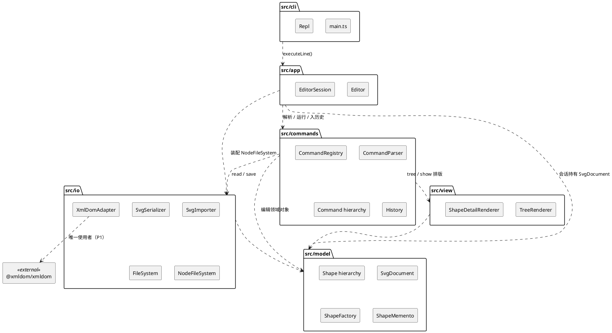
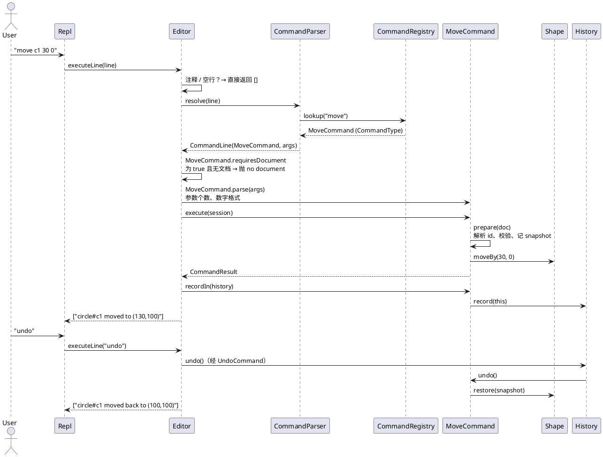

# SVG 编辑器（CLI）

## 架构方案

> 本方案对应规格 `doc/spec/phase_cli_1.md`（下文简称"规格"，章节号如 §4.3 均指该文件）。
> 本阶段范围：§3 命令总表中的全部命令、§4.1–§4.3、§5、§6（版本 A）；§4.4 `box` 与插件加载**不在本阶段实现**，只在「4 变化点假设」中讨论。

### 1 模块划分

#### 1.1 目录与职责

```text
src/
├── cli/        进程入口与终端交互（REPL）
├── app/        应用门面：会话状态 + 一行命令的完整执行流程（Invoker）
├── commands/   命令对象层次、命令行解析、命令注册表、undo/redo 历史
├── view/       显示类命令的文本排版（tree / show）
├── io/         SVG 序列化 / 反序列化、XML 解析适配器（封装 @xmldom/xmldom）、文件系统端口
└── model/      领域模型：图形层次（Composite）、文档、属性、快照、图形工厂
```

| 模块 | 职责 | 不负责 |
|---|---|---|
| `cli` | 启动程序、打印 banner、逐行读 stdin、交互时打印提示符 `svg> `、把每一行原样交给 `app`、把 `app` 返回的输出行写到 stdout | 任何命令语义与任何输入解析（包括注释、空行的判断，均由 `Editor` 处理） |
| `app` | 持有当前会话（当前文档、文件路径、历史）；对一行输入执行"解析 → 运行 → 入历史 → 捕获错误 → 产出输出行"；装配具体依赖（如 `NodeFileSystem`） | 具体命令逻辑、终端 IO |
| `commands` | 把 token 序列变成命令对象；每条命令一个类，封装参数、前置校验、执行、撤销；undo/redo 栈与 io 锁 | 文本排版细节、文件读写细节、图形内部几何 |
| `view` | 把模型排成 §5 规定的文本（树形连接线、列对齐、属性明细） | 修改模型 |
| `io` | `SvgDocument ⇄ SVG 文本`；缺 id 自动补齐与警告；文件系统抽象及 Node 实现（**唯一**允许 `import "node:fs"` 的地方） | 命令语义、undo |
| `model` | 图形与文档的状态和行为：平移、缩放、设置属性、增删子节点、查找、快照/恢复、图形类型注册 | 字符串命令解析、文件、控制台 |

`view` 是相对于脚手架新增的目录（脚手架只有 cli/app/commands/io/model），理由：tree/show 的排版既不属于领域（model 不应知道"`├──`"），也不属于文件 IO；放进 commands 会让命令类同时承担排版，违反单一职责。

#### 1.2 各模块关键类

一类一文件、文件名 = 类名（规格 §2.1）。接口同样一接口一文件。`src/cli/main.ts` 是唯一例外（进程入口脚本，见文件头注释）。

**`src/model/`**

| 类 / 接口 | 一句话职责 |
|---|---|
| `Shape`（抽象） | Composite 的 Component：持有 id、父容器引用、样式与透传属性；声明 `moveBy / scaleBy / setAttribute / summary / snapshot / restore` 等统一操作 |
| `LeafShape`（抽象） | 叶子图形的公共实现：持有一组 `GeometryAttribute`，据角色泛化实现平移、缩放、几何属性设置 |
| `Rect` / `Circle` / `Ellipse` / `Line` | 具体叶子图形：声明自己的几何属性表、可选颜色参数、tree 摘要格式与 move 回显锚点 |
| `Text` | 文字叶子图形：在几何 `x y` 之外持有文本内容 `content` |
| `Group` | Composite 的容器（`<g>`）：持有有序子节点，统一操作递归转发给子孙；`canUngroup()` 钩子默认返回 `true`（复合图形子类覆写为 `false`）；`insertAt` 拒绝插入自身或自身的祖先（会使树成环），视为程序错误抛普通 `Error`——命令层必须先校验 |
| `SvgDocument` | 文档根（`<svg>`）：画布尺寸 + 顶层子节点；按 id 查找、文档序遍历、元素计数 |
| `ShapeContainer`（接口） | `Group` 与 `SvgDocument` 共同的"可容纳子图形"协议：`indexOf / insertAt / remove / childList / containerLabel` |
| `ChildList` | 有序子节点列表，插入/移除时同步维护子节点的 `parent` 指针；被 `Group`、`SvgDocument` 组合复用。插入已有父节点的图形、下标越界、移除非子节点都是程序错误（抛普通 `Error`，不是 `EditorError`）；`Shape.attachTo / detach` 只由它调用（P8） |
| `CanvasSize` | 画布宽高值对象（正数校验、`800x600` 文本形式） |
| `GeometryAttribute` | 一个具名数值几何属性（如 `width`），绑定一个 `CoordinateRole` |
| `CoordinateRole`（接口） | 几何属性"角色"策略：平移时如何变化、缩放时如何变化、取值约束 |
| `XCoordinate` / `YCoordinate` / `Extent` | 三种角色：x 坐标随 dx 平移、y 坐标随 dy 平移、尺寸不随平移且必须 ≥ 0；三者缩放时都乘 factor |
| `StyleAttributes` | `fill / stroke / stroke-width` 三个公共可选属性：持有三个 `StyleProperty` 对象组成的有序数组，按 `name()` 查找后交给属性对象校验与保存；数组顺序即序列化与显示顺序；`copy / restoreFrom` 供快照使用（含"未设置"状态） |
| `StyleProperty`（抽象） | 一个可选样式属性：名字、`assign(raw)`（校验失败时保持原值）、`display()`（未设置为 `undefined`）、`copy()`；"未设置"由属性对象自己表示；不参与 move / scale |
| `ColorProperty` | `fill`、`stroke` 共用：任意非空字符串，不校验颜色语法（E5、E9） |
| `StrokeWidthProperty` | `stroke-width`：全精度数值，复用 `Extent` 校验 ≥ 0；不是几何属性，缩放时不变（E12） |
| `ExtraAttributes` | 读入文件时遇到的、白名单外属性的有序透传存储（只读，保证 round-trip） |
| `ShapeMemento` | 一个图形（容器则连同全部子孙）属性状态的不透明快照，供 undo 恢复 |
| `TreePosition` | 值对象：(父容器, 下标)，记录结构性命令的原位置 |
| `ShapeType`（接口） | 图形类型的"类静态侧"契约：类型名、create 参数说明 `ParamSpec[]`、`create(id, params)` |
| `ParamSpec` | 一个 create 参数的说明：显示名、对应的属性名、是否可选、取值来自属性还是文本内容；各图形类在静态侧单独声明，由测试保证与几何属性表一致（见 2.4） |
| `ShapeFactory` | **按名字分派①**：类型名 → `ShapeType`（待重构，见 4.1） |
| `IdSyntax` | id 合法性规则（CLI 新建 id 的字符集校验） |
| `NumberFormat` | 数字的严格解析与统一输出格式（显示与序列化共用） |
| `EditorError` | 用户可见错误（不含 `error:` 前缀的消息），所有"预期内失败"都抛它 |

**`src/io/`**

| 类 / 接口 | 一句话职责 |
|---|---|
| `FileSystem`（接口） | 文件系统端口：`readText(path)` / `writeText(path, text)`，**同步**（`Editor.executeLine` 本身是同步的），失败抛 `EditorError`（`cannot read file` / `cannot write file`） |
| `NodeFileSystem` | `FileSystem` 的 Node 实现（`readFileSync` / `writeFileSync`），全工程唯一 `import "node:fs"` 处 |
| `XmlDomAdapter` | Adapter：调用 `@xmldom/xmldom` 的 `DOMParser` 解析文本，把库的 DOM 树转换成 io 自有的 `XmlElement` 树；库的解析错误转成 `EditorError("malformed XML: …")`（不含文件路径，由 `SvgImporter` 换成 F9 的消息）；全工程唯一 `import "@xmldom/xmldom"` 处 |
| `XmlElement` | io 自有的 XML 节点结构（与第三方库无关）：标签名（localName）、有序属性、子元素、整棵子树的字符数据、作用域内的命名空间前缀 |
| `SvgSerializer` | `SvgDocument` → SVG 文本；按 `Shape` 暴露的序列化协议通用遍历，不认识具体图形类；手写字符串拼接，不使用 `@xmldom/xmldom` |
| `SvgImporter` | `read(fs, path): ImportResult`：读文件 → 去掉开头的 BOM → 经 `XmlDomAdapter` 解析 → 构建 `SvgDocument` + 警告，三步都在这里编排（commands 不接触适配器，D5）；元素类型经 `ShapeFactory` 构造，属性按类型的 `params` 与 `StyleAttributes.accepts` 分成 create 参数、样式、透传三类，没有按标签名的分支 |
| `IdAllocator` | 读入时先保留文件中全部显式 id，再为缺 id / 重复 id 的元素按"标签名+序号"分配新 id 并产生警告（F13、F14） |
| `ImportResult` | 读入结果：文档 + 警告行；`warning: ` 前缀只在这里添加 |

**`src/view/`**

| 类 | 一句话职责 |
|---|---|
| `TreeRenderer` | 生成 §5.1 结构树：连接线 `├── └── │`、属性列对齐；每行内容取自 `Shape.label()` / `Shape.summary()` |
| `ShapeDetailRenderer` | 生成 §5.2 `show` 明细：标签与父容器行、几何行、样式行、透传属性行 |

**`src/commands/`**

| 类 / 接口 | 一句话职责 |
|---|---|
| `Command`（抽象） | 所有命令的根：`execute(ctx)` 产出结果，`recordIn(history)` 多态钩子；静态属性 `requiresDocument` 默认 `true`（经类静态侧继承给子类，`InitCommand` / `ReadCommand` / `HelpCommand` 覆写为 `false`） |
| `EditCommand`（抽象） | 可撤销命令：`prepare`（只读校验+记快照）/ `apply`（不可失败的变更）/ `undo` / `redo` |
| `DocumentCommand`（抽象） | 文档类命令：成功后在历史上打 io 屏障 |
| `QueryCommand`（抽象） | 显示类命令：只读，不入历史 |
| `HistoryCommand`（抽象） | 历史控制命令（undo/redo）的根：自身不入历史 |
| `InitCommand` / `ReadCommand` / `SaveCommand` / `ResizeCanvasCommand` | 文档类具体命令 |
| `CreateCommand` / `DeleteCommand` / `MoveCommand` / `ScaleCommand` / `SetCommand` / `GroupCommand` / `UngroupCommand` / `AddToCommand` | 编辑类具体命令 |
| `ZOrderCommand`（抽象）、`FrontCommand` / `BackCommand` | z-order 命令：父类实现移位与撤销，子类只给出目标下标 |
| `TreeCommand` / `ShowCommand` / `HelpCommand` / `ShowCanvasCommand` | 显示类具体命令 |
| `UndoCommand` / `RedoCommand` | 历史控制具体命令 |
| `CommandType`（接口） | 命令类的"静态侧"契约：`usage`、`summary`、`category`、`requiresDocument`、`parse(args): Command` |
| `CanvasCommandParser` | `canvas` 的静态侧：无参数产出 `ShowCanvasCommand`，带参数产出 `ResizeCanvasCommand`；它不是 `Command` 子类，自行声明 `requiresDocument = true` |
| `CommandRegistry` | **按名字分派②**：命令名 → `CommandType`（待重构，见 4.2）；也为 `help` 提供有序清单 |
| `CommandParser` | 一行文本 → `CommandLine`：分词、查注册表；**不调用** `parse`（由 `Editor` 在检查 `requiresDocument` 之后调用） |
| `CommandLine` | 值对象：查表得到的 `CommandType` + 剩余参数 `ArgList` |
| `Tokenizer` / `Token` | 分词（双引号、转义）；`Token` 记录是否带引号（用于识别 `in` 关键字） |
| `ArgList` | 参数游标：`nextId() / nextNumber() / nextRaw() / remaining() / expectEnd()`，统一产生 usage 错误 |
| `History` | undo 栈、redo 栈、io 锁标志；`record / markIoBarrier / undo / redo` |
| `CommandContext`（接口） | 命令可见的会话能力：取当前文档、替换文档、文件路径、文件系统、历史、注册表 |
| `CommandResult` | 命令产出的输出行（含 `warning:` 行） |

**`src/app/`**

| 类 | 一句话职责 |
|---|---|
| `Editor` | 门面与 Invoker：`executeLine(line): string[]`；按固定顺序处理一行：跳过注释/空行 → `CommandParser.resolve` → 检查 `CommandType.requiresDocument` → `CommandType.parse` → `execute` → 成功后 `recordIn(history)`；把 `EditorError` 转成 `error: …` 行；`Editor.createDefault()` 装配 `NodeFileSystem` |
| `EditorSession` | `CommandContext` 的实现：当前文档（可无）、默认保存路径、`History`、`FileSystem`、`CommandRegistry` |

**`src/cli/`**

| 文件 / 类 | 一句话职责 |
|---|---|
| `main.ts`（入口脚本，非类） | 创建 `Editor` 与 `Repl` 并启动 |
| `Repl` | readline 循环：打印 banner、TTY 时打印提示符、逐行交给 `Editor`、输出结果、EOF 退出 |

#### 1.3 模块依赖图



依赖整体是一个分层 DAG：`cli → app → commands → {view, io} → model`，`model` 不依赖任何模块。

---

### 2 设计模式的选择

采用的模式一览：

| # | 模式 | 解决的规格问题 | 主要落点 |
|---|---|---|---|
| 2.1 | **Command**（必需） | §3 命令分类、§4.3 undo/redo 粒度、§2 "命令失败不改变任何状态" | `commands/*`、`History`、`Editor` |
| 2.2 | **Memento** | §4.3 undo 要精确还原（move/scale/set 的浮点值、删除的原位置） | `ShapeMemento`、`TreePosition` |
| 2.3 | **Composite** | §2.1 "容器与叶子统一操作"、§3 delete/move/scale 对容器递归 | `Shape` / `LeafShape` / `Group` |
| 2.4 | **Strategy** | §3 move 只平移位置、scale 同乘位置与尺寸、§4.1 尺寸类属性的取值约束 | `CoordinateRole` 及三种角色 |
| 2.5 | **Simple Factory + Registry** | §2.1 "按名字分派只允许两处"：命令名 → 实现、类型名 → 类 | `CommandRegistry`、`ShapeFactory` |
| 2.6 | **Template Method** | 编辑命令共享"先校验、后变更"骨架；front/back 只有目标下标不同 | `EditCommand.execute`、`ZOrderCommand` |
| 2.7 | **Facade** | 同一内核要服务 CLI 以及未来的 agent / 鼠标通道（§2 "为何以 id 定位"） | `Editor.executeLine` |
| 2.8 | **Adapter** | §3 `read` 要解析外部 SVG（XML）文件；第三方 XML 库的 DOM 接口不应扩散到导入逻辑中 | `XmlDomAdapter`、`XmlElement` |

#### 2.1 Command（必需）

**解决的问题**：§3 把命令分成文档类、编辑类、显示类、撤销重做四类，它们与 undo 栈的关系各不相同（§3 表头、§4.3）；§4.3 要求"一条编辑命令 = 一个 undo 单元"，`group` 这类多步操作整体一个单元；§2 要求"命令失败不改变任何状态"。把每条命令物化为对象，就能把"参数 + 执行 + 撤销 + 如何影响历史"封装在一起。

**参与者对应**

| GoF 角色 | 本工程中的类 |
|---|---|
| Command | `Command`（抽象）及四个分类抽象类 `EditCommand` / `DocumentCommand` / `QueryCommand` / `HistoryCommand` |
| ConcreteCommand | `CreateCommand`、`MoveCommand`、`GroupCommand`… 共 20 个具体命令类（见 1.2） |
| Client（创建命令） | `CommandParser` + `CommandRegistry`（定位命令类）+ 各命令类的静态 `parse`（由 `Editor` 调用） |
| Invoker（触发执行） | `Editor`（同时负责在 `parse` 之前检查 `requiresDocument`） |
| Receiver（被操作者） | `SvgDocument`、`Shape` 及其子类（编辑类）；`EditorSession`（文档类）；`History`（undo/redo） |
| 历史管理（Caretaker） | `History`（持有 `EditCommand` 对象；命令自身持有 `ShapeMemento` / `TreePosition`） |

**哪些命令进 undo 栈、其他类如何处理**——不用 `instanceof` 或 `switch`，而是由命令自己通过多态钩子 `recordIn(history)` 决定：

| 分类 | 命令 | `recordIn(history)` 的实现 | 效果 |
|---|---|---|---|
| 编辑类 `EditCommand` | create、delete、move、scale、set、group、ungroup、addto、front、back | `history.record(this)` | 压入 undo 栈、清空 redo 栈、解除 io 锁 |
| 文档类 `DocumentCommand` | init、read、save、canvas（带参数） | `history.markIoBarrier()` | 清空 undo/redo 两栈并加 io 锁；之后 undo/redo 报 `error: undo not allowed after io command`，直到下一条编辑命令成功 |
| 显示类 `QueryCommand` | tree、show、help、canvas（无参数） | 空实现 | 不入栈，不影响锁（§4.3 "显示类跳过"） |
| 历史控制 `HistoryCommand` | undo、redo | 空实现 | 自身不入栈；在 `execute` 里调 `history.undo()` / `history.redo()` |

`canvas` 一个名字对应两种性质，由 `CanvasCommandParser.parse` 按有无参数产出不同类的命令对象，分类判断在解析期一次完成，执行期没有分支。

**关键协作流程（一行输入的一生）**



`Editor` 是唯一捕获 `EditorError` 的地方：任何阶段抛出即输出 `error: <message>`，并且**不调用** `recordIn`。

**undo 具体靠什么恢复状态**——三件东西，**从不用逆运算**（`x + 0.1 - 0.1` 在浮点下不保证等于 `x`）：

1. **属性快照 `ShapeMemento`**（move / scale / set）：`prepare` 阶段调用 `target.snapshot()`；容器的快照是组合的（包含全部子孙的快照），undo 时 `target.restore(memento)` 逐一写回。
2. **结构位置 `TreePosition`**（create / delete / group / ungroup / addto / front / back）：`prepare` 阶段记下相关图形的 (父容器, 下标)，undo 时按记录插回原位。
3. **对象身份保持**：被删除、被移出的 `Shape` 对象由命令对象持有，undo 时把**同一个对象**挂回去，而不是重建。这样 redo 栈或 undo 栈中其他命令持有的对象引用始终有效。

各编辑命令的 `apply` / `undo` 要点：

| 命令 | prepare 记录 | apply | undo |
|---|---|---|---|
| create | 新建的 `Shape`（尚未挂入）、目标容器与末尾下标 | `insertAt` | `remove` |
| delete | 目标对象、`TreePosition` | `remove` | 同一对象 `insertAt` 原下标 |
| move / scale / set | 目标对象、`ShapeMemento` | `moveBy` / `scaleBy` / `setAttribute` | `restore(memento)` |
| group | 成员（按文档序）及各自 `TreePosition`、新 `Group` 对象及其插入位置 | 摘出成员 → 插入新组 → 成员依次追加 | 移除新组 → 成员按 (容器, 下标) 升序插回 |
| ungroup | 容器对象（先检查 `canUngroup()`）、其 `TreePosition`、子节点列表 | 移除容器 → 子节点依次插入原下标处 | 子节点移回容器 → 容器插回原下标 |
| addto | 目标对象、原 `TreePosition` | 摘出 → 追加到目标容器末尾 | 摘出 → 插回原位置 |
| front / back | 目标对象、原下标 | 移到同级末尾 / 开头 | 移回原下标 |

**redo** 就是再次调用 `apply()`（`redo()` 在 `EditCommand` 中有默认实现）。依据是栈的不变式：**某命令被 redo 时，文档状态与它第一次执行前完全相同**（undo 是精确还原，redo 栈在任何新编辑后清空），所以 `prepare` 记录的位置与快照依然有效，无需重新校验。

**group 这类多步操作如何保证是一个 undo 单元**：`group g1 r1 c1 t1` 在内部确实是多步（新建容器、逐个摘出成员、逐个挂入），但这些步骤都在**同一个 `GroupCommand` 对象**的 `apply()` 内完成，历史里只压入这一个对象；对应的 `undo()` 一次性按记录还原全部成员位置并移除新组。同理 `delete` 一个容器（整棵子树一次摘下）、`move`/`scale` 一个容器（递归到所有子孙，快照也是整棵子树）都只是一个命令对象。**规则：History 只接收命令对象，不接收"操作步骤"**，因此不存在"半个单元"。

**命令执行失败时如何保证"不改变任何状态"**——两阶段提交 + 结果后置：

1. **解析阶段纯函数化**：`CommandType.parse` 只做分词结果的语法检查（参数个数、数字格式），不触碰会话。
2. **`prepare` 只读**：`EditCommand.execute` 是模板方法，先调 `prepare(doc)` 完成**全部**语义校验（id 存在、类型合法、取值约束、祖先关系、容器类型……）并记录快照/位置；校验失败抛 `EditorError`，此时尚未写任何状态。
3. **`apply` 不可失败**：`apply` 只做已校验过的内存操作（数组插入删除、数值赋值），不解析、不校验、不做 IO。约束写进代码评审清单，并由"失败原子性"测试覆盖（见 3.3）。
4. **历史后置**：只有 `execute` 正常返回，`Editor` 才调用 `recordIn`；失败命令不入栈、也不解除 io 锁。
5. **文档类命令先算后提交**：`save` 先把文档序列化成完整字符串，再一次 `writeText`，写成功后才更新默认路径并打屏障；`read` 先完成读文件、XML 解析、构建新 `SvgDocument`、补 id，全部成功后才替换会话中的文档。
6. **输出后置**：警告行（如 `warning: assigned id rect1 …`）收集在 `CommandResult` 中，只有命令成功才输出；失败时只输出一行 `error:`。

#### 2.2 Memento

**解决的问题**：§4.3 要求 undo 精确还原；§6 的 `move c1 30 0` → `undo` → `moved back to (100,100)` 必须回到原值。用逆运算（反向平移、除以 factor）在浮点下会累积误差，而且 `set` 的"原来没有该属性"也无法用逆运算表达。

**参与者**：Originator = `Shape`（`snapshot()` / `restore()`）；Memento = `ShapeMemento`（对命令不透明，只能交还给原图形）；Caretaker = `MoveCommand` / `ScaleCommand` / `SetCommand`。结构性信息用值对象 `TreePosition` 记录，由结构性命令持有。

**协作**：`prepare` 时 `memento = target.snapshot()`；undo 时 `target.restore(memento)`。`Group.snapshot()` 递归收集子孙的快照（快照本身也是组合结构），`restore` 递归写回。快照只覆盖**属性状态**，不覆盖子节点列表——结构变化由结构性命令自己负责，二者职责不重叠。

#### 2.3 Composite

**解决的问题**：§2.1 "容器与叶子统一操作：move / scale / set / delete 等命令对 `<g>` 与叶子图形一视同仁"；§3 delete 容器连同子孙、move 容器整体平移、scale 递归到每个子孙；§4.4 未来 box 也是"整体又是一个容器"。

**参与者**：Component = `Shape`；Leaf = `LeafShape` 及 `Rect` / `Circle` / `Ellipse` / `Line` / `Text`；Composite = `Group`。根 `SvgDocument` 不是 `Shape`（没有 id，不能被 move/delete），但与 `Group` 共同实现 `ShapeContainer` 接口，并组合同一个 `ChildList`，所以"挂到根下"与"挂到容器下"走同一套代码。

**协作**：命令只面向 `Shape` 编程，例如 `MoveCommand` 只调用 `target.moveBy(dx, dy)`：叶子按几何角色平移自己的坐标，`Group` 把调用转发给每个子节点。需要"是否容器"的地方（`in`、`addto`、`ungroup`）调用多态方法 `shape.asContainer()`（叶子返回 `null`，`Group` 返回自身），不用 `instanceof`。

**结构不变式由模型自己守住**：`ChildList` 是唯一修改 `parent` 指针的地方（`Shape.attachTo / detach` 因 TypeScript 没有包级可见性只能是 `public`，由架构测试 P8 保证只有 `ChildList` 调用）；插入已有父节点的图形、把容器插入自身或其子孙（`Group.insertAt` 的环检测）都抛普通 `Error`。这些是**程序错误**而不是用户错误：对应的用户可见报错（如 `cannot group a container into its own descendant`）由命令在 `prepare` 中先行校验并抛 `EditorError`，模型层的检查只是最后一道防线，防止树成环后 `allShapes()` 无限递归。

#### 2.4 Strategy（几何属性角色）

**解决的问题**：§3 move 是增量平移（只影响位置），scale 是"factor 同乘到图形的全部几何属性（位置与尺寸）"，§4.1 `set` 可改各类型的几何属性。若在每个图形类里手写 `moveBy`，5 个叶子类会重复相同的逻辑；若按属性名 `switch`，则违反 §2.1。

**参与者**：Strategy = `CoordinateRole`（`shift(value, dx, dy)`、`scale(value, f)`、`validate(name, value)`）；ConcreteStrategy = `XCoordinate`（加 dx）、`YCoordinate`（加 dy）、`Extent`（不平移、要求 ≥ 0）；Context = `GeometryAttribute`。`validate` 带属性名，是因为报错文案 `invalid value for width: -5`（E4）需要它；数值用 `String(value)` 显示原值（`-1e-9` 不会被 V3 格式化成 `0`）。`StrokeWidthProperty` 复用 `Extent` 校验，文案一致。

**协作**：每个叶子类只声明属性表，例如 `Rect` = `[x: X, y: Y, width: Extent, height: Extent]`，`Line` = `[x1: X, y1: Y, x2: X, y2: Y]`。`LeafShape.moveBy` 让每个属性按自己的角色移动；`scaleBy` 统一乘 factor；`setAttribute` 在属性表里按名字找到属性，由角色校验取值。同一张属性表还决定 `show` 的几何行和序列化的属性顺序，即这两者的**单一事实来源**。

create 参数说明（`ParamSpec`）**不**由属性表生成，而是每个类在静态侧单独声明（如 `Rect.params` = `<x> <y> <w> <h> [fill]`），由测试保证与属性表一致。理由：参数表需要属性表没有的信息——①显示名与属性名不同（`<w>` 对应 `width`）；②混有非几何参数（可选的 `fill` / `stroke`、text 的 `"content"`），它们的可选性与位置是 create 语法的一部分，而不是属性的性质；③`g` 没有几何属性却有（空的）参数表。若把这些都塞进 `GeometryAttribute`，几何属性就要承担 CLI 语法的职责。一致性由 `ShapeFactory.test.ts` 保证：每种类型的几何参数必须按顺序等于其几何属性表，其余参数只能是 `fill` / `stroke` / `text`；新增类型漏写或写错参数时测试失败。

#### 2.5 Simple Factory + Registry（按名字分派的两处）

**解决的问题**：§2.1 "按名字分派只允许两处：命令分发（命令名 → 实现）与图形工厂（类型名 → 类），且须在架构方案中标注为待重构"。

**参与者**

- `CommandRegistry`：`Map<string, CommandType>`，在构造函数中硬编码注册 §3 的全部命令；`CommandParser` 是唯一调用方。值是"命令类的静态侧"（类本身满足 `CommandType` 接口：静态 `usage`、`summary`、`category`、`requiresDocument`、`parse`），所以表里放的就是类本身，名副其实的"命令名 → 实现"。
- `ShapeFactory`：`Map<string, ShapeType>`，硬编码注册 `rect / circle / ellipse / line / text / g`。值同样是类本身（静态 `typeName`、`params`、`create`）。调用方有两个：`CreateCommand`（CLI 类型名）和 `SvgImporter`（SVG 标签名）。两条路径共用同一张表，所以"按名字分派"确实只有这一处，而不是 CLI 一处、读文件又一处。未注册名字抛 `unknown shape type: X (is the plugin loaded?)`。

**协作**：`create rect r1 10 20 100 50` → `CreateCommand.prepare` 调 `factory.lookup("rect")` → 得到 `Rect`（`ShapeType`）→ 用 `Rect.params` 把剩余 token 配对成具名原始值 → `Rect.create("r1", params)` 在模型内用属性角色校验并构造。读文件时，`SvgImporter` 用标签名查表，用同一份 `params` 从 XML 属性（text 内容取自字符数据）中取值；`params` 之外，`StyleAttributes.accepts` 认可的 `fill` / `stroke` / `stroke-width` 经 `setAttribute` 设置，其余属性透传（F7）。不支持的标签先用 `factory.typeNames()` 判断后跳过（F6），而不是靠捕获 `unknown shape type`。

**待重构标注**：两处的注册列表都写死在内核中，新增类型或命令必须改内核代码。重构目标与预留见 4.1、4.2。

#### 2.6 Template Method

**解决的问题**：编辑命令都要遵守"先校验后变更"（§2 错误输出），front/back 只有目标下标不同。

**参与者与协作**

- `EditCommand.execute(ctx)`：`prepare(doc)` → `apply()` → `describe()`，子类只实现这三个钩子和 `undo()`。2.1 的失败原子性由这个固定的骨架保证。
- `ZOrderCommand`：实现"记录原下标 → 移动 → 撤销移回"，子类 `FrontCommand` / `BackCommand` 只覆写 `targetIndex(siblingCount)` 和回显动词。

"是否已有文档"（§4.2 最后一行）**不**放在命令实例的模板方法里：它必须在 `parse` 之前判断（约定补充 R10），而 `parse` 之前还没有命令实例。因此它是类静态侧的声明 `CommandType.requiresDocument`（`Command` 给出默认值 `true`，`InitCommand` / `ReadCommand` / `HelpCommand` 覆写为 `false`），由 `Editor.executeLine` 在固定流程中检查，见 2.1 时序图。

#### 2.7 Facade

**解决的问题**：§2 说明 id 定位是为了让 CLI、agent、鼠标三种通道都能无歧义地指认图形，内核因此不应绑定终端。

**参与者**：Facade = `Editor`，对外只有 `executeLine(line): string[]`（以及 `Editor.createDefault()`）；子系统 = 解析器、注册表、命令、历史、会话。`Repl` 只负责读写终端。转录测试可以直接把 §6 的命令逐行喂给 `Editor`，比对输出，不需要启动子进程。

#### 2.8 Adapter

**解决的问题**：§3 `read` 要把外部 SVG 文件读成文档；§2 要求读入时缺 id 自动补齐并警告。XML 解析本身（实体、CDATA、DOCTYPE、命名空间、属性引号等边界情况）不是本项目的考察点，自己写容易出错，因此改用成熟的 `@xmldom/xmldom`。但它的 W3C DOM 接口（`Node`、`NamedNodeMap`、`childNodes` 的 `nodeType` 判断……）不应扩散到 `SvgImporter` 的导入逻辑中，否则导入代码会与库绑定，换库或升级时要改动所有用到 DOM 的地方。

**参与者**

| GoF 角色 | 本工程中的类 |
|---|---|
| Target（客户期望的接口） | `XmlElement`：io 自有的节点结构（标签名、有序属性、子元素、字符数据） |
| Adaptee（被适配者） | `@xmldom/xmldom` 的 `DOMParser` 及其产出的 DOM `Document` / `Element` |
| Adapter | `XmlDomAdapter`：`parse(text): XmlElement` |
| Client | `SvgImporter`（只认识 `XmlElement`，不 import 库） |

**协作**：`ReadCommand` 只调用 `SvgImporter.read(fs, path)`；读文件、解析、建模型都由 `SvgImporter` 编排：`FileSystem.readText(path)` → 去掉开头的 UTF-8 BOM（`readFileSync` 不会去掉，xmldom 会把它当作格式错误）→ `XmlDomAdapter.parse(text)` → 检查根元素是 `svg` → 构建文档。这样 commands 对 io 的依赖保持在 D5 的白名单内（`FileSystem`、`SvgImporter`、`SvgSerializer`），不接触适配器。适配器内部：

1. 以 `image/svg+xml` 模式调用 `DOMParser.parseFromString`，并安装 `onError` 回调：`error` / `fatalError` 级别一律视为解析失败，`warning` 级别忽略（例如没加引号的属性值 `a=1` 只是 warning，照常接受）。库会把回调里抛出的**任何**异常包成它自己的 `ParseError`，所以回调里抛普通 `Error` 即可，适配器在 `parseFromString` 外层捕获后转成 `EditorError("malformed XML: …")`；`SvgImporter` 再把它换成不带细节的 `cannot parse file: <path>`（约定补充 F9）。**必须安装回调**：实测不装时，遇到 error 级别的问题库会调用 `console.error` 并继续解析、不抛异常，既违反 P1，又会静默接受坏文件。
2. 递归把 DOM `Element` 转成 `XmlElement`：标签取 `localName`；属性按 `attributes` 的文档顺序逐个复制（F7、F18 的顺序保留依赖于此），名字取限定名（如 `inkscape:label`）；文本与 CDATA 节点拼成字符数据；注释、处理指令丢弃；同时记下每个元素作用域内的 `xmlns:*` 前缀声明（供 F7 补声明使用）。
3. 返回根 `XmlElement`。此后 `SvgImporter` 只操作 `XmlElement`，补 id、查 `ShapeFactory`、产生警告等逻辑都与库无关。

**序列化不使用该库**：`SvgSerializer` 仍然手写字符串拼接。约定补充 F18 规定了属性顺序、2 空格缩进、自闭合空容器和统一的数字格式（V3），用库的 `XMLSerializer` 反而难以精确控制这些细节；写出方向的 XML 只需要做转义，不需要库。

**依赖变更（已执行）**：`package.json` 的 `dependencies`（运行时依赖，不是 devDependencies）加入 `@xmldom/xmldom`，安装时的最新稳定版为 0.9.12（`^0.9.12`），由 `package-lock.json` 锁定。该库自带 TypeScript 类型声明，不需要额外的 `@types` 包。换库时只需重写 `XmlDomAdapter` 一个类。

#### 2.9 类图（图形层次 + 命令层次）

```plantuml
@startuml classes
skinparam classAttributeIconSize 0
hide empty members

package model {
  interface ShapeContainer {
    +childList(): Shape[]
    +indexOf(s: Shape): number
    +insertAt(s: Shape, index: number): void
    +remove(s: Shape): number
    +containerLabel(): string
  }
  abstract class Shape {
    -id: string
    -parent: ShapeContainer
    -style: StyleAttributes
    -extras: ExtraAttributes
    +getId(): string
    +{abstract} tagName(): string
    +label(): string
    +parentContainer(): ShapeContainer | null
    +attachTo(c: ShapeContainer): void  <<ChildList only, P8>>
    +detach(): void  <<ChildList only, P8>>
    +{abstract} moveBy(dx: number, dy: number): void
    +{abstract} scaleBy(f: number): void
    +setAttribute(name: string, raw: string): void
    +{abstract} summary(): string
    +{abstract} moveDescription(dx: number, dy: number): string
    +asContainer(): Group | null
    +isAncestorOf(s: Shape): boolean
    +{abstract} snapshot(): ShapeMemento
    +{abstract} restore(m: ShapeMemento): void
    +geometryEntries(): Array<[string, string]>
    +styleEntries(): Array<[string, string]>
    +extraEntries(): Array<[string, string]>
    +textContent(): string | null
    +svgAttributes(): Array<[string, string]>
  }
  abstract class LeafShape {
    -geometry: GeometryAttribute[]
    +moveBy(dx: number, dy: number): void
    +scaleBy(f: number): void
  }
  class Rect
  class Circle
  class Ellipse
  class Line
  class Text {
    -content: string
  }
  class Group {
    -children: ChildList
    +asContainer(): Group
    +canUngroup(): boolean
    +insertAt(s: Shape, index: number): void  <<rejects self / ancestors>>
  }
  class SvgDocument {
    -size: CanvasSize
    -children: ChildList
    +findById(id: string): Shape | null
    +allShapes(): Shape[]
    +elementCount(): number
  }
  class ChildList
  class CanvasSize
  class StyleAttributes {
    -properties: StyleProperty[]
    +set(name: string, raw: string): void
    +get(name: string): string | undefined
    +copy(): StyleAttributes
    +restoreFrom(s: StyleAttributes): void
  }
  abstract class StyleProperty {
    +name(): string
    +{abstract} assign(raw: string): void
    +{abstract} display(): string | undefined
    +{abstract} copy(): StyleProperty
  }
  class ColorProperty
  class StrokeWidthProperty
  class ExtraAttributes
  class GeometryAttribute {
    -name: string
    -value: number
    -role: CoordinateRole
  }
  interface CoordinateRole {
    +shift(v: number, dx: number, dy: number): number
    +scale(v: number, f: number): number
    +validate(name: string, v: number): void
  }
  class XCoordinate
  class YCoordinate
  class Extent
  class ShapeMemento
  class TreePosition {
    -container: ShapeContainer
    -index: number
  }
  interface ShapeType <<static side>> {
    +typeName: string
    +params: ParamSpec[]
    +create(id: string, params: Map): Shape
  }
  class ParamSpec
  class ShapeFactory <<name dispatch #1, to refactor>> {
    -types: Map<string, ShapeType>
    +lookup(name: string): ShapeType
  }
}

Shape <|-- LeafShape
Shape <|-- Group
LeafShape <|-- Rect
LeafShape <|-- Circle
LeafShape <|-- Ellipse
LeafShape <|-- Line
LeafShape <|-- Text
ShapeContainer <|.. Group
ShapeContainer <|.. SvgDocument
Group *-- ChildList
SvgDocument *-- ChildList
SvgDocument *-- CanvasSize
ChildList o-- "0..*" Shape
Shape --> ShapeContainer : parent
Shape *-- StyleAttributes
StyleAttributes *-- "3" StyleProperty
StyleProperty <|-- ColorProperty
StyleProperty <|-- StrokeWidthProperty
StrokeWidthProperty --> Extent : validate
Shape *-- ExtraAttributes
LeafShape *-- "1..*" GeometryAttribute
GeometryAttribute --> CoordinateRole
CoordinateRole <|.. XCoordinate
CoordinateRole <|.. YCoordinate
CoordinateRole <|.. Extent
Shape ..> ShapeMemento : creates / restores
ShapeType ..> ParamSpec
ShapeFactory o-- ShapeType
Rect ..|> ShapeType
Circle ..|> ShapeType
Ellipse ..|> ShapeType
Line ..|> ShapeType
Text ..|> ShapeType
Group ..|> ShapeType

package commands {
  abstract class Command {
    +{static} requiresDocument: boolean = true
    +{abstract} execute(ctx: CommandContext): CommandResult
    +{abstract} recordIn(h: History): void
  }
  abstract class EditCommand {
    +execute(ctx: CommandContext): CommandResult
    #{abstract} prepare(doc: SvgDocument): void
    #{abstract} apply(): void
    #{abstract} describe(): string
    +{abstract} undo(): CommandResult
    +redo(): CommandResult
    +recordIn(h: History): void
  }
  abstract class DocumentCommand {
    +recordIn(h: History): void
  }
  abstract class QueryCommand {
    +recordIn(h: History): void
  }
  abstract class HistoryCommand {
    +recordIn(h: History): void
  }
  class CreateCommand
  class DeleteCommand
  class MoveCommand
  class ScaleCommand
  class SetCommand
  class GroupCommand
  class UngroupCommand
  class AddToCommand
  abstract class ZOrderCommand {
    #{abstract} targetIndex(count: number): number
  }
  class FrontCommand
  class BackCommand
  class InitCommand {
    +{static} requiresDocument: boolean = false
  }
  class ReadCommand {
    +{static} requiresDocument: boolean = false
  }
  class SaveCommand
  class ResizeCanvasCommand
  class TreeCommand
  class ShowCommand
  class HelpCommand {
    +{static} requiresDocument: boolean = false
  }
  class ShowCanvasCommand
  class UndoCommand
  class RedoCommand
  class History {
    -undoStack: EditCommand[]
    -redoStack: EditCommand[]
    -ioLocked: boolean
    +record(c: EditCommand): void
    +markIoBarrier(): void
    +undo(): CommandResult
    +redo(): CommandResult
  }
  interface CommandType <<static side>> {
    +usage: string
    +summary: string
    +requiresDocument: boolean
    +parse(args: ArgList): Command
  }
  class CommandRegistry <<name dispatch #2, to refactor>> {
    -types: Map<string, CommandType>
    +lookup(name: string): CommandType
  }
  class CommandParser {
    +resolve(line: string): CommandLine
  }
  class CommandLine {
    -type: CommandType
    -args: ArgList
  }
  interface CommandContext
}

Command <|-- EditCommand
Command <|-- DocumentCommand
Command <|-- QueryCommand
Command <|-- HistoryCommand
EditCommand <|-- CreateCommand
EditCommand <|-- DeleteCommand
EditCommand <|-- MoveCommand
EditCommand <|-- ScaleCommand
EditCommand <|-- SetCommand
EditCommand <|-- GroupCommand
EditCommand <|-- UngroupCommand
EditCommand <|-- AddToCommand
EditCommand <|-- ZOrderCommand
ZOrderCommand <|-- FrontCommand
ZOrderCommand <|-- BackCommand
DocumentCommand <|-- InitCommand
DocumentCommand <|-- ReadCommand
DocumentCommand <|-- SaveCommand
DocumentCommand <|-- ResizeCanvasCommand
QueryCommand <|-- TreeCommand
QueryCommand <|-- ShowCommand
QueryCommand <|-- HelpCommand
QueryCommand <|-- ShowCanvasCommand
HistoryCommand <|-- UndoCommand
HistoryCommand <|-- RedoCommand
History o-- "0..*" EditCommand
CommandRegistry o-- CommandType
CommandParser --> CommandRegistry
CommandParser ..> CommandLine : creates
CommandLine --> CommandType
Command ..|> CommandType : <<static side>>
Command ..> CommandContext
MoveCommand ..> ShapeMemento
ScaleCommand ..> ShapeMemento
SetCommand ..> ShapeMemento
DeleteCommand ..> TreePosition
GroupCommand ..> TreePosition
CreateCommand ..> ShapeFactory
EditCommand ..> Shape : receiver
UngroupCommand ..> Group : canUngroup()
@enduml
```



> 说明：`<<static side>>` 表示该接口由**类的静态成员**满足（TypeScript 结构类型允许把类本身赋给 `ShapeType` / `CommandType` 类型的变量），因此不需要再为每个图形或命令写一个工厂类。

#### 2.10 考虑过但没有采用的模式

| 模式 | 设想用途 | 不采用的理由 |
|---|---|---|
| **Visitor** | 序列化、tree 摘要、计数等操作放在模型外，用 `accept(visitor)` 双分派 | 规格最可能的变化是**新增图形类型**（§4.4 插件、§4.2 "is the plugin loaded?"），而 Visitor 正好让"新增类型"代价最大：每个 Visitor 都要加 `visitBox`，且插件无法修改内核里的 Visitor 接口。改为让 `Shape` 暴露通用的序列化协议（`tagName()` / `svgAttributes()` / `childList()` / 文本内容）与 `summary()`，`SvgSerializer` / `TreeRenderer` 写成通用遍历，新类型只需实现这些方法 |
| **MacroCommand（组合命令）** | 把 group 拆成"新建容器 + N 次移入"的子命令序列，整体入栈 | 子步骤之间互相影响下标，校验必须在任何子步骤执行前完成，拆开反而要处理"做了一半要回滚"；单个 `GroupCommand` 自持全部位置记录更简单。若以后出现"脚本回放 = 一个 undo 单元"之类需求再引入（见 4.6） |
| **整文档快照（粗粒度 Memento）** | 每条编辑命令前克隆整个文档，undo 时整体换回 | 实现最省事、对失败回滚也天然安全，但：①命令的撤销回显（`moved back to …`、`restored into g#markers`）仍需命令级信息；②克隆会破坏对象身份，其他命令持有的引用失效，只能退回按 id 重新查找；③不能体现 Command 自己负责撤销的设计。作为**备选方案**保留：如果 `apply` 不可失败的约束难以守住，可在 `Editor` 加一层整文档快照作为安全网 |
| **Observer** | 文档变更时通知视图刷新 | CLI 是请求-响应式，每条命令的输出由命令自己产出，没有需要被动刷新的订阅者。等 GUI / 鼠标通道（§2）出现再加，`Editor` 门面是自然的挂载点（见 4.3） |
| **Singleton** | `CommandRegistry`、`ShapeFactory`、`History` 全局唯一 | 全局状态妨碍测试隔离（每个测试需要干净的历史）；改为由 `Editor.createDefault()` 构造并注入 |
| **State** | "无文档 / 有文档 / io 锁定"作为编辑器状态对象 | 只有两个布尔维度、规则很少；用 State 会让 20 个命令都面向状态接口分派，过度设计。静态属性 `CommandType.requiresDocument` 加 `History.ioLocked` 已足够 |
| **Interpreter** | 为命令语言建文法与语法树 | 命令语法是扁平的"命令名 + 位置参数 + 可选 `in` 尾缀"，没有嵌套或表达式，分词加 `ArgList` 足够 |
| **Prototype** | 图形工厂按原型克隆出新实例；或 undo 时克隆子树 | create 参数决定全部状态，克隆原型再改属性不比直接构造省事；undo 采用对象身份保持，不需要克隆 |
| **Abstract Factory** | 按"产品族"创建图形 | 只有一个产品族（SVG 图形），没有需要成套替换的维度 |
| **Null Object** | 用 `NoDocument` 代替"当前文档可能为空" | 无文档时规格要求报错（§4.2），空对象会把报错分散到每个方法里；集中在 `Command.run` 检查一次更清楚 |

---

### 3 依赖方向规则

#### 3.1 模块间规则

记号：`X → Y` 表示 X 中的文件可以 `import` Y 中的文件。模块 = `src/` 下的一级目录。

| # | 规则 | 理由 |
|---|---|---|
| D1 | `model` **禁止依赖**任何其他模块 | 领域模型是最稳定的部分，要能脱离 CLI、文件、排版单独测试；未来 GUI / agent 通道也复用它 |
| D2 | `io` **可以依赖** `model`；**禁止依赖** `commands`、`view`、`app`、`cli` | 序列化只需要知道模型；不依赖命令层，换掉命令层不影响文件格式 |
| D3 | `view` **可以依赖** `model`；**禁止依赖** `io`、`commands`、`app`、`cli` | 排版是纯函数式的"模型 → 文本"，不应关心命令或文件 |
| D4 | `commands` **可以依赖** `model`、`view`、`io`；**禁止依赖** `app`、`cli` | 命令是用例，组合领域、排版与 IO；但不能反向知道谁在调用它（Invoker），否则无法被别的通道复用 |
| D5 | `commands` 对 `io` 只能依赖 `FileSystem` **接口**、`SvgSerializer`、`SvgImporter`；**禁止依赖** `NodeFileSystem`，也不依赖 `XmlDomAdapter` / `XmlElement` 等内部类（读文件、解析、建模型由 `SvgImporter.read(fs, path)` 一并完成，见 2.8） | 命令可以在测试中注入内存文件系统；具体实现只由装配层选择；XML 库的细节不越过 io 边界 |
| D6 | `app` **可以依赖** `commands`、`model`、`io`；**禁止依赖** `cli`、`view` | `app` 是装配层与 Invoker，需要 `NodeFileSystem` 来装配、需要 `SvgDocument` 类型来持有会话；排版由命令完成，`app` 不直接用 `view` |
| D7 | `cli` **只可以依赖** `app` | 终端层越薄越好；换成别的前端（测试驱动、agent）时只替换 `cli` |
| D8 | 模块间依赖必须无环（上面各条已构成 DAG：`cli → app → commands → {view, io} → model`） | 有环就无法分层测试，也说明职责划分有误 |

#### 3.2 范式与模块内规则

| # | 规则 | 理由 |
|---|---|---|
| P1 | `import "node:fs"` 只允许出现在 `io/NodeFileSystem.ts`；`import "@xmldom/xmldom"` 只允许出现在 `io/XmlDomAdapter.ts`；`node:readline`、`process.stdin/stdout`、`console.*` 只允许出现在 `cli/` | IO 隔离：内核可完全在内存中测试；输出顺序只由 `Editor` 返回值决定；第三方 XML 库被限制在适配器内，换库只改一个类（2.8） |
| P2 | 以字符串为键查找"实现"的 `Map` 只允许出现在 `CommandRegistry` 与 `ShapeFactory`；其中包括**值类型是函数的 `Map`**（如 `Map<string, (raw: string) => …>`、值为函数类型别名的 `Map`），它同样是"按名字查实现" | 规格 §2.1 "按名字分派只允许两处"。按 id 查图形（`SvgDocument.findById`）、按属性名查属性对象（`LeafShape` 的几何属性表、`StyleAttributes` 的 `StyleProperty` 数组）查的是**数据**——找到的对象自己携带行为（Strategy / 属性对象），不在此列 |
| P3 | 全工程禁止对图形类型名或命令名使用 `switch` / `if-else` 链；禁止对 `Shape` 的具体子类用 `instanceof`，改用多态方法（如 `asContainer()`） | 规格 §2.1 禁止"到处 switch(tag)"；新增图形类型时不应修改分散的分支 |
| P4 | 任何类（首先是 `Shape`、`LeafShape`，也包括将被 box 继承的 `Group`）不得在运行时 `import` 自己的子类（`import type` 可以）；具体图形类不得 `import ShapeFactory` | 避免 ESM 循环导入导致 "Class extends value undefined"；工厂依赖具体类，反过来不行 |
| P5 | 一个文件只导出一个类或接口，文件名 = 类名（`main.ts` 例外）；只允许具名导出，禁止任何形式的 `export default` | 规格 §2.1；默认导出在导入方可以取任意名字，"文件名 = 类名"的对应关系就失效了 |
| P6 | 字段一律 `private` / `protected`，对外只暴露行为与只读访问器；不导出自由函数 | 规格 §2.1 禁止贫血模型与过程式自由函数 |
| P7 | 抛给用户的错误一律是 `EditorError`；只有 `Editor` 捕获并加 `error:` 前缀 | 错误格式（§2、§4.2）只在一处生成 |
| P8 | `Shape.attachTo` / `Shape.detach` 只允许由 `model/ChildList.ts` 调用 | 它们必须是 `public`（TypeScript 没有包级可见性），但 `parent` 指针与子节点列表只有在同一处一起修改才不会失去同步（2.3） |

#### 3.3 检查手段

检查手段本身**不新增依赖**（运行时依赖 `@xmldom/xmldom` 是 2.8 的解析需要，与检查无关），采用"自写测试脚本 + 编译器 + 人工抽查"：

1. **架构测试 `tests/unit/architecture.test.ts`**（使用已有的 vitest 与 `node:fs`）：
   - 递归列出 `src/**/*.ts`，先去掉注释（代码模式类检查还会抹掉字符串内容），再用正则提取 `import … from` / `export … from` / `import "x"` / `import("x")` / `require("x")`（`import type` 与全部带 `type` 的花括号导入记为仅类型导入），把相对路径解析成目标模块；每个文件必须属于 §1.1 的某个模块；逐条断言 D1–D7，D5 按目标文件白名单检查；D8 在实际的模块依赖图上做环检测；
   - 断言 P1：`node:fs` / `@xmldom/xmldom` / `node:readline` / `console.` / `process.std*` 只出现在白名单文件（`@xmldom/xmldom` 的白名单只有 `io/XmlDomAdapter.ts`）；
   - 断言 P2：①`Map<string, ShapeType | CommandType>` 只出现在两个白名单文件；②白名单外不出现值类型为函数的 `Map` / `ReadonlyMap` / `WeakMap` / `Record`（值类型含 `=>`、`Function`，或是本文件内声明的函数类型别名 / 调用签名接口）。查不到的写法在测试注释中列明：未写类型参数、靠推断的 `new Map([["fill", fn]])`；从别的文件导入的函数类型；没有 `Record` 注解的对象字面量分派表；索引签名；按名字查找的数组；
   - 断言 P3：`src/` 中不出现 `switch (`；不对 `Shape` 的任何子类（内置类 + 从源码中识别出的子类）用 `instanceof`；不与图形类型名字面量做相等比较（`tag === "rect"`，即 if-else 链形式的分派）；
   - 断言 P4：任何类文件都不得在运行时 `import` 自己的子类（README 要求的 `Shape`、`LeafShape` 是其特例，`import type` 不算）；`Shape` 的子类文件不得 `import ShapeFactory`；
   - 断言 P5：除 `cli/main.ts` 外，每个文件恰好一条 `export`，且是名字与文件名一致的具名 `class` / `interface`（因此也排除了导出的自由函数，覆盖 P6 的一半）；`export default …` 与 `export { X as default }` 一律报错；
   - 断言 P8：`model/ChildList.ts` 以外不出现 `.attachTo(` / `.detach(`；
   - 尚无代码的目录（编写本节时为 `commands/`、`app/`、`view/`）没有文件可查，规则自然通过——这意味着规则在该目录出现代码之前并没有真正起作用，见「过程记录」第 5 条；
   - 每条规则写成"源文件集合 → 违规列表"的函数，测试文件后半部分用合成的违规源码逐条验证规则确实能报错；此外实现时对每条规则都在 `src/` 下临时放置违规文件跑过一遍，确认只有对应规则失败（io 实现时在 `SvgImporter.ts` 临时加入 `@xmldom/xmldom`、`node:fs`、`../commands/` 三条 import，D2 与 P1 均报错）；
   - 违规即测试失败，`npm test` 会直接暴露"待处理项"。
2. **TypeScript 严格模式**（`npm run typecheck`，已有 `strict`、`noImplicitOverride` 等）：保证覆写关系与空值检查。
3. **失败原子性测试**：对 §4.2 每一种错误场景，执行前后各序列化一次文档并比较，同时检查 undo 栈深度不变。
4. **人工抽查**：每完成一个模块，抽查 2–3 个文件的 import 列表，结果写入「一致性自查」。

**依赖提议（未采纳，仅供讨论）**：`dependency-cruiser`（devDependency）可以用声明式规则更完整地检查依赖与循环，并生成依赖图。本阶段规则只有十余条，自写测试就能覆盖，无需为检查手段再加依赖，所以暂不引入；如果后续模块增多，再提议加入。

---

### 4 变化点假设

按"可能性 × 影响"从高到低排列。

#### 4.1 新增图形类型 / 插件化图形（ShapeProvider）——**待重构 ①：图形工厂**

- **依据**：§3 create 说明"本阶段内核内置六种类型……`box` 为后续插件化阶段的目标"；§4.2 错误信息带 "(is the plugin loaded?)"；§4.4 整节描述 ShapeProvider 插件要做的五件事，并要求"内核为此新增的代码为 0"。§2.1 要求把图形工厂标注为待重构。
- **现状（待重构）**：`ShapeFactory` 在构造函数中硬编码注册六种内置类型，新增类型必须改内核。
- **已预留**：
  - 工厂的值是 `ShapeType` 接口而不是具体类，`ShapeFactory.register(type)` 已存在（内置类型也通过它注册），插件阶段只需从外部调用它；
  - 序列化与显示不使用 Visitor，`SvgSerializer`、`TreeRenderer` 对未知子类通用（2.10）；
  - `Shape.label()`、`Shape.summary()`、`Shape.setAttribute()` 都是可覆写的虚方法，box 可以输出 `box#n1`、`g#n1 (box)`，并实现"fill 传播到 n1-rect"的 set 语义；
  - `Group` 可被继承（box 是容器）；`asContainer()` 是多态的，`in` / `addto` 对 box 自动可用；
  - create 参数由 `ShapeType.params` 描述，usage 文本由它生成，插件类型自带参数 schema；
  - `ungroup` 拒绝复合图形的钩子：`Group.canUngroup()` 默认返回 `true`，`UngroupCommand.prepare` 调用它，返回 `false` 时报 `cannot ungroup composite shape: <id>`（§4.2、§4.4）。本阶段内置类型都返回 `true`，所以这条错误不会触发；box 子类只需覆写这一个方法。**这个钩子的成本几乎为零（一个返回常量的方法加一次调用），所以现在就留**，不必等到插件阶段再改 `UngroupCommand`。
- **决定暂不预留**：插件发现与加载机制（规格本阶段不要求）；`data-kind` 读回还原（需要 `SvgImporter` 在查标签名前先查 `data-kind`，届时改 `SvgImporter` 一处）。理由：这些只有在 box 真正落地时才能确定接口形状，现在预留容易猜错。

#### 4.2 命令集扩展 / 命令由插件提供——**待重构 ②：命令分发**

- **依据**：§2.1 把"命令分发（命令名 → 实现）"列为两处允许的按名分派之一并要求标注待重构；§4.4 box 的 `set n1 label …` 说明命令语义会被插件扩展。
- **现状（待重构）**：`CommandRegistry` 在构造函数中硬编码注册全部命令，新增命令必须改注册表。
- **已预留**：注册表的值是 `CommandType` 接口，`register()` 方法存在；`help` 从注册表生成，新增命令自动出现在帮助里；每个命令一个类，新增命令不改已有命令。
- **暂不预留**：命令别名、插件命令加载、命令名冲突策略——没有规格依据。

#### 4.3 多输入通道：agent / 鼠标 / GUI

- **依据**：§2 "为何以 id 定位"明确提到 CLI / agent / 鼠标三种通道。
- **已预留**：`Editor.executeLine` 门面与终端完全解耦（D7、P1）；命令输出以 `string[]` 返回，而不是直接打印；命令对象可以不经文本解析直接构造（例如鼠标拖拽直接 `new MoveCommand(id, dx, dy)` 交给同一个 Invoker 与 History）。
- **暂不预留**：Observer 式变更通知、结构化（非文本）的命令结果。理由：没有 GUI 时无法验证接口是否合适。

#### 4.4 寻址方式：结构路径（XPath 风格）

- **依据**：§2 "备选的结构路径寻址（如 `/canvas/g1/rect[2]`）本阶段不要求"。
- **已预留**：所有命令解析 id 都经 `SvgDocument.findById` 这一个入口，命令内部持有的是对象引用而不是 id 字符串。将来改成"定位表达式"只需替换这个入口与 `ArgList.nextId()`。
- **暂不预留**：定位器接口（如 `ShapeLocator`）。理由：只有一种寻址方式时，接口只是一层间接。

#### 4.5 undo/redo 与 io 命令的交互规则

- **依据**：§4.3 只说"执行后 undo/redo 禁止……直到下一次编辑命令重新解禁"，没有说明之前的历史是否保留（见约定补充 U2），这条规则很可能会被澄清或修改。
- **已预留**：io 命令对历史的影响集中在 `DocumentCommand.recordIn` → `History.markIoBarrier()` 一处，改成"只锁不清"或"save 不锁"都只动这一处。

#### 4.6 脚本回放与宏

- **依据**：§2 "`#` 开头为注释（便于把命令序列存成脚本回放）"。
- **已预留**：`Editor.executeLine` 逐行处理且自己负责跳过注释和空行（`cli` 不做任何解析），任何行来源（stdin、文件、测试）都可以复用。
- **暂不预留**：`source <file>` 命令、"一个脚本 = 一个 undo 单元"（届时可引入 MacroCommand，见 2.10）。

#### 4.7 SVG 覆盖面扩大（transform、path、polygon、style、更多属性）

- **依据**：§0.1 的示例使用了 `transform="translate(…) scale(…)"`、`text-anchor`、`font-size`，而 §4.1 的白名单不包含它们；真实外部 SVG 几乎都含 `<path>`。
- **已预留**：`ExtraAttributes` 原样透传白名单外的属性，读入后再保存不丢失；新增可编辑属性只需在对应类的属性表中加一项（Strategy 角色可复用）；新元素类型走 4.1 的工厂扩展。
- **暂不预留**：`transform` 的语义（move/scale 改写 transform 还是改写坐标）、不支持元素的透传保留（见约定补充 F6）。理由：需要变换矩阵与包围盒计算，远超本阶段范围。

#### 4.8 文件格式与存储

- **依据**：§2.1 明确允许"IO 未隔离"作为架构层的未模块化，说明 IO 隔离是后续可能被考察的方向。
- **已预留**：`FileSystem` 端口（D5、P1）；序列化与解析是纯字符串转换，不碰文件系统。
- **暂不预留**：多格式编解码接口（如 `DocumentCodec`）。理由：规格只有 SVG，`ReadCommand` / `SaveCommand` 直接用 `SvgImporter` / `SvgSerializer`。

#### 4.9 显示格式（tree / show 的字段与对齐）

- **依据**：§5 只给出示例，没有给出规则；§6.1 与 §5.1 的列对齐不一致（见约定补充 V1），后续很可能被修订。
- **已预留**：每行内容（`summary()`）与整体布局（`TreeRenderer`）分离；对齐规则只在 `TreeRenderer` 一处。

#### 4.10 scale 的语义（基准点）

- **依据**：§3 "factor 同乘到图形的全部几何属性（位置与尺寸）"，即以原点为基准缩放，这对用户不太直观（图形会"跑位"），未来可能改为以图形自身或包围盒中心为基准。
- **已预留**：缩放规则集中在 `CoordinateRole.scale`；改为"以某点为基准"时，给 `scaleBy` 增加一个基准点参数，由角色计算 `p + (v - p) * f`。
- **暂不预留**：包围盒计算。

#### 4.11 明确决定不作为变化点的部分

- **错误信息文本 / 国际化**：§4.2 固定了英文消息，暂不建消息表；消息字面量只出现在抛 `EditorError` 的地方，必要时可以 grep 集中。
- **数字格式精度**：集中在 `NumberFormat` 一处，修改成本本来就低，不另做配置。

---

### 附：约定补充

规格没有定义或定义不清的行为，以下逐条给出决策。编号前缀：R = REPL / 输入，F = 文件与文档，E = 编辑命令，U = undo/redo，V = 显示。

#### R 输入与 REPL

| # | 未定义 / 不清之处 | 决策 | 理由 |
|---|---|---|---|
| R1 | 非交互（stdin 非 TTY，如管道回放脚本）时是否打印提示符 | 仅当 stdin 是 TTY 时打印 `svg> `；非 TTY 时不打印提示符、不回显输入 | 脚本回放与转录测试的输出只含结果行，便于比对；与现有 smoke test（空输入只输出 banner）一致 |
| R2 | 注释如何识别 | 去掉行首空白后以 `#` 开头即为注释，整行忽略、无输出；**行内 `#` 不是注释**；由 `Editor.executeLine` 判断，`cli` 不做任何解析 | 颜色值 `#4a90d9` 以 `#` 开头，行内注释会误伤参数 |
| R3 | 空行 / 纯空白行 | 忽略，无输出；同样由 `Editor.executeLine` 判断 | 脚本可读性 |
| R4 | 命令名大小写 | 区分大小写，只认小写；未知命令报 `error: unknown command: <name>` | 与 id 大小写敏感（§2）一致；规格未给出未知命令的消息，按 §4.2 风格补充 |
| R5 | 引号规则 | 只有以 `"` 开头的 token 是引号 token，延续到下一个未转义的 `"`；引号内支持 `\"` 与 `\\`；闭合引号后必须是空白或行尾；未闭合报 `error: unterminated quote` | §2 只说"双引号包裹"，需要能表达含引号的文字，同时避免类 shell 拼接的复杂性 |
| R6 | 引号是否改变 token 含义 | 引号 token 永远是普通值；只有**未加引号**的 `in` 才被识别为 `in` 子句关键字 | 让 `create text t 0 0 "in"` 这类内容可以表达 |
| R7 | 参数个数不符 | `error: usage: <该命令的语法>`，语法文本与 `help` 中一致（create 按类型给出具体语法） | 规格未定义；复用同一份 usage 文本，避免两处不一致 |
| R8 | 数字格式 | 接受十进制与科学计数法（如 `-1.5`、`.5`、`1e3`），必须有限；拒绝 `0x10`、`Infinity`、`NaN`、空串；报 `error: invalid number: <token>` | `Number()` 过于宽松；§2 "浮点合法"只说明可以是小数 |
| R9 | 多余参数 | 一律视为参数个数不符（R7），包括 `help x`、`undo 3`、`tree a b` | 宁严勿宽，防止静默忽略用户输入 |
| R10 | 同一行有多个错误时报哪一个 | 只报第一个，检查顺序：分词（未闭合引号）→ 未知命令 → 无文档 → 参数语法（个数、数字格式）→ 语义（按参数从左到右：类型、id 合法性、id 是否已存在/不存在、容器关系、取值约束）。实现上与流程一一对应：`CommandParser.resolve` 分词并查表 → `Editor` 检查静态 `CommandType.requiresDocument` → `CommandType.parse` → `execute`（`prepare`），见 2.1 时序图 | §2 "一行一条"；固定顺序便于测试。分词错误排在最前，因为不分词就拿不到命令名 |
| R11 | 无文档时哪些命令可用 | 只有 `init`、`read`、`help`；其余（包括 `undo`、`redo`、`tree`、`canvas`、`save`）报 `no document` | §4.2 "未 read/init 就执行其他命令"按字面执行 |
| R12 | 错误与警告写到哪个流 | 全部写 stdout | 保证与正常输出的相对顺序，转录测试只比对一个流 |
| R13 | 如何退出 | EOF（Ctrl-D）或 Ctrl-C 退出，退出码 0；不新增 `exit` / `quit` 命令 | §3 命令总表没有退出命令，`help` 要显示"全部命令"，不擅自扩充命令集 |
| R14 | 命令出错后进程是否继续 | 继续读下一行；脚本中途出错不终止，退出码仍为 0 | REPL 语义；§6 transcript 中出错后继续执行 |
| R15 | 一行多条命令 | 不支持 `;` 等分隔符，一行一条 | 规格未提及 |

#### F 文档与文件

| # | 未定义 / 不清之处 | 决策 | 理由 |
|---|---|---|---|
| F1 | `init` / `canvas` 只给一个参数 | 只接受 0 个或 2 个参数，1 个时报 usage 错误 | `[w] [h]` 写法有歧义；只给宽度没有明显合理的高度 |
| F2 | 画布尺寸取值 | 必须是正的有限数（可以是小数），否则报 `error: canvas size must be positive` | 零或负尺寸的画布没有意义；§2 浮点合法 |
| F3 | `init` / `canvas` 回显 | `init` → `canvas 800x600 created`（§6）；`canvas` 无参 → `canvas 800x600`；带参 → `canvas resized to 1024x768` | 后两者规格未给出，按 §2 成功反馈风格补充 |
| F4 | 有未保存修改时 `init` / `read` | 直接替换，不提示、不跟踪"脏"状态 | 规格未要求；CLI 没有确认对话机制 |
| F5 | `save` 无参数且文档来自 `init`（没有读入路径） | 报 `error: no file path. use 'save <file.svg>'`；`save x.svg` 成功后，x.svg 成为之后无参 `save` 的默认路径 | §3 只说明从 `read` 读入时的情况；补充"另存为后路径跟随"的常见行为 |
| F6 | 读入不支持的元素（`<path>`、`<polygon>`、`<defs>`、`<title>`、`<use>` 等） | 连同其子树跳过，输出 `warning: skipped unsupported element <path>`（被跳过子树内部的元素不再各自报警告）；保存时不再写出（**会丢失数据**）。**不带文本内容的叶子图形**下的子元素（如 `<rect><title>…</title></rect>`）同样按本条跳过并警告；`<text>` 下的子元素按 F15 拍平 | 本阶段只有六种类型，"读入失败"会导致绝大多数真实 SVG 都无法打开；用警告明确告知数据丢失。透传保存需要"不可编辑节点"概念，留到 4.7。叶子图形没有子节点列表，其子元素只能丢弃，与不支持的元素同样处理 |
| F7 | 已支持元素上的白名单外属性（`transform`、`text-anchor`、`font-size`、`style`、`opacity`、`data-*`、`inkscape:label` 等） | 原样保留（`ExtraAttributes`），保存时按原顺序写回，`show` 中列出，不能 `set`。带前缀的透传属性（如 `inkscape:label`），若前缀只声明在根 `<svg>` 或被跳过的祖先上，读入时把作用域内的 `xmlns:前缀` 声明作为透传属性补到该图形上（插在第一次使用之前；元素自己已声明则不补；`xml:` 是预定义前缀，不补） | round-trip 不丢信息；§0.1 示例就包含这类属性。根元素的属性不保留（F11），不补声明的话，保存出的 `inkscape:label` 前缀未绑定，再次 `read` 会报 `cannot parse file`（Inkscape 导出的文件普遍如此）。代价是嵌套时可能出现重复声明，文件仍然合法 |
| F8 | `<g transform>` 与 move / scale 的关系 | `move` / `scale` 一律修改**局部坐标**（容器递归到子孙），不读取、不改写 `transform`；tree / show 显示的是局部坐标 | 理解 transform 需要矩阵运算；§3 "作用于容器时递归到每个子孙"本身就是改子孙坐标的语义 |
| F9 | 读入时根元素不是 `<svg>`，或 XML 格式错误（未闭合标签、多个根、重复属性、未定义实体、根元素之后有多余内容、空文件……） | `error: cannot parse file: <path>`（不附细节），原文档与历史不变；文件开头的 UTF-8 BOM 先去掉再解析，不算格式错误；XML 库只报 warning 级别的问题（如没加引号的属性值）时照常接受；根元素按 localName 判断，`<s:svg xmlns:s=…>` 也接受 | §4.2 只定义了"不存在 / 不可写"两种消息，按同一风格补充。库给出的错误描述面向 XML 专家，对用户意义不大。BOM 是 Windows 工具常见的输出，`readFileSync` 不会去掉它 |
| F10 | 读入的画布尺寸 | 取 `width` / `height`（允许 `px` 后缀与首尾空白）；**缺哪一维就从 `viewBox`（4 个数，空白或逗号分隔）取哪一维**；补完后仍缺任意一维时，整体用 800×600 并警告 `warning: missing canvas size, using 800x600`；`%`、`mm` 等单位或非法 viewBox 报 `cannot parse file: <path> (invalid value width="50%" on <svg>)`；尺寸为 0 或负数报 `cannot parse file: <path> (canvas size must be positive)` | 本编辑器坐标系就是 px（§2）；只缺一维时拿另一维的默认值拼出的尺寸没有意义，所以整体回退并警告。细节格式与 F12 相同 |
| F11 | `viewBox` 与根元素的其他属性 | 保存时总是写 `viewBox="0 0 w h"`，与 width/height 一致；读入的不同 viewBox 不保留；根 `<svg>` 上 `width` / `height` / `viewBox` 之外的属性（`version`、`style`、`xmlns:*` 等）读入时丢弃，不警告 | 模型只有一套 px 坐标系；`canvas` 改尺寸后 viewBox 应随之变化。`SvgDocument` 没有透传属性，保留根属性需要改 model；`xmlns` 每个文件都有，警告会成为噪声；带前缀属性的声明由 F7 补救 |
| F12 | 读入时几何属性或样式属性缺失或非法 | 缺失按 SVG 默认值 0（样式为未设置）；非数字、非有限数、尺寸为负、`stroke-width` 为负、`fill=""` 报 `cannot parse file: <path> (invalid value width="50%" on <rect>)`，括号内给出第一个出错的属性及其原值 | 缺失是合法 SVG，非法值说明文件不在支持范围内；指出出错的属性便于用户定位 |
| F13 | 自动补 id 的序号规则 | 先收集文件中所有显式 id（**包括被 F6 跳过的元素上的 id**；根 `<svg>` 自己的 id 不算）；再按文档序给缺 id（或 id 为空串）的元素分配 `标签名+n`，n 取从 1 起第一个未被占用的值；每个分配产生一条警告，与其他读入警告一起按文档序输出在汇总行之前 | §2 只给出格式；先收集可以避免分配的 id 与后面的显式 id 冲突。被跳过元素的 id 只影响编号，不会让后面同名的图形被当成重复（F14 只在被导入的元素之间判断） |
| F14 | 文件内 id 重复 | 第一个保留，后续重复者按 F13 规则重新分配，并警告 `warning: duplicate id r1, reassigned to rect2` | §2 要求唯一；与"自动补 id 并警告"同一处理思路，不因可修复的问题拒绝整个文件 |
| F15 | 读入 `<text>` 的内容 | 取全部字符数据（文本与 CDATA，含子孙元素中的，按文档序）拼接后去除首尾 XML 空白（空格、制表、回车、换行；不含 U+00A0）；内部子元素（如 `<tspan>`）被拍平，每个直接子元素一条警告 `warning: flattened <tspan> in text#t1`。**已知限制**：保存时内容原样写出，首尾空白会在 save → read 后丢失（`"  a  "` 读回为 `"a"`，有专门测试） | 模型的 text 只有单一内容；去除首尾空白是为了兼容其他工具导出的多行格式，SVG 渲染默认也会合并首尾空白 |
| F16 | 读入的 id 字符集 | 读入的 id 不做字符集校验（非空即可，空串按缺 id 处理）；CLI 新建的 id 必须匹配 `^[A-Za-z_][A-Za-z0-9_.:-]*$`，否则 `error: invalid id: <id>` | 读入要宽容；新建时保证写出的 SVG 合法（XML id 不能以数字开头） |
| F17 | 元素计数口径（`saved to … (N elements)`） | 统计根 `<svg>` 之外的全部图形元素，包含 `<g>`；被跳过的不支持元素不计 | 与 §6 的 5、7、8 三个数字逐一核对一致 |
| F18 | 保存格式 | XML 声明 + 2 空格缩进；属性顺序：`id` → 几何属性（按类型属性表顺序）→ `fill` / `stroke` / `stroke-width` → 透传属性；**没有子元素、也没有非空文本的元素一律自闭合**：空容器 `<g id="x"/>`、空文档 `<svg …/>`、内容为空串的 `<text id="t" x="1" y="2"/>`（读回仍是空串）；属性值与文本做 XML 转义（`& < > "`）；文件以换行结尾；注释不保留 | 与 §0.1 示例格式一致；固定顺序便于比对；一条统一规则比为每种元素单独规定更简单 |
| F19 | 保存路径 | 相对路径基于进程当前目录；已存在则覆盖不提示；父目录不存在或无权限 → `cannot write file` | 规格未定义；最小惊讶 |
| F20 | `read` 失败时的警告 | 不输出任何警告，只输出一行 error | §2 "命令失败不改变任何状态"，警告也属于副作用 |
| F21 | 保存空文档 | 允许，`saved to a.svg (0 elements)` | 没有理由拒绝 |

#### E 编辑命令

| # | 未定义 / 不清之处 | 决策 | 理由 |
|---|---|---|---|
| E1 | create 的回显 | 挂在根下：`rect#r1 created`；带 `in`：`rect#r1 created in g#node1` | §4.1、§6 示例 |
| E2 | `in` 子句的识别 | 未加引号的 `in` 出现在倒数第二个 token 时才是子句 | 与 R6 配合，消除与参数值的歧义 |
| E3 | `text` 的内容参数 | 必填；可以是 `""` 空串；单个词可不加引号；`create text` 不接受 fill 参数（创建后用 `set t fill red`） | §4.1 参数表中 text 没有 fill |
| E4 | 几何取值约束 | 坐标类（x、y、cx、cy、x1…）可以是任意有限数（包括负数）；尺寸类（width、height、r、rx、ry）与 `stroke-width` 必须 ≥ 0（允许 0）；违反时报 `error: invalid value for width: -5` | 负尺寸在 SVG 中是错误；0 合法（不渲染） |
| E5 | fill / stroke 的取值校验 | 接受任意非空字符串（包括 `none`、`#abc`、`rgb(…)` 需加引号），不校验颜色语法 | 规格未定义颜色语法，SVG 颜色语法很复杂，校验收益低 |
| E6 | 对 `g` 执行 `set` | 只允许 `fill` / `stroke` / `stroke-width`，设置在 `<g>` 自身（由 SVG 继承作用于子孙）；几何属性与 `text` 报 `unknown attribute` | §2.1 统一操作；`g` 没有几何属性；子孙传播是 box 插件的语义（§4.4），不是普通 `g` 的语义 |
| E7 | `set` 白名单外 / 类型不匹配的属性 | 例如 `set c1 width 3`、`set r1 text x`，报 `error: unknown attribute: width` | §4.1 "白名单外报 unknown attribute"，白名单按类型区分 |
| E8 | `set` 回显 | `rect#r1 updated: x=10`、`rect#r1 updated: fill=red`；text 内容加引号 `text="…"`；undo 回显同格式显示旧值，旧值为"未设置"时显示 `rect#r1 updated: fill unset` | §6 只给出 text 的例子 |
| E9 | 能否删除（取消）某个属性 | 本阶段不支持，`set r1 fill ""` 报 `invalid value for fill` | 规格没有取消属性的语法；undo 已能恢复"未设置"状态 |
| E10 | move 回显的锚点 | 叶子回显 `moved to (锚点)`：rect/text 为 (x,y)，circle/ellipse 为 (cx,cy)，line 为 (x1,y1)；容器回显 `moved by (dx,dy)`（空容器也一样） | §6 只给出 circle 与 g 的例子；锚点按"第一个位置属性"统一 |
| E11 | move undo 回显 | 叶子 `moved back to (原锚点)`；容器 `moved back by (-dx,-dy)` | §6 两个例子 |
| E12 | scale 的基准点与范围 | 以原点 (0,0) 为基准，所有几何属性（坐标与尺寸）同乘 factor；`stroke-width` 与透传属性（如 `font-size`）不变；容器递归 | §3 按字面执行（"同乘到全部几何属性"）；`stroke-width` 不在"几何属性"之列 |
| E13 | scale 的取值 | factor 必须是正的有限数，否则 `scale factor must be positive`（包括 0、负数） | §4.2 |
| E14 | scale 回显 | `rect#r1 scaled by 2`；undo `rect#r1 scaled back by 0.5`（即 1/f，按 V3 格式化）；undo 实际用快照还原，不做除法 | 规格未给出；与 move 的回显形式对称 |
| E15 | delete 回显 | `rect#box deleted`（容器同样）；undo：原父容器是 `g` 时 `rect#box restored into g#markers`，原父为根时 `rect#box restored`；恢复到原下标 | §6 给出了 `restored into` 的形式；根级情况与 create 回显对称 |
| E16 | group 的成员顺序 | 新容器中的成员按它们在**文档中的先后顺序**（前序遍历）排列，而不是参数顺序 | §3 "保持相对顺序"指的是原有相对顺序 |
| E17 | group 新容器放在哪里 | 放进"文档序第一个成员"的原父容器，位置为该成员原来的下标（扣除其前面被一起摘走的同级成员） | 规格未定义；这样单父容器的常见情况下视觉层次变化最小 |
| E18 | group 参数检查 | 至少 1 个成员；成员 id 重复报 `error: duplicate id in arguments: r1`；成员可以来自不同父容器；成员之间有祖先关系时报 `cannot group a container into its own descendant: <祖先 id>`（与 §6 示例一致，报的是容器 id） | §4.2 只覆盖了祖先关系一种 |
| E19 | group 回显 | `g#markers created with 2 children`（§6）；undo：`g#markers removed, 2 children restored` | 后者规格未给出 |
| E20 | ungroup 的目标 | 必须是 `g`，否则 `error: not a container: r1`；`canUngroup()` 返回 `false` 时报 `cannot ungroup composite shape`（本阶段不会触发），该检查排在根级检查之前；根级容器按 §4.2 拒绝（即使是刚 `group` 出来的根级容器也只能 undo） | §4.2 按字面执行；§4.4 中根级 box `n1` 的 `ungroup` 期望得到 composite 错误而不是 top-level 错误，所以 composite 检查要排在前面 |
| E21 | ungroup 容器自身的属性 | 子节点按原顺序插到容器原位置；容器自身的 fill/stroke/透传属性（如 transform）丢弃，若不为空则警告 `warning: attributes of g#g1 discarded: fill, transform` | 子节点外观可能变化，必须告知用户；undo 可完整恢复 |
| E22 | ungroup 空容器 | 允许，效果为删除该容器 | 没有理由拒绝 |
| E23 | ungroup 回显 | `g#g1 ungrouped (2 children promoted)`；undo：`g#g1 regrouped with 2 children` | 规格未给出 |
| E24 | addto 的错误 | 目标容器不存在 → `no such container`；不是 g → `not a container`；图形是目标容器本身或其祖先 → `cannot group a container into its own descendant: <id>` | 与 `in` 子句、group 共用消息 |
| E25 | addto 到已在的同一容器 | 允许，移到末尾 | 与"作为最后一个子节点"的语义一致 |
| E26 | addto 回显 | `rect#r1 added to g#g1`；undo：`rect#r1 moved back into g#x`（原父为根时 `moved back into svg`） | 规格未给出 |
| E27 | front / back 的方向 | front = 同级最后一个（最后绘制、视觉在最上）；back = 同级第一个 | SVG 按文档序绘制 |
| E28 | front / back 回显 | `rect#r1 brought to front` / `rect#r1 sent to back`；undo：`rect#r1 z-order restored` | 规格未给出 |
| E29 | 无实际变化的编辑（`move a 0 0`、set 成相同值、已在最前再 front） | 照常成功、回显、入 undo 栈 | "一条编辑命令 = 一个 undo 单元"（§4.3）规则简单统一 |
| E30 | 被删除图形的 id 能否复用 | 可以；`delete r1` 后可再 `create rect r1 …` | 唯一性只针对当前文档 |
| E31 | 根 `svg` 能否作为命令目标 | 不能（它没有 id）；`svg` 也不是保留字，可以作为普通 id | 规格只把 id 赋给图形元素 |

#### U undo / redo

| # | 未定义 / 不清之处 | 决策 | 理由 |
|---|---|---|---|
| U1 | 栈空 | `error: nothing to undo` / `error: nothing to redo` | 规格未给出 |
| U2 | io 命令之前的历史是否保留 | 成功的 init / read / save / canvas 修改**清空 undo 与 redo 两栈**并加锁；之后的第一条编辑命令解锁，此后只能 undo 到这条命令为止 | init/read 换了文档，旧历史必须作废；save/canvas 采用同一规则，使"io 命令 = 历史屏障"成为一条统一规则（见 4.5、最不确定的决策） |
| U3 | redo 在锁定期间的消息 | 与 undo 相同，按规格字面输出 `error: undo not allowed after io command` | §4.3 写的是 "undo/redo 禁止（报 …）"，只给出这一条消息 |
| U4 | 失败的命令对锁的影响 | 失败的编辑命令不解锁；失败的 io 命令不加锁、不清栈 | §2 "命令失败不改变任何状态"，锁也是状态 |
| U5 | 显示类命令与锁 | tree / show / help / canvas（无参）不影响锁 | §4.3 |
| U6 | undo / redo 的回显 | undo 输出该命令的撤销回显（见 E 各条）；redo 输出与原执行完全相同的回显 | §6 中 `redo` 的输出与 `move` 相同 |
| U7 | 历史深度 | 不限 | 规格未限制，CLI 数据量很小 |
| U8 | 进入锁定状态时、栈本来就空 | 优先报锁定消息，而不是 `nothing to undo` | §6 `save` 之后 `undo` 报锁定消息 |

#### V 显示

| # | 未定义 / 不清之处 | 决策 | 理由 |
|---|---|---|---|
| V1 | tree 的列对齐规则 | 每行"前缀+标签"后补空格，使摘要从同一列开始；列号 = 本次输出中最长的"前缀+标签"宽度 + 2；无摘要的行（g）不补空格。该规则与 §5.1、§6 的示例逐字一致；§6.1 与 §4.4 的示例对齐不规则（同一棵树内列号不同），无法用统一规则复现，以本规则为准 | 规格只有示例；选择与主示例完全吻合的规则 |
| V2 | 各类型的 tree 摘要 | rect：`x= y= w= h=`；circle：`cx= cy= r=`；ellipse：`cx= cy= rx= ry=`；以上三者设置了 fill 时追加 `fill=`；line：`(x1,y1) -> (x2,y2)`；text：`(x,y) "内容"`；g：无摘要；stroke 等样式在 tree 中不显示（见 show） | 逐条取自 §5.1、§6 示例（line 设置了 stroke 也不显示） |
| V3 | 数字输出格式 | 最多 6 位小数，去掉末尾的 0 和小数点，`-0` 输出为 `0`；内部保存全精度，不做舍入；tree、show、回显、保存统一使用 | 避免 `3.0000000000000004` 这类输出；集中在 `NumberFormat` |
| V4 | `tree <id>` 的根行 | 目标图形自身的行没有连接线前缀，其子孙照常缩进；叶子只输出一行 | §4.4 `tree n1` 示例 |
| V5 | 空文档的 tree | 只输出 `svg (800x600)` | 自然推广 |
| V6 | show 的格式 | 第 1 行 `标签  parent=g#x`（根级为 `parent=svg`）；第 2 行几何属性按属性表顺序（text 为 `x= y= text="…"`）；第 3 行已设置的 fill / stroke / stroke-width（都未设置则省略此行）；有透传属性时追加 `other: k=v …` 一行；g 的第 2 行为 `children: a, b`（无子节点为 `children: (none)`） | §5.2 只给出 circle 的例子 |
| V7 | help 的内容 | 按 §3 的四个分类分组列出每条命令的语法与一句说明，内容来自注册表 | §3 "显示全部命令与语法" |
| V8 | 标签格式 | `类型名#id`，类型名取元素标签（`rect`、`g` 等） | §2 成功反馈与 §6 示例 |
| V9 | 非 ASCII 字符的对齐宽度 | 按字符数（UTF-16 码元）计算，不计算东亚字符的显示宽度；id 含中文时 tree 的对齐会有偏差 | 规格的 id 示例均为 ASCII；显示宽度计算需要额外的字符表 |

---

## 过程记录

下面挑出最有代表性的六件事；完整的逐条记录详见 [process-log.md](process-log.md)。

**1. 方案自相矛盾：R10 的报错顺序与时序图相反。** AI 给出的 v1 方案在约定补充 R10 中规定"无文档"要先于"参数语法"报错，但 §2.1 的时序图里参数在 `parse` 阶段就校验，而"是否已有文档"放在命令实例的模板方法里、`run` 阶段才检查。我没有直接相信文字描述，而是拿 `move c1 abc 0` 在无文档时推演了一遍：按时序图会先报 `invalid number: abc`，与 R10 要求的 `no document` 不符。`parse` 之前还没有命令实例，所以这个判断不能放在实例方法里。v2 把 `requiresDocument` 移到 `CommandType` 的类静态侧，由 `Editor` 在调用 `parse` 之前检查，并新增 `CommandLine`，同步修改了时序图、§2.6、类图与 R10。

**2. 不合理的约束导致的错误方向：自写 XML 解析器。** 我最初给出"不新增依赖"的约束，AI 于是在 v1 中计划自写 `XmlParser`，处理实体、CDATA、DOCTYPE 等。评估 io 的工作量时我意识到，这些边界情况既容易写错，又不是本作业的考察点，问题的根源是我自己给的约束。v2 改用 `@xmldom/xmldom`，在 io 内用 Adapter（§2.8）隔离，并在 P1 中规定只有适配器可以 import 它。到实现阶段这条决定又被验证了一次：AI 实测发现，不装 `onError` 回调时库会往 `console` 打印并静默接受坏文件。这一点写进了 §2.8，也有测试守护。

**3. 模型没有守住自己的结构不变式。** model 层的初版代码功能测试全部通过，但我审查 `ChildList` 和 `Group` 时怀疑两处：`Group` 能不能插进自己的子孙？public 的 `detach()` 能不能绕过 `ChildList`？我写临时测试复现，三种情况都被接受了：把容器插进自己、插进自己的子孙（之后 `allShapes()` 会无限递归）、直接调用 `detach()`（父指针与子节点列表从此不一致）。纠正方法是给 `Group.insertAt` 加环检测（程序错误，抛普通 `Error`），并新增规则 P8：只有 `ChildList` 能调用 `attachTo` / `detach`，由架构测试检查（v3 ⑤⑥）。

**4. 代码绕过了规则，规则的检查也没发现。** AI 实现 `StyleAttributes` 时用了"属性名 → 校验函数"的 `Map` 加 `typeof` 判断，这本质上是按名字分派，违反 P2，而且与几何属性"属性对象自带行为"的设计不一致。架构测试当时只检查 `Map<string, ShapeType | CommandType>`，所以测试是绿的。我是在代码审查中对照 P2 和 §2.4 发现的。纠正分两步：先把代码重构为 `StyleProperty` 类层次；再加强 P2 检查，值为函数的 `Map` / `Record` 也算违规，并在测试注释中列明正则仍查不到的写法（v3 ②⑦）。

**5. 测试本身的漏洞：全绿不等于有效。** AI 为架构测试写了 27 个合成违规用例，全部能报错。我没有就此相信，而是另外写了 6 种它没想到的写法独立验证，结果只有 `export default class Bad {}` 没被发现：默认导出可以绕过"文件名 = 类名"。修正后 P5 拒绝一切 default 导出，并补了合成用例（v3 ⑨）。同类问题后来又出现一次：负责 view 的 agent 实现时发现，D3 在 `view/` 目录为空时"没东西可查所以通过"，规则其实从未起作用。修正方法是追加"view 文件必须被扫描到"的断言。从此，"规则能报错"和"规则真的检查到了目标文件"分开验证。

**6. 只测规格里的样例是不够的：两个往返 bug。** 规格 §6 与 §0.1 的样例全部通过之后又暴露了两个问题。一个是 AI 自测往返时发现的：前缀只声明在根元素上的 `inkscape:label`，save 之后再 read 会报 `cannot parse file`，因为根元素的属性没有保留，前缀成了未绑定。AI 先写临时脚本复现，再把作用域内的 `xmlns:*` 声明补到使用它的图形上（F7）。另一个是我发现的：我另外喂了 6 种测试里没有的文件，只有带 UTF-8 BOM 的文件读入失败，原因是 `readFileSync` 不会去掉 BOM。纠正方法是解析前去掉开头的 `\uFEFF`，并补回归测试：先在没有修复的代码上确认测试失败，再恢复修复。

## 一致性自查

## 质量保证手段

> 测试数量等具体数字标为 TODO，全部模块完成后统一填写。

**1. 单元测试分层**（vitest，`npm test`）

| 层 | 位置 | 覆盖内容 |
|---|---|---|
| 领域模型 | `tests/unit/model/` | 值对象（`CanvasSize`、`NumberFormat`、`IdSyntax`）、属性与角色（`GeometryAttribute`、`CoordinateRole`、`StyleProperty` / `StyleAttributes`、`ExtraAttributes`）、图形与容器（`LeafShape`、`Group`、`ChildList`、`SvgDocument`）、快照（`ShapeMemento`、`TreePosition`）、`ShapeFactory`；`ShapeFactory.test.ts` 还保证每种类型的 create 参数与几何属性表一致（§2.4） |
| io | `tests/unit/io/` | 序列化、XML 适配器、id 分配、导入、`NodeFileSystem`（在临时目录里真实读写）；命令与导入测试使用内存版 `FileSystem`（`tests/unit/io/MemoryFileSystem.ts`，只放在 `tests/` 下） |
| view / commands / app | TODO | TODO（各模块完成后补充），包括 §3.3 第 3 条的失败原子性测试 |
| 会话（端到端） | `tests/transcripts/` | 把规格 §6、§6.1 的完整会话逐行喂给 `Editor.executeLine`，逐行比对输出；数据文件的格式与相对规格原文的改动见 `tests/transcripts/README.md`；运行器 TODO |
| 架构 | `tests/unit/architecture.test.ts` | 见下文第 3 条 |

当前规模：TODO 个测试文件、TODO 条测试；`npm run typecheck`（strict、`noUncheckedIndexedAccess`、`noImplicitOverride`）无错误。

**2. 严格相等的快照测试。** 凡是规格给出了文本的地方，期望值都从规格原文复制，用 `toBe` / `toEqual` 整体比较，不用 `toContain` 或正则做部分匹配，也不用 vitest 的 `toMatchSnapshot`：自动生成的快照会把"当前输出"当成正确答案，等于没有测试。例如：
- 用 model 搭出 §0.1 第一个示例，序列化结果与规格中的 XML 逐字节相同，包括 XML 声明、缩进、属性顺序和末尾换行；
- 读入 §6 的 `other.svg` 后，7 个图形的 `label` / `summary()` 与 §6 那棵树逐字一致；
- 错误断言用辅助函数 `errorOf` 同时检查两件事：错误类型是 `EditorError`，消息与 §4.2 / 约定补充完全一致。

**3. 架构测试与"故意违规"验证。** `architecture.test.ts` 扫描 `src/`，逐条断言 §3 的 D1–D8、P1–P5、P8（方法见 §3.3）。一条规则通过，有两种可能：代码合规，或者规则根本没查到问题。为排除后者，规则的有效性分三层验证：
- 测试文件后半部分为每条规则准备合成的违规源码（TODO 个），断言规则能报错；
- 实现时在 `src/` 下临时放置违规文件，确认只有对应规则失败。例如 io 完成后，在 `SvgImporter.ts` 临时加入 `@xmldom/xmldom`、`node:fs`、`../commands/` 三条 import，D2 与 P1 均报错，之后恢复；
- 审查者另写 AI 没想到的违规写法独立验证，由此发现了 `export default` 能绕过 P5 的漏洞（「过程记录」第 5 条）。此外还断言目标目录的文件确实被扫描到，避免空目录让规则空转。

**4. 往返测试。** 读入 → 写出 → 再读入，比较两次得到的结构树与全部属性（标签、`svgAttributes()`、文本内容），并断言第二次写出的文件与第一次逐字节相同、第二次读入没有警告。测试数据覆盖：
- 全部六种类型、嵌套容器、空容器；
- 样式属性与透传属性，包括带命名空间前缀的属性；
- 需要转义的字符、中文、小数、科学计数法；
- §6 与 §0.1 的两份原文。

已知限制同样写成测试：F15 规定读入时去除首尾空白，所以测试明确断言 `"  a  "` 保存后读回为 `"a"`；往返测试的数据不带首尾空白。

**5. console 静默断言。** P1 规定只有 `cli/` 能写 `console`。XML 库默认会往 `console` 打印，而这类输出既不在 `Editor` 的返回值里，也不会让测试失败。因此在 F9 的每种解析失败场景下，都 spy 了 `console.log/info/warn/error/debug/trace`，断言一次都没有被调用。这条断言确实有效：实测不装 `onError` 回调时，库会调用两次 `console.error`。

**6. 其他。** 发现的 bug 都先复现（临时测试或脚本）再修复，修复后补回归测试，如 BOM、命名空间前缀、`-1e-9` 显示为 `0`、树成环；其中 BOM 的回归测试在未修复的代码上确认过会失败。每完成一个模块都人工抽查依赖，结果写入「一致性自查」（TODO）。

## 修订记录

| 版本 | 日期 | 修改内容 | 原因 |
|---|---|---|---|
| v1 | 2026-10-25 | 初稿：架构方案（模块划分、设计模式、依赖方向规则、变化点假设）与约定补充 | 依据 `doc/spec/phase_cli_1.md` 完成本阶段架构设计 |
| v2 | 2026-10-25 | ① `requiresDocument` 从命令实例的模板方法移到 `CommandType` 静态侧，由 `Editor` 在 `parse` 之前检查，新增 `CommandLine`，同步修改时序图、§2.6、类图与 R10；② 注释、空行统一由 `Editor` 处理，`cli` 不做任何解析；③ 放弃自写 `XmlParser`，改用 `@xmldom/xmldom`，新增 `XmlDomAdapter`（Adapter 模式，新增 §2.8，原 §2.8/§2.9 顺延为 §2.9/§2.10），P1 与架构测试限定只有适配器可以 import 该库，序列化仍手写；④ 预留 `Group.canUngroup()` 钩子，由 `UngroupCommand` 调用 | 审查意见：① R10 与时序图的检查顺序矛盾；② cli 职责与 §1.2、§4.6 的描述矛盾；③ 手写 XML 解析器的边界情况多，不是考察点；④ 钩子成本几乎为零，提前预留比日后修改 `UngroupCommand` 更划算 |
| v3 | 2026-10-25 | 同步 `src/model/` 实现中确认的偏差：① `CoordinateRole.validate(v)` 改为 `validate(name, v)`，报错用 `String(value)` 显示原值（§2.4、类图）；② 新增 `StyleProperty`（抽象）、`ColorProperty`、`StrokeWidthProperty`，`StyleAttributes` 改为持有属性对象数组（§1.2、类图）；③ `Shape.moveDescription()` 改为 `moveDescription(dx, dy)`，叶子返回 `to (x,y)`、容器返回 `by (dx,dy)`（类图）；④ 类图类型写准确：`svgAttributes(): Array<[string, string]>`、`asContainer(): Group \| null`、`findById(): Shape \| null`，并补充 `parentContainer / attachTo / detach / geometryEntries / styleEntries / extraEntries / textContent / allShapes`；⑤ `Group.insertAt` 拒绝插入自身或祖先（程序错误，抛普通 `Error`），`ChildList` 的误用同样是程序错误（§1.2、§2.3）；⑥ 新增规则 P8：`attachTo / detach` 只由 `ChildList` 调用；⑦ P2 扩展到值类型为函数的 `Map`；§3.3 按实际的架构测试改写（P3 增加类型名比较，P4 推广到任何类，D8 做环检测，列明正则查不到的写法）；⑧ §2.4 不再说属性表生成 `ParamSpec`：create 参数由各类在静态侧单独声明，由 `ShapeFactory.test.ts` 保证与几何属性表一致（§1.2、§2.4）；⑨ P5 明确禁止 `export default`（§3.2、§3.3） | ①–④ 实现时发现原签名无法产生规格要求的报错/回显文案，或原设计用"名字 → 函数"表违反 P2；⑤ 审查时复现：容器 a 含 b 时把 a 插入 b 会被接受，之后 `allShapes()` 无限递归；⑥ `attachTo / detach` 只能是 `public`，需要用规则约束调用方；⑦ 阶段 A 的 `Map<string, StyleRule>` 写法原 P2 检查发现不了；⑧ 参数表需要属性表没有的信息（显示名 `<w>` ≠ 属性名 `width`、可选的 fill/stroke、text 内容、`g` 没有几何属性），从属性表生成会让几何属性承担 CLI 语法职责，改为单独声明 + 测试保证一致；⑨ 审查时复现：`export default class Bad {}` 未被架构测试发现 |
| v4 | 2026-10-25 | 同步 `src/io/` 实现中确认的偏差：① F18 的自闭合推广为"没有子元素、也没有非空文本的元素一律自闭合"（空 `<svg/>`、空内容 `<text/>`）；② `FileSystem` 明确为同步接口（§1.2）；③ F15 增加已知限制：text 内容的首尾空白在 save → read 后丢失；④ §2.8 协作流程改为 `ReadCommand` 只调用 `SvgImporter.read(fs, path)`，由它编排读文件、去 BOM、解析、建模型，D5 写明 commands 不接触适配器（§1.2、§2.8、§3.1）；⑤ 适配器在 `parseFromString` 外层捕获库的 `ParseError` 并转成 `EditorError("malformed XML: …")`，`SvgImporter` 再换成 `cannot parse file: <path>`（§2.8、F9）；⑥ F12 的细节格式定为 `cannot parse file: <path> (invalid value width="50%" on <rect>)`，F10 的非法单位 / viewBox / 非正尺寸沿用该格式；⑦ F10 细化：允许 `px` 后缀与首尾空白、按缺失的维度从 viewBox 补、补完仍缺则整体用 800×600；⑧ F13 收集显式 id 时包括被跳过元素上的 id，根元素的 id 不算，空 id 按缺失处理（F16）；⑨ F6 扩展到不带文本内容的叶子图形的子元素，F15 每个直接子元素一条 flattened 警告；⑩ F11 写明根 `<svg>` 的其他属性丢弃且不警告；⑪ F7 新增：带前缀的透传属性补上作用域内的 `xmlns:*` 声明；⑫ §2.8 依赖变更已执行（`@xmldom/xmldom@^0.9.12`），§2.5 写明导入时属性的三分法；⑬ 起草「过程记录」「质量保证手段」两节（具体数字待填） | ①②③ 实现阶段 A / B 时确认的取舍（③ 是有意保留的限制：读入时去除首尾空白以兼容其他工具导出的多行格式）；④ 原流程违反 D5；⑤ 实测 xmldom 0.9 会把 `onError` 中抛出的异常包成 `ParseError`，不装回调时会写 `console` 并静默接受坏文件；⑥–⑩ 规格与 v3 未定义的细节；⑪ 往返自测发现 Inkscape 风格的文件 save 后无法再 read；BOM 处理来自审查者另喂文件时发现的 bug |
