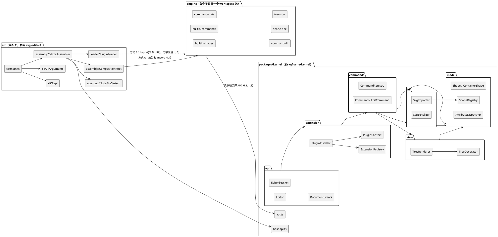
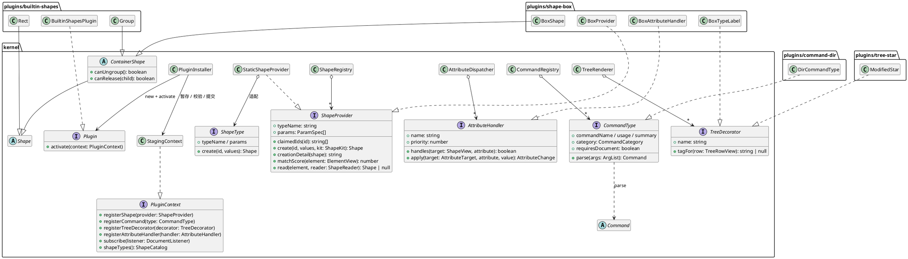
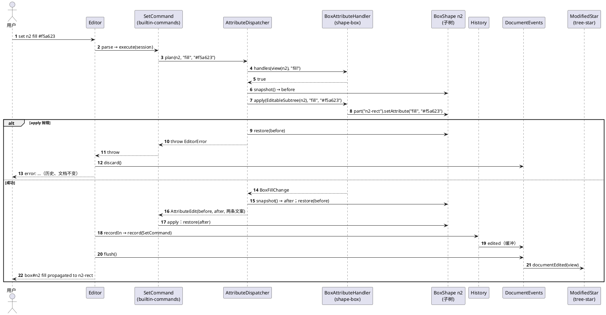
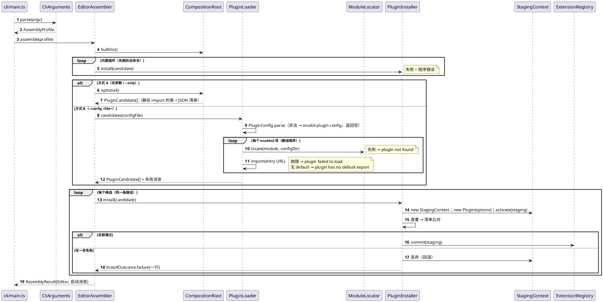

# Phase 2 插件化设计（S4）

> 本文是计划 `doc/spec/phase2-plan.md` 第 S4 步的产出，也是 S5–S15 的唯一设计依据（`CLAUDE.md` 规则 3）：接口、文案、目录和取舍一律以本文为准。
> 依据：规格 `doc/spec/phase_cli_2.md`（下称“规格”，§n 指其第二部分）、`doc/spec/phase_cli_1.md`（下称“P1 规格”）、`final` 的源码与 `doc/README.md`（下称“README”）。凡写“现有”的文件、类、方法、行号，均在 `fe10441`（里程碑 ① 之后的 `main`，`src/` 与 `final` 相同）上核对过，核对结果见附录 C。
> 分析 `doc/spec/phase2-analysis.md`（下称“分析”）只作参考：采纳的地方不再注明，推翻的地方在第 5 节写明理由。

---

## 0 阅读指引

### 0.1 本文回答的问题

| 部分 | 回答 | 主要服务的步骤 |
|---|---|---|
| 1 边界与目录 | 文件放在哪、谁能依赖谁、怎样强制、判据命令的真实路径 | S5、S9 |
| 2 四个扩展点 | `ShapeProvider`、`Command`、`TreeDecorator`、`AttributeHandler` 的签名与契约 | S6、S7 |
| 3 支撑设施 | 插件接口、上下文、事务式注册、事件、容器抽象、名字拆分、保护钩子、读回规则 | S6、S7 |
| 4 两种装配与加载器 | 组合根、加载器、装配配置（profile）、失败文案、基线工具扩展 | S8、S9 |
| 5 决定与偏差 | 决策 X1–X30、约定补充 N1–N16、已知偏差 T1–T4、K1–K6 的去向 | 全部 |
| 6 ADR 草稿 | 6 条 | S15 |
| 7 规格追溯表 | 规格每一条要求由哪个机制满足、哪一步实现、怎样验证 | 全部 |
| 8 接入演练 | `stats`、`dir`、`box`、`modified-star` 的草图与“内核零改动”论证 | S10–S13 |
| 9 测试计划与步骤划分 | 每一步的测试；修订后的步骤表 | S5–S15 |

### 0.2 编号约定

README 已经用了 R/F/E/U/V/K/B/C/W/Q/A/M/P/D，VSCode 扩展用了 VA。本文新增的编号一律换前缀，**不再出现裸写的 D 编号**：

| 前缀 | 含义 | 与已有编号的关系 |
|---|---|---|
| **X1–X30** | 决策。**X1–X18 与分析 §7 的 D1–D18 一一对应**（X*n* = 分析 D*n*），X19 起是本文新增 | 分析的“D3”在本文一律写作“决策 X3（分析 D3）”；README §3.1 的依赖规则 D1–D8 在本文一律写作“依赖规则 D1”等，两者不会撞车 |
| **L1–L10** | 新增的分层依赖规则（内核 / 装配处 / 插件之间） | 与 README 的依赖规则 D1–D8、范式规则 P1–P9 并列；S15 并入 README §3 |
| **P5a、P5b、P10** | 对范式规则的例外与新增 | P5a/P5b 是 P5 的两条受控例外，P10 是新规则 |
| **N1–N16** | 约定补充（对规格的解释） | 规则 6 要求登记的“解释” |
| **T1–T4** | 已知偏差（对规格的偏离） | 规则 6 要求登记的“偏离”；README 的 K1–K6 去向见 5.4 |
| **ADR-1–ADR-6** | 架构决策记录草稿 | S15 整理进 README |
| **G1–G16** | 接入演练发现、已回填进第 2、3 部分的缺口 | 见 8.5 |
| **TR-001…** | 规格追溯表的行号 | 见第 7 节 |

### 0.3 名字约定

- 现有的文件、类、方法用 `` `Name` `` 写真实名字；需要时附 `fe10441` 上的行号，例如 `model/Shape.ts:33`。路径在第 1 节给出搬迁规则之前，一律指 `fe10441` 上的位置（`src/` 下）。
- **本文新设计的名字在首次出现处标“（新）”**，并全部列在 0.4 的新名字表里。附录 C 的机械核对只核对“现有”名字；新名字只核对“不与现有名字撞车”。
- 改名的现有名字写作“`ShapeFactory` → `ShapeRegistry`（新）”。

### 0.4 新名字表

按所在目录排列（目录本身在 1.1 定义）。“S”列是引入它的步骤。

| 新名字 | 种类 | 位置（相对仓库根） | S | 一句话 |
|---|---|---|---|---|
| `@svgframe/kernel` | 包名 | `packages/kernel/package.json` | S5 | 内核 workspace 包 |
| `api.ts` | 汇总导出文件 | `packages/kernel/src/api.ts` | S6 | 内核公开入口 `@svgframe/kernel`（P5a） |
| `host-api.ts` | 汇总导出文件 | `packages/kernel/src/host-api.ts` | S6 | 只给装配处的入口 `@svgframe/kernel/host`（P5a） |
| `ContainerShape` | 抽象类 | `packages/kernel/src/model/` | S6 | “是图形的容器”：子节点、Composite 转发、`canUngroup`、`canRelease` |
| `ShapeProvider` | 接口 | 同上 | S6 | 扩展点①：一种图形类型 |
| `StaticShapeProvider` | 类 | 同上 | S6 | 把 `ShapeType`（类的静态侧）适配成 `ShapeProvider` |
| `ShapeRegistry` | 类 | 同上（由 `ShapeFactory` 改名） | S6 | 已提交的图形提供者；按名查找、按元素选提供者 |
| `ShapeCatalog` | 接口 | 同上 | S6 | `ShapeRegistry` 的只读 + 构造视图，给命令和插件 |
| `ShapeKit` | 接口 | 同上 | S6 | “按类型名造一个图形”，给 `ShapeProvider.create` |
| `ShapeReader` | 接口 | 同上 | S6 | 读回时内核提供给提供者的服务（id、属性、子元素、降级、拒绝） |
| `ElementView` | 接口 | 同上 | S6 | XML 元素的只读视图（`io/XmlElement` 实现它） |
| `ShapeView` | 接口 | 同上 | S7 | 图形的只读视图（`Shape` 实现它） |
| `DocumentView` | 接口 | 同上 | S7 | 文档的只读视图（`SvgDocument` 实现它） |
| `AttributeHandler` | 接口 | 同上 | S7 | 扩展点④ |
| `AttributeTarget` | 接口 | 同上 | S7 | 处理器能改的“目标子树”：只能改属性，不能改结构 |
| `AttributeChange` | 接口 | 同上 | S7 | 处理器返回的修改说明（回显与撤销文案） |
| `AttributeDispatcher` | 类 | 同上 | S7 | 查询处理器、裁决冲突、做快照事务 |
| `AttributeEdit` | 类 | 同上 | S7 | 一次已裁决、已试做的属性修改（前后快照 + 两条文案） |
| `EditableSubtree` | 类 | 同上 | S7 | `AttributeTarget` 的唯一实现 |
| `TreeDecorator` | 接口 | `packages/kernel/src/view/` | S7 | 扩展点③ |
| `TreeRowView` | 接口 | 同上 | S7 | 标签看到的一行：根行或图形行 |
| `TreeRow` | 类 | 同上 | S7 | `TreeRowView` 的实现 |
| `CommandCatalog` | 接口 | `packages/kernel/src/commands/` | S6 | `CommandRegistry` 的只读视图（给 `help`） |
| `UndoStack` | 接口 | 同上 | S7 | `History` 的收窄视图，只有 `undo` / `redo` |
| `Plugin` | 接口 | `packages/kernel/src/extension/` | S6 | `activate(context)` |
| `PluginClass` | 接口 | 同上 | S6 | 默认导出的形状：`new (options) => Plugin` |
| `PluginContext` | 接口 | 同上 | S6 | 插件能做的全部事情 |
| `PluginOptions` | 类 | 同上 | S6 | 不可变的 options 值对象 |
| `PluginManifest` | 类 | 同上 | S6 | 解析并校验后的 `package.json`（`name` + `contributes`） |
| `ContributionCategory` | 类 | 同上 | S6 | 四类注册名的封闭值对象集合（shapes、commands、decorators、attributes） |
| `PluginCandidate` | 类 | 同上 | S6 | “待安装的插件”：标签、插件类、清单、options |
| `PluginInstaller` | 类 | 同上 | S6 | 事务式注册：暂存、校验、提交、回滚 |
| `StagingContext` | 类 | 同上 | S6 | `PluginContext` 的唯一实现：注册先进暂存区 |
| `InstallOutcome` | 类 | 同上 | S6 | 安装结果：成功，或一行失败文案 |
| `ExtensionRegistry` | 类 | 同上 | S6 | 全部已提交的注册（四类 + 事件订阅） |
| `DocumentListener` | 接口 | 同上 | S7 | 文档事件的订阅者 |
| `DocumentEvents` | 类 | `packages/kernel/src/app/` | S7 | 事件缓冲：命令成功后才派发 |
| `svg-editor` | 根包（已有名字） | `package.json` | — | 装配处所在的根包（已有，不改名） |
| `CliArguments` | 类 | `src/cli/` | S8 | 解析 `--bare` / `--only` / `--config` |
| `CompositionRoot` | 类 | `src/assembly/` | S6 | 方式 A 的组合根：内置插件表 + 可选插件表 |
| `AssemblyProfile` | 类 | 同上 | S8 | 装配配置：bare / full / only / config |
| `EditorAssembler` | 类 | 同上 | S6 | 按装配配置安装插件、造出 `Editor` |
| `AssemblyResult` | 类 | 同上 | S8 | 装配结果：`Editor` + 启动消息 |
| `PluginLoader` | 类 | `src/loader/` | S8 | 方式 B：配置项 → `PluginCandidate` |
| `PluginConfig` | 类 | 同上 | S8 | 解析并严格校验 `plugins.config.json` |
| `PluginConfigEntry` | 类 | 同上 | S8 | 配置中的一项 |
| `ModuleLocator` | 类 | 同上 | S8 | 先解析：模块名 → 包目录、`package.json`、入口文件 |
| `LocatedModule` | 类 | 同上 | S8 | 解析结果 |
| `plugins.config.json` | 配置文件 | 仓库根 | S8 | 方式 B 的配置（规格 §6 指定的文件名） |
| `vitest.config.ts` | 配置文件 | 仓库根 | S5 | 测试范围 glob |
| `@svgframe/plugin-builtin-shapes` | 包名 | `plugins/builtin-shapes/` | S5 | 内置六种图形 |
| `BuiltinShapesPlugin` | 类 | `plugins/builtin-shapes/src/` | S6 | 其入口（默认导出） |
| `@svgframe/plugin-builtin-commands` | 包名 | `plugins/builtin-commands/` | S5 | 内置 19 条命令 |
| `BuiltinCommandsPlugin` | 类 | `plugins/builtin-commands/src/` | S6 | 其入口（默认导出） |
| `@svgframe/plugin-command-stats` | 包名 | `plugins/command-stats/` | S10 | `stats` |
| `StatsPlugin`、`StatsCommand`、`ShapeTally` | 类 | `plugins/command-stats/src/` | S10 | 见 8.1 |
| `@svgframe/plugin-command-dir` | 包名 | `plugins/command-dir/` | S11 | `dir` |
| `DirPlugin`、`DirCommandType`、`DirCommand`、`DirectoryLister`、`DirectoryEntry`、`NodeDirectoryLister`、`WorkingDirectory`、`NodeWorkingDirectory` | 类 / 接口 | `plugins/command-dir/src/` | S11 | 见 8.2 |
| `@svgframe/plugin-shape-box` | 包名 | `plugins/shape-box/` | S12 | `box` |
| `BoxPlugin`、`BoxShape`、`BoxProvider`、`BoxAttributeHandler`、`BoxFillChange`、`BoxLabelChange`、`BoxTypeLabel` | 类 | `plugins/shape-box/src/` | S12 | 见 8.3 |
| `@svgframe/plugin-tree-star` | 包名 | `plugins/tree-star/` | S13 | `modified-star` |
| `TreeStarPlugin`、`ModifiedStar`、`SaveBaseline` | 类 | `plugins/tree-star/src/` | S13 | 见 8.4 |
| `SessionPlan`、`RunGroup` | 类 | `scripts/baseline/` | S9 | 基线工具：会话的运行组（4.8） |
| `<会话>.runs.json` | 数据文件 | `doc/transcript/` | S9 | 会话的运行组声明 |
| `MetricsTool`、`ComplexityCounter`、`SourceSnapshot`、`MetricsReport` | 类 | `scripts/metrics/` | S9 | metrics 脚本（5.3 X18） |
| `PluginDiffCheck` | 类 | `scripts/plugin-diff/` | S9 | 规格 §6 三条判据的检查脚本 |

现有方法上新增或改变的成员（不是新类，但也是新名字）：

| 成员 | 所在 | S | 说明 |
|---|---|---|---|
| `Shape.kindName()` | `Shape` | S6 | 回显用的类型名，默认等于 `tagName()` |
| `Shape.treeLabel()` | `Shape` | S6 | 树名 `tagName#id`；`Shape.label()` 改为 `kindName#id`（3.6） |
| `Shape.parentId()`、`Shape.childViews()`、`Shape.isContainer()` | `Shape`（实现 `ShapeView`） | S7 | 只读视图方法 |
| `ShapeContainer.canRelease(child)` | 接口 `ShapeContainer` | S7 | 保护钩子（3.7） |
| `EditCommand.checkReleasable(shape)` | `EditCommand` | S7 | 调保护钩子的模板方法 |
| `CommandContext.markSaved(path)` | `CommandContext` | S7 | 取代 `setFilePath(path)`，并触发 `documentSaved` |
| `CommandContext.commands()`、`shapes()`、`attributeEdits()`、`treeDecorators()` | `CommandContext` | S6/S7 | 取代 `registry()`、`shapeFactory()`（3.2） |
| `Repl` 的 `startupMessages` 构造参数 | `Repl` | S8 | banner 之后打印的启动消息 |

---

## 1 边界与目录

### 1.1 三类目录

```text
仓库根/
├── package.json              根包 svg-editor：装配处 + 全仓脚本；"workspaces": ["packages/*", "plugins/*"]（S5）
├── package-lock.json
├── tsconfig.json             include 改为 glob（S5，见 1.4）
├── vitest.config.ts          （新，S5）测试范围 glob
├── plugins.config.json       （新，S8）方式 B 的配置
├── packages/
│   └── kernel/               ◆ 内核  @svgframe/kernel（新，S5）
│       ├── package.json      "exports": { ".": "./src/api.ts", "./host": "./src/host-api.ts" }（exports 在 S6 加）
│       ├── src/api.ts        公开入口：给插件（S6，P5a）
│       ├── src/host-api.ts   公开入口：只给装配处（S6，P5a）
│       ├── src/model/        领域模型 + 图形扩展点 + 属性扩展点
│       ├── src/io/           SVG 序列化 / 读回分派 / XML 适配 / FileSystem 端口
│       ├── src/view/         tree / show 排版 + 树标签扩展点
│       ├── src/commands/     命令框架（抽象类、注册表、解析、History）
│       ├── src/extension/    （新）插件接口、上下文、安装器、清单、事件订阅
│       ├── src/app/          Editor（Invoker）、EditorSession、DocumentEvents
│       └── tests/            内核自己的契约测试（S6 起新增；用测试替身，不依赖任何插件）
├── src/                      ◇ 装配处（根包 svg-editor）
│   ├── cli/                  main.ts（进程入口）、Repl、CliArguments
│   ├── assembly/             （新）CompositionRoot（方式 A 唯一需要改的文件）、EditorAssembler、AssemblyProfile
│   ├── loader/               （新）方式 B 的加载器，独占一个目录（规格 §6 的 rg 检查对象）
│   └── adapters/             （新）NodeFileSystem 等平台适配器
├── plugins/                  ○ 插件（每个子目录一个 workspace 包）
│   ├── builtin-shapes/       内置插件：rect circle ellipse line text g（S5 搬入，S6 插件化）
│   ├── builtin-commands/     内置插件：Phase 1 的 19 条命令（同上）
│   ├── command-stats/        S10
│   ├── command-dir/          S11
│   ├── shape-box/            S12
│   └── tree-star/            S13
├── tests/                    根测试：Phase 1 的 889 个测试（S5 只改 import 路径）、系统测试、architecture test、装配处测试、加载器夹具
├── scripts/                  baseline/（已有）、metrics/（S9）、plugin-diff/（S9）
├── doc/  docs/               doc/：README、设计、会话；docs/metrics/：S9 起的 metrics 产物
└── vscode-svg/               VSCode 扩展：独立 package.json 与锁文件，不进 workspaces、不进 CLI 的任何统计
```

**内置插件放在 `plugins/` 下**，与可选插件同级、同格式（有自己的 `package.json` 和 `contributes`）。理由：规格 §1 要求“现有的图形都改为插件式”“内置实现可通过注册机制装配”，§2.1 要求 `stats` 的包“独立于内置命令表所在的包”；内置插件和可选插件走同一条安装路径（3.3），区别只在装配处：内置插件在每一种装配配置里都装，而且总是最先装（4.3）。

**内核做成 workspace 包而不是根包里的一个目录**（决策 X1，ADR-5）。理由：插件要能写 `import … from "@svgframe/kernel"`（规格 §1“插件可依赖内核公开的领域抽象”），`exports` 只暴露 `api.ts`（给插件）与 `host-api.ts`（给装配处，规格 §1“不得依赖……宿主装配模块”的反方向：装配用的类插件看不到，3.10），深层路径 `@svgframe/kernel/src/...` 会被 TypeScript 和 Node 同时拒绝（附录 B 实验 1、2 已确认）。相对路径绕过 `exports` 的情况由 architecture test 兜底（L2）。

**装配处留在根包的 `src/`**：`src/cli/main.ts` 的路径因此不变，`npm run cli`（`tsx src/cli/main.ts`）和基线工具的 `BaselinePaths.CLI_ENTRY`（`scripts/baseline/BaselinePaths.ts:11`）都不用改。

### 1.2 依赖规则与强制手段

#### 1.2.1 分层规则 L1–L10

记号同 README §3.1：`X → Y` 表示 X 中的文件可以 `import` Y。

| # | 规则 | 理由 | 强制手段 | 引入 |
|---|---|---|---|---|
| L1 | 内核（`packages/kernel/src/**`）只能 import：内核内部的相对路径、`@xmldom/xmldom`（仅 `io/XmlDomAdapter.ts`，沿用 P1）。**禁止** import `@svgframe/*`、`src/**`、`plugins/**`，禁止 `node:fs`、`node:readline` 等平台模块 | 规格 §1 判据“内核只依赖接口，不依赖任何实现”；DIP | architecture test：解析每条 import 的目标路径，按目录归类 | S6 |
| L2 | 插件（`plugins/*/src/**`）只能 import：`@svgframe/kernel`（**只能是这个裸名**，不能带子路径）、本包内的相对路径（不得走出本包目录）、`node:*` 内置模块（受 P1 约束，见 L9） | 规格 §1“不得依赖其内部实现或宿主装配模块”；§4“插件测试不依赖其他插件” | ① `exports` + TypeScript/Node 的解析规则拒绝深层路径（附录 B 实验 2）；② architecture test 拒绝相对路径走出本包、拒绝 `@svgframe/plugin-*` | S6 |
| L3 | 插件之间不得互相 import（运行时和类型都不行） | 同上；box 需要的 rect/text 经 `ShapeKit` 按类型名创建（2.1.5） | architecture test（L2 的一部分） | S6 |
| L4 | 装配处（`src/**`）可以 import `@svgframe/kernel` 与 `@svgframe/kernel/host`；**只有** `src/assembly/CompositionRoot.ts` 可以 import 插件包（裸名，含 `<包名>/package.json`） | 方式 A 只改这一个文件（规格 §6 方式 A 判据） | architecture test | S6 |
| L5 | 加载器（`src/loader/**`）不得 import 任何插件包；源码中不得出现任何插件的包名或任何 `contributes` 注册名（从 `plugins/*/package.json` 用 glob 收集），不得出现 `switch` | 规格 §6 加载器独立性 | architecture test（名单由 glob 生成，接入新插件不用改测试） | S8 |
| L6 | 内核中不得出现任何已登记的注册名的字符串字面量（图形类型名、命令名、标签名、处理器名，名单从全部 `plugins/*/package.json` 的 `contributes` 收集） | 规格 §7 节点“内核不按名字枚举” | architecture test | S6 |
| L7 | 每个 `plugins/*/package.json` 必须：`name` 以 `@svgframe/plugin-` 开头、`"type": "module"`、`exports` 恰为 `{ ".": "<字符串>", "./package.json": "./package.json" }`、`contributes` 合法（3.3.2）；入口文件存在 | 加载器“先解析后导入”与方式 A 的 JSON import 都依赖这一形状（4.6）；`type` 缺失时 tsx 会把 `.ts` 当 CJS 处理（附录 B 实验 2 的意外发现） | architecture test（逐个读 glob 出来的 `package.json`） | S6 |
| L8 | 插件与内核的源文件顶层只允许 `import`、`export`、类 / 接口 / 类型声明；禁止顶层可执行语句（变量声明、函数调用） | 3.1 “插件不能有模块级副作用”；模块级状态会在同一进程的多个 `Editor` 之间共享 | architecture test（启发式：去掉注释与字符串后，检查列 0 开始的语句首词） | S6 |
| L9 | P1 的推广：`node:fs`、`node:module` 只允许出现在 `src/adapters/**`、`src/loader/**`，以及插件中**文件名以 `Node` 开头的适配器类**（如 `NodeDirectoryLister.ts`）；`node:readline`、`process.std*`、`console.*` 只允许出现在 `src/cli/**` | IO 隔离：内核与插件逻辑都能在内存里测 | architecture test（改写现有 `RESTRICTED_IMPORTS`、`RESTRICTED_CODE`） | S6/S8 |
| L10 | 依赖整体无环：`plugins/* → kernel`、`src → kernel`、`src/assembly → plugins/*`；内核内部沿用依赖规则 D1–D8（见下） | 同依赖规则 D8 | architecture test（现有 `moduleCycleViolations` 换成按“区域”计算） | S6 |

#### 1.2.2 依赖规则 D1–D8 在内核内部的延续

README §3.1 的依赖规则 D1–D8 按“`src/` 下的一级目录”定义模块。S5 起，模块改为“内核内部的一级目录”，规则内容不变，增加 `extension` 一个模块：

```text
src/cli → app → extension → commands → {view, io} → model        （内核内部）
```

| 依赖规则 | S5 后的含义 | 变化 |
|---|---|---|
| D1 | `kernel/model` 不依赖任何其他模块 | 不变 |
| D2 | `kernel/io` 只依赖 `model` | 不变 |
| D3 | `kernel/view` 只依赖 `model` | 不变 |
| D4 | `kernel/commands` 只依赖 `model`、`view`、`io` | 不变 |
| D5 | `kernel/commands` 对 `io` 只依赖 `FileSystem`、`SvgSerializer`、`SvgImporter` | S6 后内核的 `commands/` 不再含 `ReadCommand`、`SaveCommand`，此规则改为约束 `plugins/builtin-commands`：它从 `@svgframe/kernel` 拿到的 io 类只有这三个（`api.ts` 只导出这三个，见 3.10） |
| D6 | `kernel/app` 可依赖 `extension`、`commands`、`model`、`io` | 增加 `extension`；**删除 `app → NodeFileSystem` 这条边**（S6 起 `Editor.createDefault` 移到装配处） |
| D7 | `src/cli` 只依赖 `src/assembly`、`@svgframe/kernel` | 原“`cli` 只依赖 `app`”：`app` 进了内核，装配交给 `src/assembly` |
| D8 | 内核内部模块无环 | 不变；新模块 `extension` 依赖 `commands`、`view`、`model`、`io`，被 `app` 依赖 |

**S5 的过渡规则**（只搬不改，行为零变化）：S5 时内核的 `model/ShapeFactory.ts` 仍 import 六个图形类，`commands/CommandRegistry.ts` 仍 import 19 条命令，`app/Editor.ts` 仍 import `NodeFileSystem`。为了让 S5 的 architecture test 仍然断言“依赖规则 D1–D8 与 `final` 时完全相同”，S5 的扫描把 `plugins/builtin-shapes/src` 计入模块 `model`，`plugins/builtin-commands/src` 计入模块 `commands`，`src/adapters` 计入模块 `io`，`src/cli` 计入模块 `cli`。这张“路径 → 模块”映射表在 S6 改写，L1–L10 同时生效。

#### 1.2.3 架构测试怎样按 glob 生效

`tests/unit/architecture.test.ts` 现在只扫描 `src/`（`SRC_DIR`，第 29 行），模块 = `src/` 下的一级目录（`analyze`，第 93 行）。S5 改为：

| 改动 | 内容 |
|---|---|
| 扫描根 | 三个 glob：`packages/kernel/src/**/*.ts`、`src/**/*.ts`、`plugins/*/src/**/*.ts`；每个文件带上“区域”（kernel / host / plugin:<目录名>）和“区域内模块”两个属性 |
| 名单 | 插件列表、插件包名、`contributes` 注册名、入口文件都**从 `plugins/*/package.json` 读出来**；不维护任何写死的文件清单 |
| 防空转 | 现有的“is scanned”断言保留，路径改成新位置；新增“每个区域至少扫描到一个文件”“每个 `plugins/*` 至少扫描到其入口文件” |
| 合成违规用例 | 现有写法保留：每条规则都是“文件集合 → 违规列表”的函数，测试后半部分喂合成源码证明它能报错。L1–L10 各加一组 |

接入新插件时，新目录自动进入扫描，名单自动扩充，**测试本身不改**。

### 1.3 `api.ts` 与“一类一文件”的协调

`api.ts` 是汇总导出文件，P5“一个文件只导出一个类或接口，文件名 = 类名”管不了它；插件入口又必须有默认导出（规格 §6“没有默认导出”是一种失败），而 P5 禁止 `export default`。两处各开一条受控例外：

| # | 例外 | 条件（architecture test 逐条检查） |
|---|---|---|
| P5a | 内核 `package.json` 的 `exports` 所指的文件（即 `packages/kernel/src/api.ts`、`packages/kernel/src/host-api.ts`，3.10） | 只允许 `export { X } from "./…/X.js";` 与 `export type { I } from "./…/I.js";` 两种语句；每个被导出的名字必须等于其源文件的文件名（所以“文件名 = 类名”的对应关系在 `api.ts` 里仍然成立）；不得有声明、不得有默认导出、不得 `export *` |
| P5b | 每个插件 `package.json` 的 `exports["."]` 所指的入口文件 | 恰好一条 `export` 语句，形如 `export default class <文件名> …`；类名必须等于文件名 |
| — | 其余所有文件 | P5 原样适用（`src/cli/main.ts` 的进程入口例外保留） |

“只有这两类文件能例外”是由 `package.json` 决定的，不是由文件名决定的：例外的范围因此也不需要维护清单。

### 1.4 为插件步骤预先铺好的工程配置

下列配置如果拖到某个插件的接入提交里再做，就会改动共享配置，破坏“零差异”判据。所以全部在 S5–S9 中提前做好：

| 配置 | 内容 | 在哪一步 | 之后接入插件时 |
|---|---|---|---|
| npm workspaces | 根 `package.json` 加 `"workspaces": ["packages/*", "plugins/*"]` | **S5** | 根 `package.json` 不变；只有 `package-lock.json` 新增两段（附录 B 实验 1：一段 `node_modules/<包名>` 的 `link: true`，一段 `plugins/<目录>` 的 `name`/`version`/`dependencies`，共 11 行），`node_modules/@svgframe/` 下多一个指向 `../../plugins/<目录>` 的软链接 |
| `vscode-svg/` 隔离 | glob 只写 `packages/*`、`plugins/*`，不写 `*` 或 `**`，所以 `vscode-svg/` 永远不会被收进 workspaces | S5 | — 附录 B 实验 1 在 `vscode-svg/` 下放了一个 `package.json`，`npm install` 后锁文件里没有它 |
| 类型检查范围 | `tsconfig.json` 的 `include` 改为 `["src", "tests", "packages/*/src", "packages/*/tests", "plugins/*/src", "plugins/*/tests", "vitest.config.ts"]`；S6 加 `"resolveJsonModule": true`（方式 A 的 JSON import） | S5（include）、S6（resolveJsonModule） | 新插件的 `src/`、`tests/` 自动进入 `npm run typecheck`；`vscode-svg/` 不在任何 glob 里（附录 B 实验 2 放了一个故意写错类型的文件，`tsc` 仍然通过） |
| 测试范围 | 新增 `vitest.config.ts`：`test.include = ["tests/**/*.test.ts", "packages/*/tests/**/*.test.ts", "plugins/*/tests/**/*.test.ts"]`；`npm test` 由 `vitest run --dir tests` 改为 `vitest run` | S5 | 新插件的测试自动被执行；`vscode-svg/` 的测试不会被扫到（附录 B 实验 2：去掉配置文件、不带 `--dir` 时 vitest 会扫到 `vscode-svg/` 并失败，带配置时不会） |
| architecture test 的 glob | 见 1.2.3 | S5（扫描根与过渡映射）、S6（L1–L4、L6–L8、L10）、S8（L5、L9 的 loader 部分） | 测试不改 |
| 插件清单的 lint | L7 | S6 | 测试不改 |
| metrics 的“职责” | 职责取自每个源文件导出类（或接口）上方 JSDoc 的**第一句**（到第一个句号或空行为止）；S9 加一条 architecture test：kernel/host/plugin 区域的每个源文件都必须有这段注释（`final` 的 82 个文件全部已有） | S9 | metrics 脚本不改；新插件文件只要遵守“有类注释”就有职责一栏 |
| `plugins.config.json` | 仓库根，内容 `{ "plugins": [] }` | S8 | 方式 B 接入时只改它 |
| 基线工具的按会话参数 | 4.8 | S9 | 新会话只需加输入、期望输出、`<会话>.runs.json` |

### 1.5 差异判据的真实路径

规格 §6 的三处尖括号在本设计下的取值：

| 占位 | 真实路径 | 说明 |
|---|---|---|
| `<内核目录>` | `packages/kernel` | 整个包，包括 `package.json` 和 `tests/` |
| `<既有插件目录>` | `plugins` | `plugins/` 下全部子目录；新插件用 exclude 排除。git 的路径规格 `plugins` 只匹配目录 `plugins/`，**不**匹配 `plugins.config.json`（附录 B 实验 5 确认） |
| `<新插件包>` | `plugins/<新目录>` | 例如 `plugins/shape-box` |
| `<加载器目录>` | `src/loader` | 加载器独占的目录 |
| 方式 A 的“一个顶层装配文件” | `src/assembly/CompositionRoot.ts` | 只有它可以 import 插件（L4） |
| 方式 B 的“配置” | `plugins.config.json` | |

**路径必须存在**：`git diff C^ C -- <不存在的路径>` 返回空且退出码为 0（附录 B 实验 5）。所以每条命令前先用 `git cat-file -e <rev>:<path>` 断言路径在 `C^` 和 `C` 中都存在（新插件目录只断言在 `C` 中存在、在 `C^` 中不存在）。S9 的 `PluginDiffCheck` 把这些断言和三条判据做成一条命令：

```bash
npm run plugin-diff -- <C> plugins/<新目录> --mode A|B
```

它展开为（以 `C`、`plugins/shape-box` 为例）：

```bash
# 0. 路径存在性
for p in packages/kernel src/loader plugins src/assembly/CompositionRoot.ts; do
  git cat-file -e C^:$p && git cat-file -e C:$p || echo "MISSING $p"
done
git cat-file -e C:plugins/shape-box && ! git cat-file -e C^:plugins/shape-box 2>/dev/null || echo "NEW PLUGIN DIR NOT NEW"
# 1. 文件清单
git diff --name-status C^ C
# 2. 共同判据：内核、加载器与既有插件差异为空
git diff C^ C -- packages/kernel src/loader plugins ':(exclude)plugins/shape-box'
# 2'. 方式 B 额外判据：全部运行代码（含组合根）差异为空
git diff C^ C -- packages src plugins ':(exclude)plugins/shape-box'
# 3. 加载器独立性（辅助人工检查）
rg -n "import|require|switch" src/loader
```

共同判据比规格多包含了 `src/loader`：规格方式 A 的判据要求“不得修改加载器”，并入同一条命令。S10–S13 每次接入的完整命令与预测输出见第 8 节各演练的第 3 小节。

### 1.6 接入提交的形状（预测，详见第 8 节）

每个可选插件的接入都拆成**两个提交**，第一个满足方式 A 的判据，第二个只改配置和会话数据：

| 提交 | 内容 | 判据 |
|---|---|---|
| C（接入） | `A plugins/<新目录>/**`、`M src/assembly/CompositionRoot.ts`、`M package-lock.json` | 方式 A + 共同判据 |
| C′（配置） | `M plugins.config.json`，以及该插件需要的会话数据（`doc/transcript/…`） | 不新增插件，只改配置与测试数据 |

`box` 另有演示分支 `demo/box-config` 上的方式 B 提交 C_B：`A plugins/shape-box/**`、`M plugins.config.json`、`M package-lock.json`。

**为什么不把组合根和配置放在同一个提交里**：方式 A 的判据是“只修改一个顶层装配文件”，`plugins.config.json` 是否算“顶层装配文件”有歧义；拆开之后两种解释都满足。文档（README 的扩展点清单、过程记录）放在同一 PR 的后续提交里，不进 C。

**列表里没有出现内核、加载器或既有插件下的任何文件。** 这正是第 2、3 部分要保证的；第 8 节逐个推演。

---

## 2 四个扩展点的接口与契约

### 2.0 总则

- 四个扩展点的接口全部定义在内核里（`packages/kernel/src/model/`、`view/`、`commands/`），经 `api.ts` 导出。
- 每个扩展点只有**一条注册途径**：`PluginContext`（3.2）。内核的注册表（`ShapeRegistry`、`CommandRegistry` 等）的 `register` 方法不进 `api.ts`，插件看不到。
- “违约时框架怎样报错”统一按 3.9 的总则：**注册时**能查出来的（名字为空、缺方法）在 `activate` 期间抛出，安装器报 `plugin failed to activate`；**调用时**才能发现的，如果调用处能完整回滚（读回、创建、`set`、渲染树），就转成一行 `error:`，文档与历史不变；不能回滚的（命令的 `execute`、事件监听器）按 Phase 1 的程序错误处理（stderr、退出码 1，`cli/Repl.ts` 现有行为）。

下面的接口草图使用 TypeScript；方法注释里的“前置 / 后置 / 违约”是契约本体，S6/S7 实现时原样写进 JSDoc。

### 2.1 `ShapeProvider`：一种图形类型

#### 2.1.1 从 `ShapeType` 演变

现有的 `ShapeType`（`model/ShapeType.ts`）是**类的静态侧**：`Rect` 等类对象本身满足 `typeName`、`params`、`create`，`ShapeFactory` 直接存类（`model/ShapeFactory.ts:22-27` 在构造函数里写死六种，README K1）。

演变方式：**保留 `ShapeType` 不动**，新增实例化的扩展点接口 `ShapeProvider`（新），再用适配器 `StaticShapeProvider`（新）把任何一个 `ShapeType` 包装成 `ShapeProvider`。六个内置图形类一行不改，由内置插件注册：

```ts
// plugins/builtin-shapes/src/BuiltinShapesPlugin.ts（S6）
export default class BuiltinShapesPlugin implements Plugin {
  constructor(_options: PluginOptions) {}
  activate(context: PluginContext): void {
    for (const type of [Rect, Circle, Ellipse, Line, Text, Group]) {
      context.registerShape(new StaticShapeProvider(type));
    }
  }
}
```

`ShapeFactory` 改名为 `ShapeRegistry`（新；S6 用 `git mv` 保留历史），构造函数清空，只保留“按名查找、按元素选提供者”；登记入口变成包内可见的 `ExtensionRegistry.commit`（3.3）。`unknown shape type: <name> (is the plugin loaded?)` 的文案原样保留（`ShapeFactory.lookup`，第 39–45 行）。

#### 2.1.2 接口

```ts
// packages/kernel/src/model/ShapeProvider.ts（新，S6）
export interface ShapeProvider {
  /** create 的类型名，也是 contributes.shapes 中的注册名。大小写敏感，非空，不含空白。 */
  readonly typeName: string;

  /** create 在 id 之后的位置参数（不含 in 子句）；usage 文本由它生成（沿用 ParamSpec）。 */
  readonly params: readonly ParamSpec[];

  /**
   * 新子树将占用的全部 id，供 create 一次性查重。
   * 前置：id 已通过 IdSyntax。后置：返回非空、无重复的数组，第一个元素等于 id。
   * 违约：调用时（create 的 prepare 中）抛 Error → 3.9 转为 `shape provider failed: <type> (<reason>)`。
   */
  claimedIds(id: string): readonly string[];

  /**
   * 构造一棵游离（无父节点）的子树。values 以 ParamSpec.attributeName() 为键，均为原始字符串。
   * 子部件必须经 kit 按类型名构造，不得 import 其他插件的类（L3）。
   * 前置：claimedIds(id) 中的每个 id 都不在文档中。
   * 后置：返回的子树中出现的 id 集合恰好等于 claimedIds(id)；子树不挂在任何容器上。
   * 失败：取值非法时抛 EditorError（与 Phase 1 相同：invalid number / invalid value for …），且不留下任何东西。
   * 违约：后置条件不成立（id 集合不符、已有父节点）→ 调用时由 create 检出，转为 `shape provider failed: <type> (<reason>)`。
   */
  create(id: string, values: ReadonlyMap<string, string>, kit: ShapeKit): Shape;

  /**
   * 创建回显中紧跟 `created` 的附加说明；内置图形返回 ""，box 返回 ` (g#n1 + rect#n1-rect + text#n1-label)`。
   * 前置：shape 是本提供者刚刚 create 出来的。后置：返回单行字符串（可为空），不改文档。
   */
  creationDetail(shape: Shape): string;

  /**
   * 读回匹配：这个元素由我来读的“具体程度”。0 = 不认识。约定：只匹配标签名给 1，
   * 标签名 + 一个区分属性（如 data-kind）给 2，更具体的给更大的整数。
   * 前置：无。后置：返回有限的非负整数；不改任何状态（纯函数）。
   * 违约（负数、小数、NaN、抛错）：调用时由读回检出 → `cannot parse file: <path> (shape provider <type> failed: <reason>)`，读入失败、原文档不变。
   */
  matchScore(element: ElementView): number;

  /**
   * 由元素构造图形。子元素必须交给 reader 处理（reader.readChildren / readStandard），不得自己解析。
   * 前置：matchScore(element) 是本次选出的最高分。
   * 后置：返回一棵游离子树；它的 id 都经 reader 分配（因此满足 F13/F14 与全局唯一）。
   * 失败：用 `throw reader.reject(detail)` 拒绝整个读入；或 `return reader.readWithNext(element)` 降级（2.1.3、3.8）。
   * 返回 null 表示“这个元素跳过”（只会来自 readWithNext 找不到次优提供者）。
   */
  read(element: ElementView, reader: ShapeReader): Shape | null;
}
```

```ts
// packages/kernel/src/model/StaticShapeProvider.ts（新，S6）：Adapter（Target = ShapeProvider，Adaptee = ShapeType）
export class StaticShapeProvider implements ShapeProvider {
  constructor(type: ShapeType)
  // typeName / params：转发 type
  // claimedIds(id) = [id]；create(id, values) = type.create(id, values)；creationDetail = ""
  // matchScore(e) = e.name() === this.type.typeName ? 1 : 0   ← 与变量比较，不是字面量（P3 不受影响）
  // read(e, reader) = reader.readStandard(this.type, e)        ← Phase 1 的 importElement + build 原样搬进 reader（总是返回 Shape）
}
```

`ShapeKit`（新）、`ShapeCatalog`（新）：

```ts
export interface ShapeKit {
  /** 按类型名构造一个游离图形：等价于 lookup(typeName).create(id, values, this)。未注册时抛 `unknown shape type: <name> (is the plugin loaded?)`。 */
  build(typeName: string, id: string, values: ReadonlyMap<string, string>): Shape;
}
export interface ShapeCatalog extends ShapeKit {
  /** 已提交的类型；未注册时抛 EditorError `unknown shape type: <name> (is the plugin loaded?)`。 */
  lookup(typeName: string): ShapeProvider;
  has(typeName: string): boolean;
  /** 注册顺序。 */
  typeNames(): readonly string[];
}
```

#### 2.1.3 读回分派

现在的分派在 `io/SvgImporter.ts:147`：`this.factory.typeNames().includes(tag)`，按标签名。`box` 的标签也是 `g`，所以改为“问每个提供者的 `matchScore`”：

| 情况 | 规则 |
|---|---|
| 所有提供者都给 0 | `warning: skipped unsupported element <tag>`，连同子树跳过（F6，不变） |
| 唯一最高分 | 由它 `read` |
| **最高分并列** | 读入失败：`cannot parse file: <path> (ambiguous shape providers for <tag>: <a>, <b>)`，名字按注册顺序。理由：两个插件同样自信地认领同一个元素，说明插件之间有冲突；静默选一个就是规格 §3.4 说的“未定义的覆盖”的读回版本。内置六种图形的标签互不相同，`g`（1 分）与 `box`（`data-kind="box"` 时 2 分）分数不同，所以正常装配不会触发（决策 X22） |
| 提供者在 `read` 中调用 `reader.readWithNext(element)` | 在**本元素尚未尝试过的**提供者中按同样规则再选一次；没有可选的（全为 0）时按“不支持的元素”跳过 |

**没装 box 时**，`<g data-kind="box">` 只有 `g` 的提供者给分（1 分），自然被读成普通 `g`；`data-kind="box"` 不是 `g` 的参数也不是样式属性，按现有 `build()`（`SvgImporter.ts:175-207`）落进透传属性，保存时原样写回（F7）。**内核里不出现 `data-kind` 或 `box` 字样**（L6 只能保证注册名不出现；`data-kind` 由 S6 的人工检查与 `rg -n "data-kind" packages/kernel` 的空输出佐证）。

**装了 box 时**，`data-kind` 由 box 的 `read` 通过 `reader.applyAttributes(shape, element, ["data-kind"])` 声明为“已消费”，不进透传属性；`BoxShape.svgAttributes()` 自己输出一次 `data-kind="box"`。所以序列化不会写两次（8.3 有对应测试）。

#### 2.1.4 `ShapeReader`：读回时内核提供的服务

```ts
// packages/kernel/src/model/ShapeReader.ts（新，S6；由 io 中 SvgImporter 的内部会话对象实现）
export interface ShapeReader {
  /** Phase 1 的完整通用路径：分配 id → 拆分参数 / 样式 / 透传属性 → 构造 → 容器读子元素、叶子展平或丢弃并警告。 */
  readStandard(type: ShapeType, element: ElementView): Shape;
  /** 按 F13/F14 为这个元素分配 id（必要时产生 `assigned id …` / `duplicate id … reassigned …` 警告）。 */
  allocateId(element: ElementView): string;
  /** 把 element 的属性写到 shape 上：样式属性经 setAttribute（非法值 → cannot parse file … invalid value …），其余进透传属性；跳过 id 与 consumed 中的名字。 */
  applyAttributes(shape: Shape, element: ElementView, consumed: readonly string[]): void;
  /** 逐个子元素做读回分派；返回构造好的游离子树，顺序同文档；不支持的子元素已跳过并警告。 */
  readChildren(element: ElementView): Shape[];
  /** 整个文件中显式写出这个 id 的元素个数（含被跳过的元素，同 F13 的统计口径）。 */
  occurrences(id: string): number;
  /** 追加一条警告（不带 `warning: ` 前缀）。 */
  warn(message: string): void;
  /** 降级：把这个元素交给尚未尝试过的次优提供者；没有时返回 null（调用方原样返回 null 即“跳过”）。 */
  readWithNext(element: ElementView): Shape | null;
  /** 构造“拒绝整个读入”的错误：`cannot parse file: <path> (<detail>)`；调用方 throw 它。 */
  reject(detail: string): EditorError;
}
```

`ElementView`（新）：`name()`、`attribute(name)`、`attributes()`、`children(): readonly ElementView[]`、`text()`。现有的 `io/XmlElement.ts` 已有这五个只读方法，`implements ElementView` 即可；依赖方向是 `io → model`，符合依赖规则 D2。

**为什么 box 不自己解析子元素**：id 分配（F13/F14 要全文件统一预留）、警告的顺序与文案、透传属性与命名空间声明（`SvgImporter.withNamespaceDeclarations`）、非法值的报错格式都在 `SvgImporter` 里；box 自己写一遍就会和内置图形不一致。`readChildren` 让 box 的子部件走与普通元素完全相同的路径。

#### 2.1.5 创建时子部件从哪里来

box 要 rect 和 text。直接 `import { Rect } from …builtin-shapes…` 违反 L3（插件之间不互相依赖）和规格 §4“插件测试不依赖其他插件”。所以：

- `create(id, values, kit)` 中用 `kit.build("rect", …)`、`kit.build("text", …)` 按**类型名**构造。box 只依赖内核的 `Shape` 抽象；测试时用测试替身 `ShapeKit` 提供假的 rect/text（8.3）。
- 运行时依赖必须显式检查：`BoxPlugin.activate` 先查 `context.shapeTypes().has("rect") && has("text")`，缺任一个就抛错，安装器报 `error: plugin failed to activate: @svgframe/plugin-shape-box (requires shape types: rect, text)`，box 的全部暂存注册回滚（3.3）。理由：在激活时失败，比在用户第一次 `create box` 时报一条莫名其妙的 `unknown shape type: rect` 好；而且 `shapeTypes()` 只读已提交的注册（3.2），内置插件总是先装（4.3），所以检查结果是确定的。
- 同样的道理用于 `group`：`GroupCommand`（内置命令插件）用 `context.shapes().lookup(GroupCommand.CONTAINER_TYPE)` 造 `g`，`BuiltinCommandsPlugin.activate` 检查 `g` 已注册（3.5）。

#### 2.1.6 派生 id 查重与创建回显

`CreateCommand.prepare`（现在 `commands/CreateCommand.ts:67-76`）改为：

```text
provider = context.shapes().lookup(typeName)               // unknown shape type
values   = matchParams(provider.params)                      // usage: create <type> …（K6 的顺序不变）
for cid of provider.claimedIds(id): checkNewId(document, cid) // invalid id / id already exists: n1-rect
container = containerId === null ? document : findContainer(document, containerId)
shape    = provider.create(id, values, context.shapes())    // 数值格式与取值约束
assert ids(shape 子树) == claimedIds(id)                     // 违约 → shape provider failed
```

- 一次性查重：三个 id 中任何一个已存在，`prepare` 就抛错，`apply` 还没有执行，所以**不留下容器也不留下子部件**（规格 §4 边界第 1 条）。
- 回显：`` `${shape.label()} created${provider.creationDetail(shape)}${where}` ``，`where` 仍是 Phase 1 的 ` in ${container.containerLabel()}`（E1）。内置图形的 `creationDetail` 为空，所以输出与 `final` 完全相同；box 是 `box#n1 created (g#n1 + rect#n1-rect + text#n1-label)`，带 `in` 时是 `box#n3 created (g#n3 + rect#n3-rect + text#n3-label) in box#n1`（决策 X4）。
- undo 回显：`${shape.label()} removed`，box 为 `box#n1 removed`（E1 的自然推广）。

### 2.2 `Command`：一条命令

#### 2.2.1 注册形式

规格的 `Command` 扩展点在本设计中由**两件东西**组成，都已存在：

| 部件 | 现有名字 | 角色 |
|---|---|---|
| 静态侧 / 工厂 | `CommandType`（`commands/CommandType.ts`）：`commandName`、`usage`、`summary`、`category`、`requiresDocument`、`parse(args)` | **注册的对象**：注册名 = `commandName` |
| 命令对象 | 抽象类 `Command` 及其子类 `EditCommand`、`QueryCommand`、`DocumentCommand`、`HistoryCommand` | `parse` 产出的、带着参数的一次调用 |

**注册的是任何满足 `CommandType` 的对象**（决策 X19 的一部分）：

- 内置命令和 `stats` 注册**类本身**（类对象满足 `CommandType`，现状如此，`CommandRegistry.register(type)` 第 58 行）；
- `dir` 注册一个**实例**：`new DirCommandType(lister, cwd)`。原因是 `dir` 要注入目录访问接口，而静态侧只能靠静态字段保存它，那就是模块级状态（L8 禁止）。

两种形式都是规格 §1“以类或类的实例的方式实现扩展点”。

`CommandRegistry` 的构造函数清空（K2 消除），`lookup` 的 `unknown command: <name>` 原样保留（第 66–72 行）——这正是规格 §2.3 “未加载时执行相应命令，输出 `error: unknown command: <name>`”。

#### 2.2.2 契约

```ts
export interface CommandType {            // 现有接口，内容不变，补写契约
  /** 注册名。前置：非空、小写、不含空白（R4）。违约：注册时抛错 → plugin failed to activate。 */
  readonly commandName: string;
  /** help 与 usage 错误共用（R7）。非空单行。 */
  readonly usage: string;
  /** help 的一句说明。非空单行。 */
  readonly summary: string;
  /** 必须是 CommandCategory 的四个常量之一（引用相等）。违约：注册时抛错。 */
  readonly category: CommandCategory;
  /** Invoker 在 parse 之前检查（R10、R11）。 */
  readonly requiresDocument: boolean;
  /** 纯函数：只检查语法并构造命令对象，不碰会话。失败抛 EditorError（usage / invalid number）。 */
  parse(args: ArgList): Command;
}
```

`Command.execute(context)` 的契约沿用 Phase 1：失败抛 `EditorError` 且不改变任何状态；抛出非 `EditorError` 是程序错误，`Editor.executeLine`（第 39–51 行）不捕获，`Repl` 写 stderr 并以 1 退出。插件命令与内置命令没有区别。

#### 2.2.3 `help` 的类别与顺序

`help` 的分组与排序不变（`HelpCommand.execute`，第 33–47 行）：按 `CommandCategory.order()` 分组，组内按注册顺序（`Array.prototype.sort` 稳定）。注册顺序 = 安装顺序 = 内置插件在前，可选插件按组合根 / 配置数组的顺序在后（4.3）。所以 `stats`、`dir`（类别 `DISPLAY`）追加在 `Display:` 组的 `help` 之后（决策 X13）。`CommandCategory` 的构造函数保持私有：插件只能选四个已有类别之一，不能新增类别（规格没有这个需求；新增类别要改 `help` 的标题顺序）。

`stats`、`dir` 的 `usage` 都比 `create` 的短，所以 `help` 的对齐列（最长 usage + 2）不变；已有行逐字节不变，只多出两行。

#### 2.2.4 同步还是异步

**命令接口保持同步**（决策 X19）：`Editor.executeLine(line): string[]` 不变，`dir` 的适配器用 `fs.readdirSync`。

| 方案 | 代价 |
|---|---|
| 同步（采纳） | 无内核改动；读一个目录的耗时可以忽略；`Repl` 现在逐行同步调用 `executeLine`（`cli/Repl.ts:54-68`），顺序天然正确 |
| 命令接口支持 `Promise` | `Command.execute`、`Editor.executeLine`、`History`、`Repl`、全部 889 个测试的调用方式都要改；`Repl` 还要自己排队，保证下一行在上一行完成之后才执行 |

这个选择必须现在定：以后再改就是内核改动。如果将来真的需要异步命令，要另起一个内核版本，不在本阶段范围内。

#### 2.2.5 插件命令能看到什么

现在的 `CommandContext`（`commands/CommandContext.ts`）把具体类 `CommandRegistry`（`registry()`，第 37 行）和 `ShapeFactory`（`shapeFactory()`，第 40 行）暴露给命令，任何命令都能往注册表里塞东西。改为（S6/S7）：

```ts
export interface CommandContext {
  document(): SvgDocument;                 // 不变
  hasDocument(): boolean;                  // 不变
  replaceDocument(document: SvgDocument, path: string | null): void;   // 不变；成功后触发 documentReplaced（3.4）
  filePath(): string | null;               // 不变
  markSaved(path: string): void;           // 新：取代 setFilePath；更新默认路径并触发 documentSaved（3.4）
  fileSystem(): FileSystem;                // 不变（端口）
  history(): UndoStack;                    // 收窄：只有 undo() / redo()（新接口 UndoStack）
  commands(): CommandCatalog;              // 取代 registry()：只读，commandTypes() / lookup()
  shapes(): ShapeCatalog;                  // 取代 shapeFactory()：只读 + 按名构造（2.1.2）
  attributeEdits(): AttributeDispatcher;   // 新：set 的处理器管线（2.4）
  treeDecorators(): readonly TreeDecorator[];  // 新：tree 的标签（2.3）
}
```

| 插件命令**能**看到 | 插件命令**不能**看到 |
|---|---|
| 当前文档（可编辑，编辑类命令需要）、默认路径、文件系统端口 | 任何注册表的 `register`、`PluginInstaller`、`ExtensionRegistry` |
| `undo` / `redo`（只给 `UndoStack`） | `History.record`、`History.markIoBarrier`：命令对历史的影响只能通过 `Command.recordIn(history)` 的多态声明（Invoker 调用），不能自己动手 |
| 已注册命令和图形的只读目录 | 事件的派发（只有内核的 `EditorSession` 能发，3.4） |
| 处理器管线、树标签列表 | 装配处的任何东西：`NodeFileSystem`、加载器、组合根（L2） |

#### 2.2.6 `stats`、`dir` 与历史的关系由什么声明

| 性质 | 机制（现有） | `stats` | `dir` |
|---|---|---|---|
| 不进 undo 栈 | 继承 `QueryCommand`：`recordIn` 为空（`commands/QueryCommand.ts:9`） | ✓ | ✓ |
| 不触发 io 锁 | 同上：只有 `DocumentCommand.recordIn` 调 `History.markIoBarrier()`（`DocumentCommand.ts:13-15`） | ✓ | ✓ |
| 不解除 io 锁 | 同上：只有 `EditCommand.recordIn` 调 `History.record`，它会解锁（`History.ts:16-20`） | ✓ | ✓ |
| 不需要文档 | 静态字段 `requiresDocument = false`（同 `HelpCommand`、`InitCommand`、`ReadCommand`） | `true`：没有文档时报 `no document. use 'init' or 'read' first`（决策 X11） | `false` |
| 类别 | `QueryCommand.category = CommandCategory.DISPLAY` | DISPLAY | DISPLAY |
| 不改 dirty 状态 | 不调用 `replaceDocument` / `markSaved`，不改文档 → 不触发任何事件（3.4） | ✓ | ✓ |

### 2.3 `TreeDecorator`：结构树每行行尾的标签

#### 2.3.1 接口

```ts
// packages/kernel/src/view/TreeDecorator.ts（新，S7）
export interface TreeDecorator {
  /** contributes.decorators 中的注册名。非空，不含空白。 */
  readonly name: string;
  /**
   * 这一行要追加的标签；null 或 "" 表示不加。
   * 前置：无。后置：返回单行文本，不以空白开头或结尾、不含换行；不改任何状态。
   * 违约（返回值不合规、抛错）：调用时（tree 渲染中）检出 → `error: tree decorator failed: <name> (<reason>)`，本次 tree 不输出任何行；文档与历史不受影响（tree 是只读命令）。
   */
  tagFor(row: TreeRowView): string | null;
}

// packages/kernel/src/view/TreeRowView.ts（新，S7）
export interface TreeRowView {
  /** 是否文档根行 `svg (800x600)`。 */
  isDocumentRoot(): boolean;
  /** 图形行对应的图形（只读视图）；根行为 null。 */
  shape(): ShapeView | null;
  /** 整个文档（只读视图）。 */
  document(): DocumentView;
}
```

#### 2.3.2 三种行

| 行 | 来源（现有） | `TreeRowView` |
|---|---|---|
| 文档根行 `svg (800x600)` | `TreeRenderer.renderDocument`（`view/TreeRenderer.ts:22-27`） | `isDocumentRoot() = true`，`shape() = null` |
| `tree <id>` 的第一行（无连接线，如 `g#n1 (box)`） | `TreeRenderer.renderSubtree`（第 30–34 行） | 普通图形行：`shape()` 为该图形 |
| 普通图形行 | `TreeRenderer.collectChildren`（第 37–45 行） | 同上 |

**`tree <id>` 没有根行**（V4），所以 `modified-star` 在 `tree n1` 里只能给图形行加 `*`。

#### 2.3.3 拼接位置与分隔符

渲染顺序：先按 V1 计算列宽并对齐（`TreeRenderer.align`，第 47–50 行，**不变**），然后对每一行依次询问全部标签，把非空标签以**一个空格**为分隔追加在行尾：

```text
行 = 对齐后的行 + 每个非空标签各自前缀一个空格
```

- 标签**不参与**列宽计算（列宽在追加之前已经算完）；
- 没有摘要的行（`g`）本来不补空格，追加时直接接 ` (box)`；
- **没有任何标签（或全部返回空）时，什么都不追加**：输出与 `final` 逐字节相同，不会多出尾随空格。

用规格的两个示例核对：

| 示例 | 行 | 按 V1 计算（最宽 + 2） | 追加标签后 |
|---|---|---|---|
| 规格 §5 | 最宽的“前缀 + 标签”是 `    │   └── text#n1-label`（25），列号 27 | `rect#n1-rect` 后 3 个空格、`text#n1-label` 后 2 个、`line#arrow1` 后 8 个 | 根行 `svg (800x600) *`；`    ├── g#n1 (box)`；`…fill=#f5a623 *`。与规格 §5 逐字一致 |
| P1 规格 §6.1B | 同一棵树（无 `*`） | 同上：3/2/8 | 与规格原文（2/1/7）差一个空格，按 V1 输出 3/2/8（约定补充 N4，偏差 T3） |
| P1 规格 §4.4 `tree n1` | 第一行 `g#n1` 无连接线 | 列号 = `└── text#n1-label`（17 个码元）+ 2 = 19 | 第一行变为 `g#n1 (box)`，摘要列仍是 19，不受标签影响。注：README V1 正文写“`tree n1` 从第 18 列开始”，`tests/unit/view/TreeRenderer.test.ts:135` 的注释也写“(16) + 2 = 18”，但同一测试第 140–141 行的期望字符串实际从第 19 列开始；以代码与期望字符串为准（这是 README 与测试注释的笔误，记在 PR 里，不在本步修改） |

#### 2.3.4 多个标签的拼接顺序

**注册顺序**（决策 X17 的一部分，ADR-3）：同一插件内按 `registerTreeDecorator` 的调用顺序；插件之间按安装顺序（组合根列表 / 配置数组的顺序）。box 在 S12 接入、`modified-star` 在 S13 接入，组合根与配置都按这个顺序追加，所以同一行是 `g#n1 (box) *`。两种装配的顺序相同，才能保证双装配输出逐字节一致（4.7）。

#### 2.3.5 行视图暴露什么

| `modified-star` 需要 | `(box)` 需要 | 由谁提供 |
|---|---|---|
| 是不是根行 | — | `TreeRowView.isDocumentRoot()` |
| 图形的 id、标签名、全部属性、文本、父 id | 图形的种类名 | `ShapeView`（新，3.6）：`getId()`、`tagName()`、`kindName()`、`svgAttributes()`、`textContent()`、`parentId()` |
| 整份文档的序列化（根行比对） | — | `TreeRowView.document()` 返回 `DocumentView`，交给 `SvgSerializer.serialize(document: DocumentView)`（S7 把参数类型从 `SvgDocument` 放宽为只读视图） |

**标签不能借此修改文档**：`TreeRowView`、`ShapeView`、`DocumentView` 只有返回值类型为原始值或只读视图的方法，没有任何变更方法，也拿不到 `Shape` / `SvgDocument` 本身（`ShapeView.childViews()` 返回 `ShapeView[]` 而不是 `Shape[]`）。TypeScript 的强制转换可以绕过类型，这属于故意违约，不在契约保护范围内；S7 加一条 architecture test：插件中不得出现 `as Shape`、`as SvgDocument`、`as ContainerShape`（P10）。

### 2.4 `AttributeHandler`：某个属性在某种图形上的语义

#### 2.4.1 为什么要重设计

规格 §3.3 的初始接口 `handles(shapeId, attr)` / `apply(shapeId, attr, value)` 只传 id，处理器拿不到文档；也没有优先级、回显和撤销文案。规格要求在 ADR 中回答四个问题，本设计的回答汇总在 ADR-1，接口如下。

#### 2.4.2 接口

```ts
// packages/kernel/src/model/AttributeHandler.ts（新，S7）
export interface AttributeHandler {
  /** contributes.attributes 中的稳定注册名，如 "box-attributes"。非空，不含空白。 */
  readonly name: string;
  /** 冲突裁决用的整数；越大越优先。约定 0 为普通处理器。违约（非整数）：注册时抛错。 */
  readonly priority: number;
  /**
   * 是否负责“这个图形的这个属性”。
   * 前置：无。后置：不改任何状态（纯查询）；只能读 target。
   * 违约（抛错）：调用时 → `error: attribute handler failed: <name> (<reason>)`，什么都没改。
   */
  handles(target: ShapeView, attribute: string): boolean;
  /**
   * 执行修改。只能通过 target 改属性，不能改结构（接口里根本没有结构操作）。
   * 前置：handles(target.view(), attribute) 为 true，且本处理器在裁决中胜出。
   * 后置：返回 AttributeChange；修改都落在 target 子树内。
   * 失败：值非法时抛 EditorError（例如 `invalid value for fill: ""`）→ 内核回滚，原样报出这条错误。
   * 违约（抛出非 EditorError）：内核回滚，报 `error: attribute handler failed: <name> (<reason>)`。
   * 两种情况都不会回退到白名单（规格 §3.2）。
   */
  apply(target: AttributeTarget, attribute: string, value: string): AttributeChange;
}

// AttributeTarget（新，S7）：受限的“目标子树”
export interface AttributeTarget {
  /** 目标图形的只读视图（判断类型、读 id、读子部件）。 */
  view(): ShapeView;
  /** 目标子树中 id 为 id 的图形（含目标自身）；不在子树中时抛 Error（违约）。 */
  part(id: string): AttributeTarget;
  /** 经 Shape.setAttribute 修改一个白名单属性；非法时抛 EditorError，且该属性不变（模型保证）。 */
  setAttribute(name: string, value: string): void;
}

// AttributeChange（新，S7）：处理器提供文案
export interface AttributeChange {
  /** 执行后的回显，如 `box#n2 label updated: "处理数据 v2"`。 */
  appliedMessage(): string;
  /** 撤销后的回显，如 `box#n2 label restored: "处理数据"`。 */
  undoneMessage(): string;
}
```

**处理器怎样获取目标、判断类型、修改子部件**：内核先按 id 找到目标（`no such shape` 仍由 `SetCommand` 报），把目标的只读视图交给 `handles`，把受限的 `EditableSubtree`（新，`AttributeTarget` 的唯一实现）交给 `apply`。判断类型用 `view().kindName()` 与处理器所在插件自己的常量比较（box：`BoxShape.KIND`）；修改子部件用 `target.part("n2-rect").setAttribute("fill", …)`。处理器和图形属于同一个插件包，所以知道子部件的派生 id。

#### 2.4.3 `set` 的流程

`SetCommand`（内置命令插件）只做一件新事：先问管线。管线 `AttributeDispatcher`（新，内核）：

```text
SetCommand.prepare(document):
  target = findShape(document, id)                              // no such shape（R10 顺序不变）
  edit   = context.attributeEdits().plan(target, attribute, value)   // 可能抛 EditorError
  if edit === null: Phase 1 的白名单路径（现有代码不变：试赋值 → 快照 → 还原，K4）
  else: 记住 edit
SetCommand.apply():   edit === null ? target.restore(after) : edit.redo()
SetCommand.undo():    edit === null ? target.restore(before) + Phase 1 回显 : edit.undo()
回显：                edit === null ? Phase 1（E8） : edit.appliedMessage() / edit.undoneMessage()

AttributeDispatcher.plan(target, attribute, value):
  1. candidates = 已注册处理器中 handles(target, attribute) 为 true 的（按注册顺序询问；抛错 → attribute handler failed）
  2. candidates 为空 → 返回 null（交回白名单路径）
  3. 取 priority 最大者；最大值上并列 → EditorError `ambiguous attribute handlers for <attribute> on <id>: <a>, <b>`（名字按注册顺序），什么都不改
  4. before = target.snapshot()；ids = 子树 id 序列
  5. try { change = winner.apply(new EditableSubtree(target), attribute, value) }
     catch (e) { target.restore(before); e 是 EditorError ? 原样抛出 : 抛 EditorError `attribute handler failed: <name> (<reason>)` }
  6. 断言子树 id 序列未变（接口保证结构不变，这里是防御性检查；不成立 → 程序错误）
  7. applied = change.appliedMessage(); undone = change.undoneMessage()；after = target.snapshot()
  8. target.restore(before)                         // prepare 结束时文档不变（EditCommand 的两阶段约定）
  9. 返回 AttributeEdit(target, before, after, applied, undone)
```

`AttributeEdit`（新）：`redo()` = `target.restore(after)`，`undo()` = `target.restore(before)`；两条文案在 `plan` 时就算好并保存，撤销与重做时不再调用插件代码，redo 的回显与首次执行相同（U6）。

#### 2.4.4 四个契约问题（规格 §3.3，ADR-1 的要点）

| 问题 | 回答 | 保证机制 |
|---|---|---|
| 怎样获取目标并判断类型 | 内核定位目标，交给处理器只读视图（判断）与受限子树（修改）；类型用 `kindName()` 与插件自己的常量比较 | `ShapeView`、`AttributeTarget` 的接口形状 |
| 多个处理器同时命中 | **按 `priority` 取最大；最大值上并列就拒绝**，报 `ambiguous attribute handlers …`，不执行任何修改。不组合执行 | 第 3 步；规格 §3.4“不发生未定义的覆盖” |
| 一次 `set` 是一个 undo 单元 | `SetCommand` 是一个 `EditCommand`，`History` 只存整个命令对象（`History.ts:6-8` 已有的性质）；`AttributeEdit` 用**目标子树**的前后两个快照实现 undo/redo，修改多少个子部件都一样 | `ShapeMemento` 递归覆盖子树的样式、几何与文本（`model/ShapeMemento.ts:4-9`，`Group.snapshot` 第 64–70 行） |
| 部分修改后抛错时怎样恢复、历史不变 | 第 5 步立即 `restore(before)`；异常沿 `prepare` 抛出，`Editor` 只在 `execute` 正常返回后才调 `recordIn`（`Editor.ts:58-60`），所以 undo/redo 栈和 io 锁都不变 | 快照事务 + Invoker 的现有顺序 |

**“处理器不能改结构”靠接口形状保证**：`Group.restore` 在子节点数目不一致时直接抛错（`model/Group.ts:76-78`），如果处理器能增删子节点，回滚本身就会炸。`AttributeTarget` 没有任何结构操作（没有 `insertAt` / `remove`，也拿不到 `ContainerShape`），`part()` 返回的仍是 `AttributeTarget`；快照能覆盖的东西（样式、几何、文本）恰好就是 `setAttribute` 能改的东西，透传属性不可编辑（`ExtraAttributes` 的现有约定，F7）。

#### 2.4.5 与白名单的衔接

| 情况 | 行为 |
|---|---|
| 没有处理器命中 | `plan` 返回 `null`，`SetCommand` 走 Phase 1 的白名单路径，代码不变：允许的属性照常修改，未定义的属性报 `unknown attribute: <attr>`（`Shape.setAttribute`，第 62–67 行）。例：`set r1 fill red`、`set r1 label x`（→ `unknown attribute: label`）、没装 box 时 `set n1 label x`（→ `unknown attribute: label`） |
| 处理器命中并成功 | 走处理器；不再调用白名单 |
| 处理器命中但失败 | 回滚后报错；**不回退到白名单**（规格 §3.2“以免掩盖错误或重复修改”） |
| 装了 box、对 box 设置处理器不管的属性（如 `stroke`） | 没有处理器命中 → 白名单路径，设置在 `<g>` 自身上：`box#n1 updated: stroke=red`（决策 X8） |

K4（`SetCommand` 用“试赋值”校验）在新流程中保留并推广：处理器路径同样是“试做 → 快照 → 还原”，因为处理器没有“只校验不修改”的方法，也不应该要求它有。

#### 2.4.6 回显

| 命令 | 回显 | 来源 |
|---|---|---|
| `set n2 fill #f5a623` | `box#n2 fill propagated to n2-rect` | P1 规格 §6.1B；`BoxFillChange.appliedMessage()` |
| 其 undo | `box#n2 fill restored on n2-rect` | 规格未给，本文决定（决策 X10，约定补充 N10） |
| `set n2 label "处理数据 v2"` | `box#n2 label updated: "处理数据 v2"` | P1 规格 §6.1B；`BoxLabelChange.appliedMessage()` |
| 其 undo | `box#n2 label restored: "处理数据"` | P1 规格 §6.1B；`BoxLabelChange.undoneMessage()`（旧值在 `apply` 时取得） |
| 其 redo | 与首次执行相同 | U6 |

---

## 3 支撑设施的接口

### 3.1 插件接口与 `activate` 契约

```ts
// packages/kernel/src/extension/Plugin.ts（新，S6）
export interface Plugin {
  /**
   * 通过 context 登记本插件的全部贡献。
   * 前置：context 是一个尚未封存的暂存上下文（3.3）。
   * 后置：同步返回；全部注册都已交给 context。
   * 约束：只能通过 context 产生效果——不得写模块级变量、不得启动定时器或监听进程事件、
   *       不得保留 context 供以后使用（返回后 context 即封存，再调用会抛错）。
   * 失败：抛出任何异常 → `plugin failed to activate: <name> (<reason>)`，全部暂存注册丢弃。
   * 返回 thenable（异步 activate）同样算失败：reason 为 `activate must be synchronous`。
   */
  activate(context: PluginContext): void;
}

// packages/kernel/src/extension/PluginClass.ts（新，S6）：插件入口的默认导出必须满足它
export interface PluginClass {
  new (options: PluginOptions): Plugin;
}
```

| 约定 | 内容 | 理由 |
|---|---|---|
| 默认导出是**类** | 入口文件 `export default class XxxPlugin implements Plugin`（P5b），由安装器 `new` | 每个 `Editor` 拿到自己的插件实例：同一进程里先后造两个 `Editor`（测试、双装配运行）时，`modified-star` 的状态不会串（规格 §5 “不得用模块级变量”的同一要求）。导出实例就是模块级单例（决策 X15） |
| options 经**构造参数**传入 | `new XxxPlugin(options)`；`PluginOptions`（新）是不可变值对象，提供 `get(name): unknown`、`string(name, fallback)`、`number(name, fallback)`、`boolean(name, fallback)` 与 `isEmpty()`；没写 `options` 时是 `PluginOptions.EMPTY` | options 变成插件实例的私有字段（字段封装）；`activate` 的签名对所有插件一样 |
| 构造函数也在安装器的保护之下 | 方式 A 不在组合根里 `new`，而是把**类**交给安装器（4.2），所以构造函数抛错与 `activate` 抛错同样回滚、同样报 `plugin failed to activate` | 两种装配走同一条路径（规格 §6 加载契约第 1 条） |
| 不得有模块级副作用 | 由 L8（architecture test）启发式检查：插件与内核源文件的顶层只有 import / export / 声明 | 回滚只能撤销经 context 产生的效果；模块级副作用撤销不了 |

### 3.2 插件上下文

```ts
// packages/kernel/src/extension/PluginContext.ts（新，S6；事件订阅 S7）
export interface PluginContext {
  registerShape(provider: ShapeProvider): void;            // 注册名 provider.typeName，类别 shapes
  registerCommand(type: CommandType): void;                // 注册名 type.commandName，类别 commands
  registerTreeDecorator(decorator: TreeDecorator): void;   // 注册名 decorator.name，类别 decorators（S7）
  registerAttributeHandler(handler: AttributeHandler): void; // 注册名 handler.name，类别 attributes（S7）
  subscribe(listener: DocumentListener): void;             // 文档事件（3.4）；不属于 contributes 的类别（S7）
  /** 已提交（此前安装成功的插件）的图形类型，只读；用于检查运行时依赖（2.1.5）。不含本插件自己暂存的注册。 */
  shapeTypes(): ShapeCatalog;
}
```

这六个方法就是**向插件暴露的全部能力**。插件拿不到：已提交注册表的写入口、安装器、其他插件的实例、`Editor` / `EditorSession`、文件系统（命令执行时经 `CommandContext.fileSystem()` 拿到的是端口，不是上下文的能力）。

每个 `register*` 在调用时就做**形状校验**（违约在注册时报出）：注册名是非空、不含空白的字符串；必需的方法都是函数；`CommandType.category` 是四个 `CommandCategory` 常量之一；`AttributeHandler.priority` 是整数。不合格时 `register*` 抛 `Error`，`activate` 因此失败。

### 3.3 事务式注册

#### 3.3.1 安装路径

`PluginInstaller.install(candidate: PluginCandidate): InstallOutcome`（新，内核 `extension/`）是**唯一**的安装路径：内置插件、方式 A 的可选插件、方式 B 的插件都调用它（4.2）。

```text
install(candidate):
  0. manifest = PluginManifest.parse(candidate.manifestJson)
       失败 → `invalid plugin manifest: <label> (<reason>)`                       （新文案，N12）
  1. staging = new StagingContext(registry)                                       ← 暂存
     try { plugin = new candidate.pluginClass(candidate.options); r = plugin.activate(staging) }
     catch (e) → `plugin failed to activate: <name> (<reason>)`                  （规格）
     r 是 thenable → `plugin failed to activate: <name> (activate must be synchronous)`
     staging.seal()                                                              ← 此后对 staging 的任何调用都抛 Error
  2. 查重：按类别顺序 shapes → commands → decorators → attributes，类别内按注册顺序，
     与已提交的注册比、与本次暂存中更早的注册比；第一个重复
       → `duplicate registration: <category>/<name>`                              （规格）
  3. 清单比对：四个类别分别比较“声明的名字集合”与“暂存的名字集合”；任一类别不等
       → `plugin manifest mismatch: <name> (declared: <列表>, registered: <列表>)`  （规格）
  4. 提交：registry.commit(staging)——按暂存顺序追加到已提交的注册表与订阅列表
  任何一步失败：丢弃 staging（回滚），返回 InstallOutcome.failure(<一行文案>)；已提交的注册不受影响
```

- `<label>`：方式 B 是配置里写的 `module` 字符串；方式 A 与内置插件是组合根传入的包名（4.2）。`<name>`：清单里的 `name`（第 0 步之后一定可用）。
- `<reason>`：异常是 `Error` 时取 `message` 的第一行；否则取 `String(值)`。同一台机器、同一输入下确定；可能含 Node 给出的绝对路径（偏差 T4）。
- 清单比对的列表格式：`<类别>/<名字>` 用空格连接，类别按固定顺序，类别内声明侧按 `contributes` 中的书写顺序、注册侧按注册顺序；一侧为空写 `(none)`。例：`plugin manifest mismatch: @svgframe/plugin-shape-box (declared: shapes/box attributes/box-attributes, registered: shapes/box decorators/box-type-label attributes/box-attributes)`。
- **一个插件同时违反多条时**，只报按 0 → 1 → 2 → 3 顺序遇到的第一条（ADR-4）。理由：激活失败时暂存内容不可信，查重和比对没有意义；重复注册比清单不符更能说明问题（声明了 `box` 也注册了 `box`，但 `box` 已被别的插件占了）。

#### 3.3.2 清单（`contributes`）

```json
{
  "name": "@svgframe/plugin-shape-box",
  "version": "0.1.0",
  "private": true,
  "type": "module",
  "exports": { ".": "./src/BoxPlugin.ts", "./package.json": "./package.json" },
  "dependencies": { "@svgframe/kernel": "0.1.0" },
  "contributes": {
    "shapes": ["box"],
    "attributes": ["box-attributes"],
    "decorators": ["box-type-label"]
  }
}
```

`PluginManifest.parse` 的校验（严格，决策 X29 的一部分，约定补充 N11）：`name` 是非空字符串；`contributes` 缺省视为 `{}`；`contributes` 只能有 `shapes`、`commands`、`decorators`、`attributes` 四个键（拼错的键报 `unknown contributes key: <key>`，而不是被静默忽略）；每个值是字符串数组，元素非空、互不重复。缺省的类别视为空列表（规格 §6 加载契约第 2 条）。`package.json` 的其他字段不看。

#### 3.3.3 回滚覆盖哪些能力

| 插件能做的事 | 暂存在哪里 | 回滚 |
|---|---|---|
| 注册图形 | `StagingContext` 的 shapes 列表 | 丢弃列表；`ShapeRegistry` 从未被写 |
| 注册命令 | commands 列表 | 同上 |
| 注册树标签 | decorators 列表 | 同上 |
| 注册属性处理器 | attributes 列表 | 同上 |
| 订阅文档事件 | listeners 列表 | 同上：订阅只在提交时才进入 `ExtensionRegistry` |
| 构造函数、`activate` 中的其他副作用 | — | 契约禁止（3.1），L8 检查 |

提交是“把暂存列表追加进已提交列表”的内存操作，前面的检查已经排除了重复，所以提交本身不会失败：**不存在“提交了一半”的状态**。

**内置能力也走这条路径**：`BuiltinShapesPlugin`、`BuiltinCommandsPlugin` 有自己的 `package.json`（`contributes.shapes` 列六种图形，`contributes.commands` 列 19 条命令名），由 `EditorAssembler` 交给同一个 `PluginInstaller`。区别只有一处：内置插件安装失败是程序错误（`EditorAssembler` 抛 `Error`，`main.ts` 写 stderr、退出码 1），而可选插件安装失败只打印一行 `error:` 并继续（4.5）。

### 3.4 文档事件

`modified-star` 选定的 dirty 语义是“内容与上次保存（或载入）不一致”（ADR-3）：渲染时比对当前内容与保存点，所以它只需要知道**保存点在什么时候产生**。为了让 ADR-3 的备选语义（“发生过编辑命令”）将来也能不改内核实现，再加一个编辑事件。

```ts
// packages/kernel/src/extension/DocumentListener.ts（新，S7）
export interface DocumentListener {
  /** init 或 read 成功：document 成为当前文档；path 是默认保存路径（init 时为 null）。 */
  documentReplaced(document: DocumentView, path: string | null): void;
  /** save 成功（含另存为新路径）：document 的当前内容已写入 path。 */
  documentSaved(document: DocumentView, path: string): void;
  /** 一条编辑命令执行成功，或 undo / redo 成功。 */
  documentEdited(document: DocumentView): void;
}
```

| 事件 | 发出者（内核） | 触发点 | 何时**不**发 |
|---|---|---|---|
| `documentReplaced` | `EditorSession.replaceDocument`（`InitCommand`、`ReadCommand` 调用） | `init` 成功、`read` 成功 | `read` 失败：`ReadCommand` 在读入完成之前不调用 `replaceDocument`（F20，现有行为），所以根本没有事件 |
| `documentSaved` | `EditorSession.markSaved`（新，取代 `setFilePath`；`SaveCommand` 在写文件成功后调用，与现在调 `setFilePath` 的位置相同，`SaveCommand.ts:42-43`） | `save` 成功（无参数或另存为） | `save` 失败（`cannot write file`、`no file path`）：写文件抛错在先，`markSaved` 不会被调用 |
| `documentEdited` | `History` 在 `record`、`undo`、`redo` 成功后回调 `EditorSession`（`History` 构造时传入回调） | 编辑命令成功；`undo` / `redo` 成功 | `undo` / `redo` 失败（`nothing to undo`、io 锁）：`History.top` 先抛错（`History.ts:59-68`），没有回调；`canvas` 改尺寸是文档类命令，不算编辑 |

**只在命令成功之后派发**：上面三个触发点都只把事件放进 `DocumentEvents`（新，内核 `app/`）的缓冲区。`Editor.run`（`Editor.ts:53-62`）在 `execute` 和 `recordIn` 都正常返回之后调 `session.flushEvents()`，按产生顺序、按订阅顺序依次调用监听器；`executeLine` 捕获到 `EditorError` 时调 `session.discardEvents()`。所以任何失败的命令都不会派发事件，即使它在失败之前已经调过 `replaceDocument`。

**监听器抛错**：命令已经成功、无法回滚，按程序错误处理（异常从 `executeLine` 传出，`Repl` 写 stderr、退出码 1）。契约要求监听器不抛错。

### 3.5 容器抽象

现状：接口 `ShapeContainer`（`model/ShapeContainer.ts`）由 `Group` 与 `SvgDocument` 实现，但 Composite 的行为都写在具体类 `Group` 里，而且内核多处直接依赖它：`Shape.asContainer(): Group | null`（`model/Shape.ts:79`）、`EditCommand.findContainer(): Group`（`commands/EditCommand.ts:66`）、`new Group(this.groupId)`（`commands/GroupCommand.ts:85`）、`AddToCommand` 与 `UngroupCommand` 的字段类型 `Group`、`Group.canUngroup()`（`model/Group.ts:60`）。`g` 变成内置插件之后，这些都会成为“内核依赖插件”。

改法（S6）：

| 现有 | 改为 |
|---|---|
| `Group` 中的 Composite 行为（`ChildList` 字段、`moveBy` / `scaleBy` 转发、`summary() = ""`、`moveDescription` 的 `by (dx,dy)`、`snapshot` / `restore` 的递归、`childList` / `indexOf` / `insertAt` / `remove`、`containerLabel`、`canUngroup`） | 搬进内核的抽象类 `ContainerShape`（新）`extends Shape implements ShapeContainer`；`Group` 留在内置插件里，只剩 `typeName = "g"`、`params = []`、`create` 和 `tagName()`，`extends ContainerShape` |
| `Shape.asContainer(): Group \| null` | `asContainer(): ContainerShape \| null` |
| `EditCommand.findContainer(): Group` | 返回 `ContainerShape`；`in` 的目标因此可以是任何容器图形，包括 box（约定补充 N1） |
| `GroupCommand` 里的 `new Group(id)` | `context.shapes().lookup(GroupCommand.CONTAINER_TYPE).create(id, 空 Map, context.shapes())`，再 `asContainer()`；`CONTAINER_TYPE = "g"` 是内置命令插件里的常量 |
| `AddToCommand`、`UngroupCommand` 的字段类型 `Group` | `ContainerShape` |
| `Group.canUngroup()` | `ContainerShape.canUngroup()`，默认 `true`；box 覆写为 `false`。`UngroupCommand.prepare`（第 54 行）调用方式不变，文案 `cannot ungroup composite shape: <id>` 原样保留 |
| — | `ContainerShape.canRelease(child)`（新，3.7） |

`ShapeContainer`（接口，“能挂子节点的东西”，含文档根）与 `ContainerShape`（抽象类，“是图形的容器”）名字相近，含义不同：前者是 `TreePosition`、`ChildList` 用的最小协议，后者是 Composite 的组件实现。

**`group` 时 `g` 的提供者没装会怎样**：`BuiltinCommandsPlugin.activate` 检查 `context.shapeTypes().has("g")`，没有就抛错（`requires shape type: g`）。内置插件的安装顺序固定为先图形后命令（4.3），所以在任何装配配置下这条检查都通过；它的作用是把“内置命令依赖内置图形”这件事写成代码而不是只写在注释里。如果有人改了安装顺序，启动时就会以程序错误失败，而不是等到用户第一次 `group` 才报 `unknown shape type: g (is the plugin loaded?)`。

### 3.6 回显名与树名的拆分

box 的回显是 `box#n2 moved by …`，树里却是 `g#n1 (box)`；而 `Shape.label()`（`model/Shape.ts:33`，`tagName#id`）和 `containerLabel()` 现在被回显、树、`show`、警告和程序错误共用。拆分方式（S6，决策 X2）：

| 名字 | 定义 | 用途 |
|---|---|---|
| `Shape.kindName()`（新） | 默认返回 `tagName()`；box 返回 `"box"` | 类型的用户可见名字；`stats` 的计数键也用它（8.1） |
| `Shape.label()`（**语义改变**） | `` `${kindName()}#${id}` `` | 命令回显、`show`、警告、程序错误 |
| `Shape.treeLabel()`（新） | `` `${tagName()}#${id}` `` | **只用于** `tree` 的行 |
| `ContainerShape.containerLabel()` | `label()` | 回显中的 `in …` / `into …`、`show` 的 `parent=` |
| `SvgDocument.containerLabel()` | `"svg"`（不变） | 同上 |

内置图形的 `kindName()` 都等于 `tagName()`，所以 `label()` 与 `treeLabel()` 对它们完全相同：**内置图形的全部输出与 `final` 逐字节相同**（基线会话验证）。

`src/` 中每一处调用 `label()` / `containerLabel()` 的位置（`fe10441`，共 32 处调用 + 3 处定义）：

| # | 位置 | 用途类别 | S6 后调用 | box 在这里显示 |
|---|---|---|---|---|
| 1 | `model/Shape.ts:33` | 定义 | — | — |
| 2 | `model/Shape.ts:139` | 程序错误（memento 归属） | `label()` | `box#n1` |
| 3 | `model/Group.ts:77` | 程序错误（memento 子节点数） | `label()`（搬进 `ContainerShape`） | `box#n1` |
| 4 | `model/Group.ts:102` | 程序错误（插入成环） | 同上 | `box#n1` |
| 5 | `model/Group.ts:111-112` | 定义 `containerLabel()` | 搬进 `ContainerShape`，返回 `label()` | `box#n1` |
| 6 | `model/Text.ts:57` | 程序错误 | `label()` | —（text 不是 box） |
| 7 | `model/LeafShape.ts:66` | 程序错误 | `label()` | — |
| 8 | `model/SvgDocument.ts:59` | 定义（根） | 不变 | — |
| 9 | `model/TreePosition.ts:22` | 程序错误 | `label()` | `box#n1` |
| 10 | `model/ChildList.ts:32` | 程序错误 | `label()` | `box#n1` |
| 11 | `model/ChildList.ts:44` | 程序错误（含 `containerLabel()`） | 不变 | `… is not a child of box#n1` |
| 12 | `io/SvgImporter.ts:164` | 导入警告 `flattened <x> in …` | `label()` | 不会出现：只有带文本内容的叶子会展平，box 是容器 |
| 13 | `view/ShapeDetailRenderer.ts:18` | 程序错误 | `label()` | `box#n1` |
| 14 | `view/ShapeDetailRenderer.ts:20` | `show` 第 1 行与 `parent=` | `label()`、`containerLabel()` | `show n1` → `box#n1  parent=svg`；`show n1-rect` → `rect#n1-rect  parent=box#n1`（决策 X20） |
| 15 | `view/TreeRenderer.ts:31` | `tree <id>` 第一行 | **`treeLabel()`** | `g#n1`（再由标签追加 ` (box)`） |
| 16 | `view/TreeRenderer.ts:41` | `tree` 图形行 | **`treeLabel()`** | `g#n1` |
| 17 | `commands/SetCommand.ts:72` | 回显 `updated:` | `label()` | `box#n1 updated: stroke=red` |
| 18 | `commands/DeleteCommand.ts:38` | undo 回显 `into …` | `containerLabel()` | `rect#x restored into box#n1` |
| 19 | `commands/DeleteCommand.ts:39` | undo 回显 | `label()` | `box#n1 restored` |
| 20 | `commands/DeleteCommand.ts:53` | 回显 | `label()` | `box#n1 deleted` |
| 21 | `commands/UngroupCommand.ts:44` | undo 回显 | `label()` | 不会出现（box 不能 ungroup） |
| 22 | `commands/UngroupCommand.ts:77` | 回显 | `label()` | 同上 |
| 23 | `commands/UngroupCommand.ts:83` | 警告 `attributes of … discarded` | `label()` | 同上 |
| 24 | `commands/GroupCommand.ts:58` | undo 回显 | `label()` | 新容器总是 `g` |
| 25 | `commands/GroupCommand.ts:96` | 回显 | `label()` | 同上 |
| 26 | `commands/AddToCommand.ts:43` | undo 回显 `moved back into …` | `containerLabel()` | `rect#r1 moved back into box#n1` |
| 27 | `commands/AddToCommand.ts:65` | 回显 `added to …` | `label()` | `rect#r1 added to box#n1` |
| 28 | `commands/MoveCommand.ts:39` | undo 回显 | `label()` | `box#n2 moved back by (0,-100)` |
| 29 | `commands/MoveCommand.ts:53` | 回显 | `label()` | `box#n2 moved by (0,100)` |
| 30 | `commands/ZOrderCommand.ts:27` | undo 回显 | `label()` | `box#n1 z-order restored` |
| 31 | `commands/ZOrderCommand.ts:43` | 回显 | `label()` | `box#n1 brought to front` |
| 32 | `commands/ScaleCommand.ts:41` | undo 回显 | `label()` | `box#n1 scaled back by 0.5` |
| 33 | `commands/ScaleCommand.ts:59` | 回显 | `label()` | `box#n1 scaled by 2` |
| 34 | `commands/CreateCommand.ts:64` | undo 回显 | `label()` | `box#n1 removed` |
| 35 | `commands/CreateCommand.ts:84-85` | 回显（含 `containerLabel()`） | `label()`、`containerLabel()` | `box#n1 created (…)`、`… in box#n1` |

只有第 15、16 两处改调用；其余调用点的**代码不变**，变的是 `label()` 的定义。`show` 选回显名而不是树名：`show` 是给用户看的对象明细，`parent=box#n1` 与回显的 `added to box#n1` 一致；树是 SVG 的结构视图，类型标注由 `(box)` 标签负责（规格 §5）。

### 3.7 必要子部件的保护钩子

`delete n1-rect`、`addto other n1-label`、`group x n1-rect` 都会把 box 的必要子部件移出 box，破坏“box 内部含一个矩形与一个文本”的不变量。设计（S7）：

```ts
// 接口 ShapeContainer 新增（SvgDocument 返回 true）
/** 是否允许把直接子节点 child 移出本容器（删除或移到别的容器）。纯查询。 */
canRelease(child: Shape): boolean;
// ContainerShape 的默认实现返回 true；BoxShape 对 <id>-rect、<id>-label 返回 false

// EditCommand 新增（内核）
/** shape 的父容器不允许移走它时抛 `cannot detach required part of composite shape: <id>`。 */
protected checkReleasable(shape: Shape): void;
```

| 命令 | 何时调用 `checkReleasable` | 检查位置（R10 顺序） | 例 |
|---|---|---|---|
| `delete <id>` | 总是（目标会离开父容器） | 在 `no such shape` 之后 | `delete n1-rect` → `error: cannot detach required part of composite shape: n1-rect`；`delete n1` 正常（box 整体删除，一个 undo 单元） |
| `addto <gid> <id>` | 只在目标的当前父容器**不是** `gid` 时 | 在现有的容器、图形、成环三项检查之后 | `addto other n1-label` → 拒绝；`addto n1 n1-rect`（同一个 box 内移到末尾）允许 |
| `group <gid> <id…>` | 对每个成员（按参数顺序） | 在现有的新 id、成员存在与重复、祖先关系三项检查之后 | `group x n1-rect` → 拒绝；`group cluster n1 n2` 正常 |
| `ungroup` | 不需要：被解散的容器总是 `g`（box 的 `canUngroup` 为 false），子节点移到 `g` 的父容器，`g` 允许 | — | 解散 box 内部的一个 `g` 时，它的子节点进入 box，box 的部件不受影响 |
| `front` / `back` | 不需要 | — | 在 box 内部调整部件的绘制顺序**不算**破坏不变量：部件仍在 box 内；读回按 id 识别部件，不按位置（ADR-2） |
| `create … in <boxId>`、`addto <boxId> <id>` | 不需要 | — | **允许**往 box 里放其他图形，包括另一个 box（规格允许 box 嵌套 box；P1 规格 §4.4 `create box n3 … in n1`） |
| `move` / `scale` / `set` 部件 | 不需要 | — | 改几何或样式，不改结构 |

检查都放在 Phase 1 已有检查**之后**：内置容器的 `canRelease` 总是 true，所以 Phase 1 的报错优先级与输出不变。文案（决策 X5）的格式与 §4.2 一致：`<描述>: <id>`；“detach”覆盖删除与移走两种情况。拒绝发生在 `prepare` 中，所以“状态完全不变”由 `EditCommand` 的两阶段约定保证（S7 的契约测试逐一验证）。

### 3.8 读回规则

| 规则 | 内容 | 机制 |
|---|---|---|
| 选提供者 | 2.1.3：最高 `matchScore`；并列拒绝整个读入；全 0 跳过 | `ShapeRegistry`（读回时由 `SvgImporter` 的内部会话调用） |
| 子元素 | 一律经 `ShapeReader.readChildren` / `readStandard` 分派 | 2.1.4 |
| box 子部件不完整（装了 box 插件） | **警告并降级为普通 `g`**：`warning: box <id> read as plain g: <原因>`，然后 `reader.readWithNext(element)`；`data-kind="box"` 落进透传属性，保存时原样写回 | ADR-2；预检查只看 `ElementView`，在分配任何 id、产生任何其他警告之前完成，所以降级不会留下副作用 |
| 重复 id | 涉及 box 的重复 id **拒绝整个读入**：`cannot parse file: <path> (duplicate id <id>)`；不涉及 box 的重复 id 沿用 F14（改名并警告） | ADR-2；偏差 T1 |
| 读入失败 | 原文档、默认路径、历史都不变，不打印警告 | 现有 F20：`ReadCommand.execute` 在 `SvgImporter.read` 完成之后才调用 `replaceDocument`（`ReadCommand.ts:34-40`）；失败时也没有事件（3.4） |

### 3.9 违约处理总则

| 违约发生在 | 何时检出 | 报告 | 状态 |
|---|---|---|---|
| `register*` 的参数形状 | 注册时（`activate` 中） | `error: plugin failed to activate: <name> (<reason>)` | 本插件全部暂存注册回滚 |
| 构造函数 / `activate` 抛错、异步 `activate` | 安装时 | 同上 | 同上 |
| 重复注册 | 安装时（第 2 步） | `error: duplicate registration: <category>/<name>` | 同上 |
| 清单与注册不符 | 安装时（第 3 步） | `error: plugin manifest mismatch: …` | 同上 |
| `matchScore` / `read` 抛错或返回非法值 | 调用时（读回） | `error: cannot parse file: <path> (shape provider <type> failed: <reason>)` | 读入失败，原文档不变 |
| `claimedIds` / `create` 抛出非 `EditorError`，或后置条件不成立 | 调用时（`create` 的 `prepare`） | `error: shape provider failed: <type> (<reason>)` | `prepare` 尚未改文档 |
| `handles` / `apply` 抛出非 `EditorError` | 调用时（`set` 的 `prepare`） | `error: attribute handler failed: <name> (<reason>)` | 已回滚，历史不变 |
| `tagFor` 抛错或返回非法值 | 调用时（`tree`） | `error: tree decorator failed: <name> (<reason>)` | `tree` 只读，不影响状态 |
| 命令 `execute` 抛出非 `EditorError` | 调用时 | 程序错误：stderr `internal error: …`，退出码 1（现有 `Repl` 行为） | 文档可能已改一半，所以停止 |
| 事件监听器抛错 | 派发时 | 同上 | 命令已成功，无法回滚 |
| 插件绕过接口（强制转换、模块级副作用） | 静态检查 | architecture test（P10、L8）失败 | — |

原则：**能完整回滚的调用点，把插件的违约变成一行 `error:`，编辑器继续可用；不能回滚的，沿用 Phase 1 的程序错误处理**。`EditorError`（预期内的用户错误，例如非法值）永远原样报出，不被包装。

### 3.10 内核公开 API

内核 `package.json` 的 `exports`（S6）：

```json
"exports": { ".": "./src/api.ts", "./host": "./src/host-api.ts" }
```

| 入口 | 谁可以 import | 导出（S7 完成时；全部是现有或本文已定义的名字） |
|---|---|---|
| `@svgframe/kernel`（`api.ts`） | 插件、装配处、根测试 | **model**：`Shape`、`LeafShape`、`ContainerShape`、`ShapeContainer`(type)、`SvgDocument`、`CanvasSize`、`ShapeMemento`(type)、`TreePosition`、`ParamSpec`、`ShapeType`(type)、`ShapeProvider`(type)、`StaticShapeProvider`、`ShapeKit`(type)、`ShapeCatalog`(type)、`ShapeReader`(type)、`ElementView`(type)、`ShapeView`(type)、`DocumentView`(type)、`AttributeHandler`(type)、`AttributeTarget`(type)、`AttributeChange`(type)、`EditorError`、`NumberFormat`、`IdSyntax`、`GeometryAttribute`、`CoordinateRole`(type)、`XCoordinate`、`YCoordinate`、`Extent`；**io**：`FileSystem`(type)、`SvgImporter`、`SvgSerializer`；**view**：`TreeRenderer`、`ShapeDetailRenderer`、`TreeDecorator`(type)、`TreeRowView`(type)；**commands**：`Command`、`EditCommand`、`QueryCommand`、`DocumentCommand`、`HistoryCommand`、`CommandType`(type)、`CommandCategory`、`CommandContext`(type)、`CommandResult`、`ArgList`、`History`(type)、`UndoStack`(type)、`CommandCatalog`(type)；**extension**：`Plugin`(type)、`PluginClass`(type)、`PluginContext`(type)、`PluginOptions`、`DocumentListener`(type) |
| `@svgframe/kernel/host`（`host-api.ts`） | **只有**装配处（L2 禁止插件 import 它） | `Editor`、`EditorSession`、`ExtensionRegistry`、`PluginInstaller`、`PluginCandidate`、`PluginManifest`、`InstallOutcome` |

不导出（内核内部实现）：`ChildList`、`StyleAttributes`、`StyleProperty`、`ColorProperty`、`StrokeWidthProperty`、`ExtraAttributes`、`ShapeRegistry`、`CommandRegistry`、`CommandParser`、`CommandLine`、`Token`、`Tokenizer`、`XmlDomAdapter`、`XmlElement`、`IdAllocator`、`ImportResult`、`AttributeDispatcher`、`AttributeEdit`、`EditableSubtree`、`TreeRow`、`StagingContext`、`ContributionCategory`、`DocumentEvents`。根测试（`tests/`）不是插件，可以用相对路径 import 内部类（它们本来就这样做）。

### 3.11 图

渲染方式：本机 PlantUML 1.2026.10，`PLANTUML_LIMIT_SIZE=8192`；渲染结果不入库。

#### 3.11.1 重构后的模块与依赖



#### 3.11.2 四个扩展点



#### 3.11.3 `set` 经过处理器的事务（含事件）



---

## 4 两种装配与加载器

### 4.1 一条路径

规格 §6 示例里的 `shapeBox.activate(ctx)` 只是示意。按“加载契约”第 1 条，方式 A 与方式 B 都必须经过同一条注册与校验路径，不能绕过回滚。本设计里两种方式只在**怎样得到 `PluginCandidate`** 上不同，之后都交给同一个 `PluginInstaller.install`（3.3）：

| | 方式 A（组合根） | 方式 B（加载器） |
|---|---|---|
| 谁决定装哪些 | `CompositionRoot.optional()` 中的列表（代码） | `plugins.config.json` 的 `plugins` 数组（配置） |
| 谁得到插件类 | 静态 `import XxxPlugin from "@svgframe/plugin-xxx"` | `ModuleLocator` 解析 → `import(文件 URL)` → `default` |
| 谁得到清单 | 静态 `import manifest from "@svgframe/plugin-xxx/package.json" with { type: "json" }` | `ModuleLocator` 读同一个 `package.json` |
| options | 组合根里写 `PluginOptions.of({...})` | 配置项的 `options` |
| `<label>` | 组合根传入的包名字面量 | 配置项的 `module` 字符串 |
| 之后 | `PluginInstaller.install(candidate)`：构造 → 激活 → 查重 → 清单比对 → 提交 | **同左** |

**两种方式读的是同一份 `package.json`**：方式 A 经 JSON import（tsx 与 `tsc` 7 均可用，附录 B 实验 2；需要 `resolveJsonModule`，S6 加），方式 B 经 `ModuleLocator` 读文件。所以 `contributes` 只写一次。



### 4.2 组合根（方式 A）

```ts
// src/assembly/CompositionRoot.ts（新，S6 只有 builtins；S10 起每接入一个插件，optional() 加一项、文件头加两行 import）
import BuiltinShapesPlugin from "@svgframe/plugin-builtin-shapes";
import builtinShapesManifest from "@svgframe/plugin-builtin-shapes/package.json" with { type: "json" };
import BuiltinCommandsPlugin from "@svgframe/plugin-builtin-commands";
import builtinCommandsManifest from "@svgframe/plugin-builtin-commands/package.json" with { type: "json" };
import { PluginCandidate } from "@svgframe/kernel/host";
import { PluginOptions } from "@svgframe/kernel";

/** 方式 A：用代码列出要装的插件。接入新插件只改本文件（L4）。 */
export class CompositionRoot {
  /** 每一种装配配置都先装的内置插件；顺序固定：先图形，后命令（3.5）。 */
  builtins(): PluginCandidate[] {
    return [
      new PluginCandidate("@svgframe/plugin-builtin-shapes", BuiltinShapesPlugin, builtinShapesManifest, PluginOptions.EMPTY),
      new PluginCandidate("@svgframe/plugin-builtin-commands", BuiltinCommandsPlugin, builtinCommandsManifest, PluginOptions.EMPTY),
    ];
  }
  /** 方式 A 的可选插件，按安装顺序。 */
  optional(): PluginCandidate[] {
    return [];
  }
}
```

`CompositionRoot` 只是一张表，不含任何逻辑；“按装配配置挑选、安装、造 `Editor`”在 `EditorAssembler`（新）里，接入插件时不改它。

### 4.3 三种装配配置

`--config` 必须表示“**内置能力 + 配置里的插件**”，不能是“完整组合根 + 配置”：否则主线在 S12 把 box 同时加进组合根和配置之后，带 `--config` 启动时 box 会被安装两次，第二次报 `duplicate registration: shapes/box`。

| 装配配置（`AssemblyProfile`） | 命令行 | 安装的插件（按顺序） | 用途 |
|---|---|---|---|
| **bare** | `--bare` | 内置图形、内置命令 | 基线对照（与 `final` 逐字节相同）；规格 §1“禁用任何插件框架仍能启动，默认装配继续提供 Phase 1 的内置命令和六种图形”（约定补充 N14） |
| **full**（方式 A） | 不带参数 | 内置 + `CompositionRoot.optional()` 全部 | 日常使用；规格 §6 示例 `<启动入口> < cli-1.txt  # 方式 A` |
| **only**（方式 A 的子集） | `--only <包名>`（可重复） | 内置 + `optional()` 中 `name` 在给定集合里的（顺序仍按 `optional()`） | 需要“部分可选插件”的方式 A 运行，例如 §6.1B 要 box 但不要 `modified-star`（4.7） |
| **config**（方式 B） | `--config <file>` | 内置 + 配置中 `enabled` 不为 `false` 的项（按数组顺序） | 方式 B；`--config` 指向空列表时等价于 bare |

- **不带参数启动 = full**（规格 §6 判据的写法）。
- 三个选项互斥；出现多个、出现未知参数、`--config` / `--only` 缺少值时：stderr 输出 `usage: svg-editor [--bare | --only <plugin>… | --config <file>]`，退出码 2，不打印 banner（这是用户敲错了命令行，不是插件加载失败）。`--only` 给了 `optional()` 里没有的包名：stderr `error: --only: no such plugin in the code assembly: <name>`，退出码 2。
- **配置非法时“以默认内置能力启动”，指 bare**：打印 `error: invalid plugin config` 之后，不装配置里的任何插件，也不退回 full（`--config` 的含义里本来就没有组合根的可选插件）。

### 4.4 配置文件格式

```json
{
  "plugins": [
    { "module": "@svgframe/plugin-shape-box" },
    { "module": "./plugins/tree-star" },
    { "module": "@svgframe/plugin-shape-diamond", "options": { "fill": "#f5a623" } },
    { "module": "@svgframe/plugin-export-png", "enabled": false }
  ]
}
```

`PluginConfig.parse`（新）的规则（严格校验，决策 X29）：

| 项 | 规则 | 违反时 |
|---|---|---|
| 文件 | 能读取 | `error: cannot read plugin config: <path>`（`<path>` 为命令行原样给出的字符串），以 bare 启动 |
| 语法 | 合法 JSON | `error: invalid plugin config`，以 bare 启动 |
| 顶层 | 对象，**只有** `plugins` 一个键，值是数组 | 同上 |
| 每一项 | 对象，键只能是 `module`、`enabled`、`options`；`module` 是非空字符串；`enabled` 若有必须是布尔；`options` 若有必须是对象（不是数组、不是 null） | 同上：**任何一项不合法，整个配置都不用**（不做“部分加载”，否则同一份坏配置在不同位置坏掉会得到难以预料的插件集合） |
| 顺序 | 按数组顺序加载与安装 | — |
| `enabled: false` | 完全跳过：不解析、不导入、不输出任何内容 | — |
| 重复的 `module` | 不在配置层检查；第二次安装时由查重报 `duplicate registration`（与内置能力冲突同理） | — |

options 的传递：`options` 对象（缺省为 `{}`）深拷贝并冻结后包成 `PluginOptions`，作为插件类构造函数的唯一参数（3.1）。方式 A 在组合根里用 `PluginOptions.of({...})` 构造同一种对象，所以两种方式下插件收到的 options 完全相同。

### 4.5 失败文案

全部写到 **stdout**，每条一行，以 `error: ` 开头（P7 的推广：`error:` 前缀由 `Editor`（命令）和 `EditorAssembler`（启动）两处添加，安装器与加载器只产出不带前缀的消息）；位置是 **banner 之后、第一条命令的输出之前**，按配置数组顺序（方式 A 按 `optional()` 顺序），每个插件至多一行。出错后**继续启动**，进程最终的退出码不受影响（输入正常结束时为 0）。

| # | 情况 | 文案 | 来源 | 规格 |
|---|---|---|---|---|
| 1 | 模块找不到（解析阶段失败） | `error: plugin not found: <module>` | `PluginLoader` | 规格给出 |
| 2 | 没有默认导出（`default` 不存在或为 `undefined`） | `error: plugin has no default export: <module>` | `PluginLoader` | 规格给出 |
| 3 | 模块存在，但导入时求值失败（含插件自身的依赖缺失），或默认导出不是函数 | `error: plugin failed to load: <module> (<reason>)` | `PluginLoader` | **规格未给格式**，本文决定（决策 X14） |
| 4 | 清单不合法 | `error: invalid plugin manifest: <module> (<reason>)` | `PluginInstaller` 第 0 步 | 本文决定 |
| 5 | 构造或 `activate` 抛错 | `error: plugin failed to activate: <name> (<reason>)` | 第 1 步 | 规格给出 |
| 6 | 重复注册 | `error: duplicate registration: <category>/<name>` | 第 2 步 | 规格给出 |
| 7 | 清单与注册不一致 | `error: plugin manifest mismatch: <name> (declared: …, registered: …)` | 第 3 步 | 规格给出（列表格式本文决定，3.3.1） |
| 8 | 配置语法或结构不合法 | `error: invalid plugin config` | `PluginConfig` | 规格给出 |
| 9 | `--config` 指向的文件不存在或不可读 | `error: cannot read plugin config: <path>` | `PluginConfig` | 本文决定（与 §4.2 的 `cannot read file:` 同一风格） |
| — | 命令行用法错误 | stderr `usage: …`，退出码 2，无 banner | `CliArguments` | 本文决定 |
| — | 内置插件安装失败 | stderr `internal error: …`，退出码 1 | `EditorAssembler` 抛 `Error` | 程序错误 |

示例（配置里依次是一个找不到的包、一个正常的 box）：

```text
svg-editor 0.1 — type 'help' for commands
error: plugin not found: @svgframe/plugin-nope
canvas 800x600 created
```

### 4.6 模块名解析：先解析，后导入

“模块不存在”与“模块存在但它自己的依赖缺失”在 Node 中**抛同一个错误码** `ERR_MODULE_NOT_FOUND`（附录 B 实验 3），只看错误分不开。所以加载分两个阶段，**阶段决定文案**：

| 阶段 | 做什么 | 这一阶段的任何失败报 |
|---|---|---|
| 1 解析（`ModuleLocator.locate`） | 相对路径（以 `./`、`../` 开头）或绝对路径：以**配置文件所在目录**为基准解析成目录，要求它是目录且含 `package.json`。包名：`createRequire(<配置文件路径>).resolve("<包名>/package.json")`，即按 Node 规则从配置文件所在目录向上找 `node_modules`（workspace 包在那里是软链接）。然后读 `package.json`，取 `exports["."]`（必须是字符串），拼出入口文件的绝对路径并确认存在 | `plugin not found: <module>` |
| 2 导入 | `import(pathToFileURL(入口).href)` | `plugin failed to load: <module> (<reason>)` |
| 3 检查默认导出 | `"default"` 不在命名空间里或为 `undefined` → 文案 2；不是函数 → 文案 3 | 见 4.5 |

为什么用 `"<包名>/package.json"` 而不是直接 `resolve("<包名>")`：`createRequire().resolve` 走的是 CJS 条件（`require`、`node`、`default`），`exports` 若只写了 `import` 条件就会被误判为找不到（附录 B 实验 2：`@spike/import-only` 得到 `ERR_PACKAGE_PATH_NOT_EXPORTED`）。本设计只用它定位 `package.json`，入口由加载器自己从 `exports["."]` 取；插件包的 `exports` 因此规定为（L7 检查）：

```json
"exports": { ".": "./src/XxxPlugin.ts", "./package.json": "./package.json" }
```

- `"."` 是字符串：对 `import()`、`createRequire().resolve()`、TypeScript 的 NodeNext 解析都成立；
- `"./package.json"`：方式 B 的定位与方式 A 的 JSON import 都需要（附录 B 实验 2：缺少时两者都失败）；
- 插件包必须 `"type": "module"`：否则 tsx 把 `.ts` 当 CJS 编译（附录 B 实验 2 的意外发现）。

为什么不直接 `import("<包名>")`：裸包名的 `import()` 以**加载器文件**所在位置为基准解析，而规格要求“包名按运行环境的模块解析规则解析”，基准应当是配置文件。实验 2 也确认：`cwd` 是无关的临时目录（与基线运行相同）时，从配置文件目录解析与导入都成功。

CLI 由 tsx 运行，插件源码是 `.ts`：tsx 的加载钩子对 `import(文件 URL)` 同样生效（实验 2 的 `@svgframe/plugin-command-stats` 用例）。

### 4.7 会话与装配配置的对照矩阵

| # | 运行 | 会话 | 方式 A 的参数 | 方式 B 的参数 | 插件集合 | 比较对象 | 新插件要改代码吗 |
|---|---|---|---|---|---|---|---|
| 1 | 基线兼容 | `cli-1`、`cli-1-1a`、`regression` | `--bare` | `--config {transcript}/configs/empty.json`（`{"plugins": []}`） | 只有内置（规格 §6“禁用新增插件（包括树标签）”） | `expected/<会话>/`（`final` 的输出），A、B 两次运行都要与之逐字节相同 | 不要：两种参数都不包含任何可选插件 |
| 2 | §6.1B 复现 | `cli-1-1b` | `--only @svgframe/plugin-shape-box` | `--config {transcript}/configs/box.json` | 内置 + box（**不带 `modified-star`**，否则 `tree` 多出 `*`） | `expected/cli-1-1b/`（逐行对照 P1 规格 §6.1B 手工核对，见 9.2 S12） | 不要：S13 接入 `modified-star` 后，`--only` 与 `box.json` 都不包含它 |
| 3 | 双装配一致：基础 | `cli-1` | 不带参数（full） | `--config {repo}/plugins.config.json` | 内置 + `optional()` 全部（= 配置全部，4.9 的一致性测试保证） | A 的输出 = B 的输出（不存期望输出） | 不要：新插件进组合根和配置，两边同时增加 |
| 4 | 双装配一致：§6.1B | `cli-1-1b` | 同 #2 | 同 #2 | 同 #2 | 同 #2（期望输出 + A = B） | 不要 |
| 5 | 双装配一致：新增命令 | `cli-2`（含 `stats`、`dir`） | 不带参数（full） | `--config {repo}/plugins.config.json` | 全部 | `expected/cli-2/`（手工核对）+ A = B | 不要 |

`dir` 的会话（#5）：`SessionRunner` 已经在新建的临时目录里运行 CLI 并以它为 cwd（`SessionRunner.ts:19-31`），fixtures 复制进去后目录内容是固定的；stdout、stderr 经管道收集，**不写进这个目录**，所以日志不会改变目录列表。`cli-2` 的输入把 `dir` 放在任何 `save` 之前（`save` 产出的文件会出现在列表里）。fixtures 里放 `.hidden`、一个子目录（目录里放一个文件，因为 git 存不了空目录）和几个普通文件。

### 4.8 基线工具的扩展（S9）

现在 `SessionRunner.run`（`scripts/baseline/SessionRunner.ts:26`）以 `spawnSync(BaselinePaths.TSX, [BaselinePaths.entryAbsolute()], { cwd: workDir … })` 无参数启动 CLI。扩展方式：**不另写第二个 runner**，只让同一个 `SessionRunner` 接受参数。

| 改动 | 内容 |
|---|---|
| `SessionRunner.run(session, args)` | `args` 追加在入口路径之后；其余（临时目录、fixtures、收集输出与文件）不变 |
| 会话声明自己的运行 | 新文件 `doc/transcript/<会话>.runs.json`（可选）：`{ "groups": [ { "expected": "<expected 下的目录名>" \| null, "runs": [[参数…], …] } ] }`。参数中的 `{repo}`、`{transcript}` 由 `BaselinePaths` 替换为**绝对路径**（cwd 是临时目录，相对路径会失效） |
| 缺省 | 没有 `.runs.json` 的会话等价于 `{ "groups": [ { "expected": "<会话名>", "runs": [[]] } ] }`，即现在的行为 |
| 比对规则（`RunGroup`，新） | 组内每一次运行都与 `expected` 逐字节比较（`expected` 不为 null 时）；组内各次运行之间也两两比较（双装配一致）；差异报告注明是哪两次运行 |
| `--update` | 只写 `expected` 不为 null 的组；要求组内各次运行结果相同，否则一个文件都不写；仍然需要用户事先明确同意 |
| 孤儿检查 | `TranscriptSession.baselineNames()` 的“已知”集合改为所有 `.runs.json` 引用到的 `expected` 名 |
| 双装配运行器 | 就是上面的组：S9 不再写别的脚本 |

**这部分在 S9 实现**。理由：S8 的“允许修改”不含 `scripts/`；而在 S10 之前，不带参数启动等于 bare（`optional()` 为空），现有基线不受影响。S9 给三个已有会话加上 4.7 #1 的 `.runs.json`（`--bare` 与空配置），从此不带参数的 full 怎样增长都不影响基线。S8 的验收“空配置和不用配置两种方式启动，基线会话都与 `final` 逐字节一致”在 S8 用一次性命令手工验证，S9 把它固定成 `.runs.json`。S4（本节）、S8、S9（9.2）三处说法一致。

### 4.9 两种装配的一致性保证

| 保证 | 机制 | 何时生效 |
|---|---|---|
| 同一插件实现 | 两种方式最终都是 `new <默认导出的类>(options)`，类来自同一个包 | S8 |
| 同一注册与校验路径 | `PluginInstaller.install`（4.1） | S6（A）、S8（B） |
| 插件集合与顺序相同 | 系统测试：`CompositionRoot.optional()` 的包名序列 = `plugins.config.json` 中 `enabled` 项的 `module` 序列（包名形式） | **S14**（S10–S13 的接入提交 C 与配置提交 C′ 之间，两边会短暂不一致，所以这条测试不能早于 S13 结束） |
| options 相同 | 同上测试比较 options | S14 |
| 输出逐字节相同 | 4.7 #3–#5 | S9（工具）、S12/S14（会话） |

---

## 5 决定、约定补充与已知偏差

### 5.1 决策 X1–X18（对应分析 §7 的 D1–D18）

每条：决定、至少一个真实的备选、理由、落在哪一步、用什么测试验证。

| 决策 | 决定 | 备选（未采纳） | 理由 | 步骤 / 验证 |
|---|---|---|---|---|
| **X1**（分析 D1）目录边界 | 内核 = workspace 包 `packages/kernel`（`@svgframe/kernel`，`exports` 只暴露 `api.ts` 与 `host-api.ts`）；装配处 = 根包 `src/`；插件 = `plugins/*` 各一个 workspace 包；加载器独占 `src/loader/`（1.1） | ① 三个顶层目录都在根包里，只靠 architecture test；② 装配处也做成 workspace 包 `packages/host` | `exports` 让 TypeScript 与 Node 在解析阶段就拒绝深层 import（附录 B 实验 2），比扫描更硬；装配处留在根包，`npm run cli` 与基线工具的入口路径都不变（备选②要改 `CLI_ENTRY`，并让根包变空） | S5 搬迁、S6 加 `exports`；验证：architecture test L1–L4、`npm run typecheck`、基线 0 差异 |
| **X2**（D2）回显名与树名 | `kindName()`（新）默认 = `tagName()`；`label()` 改为 `kindName#id`（回显、`show`、警告、错误）；新增 `treeLabel()` = `tagName#id`，只给 `tree`（3.6） | 保持 `label()` = `tagName#id`，新增 `echoLabel()` 给回显 | 35 处中只有 `tree` 的 2 处要换成树名，其余 30 多处都是回显或错误；改定义比改 30 个调用点的差异小得多 | S6；验证：基线 0 差异（内置图形不变）、S12 的 `box#n2 moved by` 与 `g#n1 (box)` 测试 |
| **X3**（D3）box 的模板 | 矩形：`x y w h` 原样，`fill = #4a90d9`；标题文字位于 $\left(x + \tfrac{w}{8},\ y + \tfrac{h}{2} + 5\right)$，数值按 V3 格式化 | $(x + 20,\ y + h/2 + 5)$ | 两个公式都拟合 P1 规格的两个数据点（(120,100,160,60) → (140,135)，(520,100,160,60) → (540,135)）；P1 规格说“居中由插件模板负责”，水平偏移随宽度变化更接近“居中”的本意 | S12；验证：box 单元测试、`cli-1-1b` 会话 |
| **X4**（D4）`create box … in` 的回显 | `box#n3 created (g#n3 + rect#n3-rect + text#n3-label) in box#n1`：`<label> created<creationDetail><where>`（2.1.6） | `box#n3 created in box#n1 (g#n3 + …)` | 括号说明的是新建的 box，紧跟在它后面不会被误读为说明 `box#n1`；内置图形的 `creationDetail` 为空，Phase 1 的格式不变 | S6（机制）、S12（文案）；验证：`CreateCommand` 契约测试、box 测试 |
| **X5**（D5）移走必要子部件 | 拒绝，`error: cannot detach required part of composite shape: <id>`；钩子 `canRelease` 在 `delete`、`addto`（换容器时）、`group` 中检查（3.7） | ① 删除部件时连带删除整个 box；② 允许并把 box 降级为 `g` | ①让 `delete n1-rect` 的回显与 undo 都变得出人意料；②运行时改变对象类型，`Shape` 的子类不能就地变身。拒绝最简单、可预期、undo 语义不受影响 | S7（钩子）、S12（box 覆写）；验证：钩子契约测试（替身容器）、box 测试 |
| **X6**（D6）box 读回不完整 | 装了插件：**警告并降级为普通 `g`**；涉及 box 的重复 id：**拒绝整个读入**（ADR-2） | 不完整也拒绝整个读入 | 装插件不应让一个原本能打开的文件变得打不开；降级与“未装插件时降级”一致，`data-kind` 原样保留，保存后再读结果相同；重复 id 违反全局唯一，规格明确要求拒绝 | S6（`readWithNext`、`reject`、`occurrences`）、S12；验证：box 读回测试 |
| **X7**（D7）怎样识别子部件 | 按**派生 id**：box 元素必须有显式 id `I`，直接子元素中恰有一个 `<rect id="I-rect">` 和一个 `<text id="I-label">`；位置不限；允许其他子元素（含嵌套 box）；子部件 id 若是自动分配的（文件里没写）则不算 | 按位置：第一个 rect、第一个 text | 创建时就按派生 id 命名，读回用同一规则才能 round-trip；按位置识别会把 `front n1-rect` 之后保存的文件读错 | S12；验证：读回测试（顺序调换、缺部件、类型不符、多出子元素） |
| **X8**（D8）box 上的其他属性 | 没有处理器 → 白名单路径，设在 `<g>` 自身：`set n1 stroke red` → `box#n1 updated: stroke=red` | 把 `stroke` 等也传播到矩形 | 规格只要求 `fill`、`label` 两个领域语义；其余属性保持 Phase 1 对 `g` 的语义（E6），README 中注明这与 `fill` 不对称 | S12；验证：box 测试 |
| **X9**（D9）处理器冲突 | 取 `priority` 最大者；最大值上并列 → `error: ambiguous attribute handlers for <attr> on <id>: <a>, <b>`，不修改（2.4.4） | ① 先注册者胜；② 全部按顺序组合执行 | ①是“未定义的覆盖”的一种，换个加载顺序结果就变；②语义不清（两个处理器都改 fill 时谁的值留下？），回显也不好写 | S7；验证：替身处理器的冲突测试 |
| **X10**（D10）处理器的回显 | 由处理器返回的 `AttributeChange` 提供，`plan` 时取得并保存；`fill` 的 undo 为 `box#n2 fill restored on n2-rect` | `fill` 的 undo 沿用 Phase 1 的 `box#n2 updated: fill=#4a90d9` | 与 apply 回显 `fill propagated to n2-rect` 对称，说明改的是哪个部件；P1 规格给的 `label` undo（`label restored: "…"`）也是“restored”句式 | S7（机制）、S12（文案）；验证：box 测试、`cli-1-1b` |
| **X11**（D11）没有文档时 `stats` | `requiresDocument = true`：报 `no document. use 'init' or 'read' first` | 输出 `(total 0, containers 0)` | 规格把“空文档”与“没有文档”区分开（`dir` 特别说明“未执行 init 或 read 时也可使用”，`stats` 没有这句）；与 Phase 1 的 `tree` 一致 | S10；验证：`stats` 单元测试 |
| **X12**（D12）`dir` 的细节 | 排序：按 UTF-16 码元比较（`a < b`），不用 `localeCompare`；符号链接跟随一层后按目标归类，断链与其他特殊项（FIFO、socket、设备）一律 `[FILE]`；错误中的 `<path>` 是当前工作目录的绝对路径；有参数时报 `usage: dir` | 符号链接单独标 `[LINK]` | 规格的输出格式只有两种标记；对用户而言指向目录的链接就是目录；`stat` 一层不算“遍历其目标”。码元排序与 locale 无关，保证逐字节一致 | S11；验证：替身测试、真实临时目录测试（含符号链接） |
| **X13**（D13）`stats` / `dir` 在 `help` 中的位置 | 类别 `Display`（`QueryCommand` 的默认），组内按注册顺序：排在 `help` 之后；插件不能新增类别 | 新增 `Plugins:` 类别 | 不改 `help` 的实现与已有输出；按功能分组比按来源分组对用户有用 | S10、S11；验证：S9 的装配契约测试（9.2） |
| **X14**（D14）加载器的输出 | stdout、banner 之后、第一条命令之前；求值失败为 `plugin failed to load: <module> (<reason>)`；一个插件只报第一条（4.5、ADR-4） | 写 stderr | Phase 1 的 `error:` 一律走 stdout（R12），基线比对 stdout；只有程序错误走 stderr | S8；验证：加载器失败路径测试（每条一个夹具） |
| **X15**（D15）默认导出 | **类**；options 经构造参数传入（3.1） | 实例；options 经 `activate(ctx, options)` | 实例是模块级单例，同一进程里的多个 `Editor` 会共享插件状态（`modified-star` 的保存点就会串）；构造参数让 options 成为私有字段 | S6（接口）、S8（加载器）；验证：加载器测试“同一插件装进两个 Editor 状态独立” |
| **X16**（D16）只装内置的启动方式 | `--bare`；另有 `--only` 与 `--config`，四种装配配置见 4.3 | ① 环境变量；② 另一个入口脚本 | 命令行参数在基线工具里最容易逐会话声明（4.8）；不增加入口文件，`CLI_ENTRY` 不变 | S8；验证：`CliArguments` 测试、S9 的基线 `.runs.json` |
| **X17**（D17）`modified-star` | dirty = 与上次保存（或 `read`、`init`）的内容不一致；不向祖先传播，根行汇总；同一行多个标签按注册顺序；新建节点立即标 `*`；`init` 之后以空画布为保存点（ADR-3） | dirty = 自上次保存以来执行过编辑命令 | `undo` 回到保存点时 `*` 消失才符合“未保存的变化”的字面意思；只需要两个事件，不需要命令上报改了哪些 id | S7（事件）、S13；验证：状态机测试（8.4 的表逐行一条） |
| **X18**（D18）圈复杂度 | 见 5.3 | `@babel/parser`；`typescript@5` 别名依赖 | 见 5.3 | S9；验证：脚本自检（已知函数的 M 值） |

### 5.2 新增决策 X19–X30

| 决策 | 决定 | 备选（未采纳） | 理由 | 步骤 / 验证 |
|---|---|---|---|---|
| **X19** 命令同步 | 命令接口保持同步，`dir` 用 `readdirSync`（2.2.4、ADR-6）；注册对象是任何满足 `CommandType` 的类或实例 | 命令接口支持 `Promise` | 以后再改就是内核改动；异步要改 `Editor`、`Repl`、全部测试的调用方式 | S6；验证：现有测试不变 |
| **X20** `show` 用回显名 | `show n1` → `box#n1  parent=svg`；`show n1-rect` → `parent=box#n1`（3.6） | `show` 用树名 `g#n1` | `show` 是对象明细，与回显（`added to box#n1`）保持一致；树的类型信息由 `(box)` 标签提供 | S6；验证：box 测试 |
| **X21** 违约转换 | 能完整回滚的调用点（读回、创建、`set`、`tree`）把插件的非 `EditorError` 异常转成一行 `error:`；不能回滚的（命令 `execute`、事件监听器）按程序错误（3.9） | 一律按程序错误退出 | 规格 §3.2 要求处理器失败时“报告错误并回滚”；回滚已有保证时没有理由让整个编辑器退出 | S6/S7；验证：每种违约一个替身测试 |
| **X22** 读回并列 | 最高 `matchScore` 并列 → 拒绝整个读入（2.1.3） | 先注册者胜 | 与 X9 同理：不允许未定义的覆盖 | S6；验证：替身提供者测试 |
| **X23** 事件 | 三个事件（`documentReplaced`、`documentSaved`、`documentEdited`）；先缓冲，命令成功后才派发（3.4） | 只要前两个 | 第三个让 ADR-3 的备选语义将来也能不改内核实现；代价是几行代码 | S7；验证：事件时机测试 |
| **X24** 两段式接入 | 每个可选插件：接入提交 C（插件 + 组合根 + 锁文件）+ 配置提交 C′（配置 + 会话数据）；文档另起提交（1.6） | 一个提交同时改组合根和配置 | 方式 A 判据“只修改一个顶层装配文件”，`plugins.config.json` 是否算有歧义；拆开后两种解释都满足 | S10–S13；验证：`plugin-diff` 脚本 |
| **X25** 测试的位置 | Phase 1 的 889 个测试留在根 `tests/`；S6 起新增的测试按归属放进 `packages/kernel/tests/`、`plugins/*/tests/`、`tests/unit/host/`（附录 A.1） | S5 把全部测试拆进各包 | 旧测试同时用内核与内置图形，拆进包里会违反“插件测试不依赖其他插件”；S5 要求测试数不变、只搬不改 | S5；验证：S5 测试数 = 889 |
| **X26** 第二个公开入口 | `@svgframe/kernel/host`（`host-api.ts`）只给装配处（3.10） | 全部放进 `api.ts` | 规格 §1“插件不得依赖……宿主装配模块”：装配用的类（`PluginInstaller` 等）对插件不可见 | S6；验证：L2 |
| **X27** `dir` 的对齐 | `[DIR]  docs`、`[FILE] demo.svg`：标记补齐到 6 个字符后加一个空格，名字从第 7 列开始（约定补充 N2、偏差 T2） | 按正文“标记后两个空格”：`[FILE]  demo.svg` | 规格的示例是逐字节的输出；正文说的是 `[DIR]` 的情形 | S11；验证：替身测试 |
| **X28** 重复 id 的范围 | 只有涉及 box 的重复 id 拒绝整个读入；其余沿用 F14（偏差 T1） | 任何重复 id 都拒绝整个读入 | 规格 §4 的这句话在 box 的“边界”一节里；全局改成拒绝会改变 Phase 1 的读入行为（F14），违反“不修改 Phase 1 的行为”和基线兼容 | S6（`occurrences`）、S12；验证：box 读回测试、基线 0 差异 |
| **X29** 严格校验 | 配置文件与 `contributes` 都严格校验：未知键、类型不对都算非法（3.3.2、4.4） | 忽略未知键 | 拼错的 `"enable": false` 被静默忽略，插件就会被意外加载 | S6、S8；验证：清单与配置的单元测试 |
| **X30** 基线的按会话参数 | `doc/transcript/<会话>.runs.json` 声明运行组，在 S9 实现（4.8） | 在输入文件里用注释写参数 | 规格要求输入文件只含命令与注释；把装配方式写进注释就把两件事混在一起了 | S9；验证：`npm run baseline` |

### 5.3 决策 X18 详述：圈复杂度的口径

**解析方式：`typescript/unstable/sync`**（仓库现有 devDependency `typescript@7.0.2`，不新增依赖）。

| 候选 | 结论 |
|---|---|
| `typescript/unstable/sync` + `unstable/ast` | **采纳**。附录 B 实验 4：`new API({ cwd })` 启动内置的原生 tsgo，`updateSnapshot({ openProjects: [tsconfig] })` 取得工程，`project.program.getSourceFile(file)` 得到语法树，节点有 `kind` 和 `forEachChild`；`SyntaxKind` 来自 `typescript/unstable/ast`。`final` 的 82 个文件全部解析成功，耗时约 0.26 秒；手算核对了两个函数 |
| `@babel/parser` | 可行，但要新增 devDependency 并联网安装 |
| `typescript@5` 的别名依赖 | 可行，但同一仓库里两个 TypeScript 版本，且 5.x 的 API 与仓库实际用的编译器不一致 |

风险：`unstable` 表示接口可能随版本变化。缓解：版本由锁文件固定为 7.0.2；脚本启动时先对一份内置的小样本（`Tokenizer.readQuoted` 的副本，期望 $M = 8$）自检，不符就以非零退出码失败，而不是生成错误的数字。

**口径**：

| 项 | 定死的规则 |
|---|---|
| 函数 | 下列节点各算一个函数：`FunctionDeclaration`、`MethodDeclaration`、`Constructor`、`GetAccessor`、`SetAccessor`、`FunctionExpression`、`ArrowFunction`。嵌套函数单独计算，不计入外层函数 |
| 判定点 $d$ | `IfStatement`、`ForStatement`、`ForInStatement`、`ForOfStatement`、`WhileStatement`、`DoStatement`、`CaseClause`（`default` 不算）、`CatchClause`、`ConditionalExpression`，以及运算符为 `&&`、`\|\|`、`??`、`&&=`、`\|\|=`、`??=` 的二元表达式各算 1。可选链 `?.` 不算 |
| 单个函数 | $M_f = 1 + d_f$ |
| 文件 | $M_{\text{file}} = \sum_{f} M_f$；同时报函数个数与 $\max_f M_f$ |
| 范围 | 只算运行代码：`packages/kernel/src/**`、`src/**`、`plugins/*/src/**`。**测试文件与 `scripts/` 不算圈复杂度**（只在行数表里单列），`vscode-svg/src/**` 单独一张表，不计入 CLI 的任何合计 |
| 三类汇总 | 按路径前缀：内核 = `packages/kernel/src/`，装配处 = `src/`，插件 = `plugins/*/src/`（再按“内置 / 可选”与每个插件分别小计） |
| 取数来源 | 对每个修订版 `R`（`final`、当前提交或 `p2`）执行 `git archive R` 解包到临时目录，在那里生成临时 `tsconfig.json` 再解析，所以数字只来自 git 历史，与工作区无关 |
| `final` 怎样归类 | `final` 时还没有三类目录。用 `git diff --find-renames --name-status final R` 把 `final` 的每个文件映射到它在 `R` 中的路径，按目标路径归类；在 `R` 中已删除的文件归入“已删除”一类 |
| 增量 | 每一类 $\Delta M_c = M_c^{R} - M_c^{\text{final}}$，以及总计 $\Delta M = \sum_c \Delta M_c$；另列每个文件的 $M^{\text{final}}$、$M^{R}$ 与差值 |
| 行数 | 每个文件的物理行数与代码行数（去掉空行与只含注释的行）；三类加测试、脚本分别汇总 |
| 输出 | `docs/metrics/` 下的 Markdown 表与一份 JSON；排序按路径的码元顺序，保证同一输入逐字节相同 |

### 5.4 Phase 1 已知偏差 K1–K6 的去向

| # | 内容（README §5） | Phase 2 中 | 步骤 |
|---|---|---|---|
| K1 | `ShapeFactory` 构造函数写死六种图形 | **消除**：改名 `ShapeRegistry`，构造函数为空；六种图形由 `BuiltinShapesPlugin` 经 `PluginInstaller` 注册（2.1.1） | S6 |
| K2 | `CommandRegistry` 构造函数写死 19 条命令 | **消除**：由 `BuiltinCommandsPlugin` 注册；命令名冲突由安装器报 `duplicate registration: commands/<name>`（README 原文说“需要补的只有命令名冲突策略”，即此） | S6 |
| K3 | `help` 的排版在 `HelpCommand` 里 | **保留**：`HelpCommand` 进入内置命令插件，排版跟着它走；把排版移进内核的 view 要新增一个内核接口，不属于本阶段目标 | — |
| K4 | `SetCommand` 用“试赋值”校验 | **保留并推广**：处理器路径同样“试做 → 快照 → 还原”（2.4.5）。不再视为偏差，而是 `set` 事务的设计 | S7 |
| K5 | `warning:` 前缀在两个类里加 | **保留**：box 的读回警告走 `ImportResult`，不新增第三处 | — |
| K6 | `create` 的检查顺序 | **保留**：顺序变为“类型 → 个数 → 全部 `claimedIds` 的 id 检查 → 容器 → 取值”，K6 描述的现象不变 | S6 |

### 5.5 约定补充 N1–N16（对规格的解释）

| # | 规格的不清之处 | 约定 | 理由 |
|---|---|---|---|
| N1 | P1 规格 §4.1 说 `in` 的目标“必须为 g 类型”；规格 §4 要求 box 支持 `in` | `in` 与 `addto` 的目标可以是任何 `ContainerShape`（`g`、box）。对 Phase 1 已有的输入行为不变；`in <box>` 是新输入 | 规格开头“不修改它们的行为”指已有行为 |
| N2 | `dir` 的标记与名字之间几个空格：正文说两个，示例 `[FILE] demo.svg` 是一个 | 按示例：名字从第 7 列对齐（决策 X27，偏差 T2） | 示例是逐字节的输出 |
| N3 | `dir` 对符号链接等特殊项 | 跟随一层；目标是目录 → `[DIR]`，其余（含断链、FIFO、socket）→ `[FILE]`；不递归 | 决策 X12 |
| N4 | §6.1B 树的对齐与 V1 规则差一位 | 按 V1：3/2/8 个空格；与规格 §5 的示例一致（偏差 T3） | V1 是 Phase 1 已定的统一规则 |
| N5 | `create box … in` 的回显 | `box#n3 created (g#n3 + rect#n3-rect + text#n3-label) in box#n1` | 决策 X4 |
| N6 | 没有文档时 `stats` | `no document` 错误 | 决策 X11 |
| N7 | `dir` 读取失败时的 `<path>` | 当前工作目录的绝对路径（`process.cwd()` 的返回值） | `dir` 没有参数，目标只能是当前目录；绝对路径无歧义 |
| N8 | box 上 `fill`、`label` 以外的属性 | 白名单路径，设在 `<g>` 上 | 决策 X8 |
| N9 | box 在 `show` 中的名字 | `box#n1`，`parent=box#n1` | 决策 X20 |
| N10 | box `fill` 的 undo 回显 | `box#n2 fill restored on n2-rect` | 决策 X10 |
| N11 | `contributes` 与配置的未知键 | 非法 | 决策 X29 |
| N12 | 规格没给格式的失败 | `plugin failed to load: <module> (<reason>)`、`invalid plugin manifest: <module> (<reason>)`、`cannot read plugin config: <path>`、`ambiguous attribute handlers for <attr> on <id>: <a>, <b>`、`attribute handler failed: <name> (<reason>)`、`shape provider failed: <type> (<reason>)`、`tree decorator failed: <name> (<reason>)`、`cannot detach required part of composite shape: <id>`、读回中的 `ambiguous shape providers for <tag>: …`、`shape provider <type> failed: <reason>`、`duplicate id <id>`、警告 `box <id> read as plain g: <原因>` | 风格与 §4.2 一致：小写开头、`<描述>: <对象>`、附加信息放括号 |
| N13 | 加载失败消息的位置 | stdout，banner 之后、第一条命令之前（4.5） | 决策 X14 |
| N14 | “禁用任何插件框架仍能启动”“禁用可选扩展时的行为” | 内置能力本身也经注册机制装配，任何装配配置都先装内置；`--bare` = 禁用全部可选扩展 | 规格 §1“内置实现可通过注册机制装配” |
| N15 | `modified-star` 的新建节点与 `init` | 新建节点立即标 `*`；`init` 之后以空画布为保存点（`tree` 立即执行时没有 `*`） | ADR-3 |
| N16 | `stats` 的类型名用哪个名字；空文档的格式 | 叶子按 `kindName()` 计数（内置叶子与 `tagName()` 相同）；空文档输出恰为 `(total 0, containers 0)`，前面没有空格 | 规格示例 |

### 5.6 已知偏差 T1–T4（对规格的偏离）

| # | 规格原文 | 本设计 | 原因 | 怎样核验 |
|---|---|---|---|---|
| T1 | §4 边界：“重复 id 违反全局唯一性，不能仅靠降级消除，必须拒绝整个读入” | 只有涉及 box 的重复 id（box 自身或其派生的两个部件 id 在文件中出现不止一次）才拒绝；其余重复 id 沿用 Phase 1 F14：保留第一个，后续改名并警告 | 全局拒绝会改变 Phase 1 已实现、已被测试与基线固定的读入行为（`IdAllocator.idFor`，`io/IdAllocator.ts:29-42`）；该句位于 box 一节的“边界”里 | box 读回测试；基线（`regression` 会话的 `read mixed.svg`）0 差异 |
| T2 | §2.2：“标记后用两个空格连接名称” | `[FILE]` 后只有一个空格（名字与 `[DIR]  ` 之后的名字对齐） | 与同节示例逐字节一致；正文与示例矛盾时取示例 | `dir` 替身测试 |
| T3 | P1 规格 §6.1B 树中三处摘要前 2/1/7 个空格 | 3/2/8 个空格 | V1（最宽 + 2）；规格 §5 的示例本身就是 3/2/8 | `cli-1-1b` 会话；`doc/transcript/README.md` 加注 |
| T4 | 失败文案应当确定 | `<reason>` 取异常消息的第一行，Node 的模块错误消息含绝对路径，所以换一台机器或换一个目录，消息会不同 | 不改写 Node 的消息才能保留排错信息；同一机器、同一输入下仍然确定；会话文件中不含加载失败的用例，加载失败只在单元测试里按前缀断言 | 加载器测试 |

---

## 6 ADR 草稿

S15 把这些草稿整理进 README。

### ADR-1 属性扩展点的契约

- **背景**：规格 §3.3 的初始接口只传 `shapeId`，处理器拿不到文档；没有冲突规则；修改多个子部件时怎样成为一个 undo 单元、部分修改后抛错怎样恢复，都未定义。Phase 1 的 `Group.restore` 在子节点数不一致时直接抛错（`model/Group.ts:76-78`），处理器一旦改了结构，回滚就会失败。
- **备选**：① 处理器自己负责撤销（返回一个 undo 闭包）；② 处理器在命令层注册成独立命令；③ 内核做快照事务，处理器只能经受限视图改属性（采纳）。冲突规则的备选：先注册者胜；全部组合执行；按优先级、并列拒绝（采纳）。
- **决定**：`handles(view, attr)` 只读；`apply(target, attr, value)` 拿到 `AttributeTarget`，只能 `part(id)` 与 `setAttribute`；内核在 `apply` 前后对**目标子树**取 `ShapeMemento`，`set` 的 undo/redo 就是恢复这两个快照；`apply` 抛错立即恢复并报错，`EditorError` 原样、其他异常包装为 `attribute handler failed`；不回退到白名单；冲突按 `priority` 取最大、并列报 `ambiguous attribute handlers`；无处理器命中时回到 Phase 1 白名单。
- **后果**：① 一次 `set` 天然是一个 undo 单元，与改了几个部件无关；② 回滚不依赖处理器写对撤销逻辑；③ 处理器不能做结构性修改（例如“设置 label 时顺便新建一个 text”），需要结构修改的语义只能做成命令；④ 透传属性不能经处理器修改（快照不覆盖它们，`AttributeTarget` 也不提供）。

### ADR-2 读回：选提供者与降级

- **背景**：`box` 的元素也是 `<g>`，按标签名分派（`SvgImporter.ts:147`）无法区分；没装 box 时要自然降级为 `g`，内核里不能出现 `data-kind`；装了 box 但元素不完整怎么办；重复 id 必须拒绝。
- **备选**：① 内核先查 `data-kind` 再查标签名（内核出现 `data-kind`，违反规格 §4）；② 每个提供者给 `matchScore`，最高者读（采纳）。不完整时：拒绝整个读入；警告并降级（采纳）。
- **决定**：`matchScore` 0 = 不认识，1 = 标签名，2 = 标签名 + 区分属性；最高分并列拒绝整个读入；box 的 `read` 先只看 `ElementView` 做三项检查——**涉及 box 的重复 id → `throw reader.reject("duplicate id …")`**；结构不完整（缺显式 id、缺 `<id>-rect` 或 `<id>-label`、部件标签不符）→ `reader.warn("box <id> read as plain g: <原因>")` 并 `return reader.readWithNext(element)`；都通过才分配 id、读子元素、构造 `BoxShape`。部件按派生 id 识别，位置不限，允许多余子元素。
- **后果**：① 未装插件时降级是分数规则的自然结果，内核零特例；② 装插件不会让原来能打开的文件打不开；③ 降级后的 `g` 带着 `data-kind="box"` 透传属性，保存再读结果相同；④ 预检查必须在任何副作用之前完成，所以 box 的检查只能基于 XML 元素，不能基于构造好的对象；⑤ 两个插件同时认领一类元素时，用户会得到明确的读入错误而不是随机结果。

### ADR-3 `modified-star` 的 dirty 语义、祖先传播与拼接顺序

- **背景**：规格 §5 要求在 ADR 中说明三处取舍，并说明新建节点是否立即标记；状态必须封装在标签实例的字段里。
- **备选**：dirty 判定——① 发生过编辑命令（`undo` 后 `*` 不消失）；② 内容与上次保存不一致（采纳）。祖先传播——① 子图形改了，所有祖先容器行都标；② 不传播，只标改动的节点和根行（采纳）。拼接顺序——① 按注册顺序（采纳）；② 按标签名字母序；③ 每个标签自带权重。
- **决定**：`ModifiedStar` 在 `documentReplaced`、`documentSaved` 时记录保存点：每个图形的指纹（`tagName`、全部 `svgAttributes()`、`textContent()`、父 id）与整份文档的序列化文本。渲染时：图形行的指纹与保存点不同、或保存点里没有这个 id → `*`；根行的序列化文本与保存点不同 → `*`。`init` 的保存点是空画布。多个标签按注册顺序拼接，所以是 `g#n1 (box) *`。
- **后果**：① `undo` 回到保存点时 `*` 全部消失，`redo` 又出现；② 只依赖两个事件，不需要命令上报改了哪些 id；③ 删除节点、调整 z-order 不会让任何图形行带 `*`，只体现在根行上（根行比较的是整份序列化）；④ 父容器不因子节点改动而带 `*`，与规格 §5 示例一致（`rect#n1-rect` 有 `*`，`g#n1` 没有）；⑤ 每次 `tree` 都要序列化一次文档，代价与文档大小成正比，对 CLI 可以忽略；⑥ 两种装配的顺序必须一致，由 4.9 的测试保证。

### ADR-4 配置清单的校验时机

- **背景**：`contributes` 声明与实际注册可能不一致；规格要求不一致、激活失败、重复注册时撤销该插件的全部暂存注册，并继续加载后续插件。
- **备选**：① 激活**前**只看清单查重、激活后再比对；② 激活后统一校验（采纳）；③ 不暂存，直接写入注册表，失败时逐项撤销。
- **决定**：顺序固定为 清单解析 → 构造并激活（写进暂存区）→ 查重（暂存区内部与已提交的注册）→ 清单比对 → 提交。只报第一条失败。内置插件、方式 A、方式 B 用同一个 `PluginInstaller`。
- **后果**：① 查重以实际注册为准，清单写错不会导致漏查；② 提交前任何一步失败都只需丢弃暂存区，不存在“提交了一半”；③ 清单比对放在查重之后，同时违反两条的插件报的是重复注册（更能说明冲突在哪）；④ 插件在激活时能做的事必须全部经过上下文，否则无法回滚，所以 `activate` 契约禁止其他副作用，L8 做静态检查。

### ADR-5 内核做成 workspace 包，用 `exports` 划定公开 API

- **背景**：规格 §1 要求插件只依赖内核公开的抽象，§6 要求包名按 Node 规则解析；判据 `git diff -- <内核目录>` 需要清楚的目录边界。
- **备选**：① 内核留在根包的 `src/kernel/`，只靠 architecture test；② 内核、装配处都做成 workspace 包；③ 内核做成 workspace 包，装配处留在根包（采纳）。
- **决定**：`packages/kernel`（`@svgframe/kernel`），`exports` 只有 `.`（`api.ts`，给插件）与 `./host`（`host-api.ts`，给装配处）；插件只写裸名 import；P5 为这两个汇总文件开受控例外（P5a）。
- **后果**：① 深层 import 在 `tsc` 与运行时都会失败，architecture test 只需兜底相对路径；② 新增内核公开类型要改 `api.ts`（这是内核改动，接入插件时不应发生）；③ 根测试仍可用相对路径测内部类；④ `npm install` 会在 `node_modules/@svgframe/` 下建软链接，CI 的 `npm ci` 同样处理。

### ADR-6 命令接口保持同步

- **背景**：`dir` 要读文件系统；`Editor.executeLine` 是同步的，`Repl` 逐行同步调用它。
- **备选**：① 命令支持异步（`execute` 返回 `Promise`）；② 保持同步，`dir` 用 `readdirSync`（采纳）。
- **决定**：保持同步。
- **后果**：① 内核、`Repl` 与全部现有测试不变；② 将来真正需要异步的插件（网络、长耗时导出）无法接入，需要另起内核版本；③ 读一个目录的阻塞时间对交互式 CLI 可以忽略。

---

## 附录 A 现有文件归属表

`fe10441` 上 `src/` 的 82 个文件逐个列出：归到哪一类、S5 怎样搬、之后哪一步改它。S5 只做表中的 `git mv` 与 import 路径修正，**不改任何行为**；“之后”一列是 S6–S8 的预告，以第 2–4 部分为准。

统计：内核 51 个，内置插件 28 个（`builtin-shapes` 6、`builtin-commands` 22），装配处 3 个（其中 2 个不搬）。

| # | 现有路径 | 归属 | S5 的搬法 | 之后 |
|---|---|---|---|---|
| 1 | `src/app/Editor.ts` | 内核 | `git mv src/app/Editor.ts packages/kernel/src/app/Editor.ts` | S6：删除 `createDefault`（移到装配处）；S7：成功后 `flushEvents` |
| 2 | `src/app/EditorSession.ts` | 内核 | `git mv src/app/EditorSession.ts packages/kernel/src/app/EditorSession.ts` | S6：构造参数改为 `(FileSystem, ExtensionRegistry)`；S7：事件、`markSaved` |
| 3 | `src/cli/Repl.ts` | 装配处 | （不搬） | S8：启动消息 |
| 4 | `src/cli/main.ts` | 装配处 | （不搬） | S6：改用 `EditorAssembler`；S8：`CliArguments` |
| 5 | `src/commands/AddToCommand.ts` | 内置插件 | `git mv src/commands/AddToCommand.ts plugins/builtin-commands/src/AddToCommand.ts` | S6：字段类型 `ContainerShape`；S7：`checkReleasable` |
| 6 | `src/commands/ArgList.ts` | 内核 | `git mv src/commands/ArgList.ts packages/kernel/src/commands/ArgList.ts` | — |
| 7 | `src/commands/BackCommand.ts` | 内置插件 | `git mv src/commands/BackCommand.ts plugins/builtin-commands/src/BackCommand.ts` | — |
| 8 | `src/commands/CanvasCommandParser.ts` | 内置插件 | `git mv src/commands/CanvasCommandParser.ts plugins/builtin-commands/src/CanvasCommandParser.ts` | — |
| 9 | `src/commands/Command.ts` | 内核 | `git mv src/commands/Command.ts packages/kernel/src/commands/Command.ts` | — |
| 10 | `src/commands/CommandCategory.ts` | 内核 | `git mv src/commands/CommandCategory.ts packages/kernel/src/commands/CommandCategory.ts` | — |
| 11 | `src/commands/CommandContext.ts` | 内核 | `git mv src/commands/CommandContext.ts packages/kernel/src/commands/CommandContext.ts` | S6/S7：方法表见 2.2.5 |
| 12 | `src/commands/CommandLine.ts` | 内核 | `git mv src/commands/CommandLine.ts packages/kernel/src/commands/CommandLine.ts` | — |
| 13 | `src/commands/CommandParser.ts` | 内核 | `git mv src/commands/CommandParser.ts packages/kernel/src/commands/CommandParser.ts` | — |
| 14 | `src/commands/CommandRegistry.ts` | 内核 | `git mv src/commands/CommandRegistry.ts packages/kernel/src/commands/CommandRegistry.ts` | S6：构造函数清空（K2 消除）；实现 `CommandCatalog` |
| 15 | `src/commands/CommandResult.ts` | 内核 | `git mv src/commands/CommandResult.ts packages/kernel/src/commands/CommandResult.ts` | — |
| 16 | `src/commands/CommandType.ts` | 内核 | `git mv src/commands/CommandType.ts packages/kernel/src/commands/CommandType.ts` | — |
| 17 | `src/commands/CreateCommand.ts` | 内置插件 | `git mv src/commands/CreateCommand.ts plugins/builtin-commands/src/CreateCommand.ts` | S6：经 `ShapeCatalog`/`ShapeProvider` 创建，`claimedIds` 查重，`creationDetail` |
| 18 | `src/commands/DeleteCommand.ts` | 内置插件 | `git mv src/commands/DeleteCommand.ts plugins/builtin-commands/src/DeleteCommand.ts` | S7：`checkReleasable` |
| 19 | `src/commands/DocumentCommand.ts` | 内核 | `git mv src/commands/DocumentCommand.ts packages/kernel/src/commands/DocumentCommand.ts` | — |
| 20 | `src/commands/EditCommand.ts` | 内核 | `git mv src/commands/EditCommand.ts packages/kernel/src/commands/EditCommand.ts` | S6：`findContainer` 返回 `ContainerShape`；S7：`checkReleasable` |
| 21 | `src/commands/FrontCommand.ts` | 内置插件 | `git mv src/commands/FrontCommand.ts plugins/builtin-commands/src/FrontCommand.ts` | — |
| 22 | `src/commands/GroupCommand.ts` | 内置插件 | `git mv src/commands/GroupCommand.ts plugins/builtin-commands/src/GroupCommand.ts` | S6：经 `ShapeCatalog` 创建 `g`；S7：`checkReleasable` |
| 23 | `src/commands/HelpCommand.ts` | 内置插件 | `git mv src/commands/HelpCommand.ts plugins/builtin-commands/src/HelpCommand.ts` | S6：`context.commands()` |
| 24 | `src/commands/History.ts` | 内核 | `git mv src/commands/History.ts packages/kernel/src/commands/History.ts` | S7：构造参数加事件回调；实现 `UndoStack` |
| 25 | `src/commands/HistoryCommand.ts` | 内核 | `git mv src/commands/HistoryCommand.ts packages/kernel/src/commands/HistoryCommand.ts` | — |
| 26 | `src/commands/InitCommand.ts` | 内置插件 | `git mv src/commands/InitCommand.ts plugins/builtin-commands/src/InitCommand.ts` | — |
| 27 | `src/commands/MoveCommand.ts` | 内置插件 | `git mv src/commands/MoveCommand.ts plugins/builtin-commands/src/MoveCommand.ts` | — |
| 28 | `src/commands/QueryCommand.ts` | 内核 | `git mv src/commands/QueryCommand.ts packages/kernel/src/commands/QueryCommand.ts` | — |
| 29 | `src/commands/ReadCommand.ts` | 内置插件 | `git mv src/commands/ReadCommand.ts plugins/builtin-commands/src/ReadCommand.ts` | S6：`new SvgImporter(context.shapes())` |
| 30 | `src/commands/RedoCommand.ts` | 内置插件 | `git mv src/commands/RedoCommand.ts plugins/builtin-commands/src/RedoCommand.ts` | — |
| 31 | `src/commands/ResizeCanvasCommand.ts` | 内置插件 | `git mv src/commands/ResizeCanvasCommand.ts plugins/builtin-commands/src/ResizeCanvasCommand.ts` | — |
| 32 | `src/commands/SaveCommand.ts` | 内置插件 | `git mv src/commands/SaveCommand.ts plugins/builtin-commands/src/SaveCommand.ts` | S7：`setFilePath` → `markSaved` |
| 33 | `src/commands/ScaleCommand.ts` | 内置插件 | `git mv src/commands/ScaleCommand.ts plugins/builtin-commands/src/ScaleCommand.ts` | — |
| 34 | `src/commands/SetCommand.ts` | 内置插件 | `git mv src/commands/SetCommand.ts plugins/builtin-commands/src/SetCommand.ts` | S7：先问 `AttributeDispatcher`（2.4.3） |
| 35 | `src/commands/ShowCanvasCommand.ts` | 内置插件 | `git mv src/commands/ShowCanvasCommand.ts plugins/builtin-commands/src/ShowCanvasCommand.ts` | — |
| 36 | `src/commands/ShowCommand.ts` | 内置插件 | `git mv src/commands/ShowCommand.ts plugins/builtin-commands/src/ShowCommand.ts` | — |
| 37 | `src/commands/Token.ts` | 内核 | `git mv src/commands/Token.ts packages/kernel/src/commands/Token.ts` | — |
| 38 | `src/commands/Tokenizer.ts` | 内核 | `git mv src/commands/Tokenizer.ts packages/kernel/src/commands/Tokenizer.ts` | — |
| 39 | `src/commands/TreeCommand.ts` | 内置插件 | `git mv src/commands/TreeCommand.ts plugins/builtin-commands/src/TreeCommand.ts` | S7：`new TreeRenderer(context.treeDecorators())` |
| 40 | `src/commands/UndoCommand.ts` | 内置插件 | `git mv src/commands/UndoCommand.ts plugins/builtin-commands/src/UndoCommand.ts` | — |
| 41 | `src/commands/UngroupCommand.ts` | 内置插件 | `git mv src/commands/UngroupCommand.ts plugins/builtin-commands/src/UngroupCommand.ts` | S6：字段类型 `ContainerShape` |
| 42 | `src/commands/ZOrderCommand.ts` | 内置插件 | `git mv src/commands/ZOrderCommand.ts plugins/builtin-commands/src/ZOrderCommand.ts` | — |
| 43 | `src/io/FileSystem.ts` | 内核 | `git mv src/io/FileSystem.ts packages/kernel/src/io/FileSystem.ts` | — |
| 44 | `src/io/IdAllocator.ts` | 内核 | `git mv src/io/IdAllocator.ts packages/kernel/src/io/IdAllocator.ts` | — |
| 45 | `src/io/ImportResult.ts` | 内核 | `git mv src/io/ImportResult.ts packages/kernel/src/io/ImportResult.ts` | — |
| 46 | `src/io/NodeFileSystem.ts` | 装配处 | `git mv src/io/NodeFileSystem.ts src/adapters/NodeFileSystem.ts` | — |
| 47 | `src/io/SvgImporter.ts` | 内核 | `git mv src/io/SvgImporter.ts packages/kernel/src/io/SvgImporter.ts` | S6：按 `matchScore` 分派；内部会话类实现 `ShapeReader` |
| 48 | `src/io/SvgSerializer.ts` | 内核 | `git mv src/io/SvgSerializer.ts packages/kernel/src/io/SvgSerializer.ts` | S7：参数类型放宽为 `DocumentView` |
| 49 | `src/io/XmlDomAdapter.ts` | 内核 | `git mv src/io/XmlDomAdapter.ts packages/kernel/src/io/XmlDomAdapter.ts` | — |
| 50 | `src/io/XmlElement.ts` | 内核 | `git mv src/io/XmlElement.ts packages/kernel/src/io/XmlElement.ts` | S6：`implements ElementView` |
| 51 | `src/model/CanvasSize.ts` | 内核 | `git mv src/model/CanvasSize.ts packages/kernel/src/model/CanvasSize.ts` | — |
| 52 | `src/model/ChildList.ts` | 内核 | `git mv src/model/ChildList.ts packages/kernel/src/model/ChildList.ts` | — |
| 53 | `src/model/Circle.ts` | 内置插件 | `git mv src/model/Circle.ts plugins/builtin-shapes/src/Circle.ts` | — |
| 54 | `src/model/ColorProperty.ts` | 内核 | `git mv src/model/ColorProperty.ts packages/kernel/src/model/ColorProperty.ts` | — |
| 55 | `src/model/CoordinateRole.ts` | 内核 | `git mv src/model/CoordinateRole.ts packages/kernel/src/model/CoordinateRole.ts` | — |
| 56 | `src/model/EditorError.ts` | 内核 | `git mv src/model/EditorError.ts packages/kernel/src/model/EditorError.ts` | — |
| 57 | `src/model/Ellipse.ts` | 内置插件 | `git mv src/model/Ellipse.ts plugins/builtin-shapes/src/Ellipse.ts` | — |
| 58 | `src/model/Extent.ts` | 内核 | `git mv src/model/Extent.ts packages/kernel/src/model/Extent.ts` | — |
| 59 | `src/model/ExtraAttributes.ts` | 内核 | `git mv src/model/ExtraAttributes.ts packages/kernel/src/model/ExtraAttributes.ts` | — |
| 60 | `src/model/GeometryAttribute.ts` | 内核 | `git mv src/model/GeometryAttribute.ts packages/kernel/src/model/GeometryAttribute.ts` | — |
| 61 | `src/model/Group.ts` | 内置插件 | `git mv src/model/Group.ts plugins/builtin-shapes/src/Group.ts` | S6：Composite 行为搬进内核 `ContainerShape`，本类只剩静态侧与 `tagName` |
| 62 | `src/model/IdSyntax.ts` | 内核 | `git mv src/model/IdSyntax.ts packages/kernel/src/model/IdSyntax.ts` | — |
| 63 | `src/model/LeafShape.ts` | 内核 | `git mv src/model/LeafShape.ts packages/kernel/src/model/LeafShape.ts` | — |
| 64 | `src/model/Line.ts` | 内置插件 | `git mv src/model/Line.ts plugins/builtin-shapes/src/Line.ts` | — |
| 65 | `src/model/NumberFormat.ts` | 内核 | `git mv src/model/NumberFormat.ts packages/kernel/src/model/NumberFormat.ts` | — |
| 66 | `src/model/ParamSpec.ts` | 内核 | `git mv src/model/ParamSpec.ts packages/kernel/src/model/ParamSpec.ts` | — |
| 67 | `src/model/Rect.ts` | 内置插件 | `git mv src/model/Rect.ts plugins/builtin-shapes/src/Rect.ts` | — |
| 68 | `src/model/Shape.ts` | 内核 | `git mv src/model/Shape.ts packages/kernel/src/model/Shape.ts` | S6：`kindName`、`treeLabel`，`label()` 改义，`asContainer(): ContainerShape | null`；S7：实现 `ShapeView` |
| 69 | `src/model/ShapeContainer.ts` | 内核 | `git mv src/model/ShapeContainer.ts packages/kernel/src/model/ShapeContainer.ts` | S7：加 `canRelease` |
| 70 | `src/model/ShapeFactory.ts` | 内核 | `git mv src/model/ShapeFactory.ts packages/kernel/src/model/ShapeFactory.ts` | S6：`git mv` 为 `ShapeRegistry.ts`，构造函数清空（K1 消除），增加 `bestFor` |
| 71 | `src/model/ShapeMemento.ts` | 内核 | `git mv src/model/ShapeMemento.ts packages/kernel/src/model/ShapeMemento.ts` | — |
| 72 | `src/model/ShapeType.ts` | 内核 | `git mv src/model/ShapeType.ts packages/kernel/src/model/ShapeType.ts` | S6：不变；由 `StaticShapeProvider` 适配 |
| 73 | `src/model/StrokeWidthProperty.ts` | 内核 | `git mv src/model/StrokeWidthProperty.ts packages/kernel/src/model/StrokeWidthProperty.ts` | — |
| 74 | `src/model/StyleAttributes.ts` | 内核 | `git mv src/model/StyleAttributes.ts packages/kernel/src/model/StyleAttributes.ts` | — |
| 75 | `src/model/StyleProperty.ts` | 内核 | `git mv src/model/StyleProperty.ts packages/kernel/src/model/StyleProperty.ts` | — |
| 76 | `src/model/SvgDocument.ts` | 内核 | `git mv src/model/SvgDocument.ts packages/kernel/src/model/SvgDocument.ts` | S7：实现 `DocumentView`；`canRelease` 返回 true |
| 77 | `src/model/Text.ts` | 内置插件 | `git mv src/model/Text.ts plugins/builtin-shapes/src/Text.ts` | — |
| 78 | `src/model/TreePosition.ts` | 内核 | `git mv src/model/TreePosition.ts packages/kernel/src/model/TreePosition.ts` | — |
| 79 | `src/model/XCoordinate.ts` | 内核 | `git mv src/model/XCoordinate.ts packages/kernel/src/model/XCoordinate.ts` | — |
| 80 | `src/model/YCoordinate.ts` | 内核 | `git mv src/model/YCoordinate.ts packages/kernel/src/model/YCoordinate.ts` | — |
| 81 | `src/view/ShapeDetailRenderer.ts` | 内核 | `git mv src/view/ShapeDetailRenderer.ts packages/kernel/src/view/ShapeDetailRenderer.ts` | — |
| 82 | `src/view/TreeRenderer.ts` | 内核 | `git mv src/view/TreeRenderer.ts packages/kernel/src/view/TreeRenderer.ts` | S7：`treeLabel()`、标签钩子（2.3） |

### A.1 其他目录

| 目录 | 处理 |
|---|---|
| `tests/` | **Phase 1 的 889 个测试留在根 `tests/`**，S5 只改 import 路径（相对路径指向新位置），测试数不变。它们大量同时使用内核类与内置图形（如 `tests/unit/model/build.ts` 用 `Rect`、`Group` 搭树），放进内核包会让内核测试依赖插件，放进插件包会让插件测试依赖另一个插件。S6 起**新增**的测试按归属放：内核的契约测试放 `packages/kernel/tests/`（用测试替身），插件的测试放 `plugins/<目录>/tests/`，装配处与加载器的测试放根 `tests/unit/host/`，加载器的假插件夹具放 `tests/fixtures/plugins/<用例>/`（不在 `plugins/` 下，所以不是 workspace，也不受 L 规则约束）。`tests/transcripts/` 不动（`CLAUDE.md` 禁止事项） |
| `tests/unit/architecture.test.ts` | 留在根；S5 改扫描根与过渡映射（1.2.2–1.2.3），S6/S8 加 L 规则 |
| `scripts/baseline/` | 留在原处。CLI 入口仍是 `src/cli/main.ts`，`BaselinePaths.CLI_ENTRY` 不改；S9 扩展按会话传参（4.8） |
| `scripts/metrics/`、`scripts/plugin-diff/` | S9 新建；`scripts/tsconfig.json` 的 `include: ["."]` 自动覆盖 |
| `doc/transcript/` | S5–S8 不动；S9 为已有的三个会话加 `<会话>.runs.json`（4.8）；S12 加 `cli-1-1b`，S14 加 `cli-2` |
| `vscode-svg/` | 不动；不进 workspaces、tsconfig、vitest、architecture test、CLI 的 metrics（1.4） |

---

## 附录 B 验证实验记录

全部在仓库之外的 `/tmp/s4-spike/` 中进行，代码不入库。环境：macOS，Node v26.13.0，npm 12.2.2，`typescript` 7.0.2，tsx 4.23.15 与 vitest（均取自仓库的 `node_modules`）。

### B.1 实验 1：npm workspaces

- **目的**：新增一个 `.ts` 插件包时，根 `package.json` 与 `package-lock.json` 各有什么变化；`vscode-svg/` 会不会被收进去。
- **做法**：

```bash
mkdir -p /tmp/s4-spike/ws && cd /tmp/s4-spike/ws
cp <仓库>/package.json <仓库>/package-lock.json <仓库>/tsconfig.json .
cp -cR <仓库>/node_modules .                                  # APFS 克隆，免联网
mkdir vscode-svg && echo '{"name":"vscode-svg","version":"0.0.1","private":true}' > vscode-svg/package.json
git init -q && git add package.json package-lock.json && git commit -qm base
# ① 只加 workspaces 字段
node -e 'p=require("./package.json");p.workspaces=["packages/*","plugins/*"];require("fs").writeFileSync("package.json",JSON.stringify(p,null,2)+"\n")'
npm install --no-audit --no-fund --prefer-offline && git diff --stat
# ② 加内核包 packages/kernel（exports: {".": "./src/api.ts"}），npm install
# ③ 加插件包 plugins/command-stats（type: module，exports 字符串 + ./package.json，dependencies: {"@svgframe/kernel": "0.1.0"}），npm install
```

- **输出摘录**：
  - ①：`package.json` 多出 `workspaces`；`package-lock.json` 只在根条目 `""` 下多出同样的 `workspaces` 数组（4 行）。
  - ②：`package-lock.json` +8 行：`"node_modules/@svgframe/kernel": { "resolved": "packages/kernel", "link": true }` 与 `"packages/kernel": { "name": "@svgframe/kernel", "version": "0.1.0" }`；`node_modules/@svgframe/kernel -> ../../packages/kernel`。
  - ③：**根 `package.json` 无变化**；`package-lock.json` +11 行：`"node_modules/@svgframe/plugin-command-stats": { "resolved": "plugins/command-stats", "link": true }` 与 `"plugins/command-stats": { "name": …, "version": "0.1.0", "dependencies": { "@svgframe/kernel": "0.1.0" } }`；`node_modules/@svgframe/plugin-command-stats -> ../../plugins/command-stats`。
  - 三次安装后锁文件中都没有 `vscode-svg`；`plugins/` 下没有 `package.json` 的空目录被忽略，不报错。
- **结论**：S5 声明 glob 之后，每接入一个插件只改 `package-lock.json`（两段，约 11 行）；glob 写成 `packages/*`、`plugins/*` 不会收进 `vscode-svg/`（1.4）。

### B.2 实验 2：tsx 下按字符串模块名加载 `.ts` 插件；`exports` 的写法；类型检查与测试范围

- **目的**：加载器用字符串模块名（相对路径、包名各一个）能否在 tsx 下导入 `.ts` 插件；`exports` 怎样写才能同时被 `import()` 与 `createRequire().resolve()` 解析；`tsconfig` 与 vitest 的 glob 是否覆盖新插件、排除 `vscode-svg/`。
- **做法**：在 `ws/host/probe.ts`（`ws` 是 `"type": "module"`）里实现“先解析后导入”：相对路径以配置文件目录为基准找 `package.json`，包名用 `createRequire(<配置文件>).resolve("<包名>/package.json")`，再按 `exports["."]` 拼入口、`import(pathToFileURL(入口).href)`。**在无关的临时目录 `/tmp/s4-spike/cwd` 下运行**：

```bash
cd /tmp/s4-spike/cwd && <仓库>/node_modules/.bin/tsx /tmp/s4-spike/ws/host/probe.ts /tmp/s4-spike/ws/plugins.config.json
```

- **输出摘录**：

```text
@svgframe/plugin-command-stats   resolve: ok …/plugins/command-stats/package.json   import: ok, default=function hello stats
./plugins/command-stats          resolve: ok plugins/command-stats/package.json     import: ok, default=function hello stats
@spike/import-only               resolve: FAIL ERR_PACKAGE_PATH_NOT_EXPORTED        （exports 只有 {".": {"import": …}}，没有 ./package.json）
@spike/no-pkgjson-export         resolve: FAIL ERR_PACKAGE_PATH_NOT_EXPORTED        （exports 是字符串但没有 ./package.json）
createRequire.resolve @spike/import-only            -> FAIL ERR_PACKAGE_PATH_NOT_EXPORTED   （CJS 条件不匹配 import）
createRequire.resolve @svgframe/plugin-command-stats -> plugins/command-stats/src/StatsPlugin.ts
import() @spike/import-only ok                                                      （ESM 条件匹配）
json import: @svgframe/plugin-command-stats {"commands":["stats"]}                  （import … with { type: "json" }）
```

  另外：把探针放在没有 `"type": "module"` 的目录里时，tsx 报 `Top-level await is currently not supported with the "cjs" output format`——说明 `.ts` 文件的模块格式取决于所在包的 `type`。
- **类型检查**：`tsconfig.json` 的 `include` 改为 `["src","tests","host","packages/*/src","packages/*/tests","plugins/*/src","plugins/*/tests"]`、加 `resolveJsonModule`：`tsc --noEmit -p .` 通过（内核经 `exports` 指向 `.ts` 源码、JSON import、默认导出都能解析）；在 `vscode-svg/src/bad.ts` 放 `const x: number = "not checked";` 仍通过（不在范围内）；插件里写 `import { Greeter } from "@svgframe/kernel/src/Greeter.js"` 报 `TS2307: Cannot find module`。运行时深层 import 报 `ERR_PACKAGE_PATH_NOT_EXPORTED`。
- **测试范围**：`vitest.config.ts` 设 `include: ["tests/**/*.test.ts","packages/*/tests/**/*.test.ts","plugins/*/tests/**/*.test.ts"]`，在 `vscode-svg/tests/bad.test.ts` 放一个必然失败的测试：`vitest run` → `Test Files 3 passed (3)`；去掉配置文件再运行 → `FAIL vscode-svg/tests/bad.test.ts`。插件测试经 `@svgframe/kernel` 导入 `.ts` 源码正常。
- **结论**：插件包的 `exports` 定为 `{ ".": "<入口>.ts", "./package.json": "./package.json" }`，并且必须 `"type": "module"`（L7）；加载器只用 `createRequire` 定位 `package.json`，入口自己取（4.6）；tsconfig 与 vitest 的 glob 按 1.4 写。

### B.3 实验 3：三种失败分别抛什么

- **目的**：“模块不存在”“模块存在但求值时抛错”“模块存在但它自己的依赖缺失”能否区分。
- **做法**：三个夹具包——`@spike/eval-throws`（入口顶层 `throw new Error("boom at load")`）、`@spike/missing-dep`（入口 `import { x } from "left-pad-does-not-exist"`）、`@spike/no-default`（只有具名导出）；外加不存在的 `@svgframe/plugin-nope` 与 `./plugins/nope`。分别用“先解析后导入”与“直接 `import(包名)`”两种方式加载。
- **输出摘录**：

```text
先解析后导入：
  @svgframe/plugin-nope   resolve: FAIL MODULE_NOT_FOUND: Cannot find module '@svgframe/plugin-nope/package.json'
  ./plugins/nope          resolve: FAIL（目录或 package.json 不存在）
  @spike/eval-throws      resolve: ok   import: FAIL Error: boom at load
  @spike/missing-dep      resolve: ok   import: FAIL ERR_MODULE_NOT_FOUND: Cannot find package 'left-pad-does-not-exist' imported from …/plugins/missing-dep/src/Entry.ts
  @spike/no-default       resolve: ok   import: ok, default=undefined
直接 import(包名)：
  @svgframe/plugin-nope   FAIL ERR_MODULE_NOT_FOUND Cannot find package '@svgframe/plugin-nope' imported from <ws>/host/probe2.ts
  @spike/missing-dep      FAIL ERR_MODULE_NOT_FOUND Cannot find package 'left-pad-does-not-exist' imported from <ws>/plugins/missing-dep/src/Entry.ts
```

- **结论**：直接 `import()` 时“找不到”与“依赖缺失”是同一个错误码，只有消息文本不同（不可靠）；先解析后导入则按阶段区分：解析失败 → `plugin not found`，导入失败 → `plugin failed to load`，`default` 为 `undefined` → `plugin has no default export`（4.5、4.6）。另见 Node 的消息含绝对路径（偏差 T4）。

### B.4 实验 4：D18 的解析方案

- **目的**：在 TypeScript 7 下解析 `src/` 中的文件并数出判定点。
- **做法**：`git archive fe10441 src | tar -x -C /tmp/s4-spike/cc/snap`，在 `snap/` 写一个最小 `tsconfig.json`；脚本 `cc.ts`：

```ts
import { API } from "typescript/unstable/sync";
import { SyntaxKind } from "typescript/unstable/ast";
const api = new API({ cwd: root });
const project = api.updateSnapshot({ openProjects: [`${root}/tsconfig.json`] }).getProjects()[0];
const sf = project.program.getSourceFile(`${root}/${file}`);
// 遍历 forEachChild；函数节点：FunctionDeclaration、MethodDeclaration、Constructor、Get/SetAccessor、FunctionExpression、ArrowFunction
// 判定点：If、For、ForIn、ForOf、While、Do、CaseClause、CatchClause、ConditionalExpression，以及 &&、||、?? 的 BinaryExpression
```

- **输出摘录**：

```text
src/commands/HelpCommand.ts  execute  M=3        ← 手算：for + if = 2 个判定点
src/commands/Tokenizer.ts    readQuoted  M=8     ← 手算：while 1；if(… && (… || …)) 3；else if 1；if(… && …) 2 → d = 7
src/commands/Tokenizer.ts    readPlain   M=3     ← while + && 
src/model/IdSyntax.ts        validate    M=2
82 files, total M=669        （0.26 s）
```

  `cc.ts` 以仓库的 `tsconfig.json` 为基础做类型检查，`tsc --noEmit` 通过（`typescript/unstable/sync` 带类型声明）。
- **结论**：采纳 `typescript/unstable/sync`，不新增依赖；口径见 5.3。

### B.5 实验 5：差异判据的路径规格

- **目的**：`plugins` 作为路径规格是否会匹配 `plugins.config.json`；不存在的路径时 `git diff` 的行为。
- **做法与输出**：在实验 1 的仓库里，一个提交同时改 `plugins.config.json` 与 `plugins/command-stats/src/StatsPlugin.ts`：

```text
$ git diff HEAD^ HEAD --name-status -- packages/kernel plugins ':(exclude)plugins/command-stats'
（空）
$ git diff HEAD^ HEAD --name-status -- plugins
M	plugins/command-stats/src/StatsPlugin.ts            ← 不含 plugins.config.json
$ git diff HEAD^ HEAD --name-status -- no/such/dir ; echo rc=$?
rc=0                                                    ← 路径不存在时空输出、退出码 0
$ git cat-file -e HEAD^:no/such/dir ; echo rc=$?
fatal: path 'no/such/dir' does not exist in 'HEAD^'
rc=128
```

- **结论**：`<既有插件目录>` 可以直接写 `plugins` 再排除新插件；判据命令之前必须用 `git cat-file -e` 断言路径存在（1.5）。
