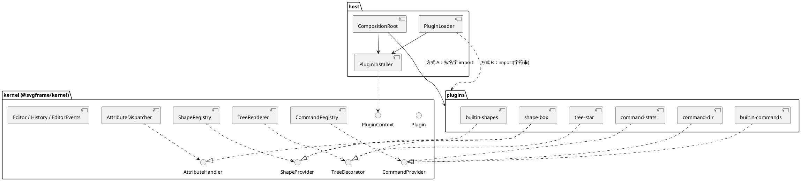

> **仓库副本说明**：本文件是 `Notes/Lab/Lab1-Phase2-作业分析.md` 的逐字副本，只在开头加了这一段引用块，正文未改。正文中提到的路径与仓库内路径的对应关系：
>
> - `Lab/pj1-phase2/phase_cli_2.md`（规格）→ `doc/spec/phase_cli_2.md`
> - `Notes/Lab/Lab1-Phase2-作业分析.md`（即“分析”）→ `doc/spec/phase2-analysis.md`
> - `Lab/phase_cli_1.md` → `doc/spec/phase_cli_1.md`（仓库里已有，内容相同）

# Lab1 Phase 2 · 插件实践与插件式重构 作业分析

> 原文：`Lab/pj1-phase2/phase_cli_2.md`（另附两张截图 `docs/images/vscode-svg-*.jpg`）｜前置：`Lab/phase_cli_1.md`、仓库 `Project/svg_editor` 的 tag `final`（`7311723`，889 个测试）
> 标记：⚠️ 表示规格自身的不一致或坑；💡 表示分析补充的建议；🔧 表示规格没有写、需要自己决定并写进 README/ADR 的点。
> 本文第 3 节直接对照了 `final` 的源码，所以“差距”一节说的是**你这个仓库**要改什么，不是泛泛而谈。

---

## 0. 一句话概括

**第一部分是热身：用 VSCode 扩展 API 写一个文件标记和一个大纲，再分析它和 Decorator / Adapter 的关系。第二部分是正题：把 Phase 1 的 CLI 重构成“稳定内核 + 四个扩展点 + 插件”，并用 `git diff` 证明后来接入的 `box`、`stats`、`dir` 和树标签**没有改动内核**。**

整个阶段最要紧的约束是第 4、5、6 节的差异判据：**接入 `box`（以及树标签）的那次提交，内核和既有插件的差异必须为 0。** 这意味着框架在 `box` 出现之前就得把 `box` 需要的东西全部准备好：容器抽象、读回分派、属性处理器、树标签钩子、子部件保护钩子、事件通知。所以正确的工作顺序是**以终为始**：先在一个丢弃分支里把 `box`、`stats`、`dir`、`modified-star` 都草拟一遍，找出内核缺什么，把这些缺口补进“框架可扩展”那次提交，然后再把各个插件作为干净的提交逐个接入（见 §9）。

---

## 1. 交付物清单

| 交付物 | 硬性要求 | 容易丢分的地方 |
|---|---|---|
| 仓库 / tag | 同一个远程仓库继续开发，收尾提交打 **`p2`**；**已打的 `final` 不能移动** | 重打 `final`、`git push --force` 覆盖历史；忘记 `git push origin p2` |
| 过程节点 | 6 个普通 commit（**不打 tag**）：VSCode 实践 → 框架可扩展 → 命令插件 → `box` 接入 → 标签完成 → 收尾 | 节点不容易找到。💡 commit message 统一加前缀，例如 `milestone(2/6): …` |
| VSCode 扩展 | 源码、安装/启动步骤、示例 SVG、**两张截图**（标记、大纲定位）、异常输入的验证证据 | 截图只能在你的 Mac 上截，我的沙箱跑不了 VSCode GUI |
| `doc/README.md` | ① 扩展点清单（逐项给出**文件名 + 函数名**）② 两种装配方式与配置格式 ③ 重构**前后**的模块依赖图（PlantUML）④ ADR ⑤ `dir` 的适配器说明 ⑥ A.3 的三项分析 | 扩展点清单写得笼统。规格原话是“**无法据此核验的条目按未交付计**” |
| `docs/metrics/` | 文件清单与职责；行数按 **内核 / 装配处 / 插件** 三类拆分；`final`→`p2` 的**圈复杂度增量**；**由提交到仓库的脚本从 git 历史生成** | 手填数字；VSCode 扩展混进 CLI 指标；把 `node_modules` 和构建产物算进去 |
| ADR | 至少 3 条，候选：属性扩展点契约、读回降级、dirty 语义与祖先传播、配置清单校验时机 | 只写结论。ADR 要有背景、备选方案、决定、后果 |
| 测试 | 每个插件能独立测试；`dir` 有测试替身测试**和**真实文件系统（临时目录）测试；加载器的 **4 条失败路径 + 重复注册 + 回滚**各有测试；`modified-star` 状态机测试；双装配输出逐字节比对 | 插件测试依赖了其他插件；`dir` 只做了真实文件系统测试 |
| 会话文件 | `doc/transcript/cli-1.txt` 等：**只含命令与注释**，不含 `svg>` 和输出；期望输出和 SVG 夹具单独存放 | 直接复用 Phase 1 的 `tests/transcripts/*.txt`。那里的格式是带 `svg> ` 前缀的输入和输出交错存放，不符合要求 |

⚠️ 目录名不统一：规格同时用了 `doc/`（`doc/README.md`、`doc/transcript/`）和 `docs/`（`docs/metrics/`、`docs/images/`）。**照原文逐字建两个目录**，并在 README 里说明一句，不要擅自合并。

---

## 2. 范围速览

### 2.1 第一部分：VSCode

| 项 | 要做什么 | 关键 API（💡） |
|---|---|---|
| A.1 SVG 文件标记 | Explorer 里 `.svg` **文件**旁显示 `[]`；非 SVG 和目录不显示；不改文件 | `window.registerFileDecorationProvider`，返回 `new FileDecoration('[]', tooltip)` |
| A.2 SVG 大纲 | 原生 Outline 显示 `标签名#id` 的层级；点击定位；编辑后更新；XML 不完整时可以清空但**不能崩溃** | `languages.registerDocumentSymbolProvider`，返回 `DocumentSymbol[]` |
| A.3 分析 | 宿主与插件的职责和注册/回调过程；文件装饰与 Decorator、Adapter 的对应和差异；Phase 1 代码复用评估 | 见 §6.3 |

### 2.2 第二部分：CLI

| 节 | 内容 | 本质考点 |
|---|---|---|
| §1 | 四个扩展点：`ShapeProvider` / `Command` / `TreeDecorator` / `AttributeHandler` | OCP、DIP：接口放在内核一侧 |
| §2 | 命令插件 `stats`、`dir`（`dir` 必须用**适配器**访问文件系统） | Command、Adapter、测试替身 |
| §3 | 补全 `AttributeHandler` 的接口和契约：访问目标、冲突规则、**一次 `set` = 一个 undo 单元**、失败回滚 | 契约设计 + 事务（Memento） |
| §4 | `box` 图形插件，**内核改动为 0** | Composite + 插件式类型扩展 |
| §5 | 树标签 `modified-star` 和 `(box)` 并存，渲染器和内核差异为 0 | Decorator（或 Chain）、Observer |
| §6 | 同一个插件能用**代码装配（A）**和**配置装配（B）**两种方式装入；加载器有 4 类失败、重复注册、回滚 | 组合根、插件加载器、事务式注册 |

---

## 3. 现状差距：对照 `final` 的源码

好消息是 Phase 1 已经为插件化留了不少“伏笔”。坏消息是有几处结构性的耦合，必须在“框架可扩展”这一步解决，否则 `box` 的那次提交不可能做到内核零差异。

| 位置（`final`） | 现状 | Phase 2 要怎么改 |
|---|---|---|
| `model/ShapeFactory.ts` 构造函数 | 硬编码 `register(Rect)…register(Group)`，标注为“待重构 ①” | 只保留注册表；六种内置图形由**内置插件**通过 `ctx.shapes.register(...)` 装入 |
| `commands/CommandRegistry.ts` 构造函数 | 硬编码 19 条命令，标注为“待重构 ②” | 同上，由内置命令插件注册。`lookup` 已经输出 `unknown command: <name>`，正好满足 §2.3 |
| `model/ShapeType.ts`（静态侧：`typeName`/`params`/`create`） | 已经接近 `ShapeProvider` 的雏形 | 把静态侧升级为**实例化的** `ShapeProvider`，补上：读回匹配、创建回显、派生子部件 id 等方法（§5.1） |
| `io/SvgImporter.ts:147` | `factory.typeNames().includes(tag)`：**按标签名**分派 | `<g data-kind="box">` 和 `<g>` 的标签都是 `g`，所以要改成“问各个 provider 能不能读这个元素”，**更具体的匹配优先**（§5.1） |
| `io/SvgSerializer.ts` | 只用到 `tagName()`、`svgAttributes()`、`textContent()`、`asContainer()` | ✅ 不用改：box 在 `svgAttributes()` 里输出 `data-kind="box"` 就行 |
| `commands/GroupCommand.ts:85` `new Group(...)`；`EditCommand.findContainer(): Group`；`Shape.asContainer()` 的返回类型也是 `Group` | 内核命令和 Shape 协议都**直接依赖 `g` 这个具体类** | 内核持有抽象的 `ContainerShape`；`group` 命令通过注册表创建 `g`。否则 `g` 变成插件以后，内核就反向依赖插件了 |
| `model/Shape.ts:33` `label()` = `${tagName()}#${id}` | 树和回显共用同一个 label | ⚠️ `box` 的回显是 `box#n2 moved by`，树却显示 `g#n1 (box)`，**需要把这两个 label 拆开**（见 ⚠️2） |
| `commands/SetCommand.ts` | 白名单在模型里（`setAttribute`），用快照做试应用 | 在调用 `setAttribute` 之前插入“处理器查询”。✅ 现有的 `ShapeMemento` **覆盖整棵子树的属性**，正好可以作为处理器修改子部件时的事务基础 |
| `commands/History.ts` | 没有 dirty 概念，也没有事件 | 内核要加**事件通知**（已保存、已载入、已执行、已撤销、已重做），否则 `modified-star` 无法在零内核差异的前提下接入 |
| `view/TreeRenderer.ts` | 内容全靠多态的 `label()`/`summary()`，列宽 = 最宽 + 2，没有 summary 的行不补空格 | ✅ 遍历不用改。在 `align` 之后给每行追加标签即可；**无标签时必须逐字节不变**（不能多出尾随空格） |
| `model/Group.ts:60` `canUngroup()` | ✅ Phase 1 已经预留 | `box` 覆写为 `false`。另外要**新增**“能否移走某个子节点”的钩子（`delete`/`addto`/`group` 移走必要子部件时用，§5.4） |
| `commands/HelpCommand.ts` | 读取 `commandTypes()` 的 `usage`/`summary`，按类别分组 | ✅ 基本可以直接用，插件命令只要提供 `usage`/`summary`/类别 |
| `tests/unit/architecture.test.ts` | D1–D8、P1–P5 依赖规则 | 新增规则：内核不 import 插件和装配处；插件只 import 内核的公开 API；加载器里不能出现插件名 |
| 全部 `src/*` | 没有“内核 / 装配处 / 插件”的目录边界 | 必须**按目录划清**，否则 `git diff C^ C -- <内核目录>` 这条判据根本没法执行（§4） |

---

## 4. 推荐目标架构

### 4.1 目录（三类边界直接对应 metrics 的统计口径）

```text
packages/kernel/            ← 内核（@svgframe/kernel）：领域抽象 + 扩展点接口 + 注册表 + 命令框架 + History + 渲染器 + io 协议
  src/model/  src/commands/  src/io/  src/view/
  src/extension/            ShapeProvider, CommandProvider, TreeDecorator, AttributeHandler,
                            Plugin, PluginContext, PluginManifest, EditorEvents …
  src/api.ts                公开 API（package.json "exports" 只暴露这一个入口）
src/host/                   ← 装配处：CompositionRoot（方式 A）、PluginLoader + ConfigReader（方式 B）、
                              PluginInstaller（暂存/校验/提交）、cli/main.ts、Repl、NodeFileSystem
plugins/
  builtin-shapes/           rect circle ellipse line text g 的 provider（六个图形）
  builtin-commands/         Phase 1 的 19 条命令
  command-stats/            @svgframe/plugin-command-stats
  command-dir/              @svgframe/plugin-command-dir（DirCommand + DirectoryLister + NodeDirectoryLister）
  shape-box/                @svgframe/plugin-shape-box（BoxProvider + BoxAttributeHandler + BoxTypeLabel）
  tree-star/                @svgframe/plugin-tree-star
plugins.config.json         ← 方式 B 的配置（仓库根目录）
vscode-svg/                 ← VSCode 扩展（独立的 package.json，单独统计指标）
docs/metrics/  doc/README.md  doc/transcript/
```

💡 **用 npm workspaces 加 `exports` 来强制执行“插件不得依赖内核内部实现”**：内核做成 workspace 包，`"exports": { ".": "./src/api.ts" }`；插件只能写 `import … from "@svgframe/kernel"`，深层路径会被 Node 的解析规则直接拒绝。这比 architecture test 的扫描更硬，也正好解决了 §6 “包名按运行环境的模块解析规则解析”这一条：workspace 会把 `@svgframe/plugin-shape-box` 软链接进 `node_modules`。要注意的是，`api.ts` 这种汇总导出文件和 Phase 1 的“一类一文件”约定有张力，需要在 README 里说明它是**接口文件**，不是类。

> 如果嫌搬目录的成本太高，最低限度是 `src/kernel/`、`src/host/`、`plugins/` 三个顶层目录，再加一条 architecture test。但这样就失去了 `exports` 的硬隔离。

### 4.2 依赖规则

| 规则 | 理由 |
|---|---|
| `kernel` 不依赖 `host`、`plugins` 中的任何东西 | DIP：扩展点接口在内核一侧 |
| `plugins/*` 只依赖 `@svgframe/kernel` 的公开 API 和 Node 内置模块；**插件之间不互相依赖** | §1 判据；§4 要求“插件测试不依赖其他插件” |
| `host` 依赖 `kernel`；**只有** `CompositionRoot` 可以按名字 import 具体插件 | 方式 A 只改这一个文件 |
| `host/PluginLoader` 不 import 任何插件，不含插件名、映射表或 `switch` | §6 加载器独立性 |

### 4.3 PlantUML 骨架（重构后）



README 还要求一张**重构前**的依赖图。Phase 1 的 `doc/diagrams` 里已经有了，直接引用，并在旁边标出两处“待重构”是怎样消失的。

---

## 5. 各扩展点的设计要点

### 5.1 `ShapeProvider`

Phase 1 的 `ShapeType` 只负责“创建”。Phase 2 要覆盖 `box` 的全部需求，接口至少需要以下几项：

```ts
export interface ShapeProvider {
  readonly typeName: string;                       // "rect" / "box"：create 的类型名，也是注册名
  readonly params: readonly ParamSpec[];           // create 参数表（box: x y w h label）
  create(id: string, values: ReadonlyMap<string, string>, ctx: ShapeBuildContext): Shape;
  /** 新子树会占用的全部 id（box: n1, n1-rect, n1-label），供 create 一次性查重 */
  claimedIds(id: string): readonly string[];
  /** 读回：能否读这个元素；返回值越大越具体（data-kind 匹配 > 只匹配标签名） */
  matchScore(element: XmlElementView): number;
  read(element: XmlElementView, ctx: ShapeReadContext): Shape;   // 不完整时抛错或返回降级结果，见 ADR
  createdMessage(shape: Shape): string;            // box#n1 created (g#n1 + rect#n1-rect + text#n1-label)
}
```

- **读回分派**：遍历所有 provider，取 `matchScore` 最大的那个；`g` 给 1 分，`box` 遇到 `data-kind="box"` 时给 2 分。**没装 box 插件时，自然由 `g` 的 provider 接手**，也就是规格要求的“降级为普通 `g`”。这样写不需要任何 `if (dataKind === 'box')`。
- 💡 **box 需要的 rect/text 从哪里来？** 规格同时要求“现有图形都改为插件”和“插件测试不依赖其他插件”。如果 `BoxProvider` 去 `import { Rect } from "plugins/builtin-shapes"`，就违反了插件之间不互相依赖的规则。推荐的做法是：**box 通过 `ctx.shapes.create("rect", …)` 由注册表构造子部件**，只依赖内核的 `Shape` 抽象；测试时用替身上下文提供假的 rect/text。代价是存在运行时依赖（没有 rect 就造不出 box），所以 🔧 要在 manifest 或 `activate` 里声明并检查（例如 `requires: ["rect","text"]`，缺少时以 `plugin failed to activate` 拒绝）。
- 同理，`ContainerShape`（子节点管理、Composite 行为）必须是**内核的抽象类**。`g` 和 `box` 都继承它，box 不能继承 `g` 插件里的 `Group`。

### 5.2 `Command`

- 静态侧现在已经有 `commandName`/`usage`/`summary`/`parse`/类别，可以直接变成一个 `CommandProvider` 对象注册。
- 💡 Phase 1 的 `Editor.executeLine` 是**同步**的。`dir` 如果用 `fs.promises`，命令接口就得改成 async，这是一次内核改动。必须在“框架”这一步就决定好：**要么命令接口一开始就支持 async，要么 `dir` 的适配器用 `readdirSync`**。我推荐后者，因为改动最小，而且读一个目录的耗时可以忽略。
- 命令的“文档类 / 编辑类 / 显示类”分类决定了它和 History 的交互。`stats`、`dir` 都属于显示类（不进 undo 栈，不解除 io 锁，**也不触发 io 锁**），而 `dir` 还要声明 `requiresDocument = false`（Phase 1 的 `HelpCommand` 已经有这个静态字段）。

### 5.3 `AttributeHandler`：完善接口与契约（§3，ADR 必写）

规格给出的初始接口 `handles(shapeId, attr)` / `apply(shapeId, attr, value)` 有三个问题：只拿到一个 id 却无法访问文档；不能表达冲突规则；拿不到回显和撤销时的消息。推荐改成：

```ts
export interface AttributeHandler {
  readonly name: string;                 // 稳定注册名，对应 contributes.attributes，如 "box-attributes"
  readonly priority: number;             // 冲突规则用
  handles(target: ShapeView, attr: string): boolean;          // 纯查询，不改状态
  apply(target: EditableSubtree, attr: string, value: string): AttributeChange;
}
export interface AttributeChange {        // 由处理器提供文案
  appliedMessage(): string;               // box#n2 label updated: "处理数据 v2"
  undoneMessage(): string;                // box#n2 label restored: "处理数据"
}
```

| 契约问题 | 推荐决定 | 理由 / 实现 |
|---|---|---|
| 如何访问目标 | 内核先按 id 定位，**把目标子树以受限视图传进去**（可以读类型和子部件，可以改属性，**不能改结构**） | 处理器的作用范围限定为目标子树，内核据此就能确定快照范围 |
| 判断类型 | `target.kind() === "box"` 或者 `target instanceof`（instanceof 需要 import box 类，**只在 box 插件内部**使用是允许的） | 处理器和图形同属一个插件包 |
| 多个处理器命中 | **按 `priority` 取最高的一个；最高优先级上出现并列就报错** `error: ambiguous attribute handler: <attr> on <id> (a, b)`，不执行任何修改 | 杜绝“未定义的覆盖”；“组合执行”方案语义不清，而且回显不好写 |
| 一次 `set` = 一个 undo 单元 | `SetCommand` 在调用处理器之前对**目标子树**做 `snapshot()`，成功后再 snapshot 一次。undo/redo 就是恢复这两个快照 | ✅ `final` 的 `ShapeMemento` 已经递归覆盖子孙节点的属性 |
| 部分修改后抛错 | `try { apply } catch { restore(before); 不 record; 输出 error }`。**不回退到默认白名单**（规格明令禁止） | History 只在成功后 `record`，所以失败时历史天然不变 |
| 无处理器命中 | 回到 Phase 1 的 `shape.setAttribute`（白名单），未定义的属性报 `unknown attribute` | 即“缺省行为” |

⚠️ 坑：`Group.restore` 在子节点数量不一致时会 `throw new Error(...)`（`Group.ts:77`）。如果处理器违约改了结构，回滚本身就会炸。所以“处理器不得改结构”必须**靠 API 形状来保证**（受限视图不暴露 `insert`/`remove`），不能只写在注释里。

验收用例：`set n1 fill #f5a623` 改的是 `n1-rect`；`set n1 label "处理数据 v2"` 改的是 `n1-label`；两条命令各自一次 undo、一次 redo；`set r1 fill red`、`set r1 label x`（→ unknown attribute）；两个并列处理器（→ ambiguous）；一个改了一半就抛错的假处理器（→ 文档、undo 深度、redo 深度都与执行前相同）。

### 5.4 `box` 图形插件（§4）

| 要点 | 推荐 |
|---|---|
| 结构 | `Box extends ContainerShape`；`tagName() = "g"`；`kind() = "box"`；`svgAttributes()` 额外输出 `data-kind="box"`；`canUngroup() = false` |
| 创建 | `create box n1 120 100 160 60 "开始"`。🔧 规格只给了一组样例：`n1-rect` 的 fill 是 `#4a90d9`，标签位于 $(x+20,\ y+h/2+5)$ = (140,135)。这是**唯一一组数据点**，公式必须自己定下来并写进 ADR（如 $(x + w/8,\ y + h/2 + 5)$ 也能拟合同一个点） |
| id 查重 | 用 `claimedIds("n1")` 把 `n1`、`n1-rect`、`n1-label` **一次性**查重，冲突时报 `error: id already exists: n1-rect`，什么都不留下。派生出来的 id 也要满足 `IdSyntax` |
| 嵌套 / `in` | box 可以作为 `in` 的目标（`findContainer` 要认 `ContainerShape`，不再只认 `g`），也可以被 `group` 收编 |
| 必要子部件保护 | `delete n1-rect`、`addto other n1-label`、`group x n1-rect`（会把它移出 box）都要**拒绝**。内核在 `ContainerShape` 上提供 `canRelease(child): boolean`，box 对两个必要子部件返回 false。🔧 报错文案自己定，例如 `error: cannot detach required part of composite shape: n1-rect` |
| 读回 | 装了插件、但缺子部件或子部件类型不对时：🔧 **拒绝整个读入**，或者**警告并降级为 `g`**（ADR 二选一；我倾向于降级加警告，与“未装插件时降级”保持一致）。**重复 id 必须拒绝整个读入**。读入失败时保持原文档不变（`final` 的 read 本来就是原子的） |
| 读回细节 | 🔧 子部件的识别方式：按派生 id（`n1-rect`）还是按位置（第一个 rect、第一个 text）？如果子部件没有 id 而被 `IdAllocator` 自动分配成 `rect1`，还算不算合法的 box？额外的子节点（嵌套的 box）是否允许？ |

§6.1 版本 B 的会话要能“完整复现”。⚠️ 但规格原文那棵树的对齐方式与 Phase 1 实现的 V1 规则（列宽 = 最宽 + 2）不一致：原文是 2/1/7 个空格，按规则算应该是 3/2/8。**Phase 2 §5 的示例树恰好是 3/2/8**，与你的实现一致。所以版本 B 的期望输出沿用 Phase 1 的 V1 偏差，在 transcript 的 README 里注明即可。

### 5.5 `TreeDecorator`（§5）

```ts
export interface TreeDecorator {
  readonly name: string;                                   // "modified-star" / "box-type-label"
  decorate(line: TreeLineView): string | null;             // null 表示不加标签
}
```

- `TreeLineView` 必须**同时覆盖根行** `svg (800x600)`（示例里根行也带 `*`）和图形行。
- 渲染器在 `align()` 之后按**注册顺序**拼接：`行 + " " + 标签1 + " " + 标签2`。没有任何标签时原样输出，保证 Phase 1 的基线逐字节不变。
- 💡 和 GoF Decorator 的关系值得在 A.3 和 README 里一起讨论：这里的“装饰器”其实是一个**由宿主聚合的贡献者列表**，不是层层包装的对象。如果想做成正宗的 Decorator，也可以设计成 `LineFormatter` 接口，每个标签包装上一层。那样“拼接顺序”就是“包装顺序”。两种写法都能满足“渲染器零改动”，选哪种要在 ADR 里说明。

**`modified-star` 的推荐设计**（三处取舍写进 ADR）：

| 取舍 | 推荐 | 理由 |
|---|---|---|
| dirty 判定 | **内容与上次保存不一致**：保存或载入时记录每个 id 的指纹（标签名 + 自身属性 + 文本 + 父 id + 兄弟序号），渲染时比对；根行比对整份序列化结果 | `undo` 回到保存点时 `*` 自然消失；只需要“已保存/已载入”两个事件，不需要命令上报改了哪些 id |
| 祖先传播 | **不传播**：只标改动的节点本身和根行 | 与 §5 示例一致（`n1-rect` 有 `*`，`g#n1` 没有，根有）；删除节点导致的变化由根行体现 |
| 拼接顺序 | 注册顺序（配置数组顺序或组合根里的顺序），所以是 `g#n1 (box) *` | 两种装配顺序相同，才能保证输出逐字节一致 |
| 新建节点 | 立即标 `*`（保存快照里没有这个 id） | 规格要求必须说明 |
| `init` 之后 | 🔧 没有保存点，全部视为新节点，根行也标 `*` | 保持一致性 |

状态（快照 Map）放在 `TreeStar` **实例的字段**里，**不用模块级变量**；事件由内核的 `EditorEvents`（Observer）推送。⚠️ 这个事件接口必须在“框架”那一步就存在，否则接入 `tree-star` 时就得改内核。

状态机测试：编辑 → 有 `*`；保存 → 没有 `*`；再编辑 → 有 `*`；`undo` 回到保存点 → 没有 `*`；`redo` → 有 `*`；`read` 之后 → 没有 `*`；新建节点 → 有 `*`。

### 5.6 `stats` 与 `dir`（§2）

| 命令 | 细节 / 🔧 |
|---|---|
| `stats` | 深度优先、子节点顺序、类型按**首次出现**排序；`g` 和 `box` 只计入 containers（判断依据是 `asContainer() !== null`，**不要按名字判断**）；box 内部的 rect/text 照常计数。输出格式 `rect: 3  circle: 1  text: 2  (total 6, containers 2)`，各段用两个空格分隔；空文档输出 `(total 0, containers 0)`。🔧 没有文档时：我建议 `requiresDocument = true`，报 Phase 1 的 `no document` 错误 |
| `dir` | 不接受参数（🔧 多给了参数报什么错，可以沿用 `ArgList.expectCount` 现有的报错）；目录在前、文件在后；🔧 **排序用码元比较**（`a < b ? -1 : …`），**不要用 `localeCompare`**，因为后者依赖 locale，换一台机器输出就可能不同，破坏“逐字节一致”；包含隐藏项；🔧 符号链接：建议用 `lstat` 识别后单独标为 `[LINK]` 并排在文件之后，或者“跟随一层 stat 再按目标归类、断链按 FILE”，二选一写进文档；🔧 错误信息里的 `<path>` 用绝对路径还是 `.`？ |

**`dir` 的适配器角色对照**（README 必写）：

| Adapter 角色 | 本作业中的对应 |
|---|---|
| Client | `DirCommand` |
| Target（目标接口） | `DirectoryLister`：`list(path): DirectoryEntry[]`，`DirectoryEntry` 有 `name` 和 `kind: dir/file/link` |
| Adaptee（被适配者） | Node 的 `fs.readdirSync(path, { withFileTypes: true })` 和 `Dirent` |
| Adapter（适配器） | `NodeDirectoryLister implements DirectoryLister` |
| 测试替身 | `FakeDirectoryLister`（内存列表 / 抛错） |

再加一个 `WorkingDirectory` 端口（适配 `process.cwd()`），测试里就不需要真的 `chdir`。两种装配方式要使用“同一个命令实现和同一个目录访问接口”：插件的默认导出在内部 `new DirPlugin(new NodeDirectoryLister())`，测试再通过构造参数注入替身。

### 5.7 插件加载器与两种装配（§6）

推荐的统一路径（A 和 B 都走这一条）：

```text
PluginInstaller.install(plugin, manifest, options)
  1. ctx = 暂存上下文 StagingContext（注册先进暂存区，不进正式注册表）
  2. try plugin.activate(ctx, options)    → 失败：error: plugin failed to activate: <name> (<reason>)
  3. 暂存区和已提交区、以及暂存区内部查重 → 重复：error: duplicate registration: <category>/<name>
  4. 比对 manifest.contributes 与暂存区   → 不一致：error: plugin manifest mismatch: <name> (declared: …, registered: …)
  5. 全部通过 → 提交；任何一步失败 → 丢弃暂存区（回滚），继续加载下一个插件
```

方式 A 的组合根写成 `installer.install(new ShapeBoxPlugin(), boxManifest)`。规格示例里的 `shapeBox.activate(ctx)` **只是示意**，按“加载契约”不能绕过第 3、4 步。方式 A 的 manifest 可以由组合根 `import … from "@svgframe/plugin-shape-box/package.json" with { type: "json" }` 读入，与方式 B 共用同一份 `contributes` 数据。

| 加载器细节 | 要点 |
|---|---|
| 区分“找不到”和“求值失败” | ⚠️ 两种情况都可能抛 `ERR_MODULE_NOT_FOUND`（插件自身的依赖缺失时也是）。应**先解析再导入**：相对路径基于配置文件所在目录 + `fs.existsSync`；包名用 `createRequire(configPath).resolve()`（注意：这走的是 CJS 条件，插件包的 `exports` 要提供 `default` 条件）。解析失败才算 `plugin not found`，导入阶段的任何失败都算加载失败 |
| 求值失败的文案 | ⚠️ 规格表里**没有给格式**。🔧 例如 `error: plugin failed to load: <module> (<reason>)`，在 README 里说明 |
| 默认导出 | 🔧 默认导出是**类**（由加载器 `new`，options 通过构造参数传入）还是**实例**（options 通过 `activate(ctx, options)` 传入）？规格两者都允许，但要说明 options 怎样传递 |
| `<name>` | 优先用 `package.json` 的 `name`；“找不到”和“无默认导出”两种情况拿不到 name，用 `<module>` |
| 失败顺序 | 🔧 一个插件同时违反多条时，只报第一条（按上面 1→5 的顺序） |
| 配置非法 | JSON 语法错误、不是 `{plugins: [...]}`、某一项缺少 `module` → `error: invalid plugin config`，然后只用内置能力启动。🔧 `--config` 指向的文件不存在算哪一类？ |
| 输出流 | 🔧 stdout 还是 stderr？Phase 1 的 `error:` 写到 stdout，但内部错误写到 stderr、退出码为 1（见 C1–C15）。建议加载错误也写 stdout，保持“`error:` 前缀一行一条”的约定 |
| 内置能力 | 内置图形和命令**总是由代码装配**（“禁用任何插件框架仍能启动”），配置只追加可选插件 |
| 基线对照 | 🔧 方式 A 也需要一种“只装内置”的启动方式（例如 `--bare` 参数，或者组合根导出多套 profile）。否则无法用方式 A 对照 `final` 的输出（树标签会让 `tree` 多出 `*`） |
| `activate` 的副作用 | 契约里要写明：`activate` 只能通过 `ctx` 注册，不能有模块级副作用，否则回滚不干净 |

---

## 6. 第一部分：VSCode 扩展

### 6.1 实现要点

- **工程**：放在仓库的 `vscode-svg/` 目录，使用独立的 `package.json`。💡 Phase 1 是 `"type": "module"` 加 TS 7，而 VSCode 扩展最稳妥的做法是用 esbuild 打包成 **CJS** 的 `dist/extension.js`，不要和 CLI 共用构建配置。
- **激活**：`activationEvents` 设为 `onStartupFinished`（Explorer 标记需要尽早激活）和 `onLanguage:xml`。⚠️ VSCode 把 `.svg` 识别为 **XML** 语言（截图右下角显示的就是 `XML`），所以选择器写 `{ language: "xml", pattern: "**/*.svg" }`，不要写成不存在的 `svg` 语言。
- **A.1**：`FileDecoration.badge` **只能有 1–2 个字符**，`[]` 正好卡在上限，以后不要改成 `[svg]`。判断条件是扩展名 `.svg`（🔧 `.SVG` 大小写算不算？），**并且** `workspace.fs.stat(uri).type` 是文件。⚠️ 一个名叫 `icons.svg` 的**目录**不能加标记，光看文件名不够。另外，截图里编辑器标签页上也出现了 `[]`，这是 VSCode 的默认行为，不用处理。
- **A.2**：返回 `DocumentSymbol(name, detail, kind, range, selectionRange)`。`range` 是整个元素（从起始标签到闭合标签），`selectionRange` 是起始标签，**必须包含在 `range` 之内**，否则 VSCode 会报错。偏移量转换为位置用 `document.positionAt(offset)`。
- **解析器的选择**：大纲需要**每个元素的起止偏移**。⚠️ Phase 1 用的 `@xmldom/xmldom` 只提供起始行列，**没有结束位置**，所以不够用。可以选择：手写一个面向对象的小型分词器（同时处理注释、CDATA、`<?xml?>`、DOCTYPE、实体），或者用能报告位置的 SAX 解析器（如 `saxes`，严格模式出错就抛异常，正好映射为“清空大纲”）。
- **不完整 XML**：`provideDocumentSymbols` 内部 `try/catch`，出错时返回 `[]`。**绝不能让异常冒泡到宿主**。
- **先观察原生大纲**（规格要求）：打开一个 Markdown 或 JSON 文件，观察层级、点击跳转、光标跟随、编辑后的刷新（VSCode 在内容变化后会带防抖地重新请求 provider）。⚠️ 如果你装了 Red Hat 的 XML 扩展，它本身就会给 `.svg` 提供大纲，会和你的结果重复。录屏和截图时要禁用它，并在文档里说明。
- **测试**：把“文本 → 大纲节点树”写成**不依赖 vscode 的纯类**，用 vitest 覆盖嵌套分组、无 id、不完整 XML；“编辑后更新”用 `@vscode/test-electron` 做集成测试（打开文档 → `vscode.executeDocumentSymbolProvider` → `WorkspaceEdit` → 再查一次）。集成测试只能在你的 Mac 上跑。

### 6.2 截图要点

对照规格截图：图 A.1 中 `example.svg` 有 `[]`，`plain.txt` 和 `.vscode` 没有；图 A.2 中大纲为 `svg › g#flow › rect#start`、`g#nested › text`，点击 `rect#start` 后选中第 3 行。建议再补两张：一个名为 `x.svg` 的目录（没有标记），以及编辑到一半的 XML（大纲为空，扩展没有报错）。

### 6.3 A.3 分析的写法提纲

**① 宿主与插件的职责、注册与回调。** VSCode 负责 UI、Explorer 和 Outline 的渲染、扩展的生命周期（按激活事件懒加载）、扩展宿主进程，以及**合并多个 provider 的结果**。插件只按接口提供数据。过程是：`activate(context)` → `register…Provider(...)` 返回 `Disposable`，放进 `context.subscriptions` → VSCode 在需要渲染时**主动回调** `provideFileDecoration(uri)` 或 `provideDocumentSymbols(doc, token)`（控制反转，即“好莱坞原则”）。插件想主动通知刷新时，通过 `onDidChangeFileDecorations` 事件（Observer）。扩展运行在独立的 Extension Host 进程中，调用经过 RPC 代理。

**② 与 Decorator、Adapter 的对应和差异。**

| | GoF Decorator | VSCode 文件装饰 |
|---|---|---|
| 意图 | 不改原对象，动态附加职责 | ✅ 相同：文件名和内容都不变，只附加 `[]` |
| 接口 | 装饰器实现**与被装饰者相同的** Component 接口 | ❌ provider 实现的是 `FileDecorationProvider`，跟 Explorer 的条目接口无关 |
| 对象组合 | 装饰器**持有**被装饰者，转发调用后再追加 | ❌ provider 不持有、也不转发，只返回一份数据（badge/color/tooltip） |
| 多重装饰 | 递归包装，顺序由包装次序决定 | 由**宿主聚合**多个 provider 的结果，顺序由宿主决定 |
| 客户端视角 | 客户端感知不到装饰的存在 | Explorer 显式地查询所有 provider |

结论：文件装饰在**意图**上接近 Decorator，在**结构**上更接近“宿主聚合的 Strategy 列表 + Observer 刷新”。Adapter 则更贴切：`SvgOutlineProvider` 把自己的解析结果（或 XML 库的输出，即 Adaptee）转换成 VSCode 期望的 `DocumentSymbolProvider`/`DocumentSymbol`（Target）；偏移量到 `Range` 的转换就是典型的适配工作。差异在于经典 Adapter 是去包装一个**既有的、不兼容的**类，而这里被适配的那一端通常也是自己写的。（⚠️ 规格原文写作 “adaptor”。）建议把这一段和 CLI 的 `TreeDecorator`、`dir` 的 `NodeDirectoryLister` 并排讨论，两部分就能前后呼应。

**③ Phase 1 代码复用评估。**

| 模块 | 能否复用 | 原因 |
|---|---|---|
| `io/XmlDomAdapter` + `@xmldom/xmldom` | ❌ 基本不能 | 没有元素的结束位置；严格/宽松行为不适合“编辑中”的文本 |
| `io/SvgImporter` | ❌ | 会自动补 id 并打印警告、**跳过** `path`/`defs`/`use` 等不支持的元素、数值不合法时整体失败，而大纲需要**原样**反映源码 |
| `model/*`（Shape/Group） | ❌ | 只覆盖 6 种元素，也不带源码位置 |
| `view/TreeRenderer` 的遍历思路 | ⚠️ 思路可以复用 | 都是 Composite 的深度优先遍历，`asContainer()` 这种遍历协议可以借鉴；但输出是文本行，不是 `DocumentSymbol` |
| `model/IdSyntax` | ✅ 可以复用（如果要校验 id） | 纯函数式的值对象 |
| 工程层面 | ⚠️ | ESM + TS 7 的源码可以由 esbuild 打包进 CJS 扩展，技术上可行；真正的障碍是语义不匹配，而不是模块系统 |

💡 如果想做出更有说服力的复用，可以把“带源码区间的 XML 元素树”抽成一个共享包，Phase 1 的导入器和 VSCode 大纲都基于它。不过这会改动 CLI 的 io 层，要在第二部分的框架步骤里一并完成，并计入指标。

---

## 7. 规格没写、需要自己定的点 🔧（汇总）

| # | 决策点 | 我的建议 |
|---|---|---|
| D1 | 内核 / 装配处 / 插件的目录边界 | §4.1；用 workspaces + `exports` 强制 |
| D2 | 回显 label 与树 label 拆分 | `Shape.kind()` 默认等于 `tagName()`；回显用 `kind#id`，树用 `tagName#id` |
| D3 | box 标签位置公式、默认 fill | $(x+20,\ y+h/2+5)$，fill 为 `#4a90d9`，写进 ADR |
| D4 | `create box … in n1` 的回显 | `box#n3 created in box#n1 (g#n3 + …)`？或者沿用 Phase 1 的 `created in` 格式，二选一 |
| D5 | 移走 box 必要子部件时的报错文案 | §5.4 |
| D6 | box 读回不完整时：拒绝还是降级 | 警告 + 降级；重复 id 一律拒绝 |
| D7 | 子部件靠派生 id 识别还是靠位置识别；自动分配 id 的子部件算不算 | 靠派生 id，严格 |
| D8 | box 上 `stroke` 等其他属性 | 不加处理器，走 `g` 的白名单（设置在 `<g>` 上）；在 README 里注明这与 `fill` 语义不对称 |
| D9 | 处理器冲突规则 | 优先级取最高；最高处并列报 ambiguous |
| D10 | 处理器的 undo/redo 回显 | 由 `AttributeChange` 提供；`fill` 的 undo 文案自己定 |
| D11 | `stats` 在没有文档时 | 报 `no document` |
| D12 | `dir` 的排序、符号链接、错误路径、多余参数 | 码元排序、`[LINK]`、绝对路径、`expectCount(0)` |
| D13 | `stats`/`dir` 在 `help` 中的类别和位置 | 按注册顺序追加在对应类别的末尾 |
| D14 | 加载器的输出流、求值失败的文案、多重失败时的报告顺序 | §5.7 |
| D15 | 默认导出是类还是实例；options 怎样传递 | 导出类，`new Plugin(options)` |
| D16 | 方式 A 的“仅内置”启动方式 | `--bare` 或组合根 profile |
| D17 | dirty 语义、祖先传播、拼接顺序、新节点、`init` | §5.5 |
| D18 | 圈复杂度的计算口径 | 每个函数 $M = 1 + d$，其中 $d$ 是判定点个数（`if`、`for`、`while`、`case`、`catch`、`?:`、`&&`、`\|\|`、`??`）；按三类目录分别汇总，报告 $\Delta M = M_{\text{p2}} - M_{\text{final}}$ |

⚠️ 关于 D18：仓库装的是 **TypeScript 7.0.2**，`typescript` 包只导出 `./unstable/*`，**不再有 5.x 的 JS Compiler API**。metrics 脚本不要假设 `ts.createSourceFile` 还能用。可选方案：使用 `@babel/parser` 的 typescript 插件，或者为脚本单独装一个 `npm:typescript@5` 的别名依赖。动手前先验证。

---

## 8. 规格自身的不一致 / 坑 ⚠️

1. **`doc/` 和 `docs/` 并存**（§1）。照原文逐字建两个目录。
2. **box 的显示名前后不一致**：Phase 1 §6.1B 的回显是 `box#n2 moved by …`、`box#n1 created …`，树里却是 `g#n1 (box)`，而 `final` 里的 `label()` 两处共用 `tagName#id`。必须拆分（D2），否则不是回显错就是树错。
3. **§6.1B 的树对齐**与 V1 规则相差 1 个空格（原文 2/1/7，规则算出 3/2/8）；Phase 2 §5 的示例却是 3/2/8。沿用 Phase 1 的偏差记录。
4. **§6 失败表只有 4 类**，但正文又要求“模块求值失败不能误报为找不到”。这第 5 类没有给出格式（D14）。
5. **§3.3 的初始接口**只传 `shapeId`，处理器没法拿到文档。规格自己也承认“尚未明确”，所以必须重新设计（§5.3）。
6. **“现有图形都改为插件”与“插件之间不互相依赖”之间有张力**：box 需要 rect/text，`group` 命令需要 `g`。解法是通过注册表按类型名创建，并声明运行时依赖（§5.1）。
7. **Phase 1 §4.1 说 `in` 的目标“必须为 g 类型”**，而 Phase 2 要求 box 也能作为 `in` 的目标。Phase 2 开头又说“不修改 Phase 1 命令的行为”。应理解为“对 Phase 1 已有的输入行为不变”，`in box` 属于新输入。
8. **§6 方式 A 的示例 `shapeBox.activate(ctx)`** 直接激活插件，看上去绕过了校验；但“加载契约”要求 A、B 走同一条注册和校验路径。以契约为准。
9. **基线兼容要求“禁用新增插件（包括树标签）后对照 `final`”**，但方式 A 是写死在代码里的装配，没有现成的禁用手段（D16）。
10. **§2.3 要求“两种装配下对同一固定目录执行 `dir`，输出逐字节一致”**：日志文件不能写进被列的目录，临时目录的内容在测试过程中不能变化，而且两种方式的 cwd 必须相同。
11. **差异判据的空输出陷阱**（规格自己也提醒了）：`git diff C^ C -- 不存在的路径` 会返回空。💡 写一个 `scripts/check-plugin-diff.sh <C> <新插件目录>`，先断言每个路径在 `C^` 和 `C` 中都存在，再运行 diff，把输出贴进 README。

---

## 9. 建议的提交节奏（对应 6 个过程节点）

整体策略：**先 spike、后重放**。在丢弃分支 `spike/plugins` 上把 box、stats、dir、tree-star 都粗糙地写一遍，记下“内核缺什么”的清单，再把这份清单整体并入框架步骤。之后每个插件都在干净的主线上**重新**提交一次。

| 节点 | 内容 | 可并行吗 | 自检 |
|---|---|---|---|
| ① VSCode 实践 | `vscode-svg/`：标记、大纲、纯逻辑单测、集成测试、截图、A.3 草稿 | ✅ 与 ② 完全并行（目录不重叠） | 截图 4 张；不完整 XML 不崩溃 |
| ②a 搬目录 | `git mv` 到 kernel/host/plugins，行为零变化 | | 889 个测试全绿；`npm run cli < 会话` 与 `final` 逐字节一致 |
| ②b 两个注册表 + 内置插件 | ShapeProvider/CommandProvider；内置 6 种图形和 19 条命令走 `PluginInstaller`；读回按 `matchScore` 分派；`ContainerShape` 抽象 | | 两处“待重构”标注被删除；architecture test 增加“内核不按名字枚举” |
| ②c 其余两个扩展点 + 钩子 | AttributeHandler 管线（快照事务）、TreeDecorator 钩子、`EditorEvents`、`canRelease`、`kind()` | | 处理器契约测试（替身处理器：命中、并列、抛错） |
| ②d 加载器 | `PluginLoader`、`ConfigReader`、暂存与回滚、`plugins.config.json`、`--config` | | 4 条失败路径 + 重复注册 + 回滚的测试；加载器中搜不到插件名 |
| ②e metrics | `scripts/metrics.*` 第一次产出 `docs/metrics/` | | 数字可以由脚本复现 |
| ③ 命令插件 | `command-stats`、`command-dir`（两次提交，各自满足零差异） | stats ∥ dir | `dir` 的替身测试 + 临时目录测试；未加载时报 `unknown command` |
| ④ box | 主线上一次提交（方式 A：新增插件 + 只改 `CompositionRoot`）；从同一父提交拉一个演示分支（方式 B：同一插件包 + 只改配置）。之后在主线把配置也补上 | | `git diff C_A C_B -- plugins/shape-box` 为空；`check-plugin-diff.sh` 通过；§6.1B 复现 |
| ⑤ 标签 | `tree-star` 一次提交 | | 渲染器和内核差异为 0；状态机测试；`g#n1 (box) *` |
| ⑥ 收尾 | README（扩展点清单、ADR×≥3、前后依赖图、迭代报告）、`doc/transcript/` 三组会话、metrics 最终版、`git tag p2 && git push origin p2` | | 从全新 clone 跑一遍全部验证 |

💡 沿用 Phase 1 的协作方式（你指挥编码 agent，我负责评审），② 是风险最大的一步，建议拆成 ②a–②e 五个 PR，每个合并点都让我做一次模拟合并和回归检查。③④⑤ 是插件提交，评审时重点看 `git diff --name-status`。

---

## 10. 提交前自查清单

- [ ] `final` 没有被移动（`git rev-list -n1 final` 仍是 `7311723`），`p2` 已经推送
- [ ] 6 个过程节点的 commit 都能在 `git log` 中找到
- [ ] 扩展点清单的每一项都写了：接口名、职责、**调用位置（文件 + 函数）**、已有实现、禁用时的行为、违约时的报错
- [ ] 用 `check-plugin-diff.sh` 检查了 box 的 A/B 两次提交和 tree-star 的提交，并确认路径存在
- [ ] 不装任何新增插件时，三组会话中的基础会话输出与 `final` 逐字节相同
- [ ] 双装配的三组会话（基础、§6.1B、stats+dir）输出逐字节相同
- [ ] 加载器测试覆盖：not found、no default export、manifest mismatch、activate 抛错、duplicate、回滚后后续插件照常加载、invalid config、求值失败不误报为 not found
- [ ] `set` 的契约测试覆盖：命中、未命中、并列冲突、部分修改后抛错（文档、undo 深度、redo 深度都不变）
- [ ] box 的边界测试覆盖：派生 id 冲突、删除或移走必要子部件、读回缺部件、重复 id、未装插件时降级
- [ ] `modified-star` 状态机的各分支都有测试；状态不在模块级变量里
- [ ] `dir` 的测试覆盖：混合文件和子目录、空目录、隐藏项、读取失败、稳定排序、没有文档时可用、不改变 undo/redo 和 io 锁
- [ ] VSCode：4 张截图（标记、大纲定位、目录 `x.svg` 无标记、不完整 XML）；A.3 的三项分析
- [ ] metrics 由脚本生成，VSCode 扩展单独列出，排除 `node_modules` 和 `dist`
- [ ] ADR ≥ 3 条，每条都有背景、备选方案、决定、后果
- [ ] 过程记录写明了对 AI 建议的检查与修正（沿用 Phase 1 的格式）
