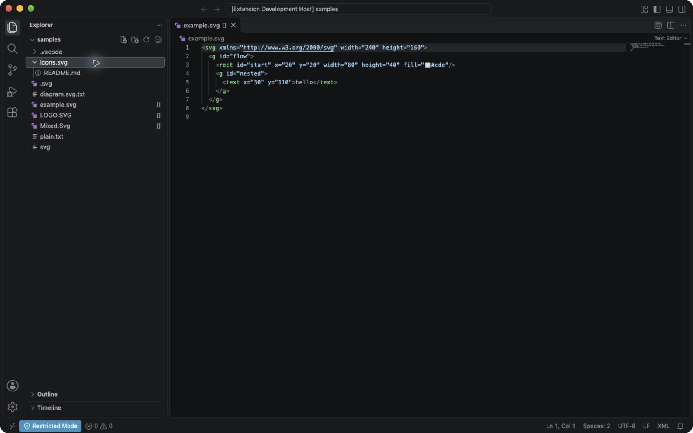
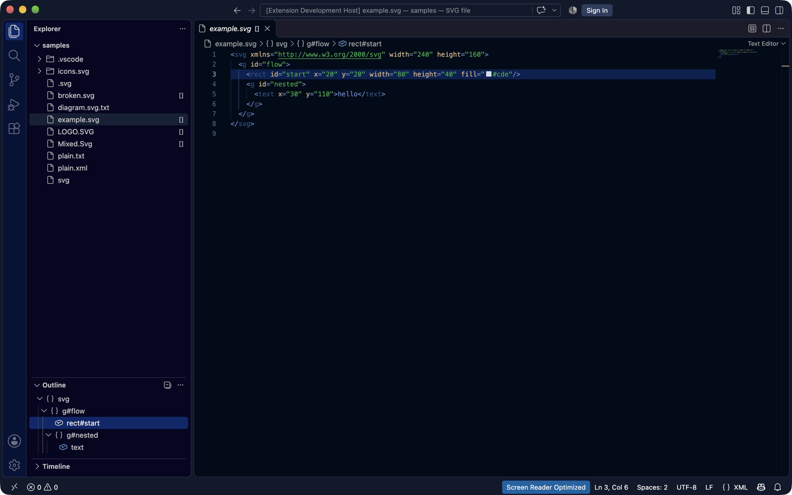
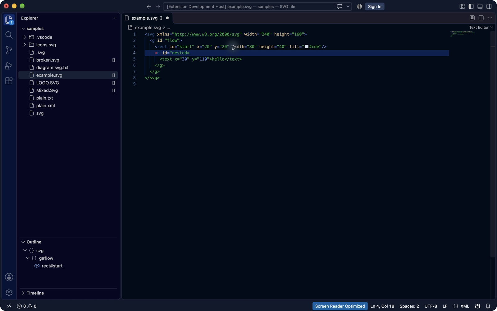
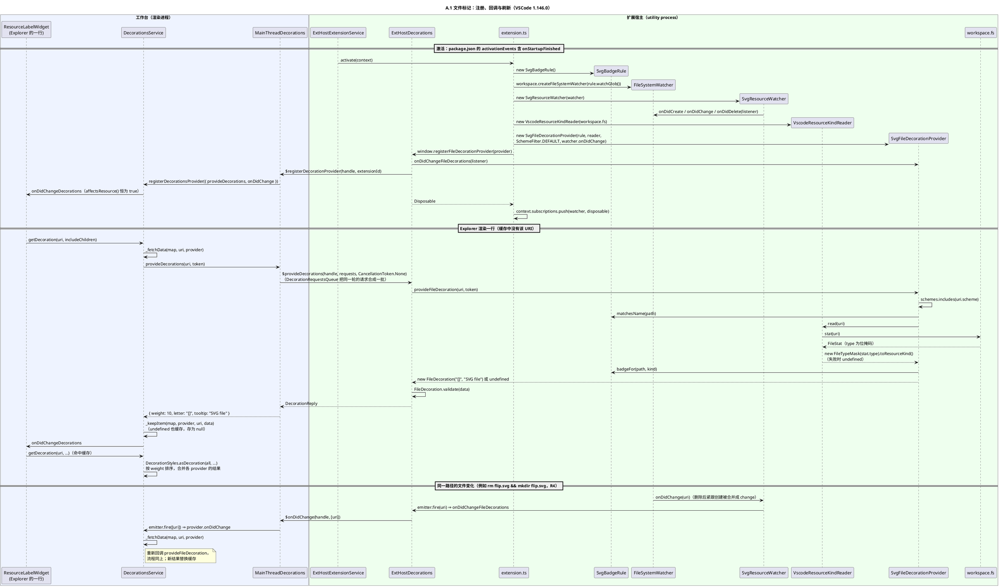
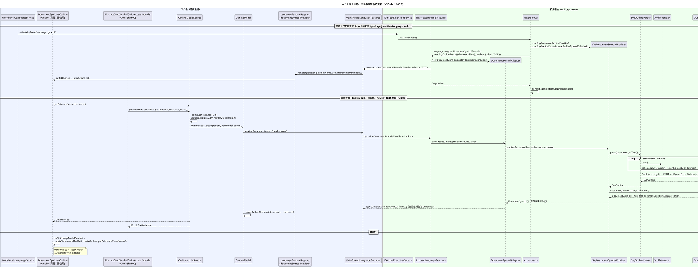
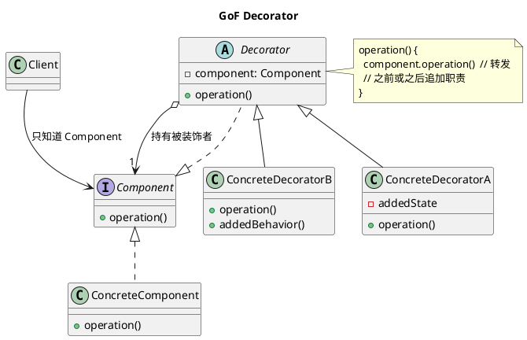
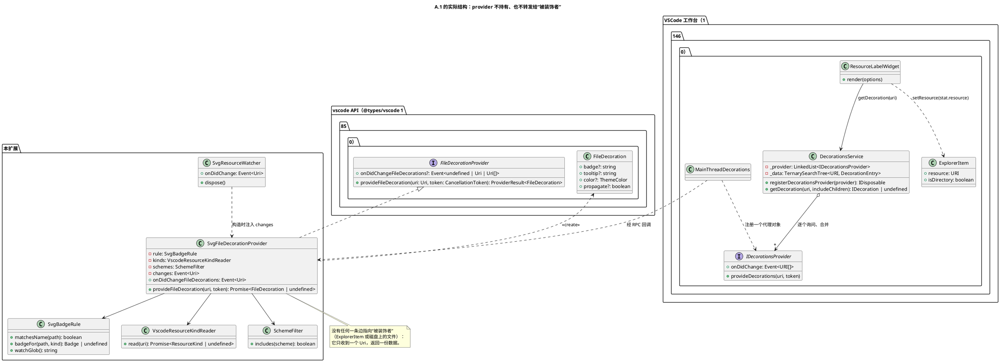

# vscode-svg · 第一部分 A.3 分析

规格 A.3 要求说明三件事：VSCode 与插件各自的职责和注册/回调过程（[第 1 节](#1-vscode-与插件的职责注册与回调)）；文件装饰与经典 Decorator、Adapter 的对应和差异（[第 2 节](#2-文件装饰与-decoratoradapter)）；Phase 1 解析、模型、遍历代码的复用评估（[第 3 节](#3-phase-1-代码的复用评估)）。[第 0 节](#0-截图)是四张演示截图及图注。本文写于 S3，S15 会把要点并入 `doc/README.md`，所以尽量写成可以单独阅读的形式；扩展本身的用法、决定（VA1–VA22）和测试见 [README](../README.md)。

## 证据的写法

- **代码**：`src/host/SvgFileDecorationProvider.ts` 的 `provideFileDecoration`，或 `package.json` 的 `activationEvents`。路径相对于 `vscode-svg/`；Phase 1 的代码写作仓库根目录下的 `src/io/…`，并注明“Phase 1”。
- **测试**：文件加用例名，例如 `tests/unit/SvgBadgeRule.test.ts`「a directory named *.svg gets nothing」。集成测试在 `tests/integration/suite/outline.ts`，用例名同样照抄。
- **观察**：[`observations.md`](observations.md) 第 2 节是不装扩展时的原生行为，写作“观察表第 n 项”；第 3 节是 S2 的界面验收，写作“观察表 §3 的 O2 行”。README 的手动步骤写作 R1–R5、O1–O9。
- **编号**：VA1–VA22 是本扩展 README“决定”一节的编号；F、V、D、P 开头的编号（例如 F13、V8、P1）是 Phase 1 `doc/README.md`（仓库根目录）的约定补充和依赖规则。
- **独立验收**：S1、S2 各有一份仓库外的独立验收报告，引用时写“S1/S2 独立验收实测”，并给出对应的 R/O 步骤，读者可以按步骤复现。
- **VSCode 内部**：一律引用 `microsoft/vscode` 的源码，版本标签为 **1.146.0**（本机版本，集成测试默认版本），只在明确写出时才是 1.85.0。为了不在正文里反复写长路径，下表给出简称：

| 简称 | 文件（`microsoft/vscode` 1.146.0） |
|---|---|
| `decorationsService.ts` | `src/vs/workbench/services/decorations/browser/decorationsService.ts` |
| `mainThreadDecorations.ts` | `src/vs/workbench/api/browser/mainThreadDecorations.ts` |
| `extHostDecorations.ts` | `src/vs/workbench/api/common/extHostDecorations.ts` |
| `labels.ts` | `src/vs/workbench/browser/labels.ts` |
| `explorerViewer.ts` | `src/vs/workbench/contrib/files/browser/views/explorerViewer.ts` |
| `extHostExtensionService.ts` | `src/vs/workbench/api/common/extHostExtensionService.ts` |
| `extensionHostStarter.ts` | `src/vs/platform/extensions/electron-main/extensionHostStarter.ts` |
| `languageService.ts` | `src/vs/workbench/services/language/common/languageService.ts` |
| `extHostLanguageFeatures.ts` | `src/vs/workbench/api/common/extHostLanguageFeatures.ts` |
| `mainThreadLanguageFeatures.ts` | `src/vs/workbench/api/browser/mainThreadLanguageFeatures.ts` |
| `extHostTypeConverters.ts` | `src/vs/workbench/api/common/extHostTypeConverters.ts` |
| `extHostTypes.ts` | `src/vs/workbench/api/common/extHostTypes.ts` |
| `outlineModel.ts` | `src/vs/editor/contrib/documentSymbols/browser/outlineModel.ts` |
| `documentSymbolsOutline.ts` | `src/vs/workbench/contrib/codeEditor/browser/outline/documentSymbolsOutline.ts` |
| `gotoSymbolQuickAccess.ts` | `src/vs/editor/contrib/quickAccess/browser/gotoSymbolQuickAccess.ts` |
| `languageFeatureDebounce.ts` | `src/vs/editor/common/services/languageFeatureDebounce.ts` |
| `rpcProtocol.ts` | `src/vs/workbench/services/extensions/common/rpcProtocol.ts` |
| `uriIdentityService.ts` | `src/vs/platform/uriIdentity/common/uriIdentityService.ts` |

源码和实测都没有的，明确标成 **推断**。

## 0 截图

四张图都在 [`images/`](images/)，PNG，1600×1000。A.1 两张取自 S1 独立验收，A.2 两张取自 S2 独立验收（观察表 §3）。两组图的文件图标样式不同（前者是带颜色的 SVG 图标，后者是统一的文档图标），规格说明“主题、图标和布局不要求与截图一致”。

![Explorer 中的 [] 标记](images/a1-explorer-badges.png)

**图 0-1 `a1-explorer-badges.png`（规格 A.1：“`.svg` 文件旁显示 `[]` 标记……非 SVG 文件和目录不加标记”，对应图 A.1）**。应该看 Explorer 的右侧一列：`example.svg`、`LOGO.SVG`、`Mixed.Svg` 有 `[]`；`.vscode/`、`icons.svg/`（目录）、隐藏文件 `.svg`、`diagram.svg.txt`、`plain.txt`、无扩展名的 `svg` 都没有。所有文件名与磁盘一致，`[]` 不是文件名的一部分。编辑器标签页 `example.svg` 右侧的 `[]` 是 VSCode 默认也在标签页上显示装饰（观察表第 10、11 项），不是本扩展另外做的。这张图截于 S1，`broken.svg`、`plain.xml` 是 S2 才加入 `samples/` 的，所以不在图中。**与扩展无关的界面元素**：左下角状态栏的 **Restricted Mode** 表示截图时工作区未受信任；F5 开发模式加载的扩展不受信任规则约束，所以图中照常有标记。装成 `.vsix` 之后在受限模式下能否工作，由 VA12 的 `capabilities.untrustedWorkspaces` 和 `npm run test:restricted` 保证（README“集成测试”）。



**图 0-2 `a1-directory-no-badge.png`（规格 A.1：“非 SVG 文件和目录不加标记”）**。应该看 `icons.svg`：它是一个名字以 `.svg` 结尾的**目录**，已展开，里面有 `README.md`；它和 `README.md` 都没有 `[]`，而同一列的 `example.svg` 等文件有。这说明判断依据是“名字 + 资源类型”，不是只看名字（`src/core/SvgBadgeRule.ts` 的 `badgeFor`）。状态栏的 Restricted Mode 同图 0-1。



**图 0-3 `a2-outline.png`（规格 A.2：“在 VSCode 原生 Outline 视图展示元素的嵌套层级……点击节点定位到相应源代码”，对应图 A.2）**。应该看左下角 **Outline**：`svg` › `g#flow` › `rect#start`，`g#flow` › `g#nested` › `text`；`text` 没有 id，只显示标签名。`rect#start` 被选中（点击后），编辑器第 3 行高亮，状态栏为 `Ln 3, Col 6`，即光标在 `<rect` 的 `r` 之前（VA19，O2）。编辑器上方的面包屑 `example.svg › svg › g#flow › rect#start` 和大纲用的是同一份 provider 结果（第 1.2 节）。**与扩展无关的界面元素**：右下角状态栏的 **Screen Reader Optimized** 是 S2 验收时为了读取界面结构而开启的辅助功能设置：验收用的临时配置写了 `"editor.accessibilitySupport": "on"`（S2 独立验收记录的配置；观察表第 7 项的原生大纲观察用的是同一做法），与本扩展无关；标题栏的 Sign In 按钮也是 VSCode 自带的。



**图 0-4 `a2-incomplete-xml.png`（规格 A.2：“编辑过程中 XML 不完整时允许暂时清空大纲，但不得使扩展崩溃”）**。第 4 行被改成 `<g id="nested>`（删去一个引号，O5），文件处于未保存状态（标签页上的圆点）。应该看三处：大纲只剩 `svg` › `g#flow` › `rect#start`；没有错误弹窗，状态栏问题计数为 0；扩展仍在工作（把引号补回后完整的树恢复，观察表 §3 的 O5 行）。**注意**：规格说的是“允许暂时清空”，本扩展选择的是**保留出错位置之前的部分**，所以图中大纲没有清空，而是只少了出错处及之后的元素，这是 VA16 的设计，不是清空失败。Explorer 图标上的数字 `1` 是 VSCode 的“未保存文件数”，状态栏的 Screen Reader Optimized 同图 0-3。

## 1 VSCode 与插件的职责、注册与回调

**结论**：VSCode 掌握进程、激活时机、渲染、缓存、取消、多 provider 的合并以及“何时回调”；本扩展只在 `activate` 里组装对象、注册两个 provider，然后在被回调时根据输入返回数据（`FileDecoration` 或 `DocumentSymbol[]`），唯一主动做的事是在文件变化时发出 `onDidChangeFileDecorations`。这是典型的控制反转：扩展从不调用 Explorer 或 Outline，只等 VSCode 来调用自己。

### 1.1 职责划分

| 方面 | VSCode（宿主） | 本扩展（插件） | 依据 |
|---|---|---|---|
| 进程 | 扩展跑在单独的**扩展宿主**进程里（Electron utility process），Explorer、Outline 跑在工作台（渲染进程）里，两边只能通过 RPC 通信。每个 API 都成对出现：扩展侧 `ExtHost…`，工作台侧 `MainThread…` | 不关心进程；`src/` 不导入任何 Node 内置模块（VA10），只通过 `vscode` 模块的 API 与宿主打交道 | `extensionHostStarter.ts` 的 `ExtensionHostStarter`（`new WindowUtilityProcess(…)`）；`extHostDecorations.ts` 与 `mainThreadDecorations.ts` 经 `_proxy.$…` 互相调用；`tests/unit/architecture.test.ts`「VA10: src/ imports no Node built-in module (the extension host may be Node 18)」 |
| 激活时机 | 读清单里的 `activationEvents`，在事件发生时加载 `main` 并调用 `activate(context)`：`onStartupFinished` 在启动完成后；`onLanguage:xml` 在需要 XML 语言的“富特性”时（打开语言为 `xml` 的文档） | 声明两个激活事件（VA1）；`activate` 只组装和注册，不读任何文件 | `package.json` 的 `activationEvents`；`extHostExtensionService.ts` 的 `_activateAllStartupFinished`、`_callActivateOptional`；`languageService.ts` 的 `WorkbenchLanguageService`（`onDidRequestRichLanguageFeatures` → `` activateByEvent(`onLanguage:${languageId}`) ``）；`tests/unit/manifest.test.ts`「VA1: onStartupFinished for the badge (no contribution point), onLanguage:xml for the outline」；`tests/integration/suite/outline.ts`「opening example.svg activates the extension; its language ID is xml」 |
| 渲染 | 决定装饰画在哪里、怎么画：把 badge 写成 CSS 规则 `::after { content: "[]" }` 挂到 Explorer 行和标签页上；大纲树、图标（由 `SymbolKind` 决定）、面包屑、Follow Cursor 的高亮、点击后的跳转全部由 VSCode 完成 | 只返回数据：`new FileDecoration(badge.text(), badge.tooltip())`；`DocumentSymbol` 的 `name`、`kind`、`range`、`selectionRange`。扩展**没有**注册任何命令或视图（`contributes` 为空对象），点击定位完全由宿主根据 `selectionRange` 完成 | `decorationsService.ts` 的 `DecorationRule.appendCSSRules`；`labels.ts` 的 `ResourceLabelWidget.render`；`package.json` 的 `contributes`（空对象）；观察表 §3 的 O2、O3 行（VA19） |
| 缓存 | 装饰：按 URI、按 provider 缓存结果，“没有标记”也缓存（`undefined` 存成 `null`），直到 provider 发出变化事件。大纲：按文本模型的 `id` 和 `versionId` 缓存整棵 `OutlineModel`，文本版本不变就不再调用 provider | 不缓存任何东西：每次回调都重新 `stat`、重新解析全文 | `decorationsService.ts` 的 `getDecoration`、`_fetchData`、`_keepItem`；`outlineModel.ts` 的 `OutlineModelService.getOrCreate`；`tests/unit/SvgDocumentSymbolProvider.test.ts`「asks the document for its text on every call, so an edit is seen at once」 |
| 取消 | 为每次回调传入 `CancellationToken`。装饰：工作台在同一 URI 发起新请求时取消旧请求，但只是丢弃自己这一侧的等待，跨 RPC 传给扩展宿主的是 `CancellationToken.None`。大纲：文本又变了、调用方都不再需要时取消，取消会经 RPC 传到扩展宿主 | 两个 provider 都检查 token（VA8、VA22），详见第 1.3 节 | `decorationsService.ts` 的 `_fetchData`（`pendingRequest.source.cancel()`）；`mainThreadDecorations.ts` 的 `DecorationRequestsQueue._processQueue`；`outlineModel.ts` 的 `getOrCreate`（`data.source.cancel()`）；`rpcProtocol.ts` 的 `_receiveRequest`、`_receiveCancel` |
| 合并多个 provider | 装饰：`DecorationsService` 用一个链表保存所有 provider，渲染时向每一个要结果，按 `weight` 排序后合并：多个 badge 用 `, ` 连接，tooltip 用 ` • ` 连接。大纲：每个 provider 的结果成为一个 `OutlineGroup`，组名取注册时的 `label`；只有一组时直接展开为顶层节点 | 只提供自己的一份；注册大纲时给出 `{ label: "SVG" }`，与其他 XML/SVG 大纲并存时作组名；选择器让位给把 `.svg` 关联到其他语言的扩展（VA14） | `decorationsService.ts` 的 `registerDecorationsProvider`（`this._provider.unshift(provider)`）、`DecorationStyles.asDecoration`、`DecorationRule.appendCSSRules`；`mainThreadDecorations.ts` 的 `$registerDecorationProvider`（所有扩展的装饰 `weight: 10`）；`outlineModel.ts` 的 `OutlineModel.create`、`_compact`；`src/extension.ts` 的 `activate` |
| 何时回调 | 装饰：Explorer 或标签页渲染一行时调用 `getDecoration`，缓存里没有才回调 provider；provider 注册时、发出变化事件时重新回调。大纲：打开编辑器、切换模型或语言、provider 集合变化时立即请求；文本变化后按自适应的防抖间隔（下限 350 ms）再请求 | 被动等待；对装饰，唯一主动的动作是文件变化时发出事件，请 VSCode 重新回调（VA7） | `labels.ts` 的 `ResourceLabelWidget.render`、`notifyFileDecorationsChanges`；`documentSymbolsOutline.ts` 的 `DocumentSymbolsOutline` 构造函数（`onDidChangeModelContent` → `updateSoon.cancelAndSet(…, getDebounceValue(model))`）；`outlineModel.ts` 的 `OutlineModelService` 构造函数（`debounces.for(…, 'DocumentSymbols', { min: 350 })`）；`languageFeatureDebounce.ts` |
| 生命周期 | 扩展被停用时（例如扩展宿主随窗口关闭而结束），先调用 `deactivate`，再 `dispose` `context.subscriptions` 里的每一项 | 把注册返回的 `Disposable` 和自己持有资源的 `SvgResourceWatcher` 都放进 `context.subscriptions`；`deactivate` 为空 | `extHostExtensionService.ts` 的 `_callActivate`（`dispose(context.subscriptions)`）、`_deactivate`；`src/extension.ts` 的 `activate`、`deactivate`；`tests/unit/extension.test.ts`「puts the registration and the watcher into context.subscriptions」「deactivate does nothing and does not throw」 |
| 校验与容错 | 扩展宿主校验扩展返回的数据：badge 超过 2 个字符时丢弃并写 `INVALID decoration` 警告；`DocumentSymbol` 的名字为空或 `selectionRange` 不在 `range` 内时构造函数直接抛错；provider 抛出的异常被扩展宿主捕获并写进日志 | 在 core 里提前守住同样的规则（`Badge` 构造时检查 1–2 个字符，`OutlineNode` 构造时检查名字和区间），provider 自己 `try/catch`，不把异常交给宿主（VA2、VA8、VA22） | `extHostDecorations.ts` 的 `$provideDecorations`（`FileDecoration.validate`、`this._logService.error(err)`）；`extHostTypes.ts` 的 `DocumentSymbol.validate`；`extHostLanguageFeatures.ts` 的 `_withAdapter`（`provider FAILED`）；`tests/unit/Badge.test.ts`「rejects an empty badge and anything longer than 2 characters」；`tests/unit/OutlineNode.test.ts`「DocumentSymbol rule: rejects a selection outside the range」 |

### 1.2 注册与回调的两条链

两张时序图中，参与者和消息都是代码里真实存在的名字：本扩展的类和方法来自 `src/`，VSCode 一侧来自 1.146.0 的源码（上表的简称）。为了能读，VSCode 内部省略了中间的转发层（例如 `extHost.api.impl.ts` 里 `window.registerFileDecorationProvider` 直接转给 `ExtHostDecorations`），只保留跨进程的那一跳。本机没有 PlantUML，图**未渲染**。

**A.1 文件标记**



**A.2 大纲**



两条链对照，可以看到同一个骨架：**清单声明激活事件 → `activate(context)` 组装对象 → `register…Provider` 返回 `Disposable` → 放进 `context.subscriptions` → VSCode 在自己需要时回调 `provide…`**。不同点在于“何时再回调”：装饰要等扩展发事件，大纲由 VSCode 自己根据文本版本决定（第 1.3 节）。

关于“Outline、面包屑、Cmd+Shift+O 共用同一份结果”：三者都经过 `outlineModel.ts` 的 `OutlineModelService.getOrCreate`，它按 `textModel.id` 缓存，`versionId` 和 provider 列表都没变时直接返回已有的 `OutlineModel`（`documentSymbolsOutline.ts` 的 `_createOutline`、`gotoSymbolQuickAccess.ts` 的 `getDocumentSymbols` 都调用它）。所以三处看到的是同一次 provider 调用的结果，O9（Cmd+Shift+O 按种类分组）与 O1（大纲）一致是这个缓存的直接结果，而不是扩展分别实现了三次。图 0-3 的面包屑与大纲一致也是同一原因。缓存是容量 15 的 LRU，被挤出后会重新调用 provider，结果仍相同，因为 provider 对同一文本是确定的（`tests/unit/SvgOutlineParser.test.ts`「the same text always gives the same tree」）。

### 1.3 其中的设计概念

**控制反转（好莱坞原则：“别打电话给我们，我们会打给你”）**。扩展里没有任何代码去“找” Explorer 或 Outline，也不决定何时显示：`src/extension.ts` 的 `activate` 执行完就返回，此后 `SvgFileDecorationProvider.provideFileDecoration` 和 `SvgDocumentSymbolProvider.provideDocumentSymbols` 只在 VSCode 调用时运行。框架定义接口（`vscode.d.ts` 中的 `FileDecorationProvider`、`DocumentSymbolProvider`），插件实现并注册，框架掌握调用时机。由此带来的一个后果是：扩展的正确性必须对**任意时机、任意次数**的调用成立。本扩展用“无状态 + 每次从头计算”来满足它：provider 不缓存（第 1.1 节“缓存”一行），同一输入总是同一输出（`tests/unit/SvgOutlineParser.test.ts`「the same text always gives the same tree」），重复的回调和重复的事件都无害（README“刷新（VA7）的依据”最后两条）。

**Observer：`onDidChangeFileDecorations`**。装饰的输入是**磁盘状态**（资源类型），它会在 VSCode 不知情的情况下变化，而 VSCode 又缓存了每个 URI 的答案，“没有标记”也缓存（`decorationsService.ts` 的 `_keepItem` 把 `undefined` 存成 `null`）。于是 VSCode 在接口里留了一个可选事件 `FileDecorationProvider.onDidChangeFileDecorations`（`@types/vscode` 1.85.0 的 `index.d.ts`），扩展是 Subject，`DecorationsService` 是 Observer：`registerDecorationsProvider` 里订阅 `provider.onDidChange`，收到 URI 就对该 URI 重新 `_fetchData`。本扩展的 Subject 由两个类组成：`SvgResourceWatcher` 把 `FileSystemWatcher` 的三个事件合成一个 `Event<Uri>`（`src/host/SvgResourceWatcher.ts` 的构造函数），`SvgFileDecorationProvider` 通过 getter `onDidChangeFileDecorations` 把它交给 VSCode（测试：`tests/unit/SvgResourceWatcher.test.ts`「VA7: re-announces created and deleted paths」「VA7: re-announces changed paths too (coalesced delete + create)」，`tests/unit/SvgFileDecorationProvider.test.ts`「exposes the injected change event as onDidChangeFileDecorations」）。

**为什么大纲不需要类似的事件**。大纲的输入只有一样东西：VSCode 自己持有的文档文本。文本的每次变化都由 VSCode 产生，它知道版本号（`versionId`），也知道什么时候该重算：`documentSymbolsOutline.ts` 的 `DocumentSymbolsOutline` 订阅 `onDidChangeModelContent` 并按防抖间隔重新调用 `getOrCreate`，而 `getOrCreate` 发现 `versionId` 变了就丢弃缓存。provider 不依赖文本以外的任何状态（`src/host/SvgDocumentSymbolProvider.ts` 的 `provideDocumentSymbols` 只读 `document.getText()`；`src/core/SvgOutlineScope.ts` 不读设置），所以不存在“VSCode 不知道的变化”，也就不需要通知。VSCode 的接口也是这样设计的：`DocumentSymbolProvider` 只有 `provideDocumentSymbols` 一个方法，没有变化事件（`@types/vscode` 1.85.0 的 `index.d.ts`）。反过来说，如果大纲将来依赖文本以外的东西（例如一个设置项），就会出现缓存过期而无法通知的问题。

**`Disposable` 与生命周期**。每个 `register…` 都返回一个 `Disposable`，`dispose()` 就是“撤销注册”：`extHostDecorations.ts` 中它注销 RPC 句柄，`decorationsService.ts` 中对应的 `toDisposable` 从链表中移除 provider 并清掉它的全部缓存（`removeAll`），界面上的标记随之消失。扩展把这些 `Disposable` 交给 `context.subscriptions`，由 VSCode 在停用时统一释放（`extHostExtensionService.ts` 的 `_callActivate` 中 `dispose(context.subscriptions)`），所以 `deactivate` 可以为空（`src/extension.ts`）。扩展自己创建的资源也遵守同一约定：`SvgResourceWatcher implements Disposable`，构造时接管 `FileSystemWatcher` 和 `EventEmitter`，`dispose` 时一并释放（`src/host/SvgResourceWatcher.ts`；`tests/unit/SvgResourceWatcher.test.ts`「dispose releases the watcher and stops events」）。这样“谁创建谁释放”的链条一直延伸到宿主：扩展只负责把所有权交出去，释放时机由宿主决定，这同样是控制反转。

**取消令牌（VA22）**。两个 provider 都接收 `CancellationToken`，但在 1.146.0 中它们的实际作用不同，读源码后有两点值得写下来：

- **装饰**：`SvgFileDecorationProvider.provideFileDecoration` 在 `await this.kinds.read(uri)` 之后检查 `token.isCancellationRequested`（`tests/unit/SvgFileDecorationProvider.test.ts`「returns nothing once VSCode has cancelled the request」）。但 `mainThreadDecorations.ts` 的 `DecorationRequestsQueue._processQueue` 调用 `$provideDecorations(this._handle, [...requests.values()], CancellationToken.None)`：工作台侧的取消只是让自己不再等待这个结果（`enqueue` 中 `token.onCancellationRequested` → `defer.error(new CancellationError())`），并不会传到扩展宿主。扩展宿主收到的 token 是 `rpcProtocol.ts` 的 `_receiveRequest` 新建的，只有收到 `Cancel` 消息才会被取消，而这里永远不会发。所以在 1.146.0 中这个检查不会生效；1.85.0 的 `mainThreadDecorations.ts` 同样传 `CancellationToken.None`。它是无害的防御，保留它的理由是接口契约允许取消、以后的版本可能会传真实的 token。
- **大纲**：`outlineModel.ts` 的 `getOrCreate` 在所有调用方都取消后 `data.source.cancel()`，`mainThreadLanguageFeatures.ts` 把 token 原样交给 `$provideDocumentSymbols`，扩展宿主会收到真实的取消。`SvgDocumentSymbolProvider.provideDocumentSymbols` 在解析前、转换前各检查一次（`tests/unit/SvgDocumentSymbolProvider.test.ts`「already cancelled → empty, without reading or parsing the text」「cancelled while parsing → empty, without building symbols」）。不过 provider 是同步的，`extHostLanguageFeatures.ts` 的 `_withAdapter` 同步调用它，而取消是一条后到的 RPC 消息，要等当前同步代码执行完才会被处理。**推断**：在真实宿主中，这两次检查几乎不会看到取消；它们的价值在于契约完整，以及假如以后改成异步分块时不必再补。真正保证“不会因为大文档卡住宿主”的是解析的线性复杂度（5 万个元素、约 260 万字符一次约 0.2 s，`tests/integration/suite/outline.ts`「a large document: 50 000 elements」），而不是取消。

**宿主与插件在“谁负责刷新”上的分工**。大纲的刷新完全由宿主负责（文本版本 + 防抖），扩展什么都不用做；装饰的刷新由扩展负责“通知”，由宿主负责“重新询问和重画”。分工的分界线就是上面说的输入归属：宿主拥有的状态由宿主跟踪，宿主不拥有的状态（磁盘）由插件报告变化。S1 独立验收的一个实测正好说明了这条分界线（R4：`rm flip.svg && mkdir flip.svg`）：

- 本扩展的标记是对的：操作后约 0.5 s 的第一帧中 `[]` 就已消失，从 +0.5 s 到 +5.0 s 每隔 0.5 s 一帧，10 帧都没有 `[]`。原因是 `SvgResourceWatcher` 转发了这个路径的事件（类型被 VSCode 合并成 `change`），VSCode 随即重新调用 `provideFileDecoration`，而 provider 每次都自己 `stat`，于是得到“目录”，不加标记（VA5、VA7）。
- 同一行的**文件图标**却没有变成文件夹图标，`flip.svg` 仍按文件显示。这个图标不属于装饰，而是 Explorer 根据自己的模型画的（`explorerViewer.ts` 中 `fileKind: stat.isRoot ? FileKind.ROOT_FOLDER : stat.isDirectory ? FileKind.FOLDER : FileKind.FILE`，`stat` 是 Explorer 模型中的 `ExplorerItem`）。**推断**：Explorer 收到的是合并后的 `change` 事件，它把它当成“内容变了”，没有重新解析该项的类型。S1 独立验收没有验证 Explorer 内部的重建机制，这里只能推断。

同一次验收还实测到另外两件事，都说明“不依赖事件的形状”是对的：每一次文件操作的事件都会到达两次，间隔约 100 ms（例如 `2026-11-13T12:30:42.023Z` 和 `.123Z` 各一次 `change`）；删除后立即创建同名目录时，两种事件被合并成 `change`（`src/vs/platform/files/common/watcher.ts` 的 `EventCoalescer`）。本扩展转发全部三种事件且不去重，重复的事件只会让 VSCode 多问一次，结果相同（README“刷新（VA7）的依据”）。

### 1.4 与第二部分的关系

“宿主定义接口、插件实现并注册、宿主在需要时回调；插件通过事件通知宿主、通过 `Disposable` 交出生命周期”，正是第二部分 CLI 四个扩展点（`ShapeProvider`、`Command`、`TreeDecorator`、`AttributeHandler`）要模仿的结构。CLI 里的对应物（注册表、插件上下文、注册的撤销与回滚）在 S4 的设计文档 `doc/design-phase2.md`（尚未编写）中给出，这里不展开。

## 2 文件装饰与 Decorator、Adapter

**结论**：文件装饰在**意图**上接近 Decorator（不改文件名和内容，只附加信息），但在接口、对象组合和调用关系三个维度上都不是 Decorator：它在结构上是“宿主持有一组同接口的 provider、逐个询问并合并结果”，加上 Observer 刷新，与其说是 Decorator，不如说是由宿主聚合的一组 Strategy（插件化的扩展点）。Adapter（规格原文写作 adaptor，本文统一写 Adapter）则在本扩展中真实存在：`SvgDocumentSymbolProvider`、`VscodeResourceKindReader` 是对象适配器，`SvgResourceWatcher` 是事件层面的对象适配器（更像合流器），`OutlineSymbolAdapter` 承担适配职责但形式上是无状态的转换器，`FileTypeMask` 只是数据解码。与 GoF 的主要差异是：除了 VSCode 规定的接口外，本扩展没有抽象的 Target 接口，被适配的一端多半是自己写的代码。

### 2.1 Decorator

**GoF 的结构**：



**本扩展 A.1 的实际结构**（VSCode 一侧只画与装饰有关的部分）：



逐个维度比较：

| 维度 | GoF Decorator | 本扩展的文件装饰 | 依据 |
|---|---|---|---|
| **接口**：装饰者是否实现与被装饰者相同的接口？ | 是。Decorator 与 ConcreteComponent 都实现 Component，所以可以互相替换 | 否。`SvgFileDecorationProvider` 实现的是 `FileDecorationProvider`（`provideFileDecoration`、`onDidChangeFileDecorations`），被“装饰”的 Explorer 行（`ResourceLabelWidget`）或其模型（`ExplorerItem`）、磁盘上的文件都不实现这个接口，两者之间没有共同的接口 | `src/host/SvgFileDecorationProvider.ts` 的类声明 `implements FileDecorationProvider`；`labels.ts`、`explorerViewer.ts` |
| **对象组合**：装饰者是否持有被装饰者并转发调用？ | 是。`Decorator` 持有一个 `Component`，`operation()` 先转发再追加 | 否。provider 持有的是 `SvgBadgeRule`、`VscodeResourceKindReader`、`SchemeFilter` 和一个 `Event<Uri>`，都是它自己完成判断所需的协作者，没有一个是被装饰者。它收到的 `Uri` 只是资源的标识（值），不是对象；它不调用被装饰者的任何方法，只返回一份数据 `FileDecoration`（badge、tooltip） | `src/host/SvgFileDecorationProvider.ts` 的四个字段和 `provideFileDecoration`；`src/extension.ts` 的 `activate` |
| **调用关系**：谁调用谁？ | 客户端调用最外层装饰者，调用沿着包装链一层层向内转发 | 反过来：客户端（`ResourceLabelWidget`）调用宿主的 `DecorationsService.getDecoration`，宿主再经 RPC 回调 provider。provider 是被调用的一方，调用链里没有“向内转发” | 第 1.2 节 A.1 时序图；`decorationsService.ts` 的 `getDecoration`、`_fetchData` |
| **多个装饰如何叠加，顺序由谁决定？** | 递归包装：`new B(new A(component))`，顺序由**组装包装链的代码**决定，外层看到内层的结果 | 并列而非嵌套：`DecorationsService` 把所有 provider 存进链表（`registerDecorationsProvider` 中 `this._provider.unshift(provider)`，后注册的在前），渲染时**逐个**询问，各 provider 互相看不到对方的结果；合并由宿主完成：`DecorationStyles.asDecoration` 按 `weight` 排序（扩展提供的装饰在 `mainThreadDecorations.ts` 中一律为 `weight: 10`），`DecorationRule.appendCSSRules`（其中的 `_appendForMany`）把多个 badge 用 `, ` 连起来，`asDecoration` 把 tooltip 用 ` • ` 连起来。顺序由宿主的规则决定，扩展无法干预。（同为 `weight: 10` 时按链表顺序，即后注册的在前，这是从 `Array.prototype.sort` 的稳定性读出来的，**未实测**多个扩展同时装饰的界面） | `decorationsService.ts`；`mainThreadDecorations.ts` 的 `$registerDecorationProvider` |
| **客户端是否知道装饰的存在？** | 不知道。客户端只依赖 Component，拿到的是不是装饰过的对象对它透明 | 知道，而且是主动去取：`ResourceLabelWidget.render` 显式调用 `decorationsService.getDecoration(resource, …)`，再把结果变成 CSS class；是否显示还受设置控制（Explorer 的 `explorer.decorations.badges`，标签页的 `workbench.editor.decorations.badges`） | `labels.ts` 的 `ResourceLabelWidget.render`；`explorerViewer.ts` 中 `fileDecorations: this.config.explorer.decorations`；观察表第 11 项（关掉标签页的设置后，标签页上的 `[]` 消失、Explorer 中仍在） |
| **意图**：不改原对象，只附加信息？ | “动态地给一个对象附加职责”，被装饰后的对象**行为**变了（`operation()` 多做了事），但对象本身不改 | 相同的部分：文件名和内容都不变，`[]` 只是附加在显示上的信息。实现上，provider 读磁盘只用 `stat`，而且依赖的类型是 `Pick<FileSystem, "stat">`，类型层面就拿不到任何写操作；宿主把 badge 画成 CSS 伪元素 `::after`，标签文本本身不变。不同的部分：GoF 附加的是**职责（行为）**，文件装饰附加的只是**展示数据**，文件对象的任何行为都没有改变；而且附加的不是“对象”，而是视图上的一个标注 | `src/host/VscodeResourceKindReader.ts` 的 `fileSystem` 字段；`decorationsService.ts` 的 `DecorationRule.appendCSSRules`；图 0-1；README“手动确认清单：文件标记（A.1）”最后一句 |

**判断**：六个维度中，只有“意图”部分相同，其余五个都不同，而且不同在 Decorator 的结构核心上（同接口、持有并转发、递归包装、对客户端透明）。所以“文件装饰”这个名字说的是**用途**，不是 GoF 的 Decorator 结构。结构上它更像下面两样东西的组合：

- **由宿主聚合的一组 Strategy**：`FileDecorationProvider` 是宿主定义的策略接口，“给定一个 URI，它该带什么标注”这个决定被委托给可替换的策略对象；宿主持有多个策略，逐个询问后用固定规则合并。与教科书 Strategy 的差别是策略不止一个、而且是并列合并而不是选一个，这正是“扩展点”的一般形状，也就是第二部分 CLI 要做的事（第 1.4 节）。
- **Observer 刷新**：策略的答案会过期，所以策略同时是 Subject（第 1.3 节）。

如果一定要在这条链上找“装饰”，它在**宿主的渲染层**：`ResourceLabelWidget` 拿到合并后的 `IDecoration`，给标签附加 CSS class，由 CSS 规则在名字后面画出 `[]`，标签原有的内容不变。这一层的意图和效果都接近 Decorator，但它是 VSCode 内部的事，扩展既不实现也不参与。

### 2.2 Adapter

**本扩展里承担适配职责的类**：

```plantuml
@startuml adapters
title 本扩展中的适配（host/ 是唯一接触 vscode 的一层）
package "vscode API（既有、不能改）" {
  interface DocumentSymbolProvider {
    +provideDocumentSymbols(document, token): ProviderResult<DocumentSymbol[]>
  }
  class DocumentSymbol {
    +name +detail +kind: SymbolKind
    +range: Range +selectionRange: Range
    +children: DocumentSymbol[]
  }
  interface TextDocument {
    +getText(): string
    +positionAt(offset): Position
  }
  interface FileSystem {
    +stat(uri): Thenable<FileStat>
  }
  interface FileSystemWatcher {
    +onDidCreate +onDidChange +onDidDelete
  }
}
package "src/host" {
  class SvgDocumentSymbolProvider {
    -parser: SvgOutlineParser
    -adapter: OutlineSymbolAdapter
    +provideDocumentSymbols(document, token): DocumentSymbol[]
  }
  class OutlineSymbolAdapter {
    +toSymbols(nodes, document): DocumentSymbol[]
    +kindOf(role): SymbolKind
  }
  class VscodeResourceKindReader {
    -fileSystem: Pick<FileSystem, "stat">
    +read(uri): Promise<ResourceKind | undefined>
  }
  class SvgResourceWatcher {
    +onDidChange: Event<Uri>
  }
  class SvgFileDecorationProvider
}
package "src/core（不导入 vscode）" {
  class SvgOutlineParser {
    +parse(text: string): SvgOutline
  }
  class SvgOutline {
    +roots(): OutlineNode[]
    +error(): XmlSyntaxError | undefined
  }
  class OutlineNode {
    +label() +detail() +role(): OutlineRole
    +range(): SourceSpan +selection(): SourceSpan
    +children(): OutlineNode[]
  }
  class FileTypeMask {
    +has(flag): boolean
    +toResourceKind(): ResourceKind
  }
  class ResourceKind
}
DocumentSymbolProvider <|.. SvgDocumentSymbolProvider
SvgDocumentSymbolProvider o--> SvgOutlineParser : Adaptee（持有并转发 parse）
SvgDocumentSymbolProvider o--> OutlineSymbolAdapter
SvgDocumentSymbolProvider ..> TextDocument : getText()
SvgOutlineParser ..> SvgOutline : <<create>>
OutlineSymbolAdapter ..> OutlineNode : 读取（参数，不持有）
OutlineSymbolAdapter ..> TextDocument : positionAt()
OutlineSymbolAdapter ..> DocumentSymbol : <<create>>
VscodeResourceKindReader o--> FileSystem : Adaptee（持有并转发 stat）
VscodeResourceKindReader ..> FileTypeMask : 解码位掩码
FileTypeMask ..> ResourceKind : <<create>>
SvgFileDecorationProvider --> VscodeResourceKindReader : 依赖具体类（没有 Target 接口）
SvgResourceWatcher o--> FileSystemWatcher : Adaptee（三个事件 → 一个）
note bottom of OutlineSymbolAdapter
  对照：VSCode 自己在扩展宿主里也有一个
  DocumentSymbolAdapter（extHostLanguageFeatures.ts），
  把扩展的 DocumentSymbolProvider 适配成
  内部的 languages.DocumentSymbolProvider。
end note
@enduml
```



逐个类说明：

| 类 | Target | Adaptee | 适配的不兼容 | 形式 | 与 GoF 不一致的地方 | 依据 |
|---|---|---|---|---|---|---|
| `SvgDocumentSymbolProvider` | VSCode 的 `DocumentSymbolProvider` 接口：输入 `TextDocument` 和 `CancellationToken`，输出 `DocumentSymbol[]`，宿主期望它不抛错 | `SvgOutlineParser`：输入 `string`，输出 `SvgOutline`（节点 + 可能的语法错误），不知道 `vscode` | ① 输入形状：`TextDocument` → `document.getText()`；② 错误语义：不完整的 XML 在 core 中是“结果的一部分”（`SvgOutline.error()`），宿主侧要的是“永不抛错”，所以意外异常在这里 `try/catch` 成空数组并写一行日志（VA22）；③ 取消：core 不知道 token，这里检查；④ 输出形状交给第二个适配器 | **对象适配器**：实现 Target 接口，持有 Adaptee（字段 `parser`），`provideDocumentSymbols` 转发到 `parser.parse` | 最接近 GoF。不一致的是：Adaptee 是为这个扩展专门写的，不是“既有的、不能改的”类；它同时持有两个协作者，本身还串起了第二个适配（`OutlineSymbolAdapter`） | `src/host/SvgDocumentSymbolProvider.ts` 的 `provideDocumentSymbols`；`tests/unit/SvgDocumentSymbolProvider.test.ts`「incomplete XML → the part before the error, not an exception (VA16)」「an unexpected exception (here: from the document) → empty outline and one log line」 |
| `OutlineSymbolAdapter` | VSCode 的 `DocumentSymbol` 树（数据形状，不是接口） | `OutlineNode` 树（core）：UTF-16 偏移量的 `SourceSpan`、`OutlineRole` | ① 偏移量 → 行列：`SourceSpan` 的 `start()`/`end()` 经 `document.positionAt` 变成 `Position`，再组成 `Range`（CRLF、代理对按编辑器的规则处理）；② 角色 → 枚举：`OutlineRole` 经静态表 `KINDS` 变成 `SymbolKind`（VA18）；③ 树 → 树：显式栈逐层建 `DocumentSymbol.children` | **转换器**（函数式的适配）：无状态，`toSymbols(nodes, document)` 把被适配的数据作为**参数**接收，而不是持有被适配的对象 | GoF 的 Adapter 包装一个对象、实现 Target 接口；这里既不包装也不实现接口，调用方 `SvgDocumentSymbolProvider` 依赖的是具体类 `OutlineSymbolAdapter`。它适配的是数据，不是接口 | `src/host/OutlineSymbolAdapter.ts` 的 `toSymbols`、`kindOf`、`toRange`；`tests/unit/OutlineSymbolAdapter.test.ts`「CRLF and lone CR line ends count as one line break each」「columns are UTF-16 code units, as VSCode counts them (astral characters take two)」「kinds: root Module, container Namespace, leaf Field (VA18)」「maps each role, and nothing else, to a kind」 |
| `VscodeResourceKindReader` | `SvgFileDecorationProvider` 需要的“查资源类型”：`read(uri): Promise<ResourceKind \| undefined>`，永不 reject | VSCode 的 `FileSystem`（`workspace.fs`）的 `stat`：返回 `FileStat`，失败时 reject | ① 位掩码 → 类型：`FileStat.type`（`FileType` 位掩码，符号链接为 65、66、64）交给 `FileTypeMask` 解码成 `ResourceKind`（VA5）；② 异常 → 返回值：reject 和同步抛出都变成 `undefined`（VA8） | **对象适配器**：持有 Adaptee（字段 `fileSystem`），`read` 转发到 `stat` | Adaptee 这次是真正“既有的、不能改的”`vscode` API，这一点最符合 GoF。不一致的是没有抽象的 Target 接口：`SvgFileDecorationProvider` 的构造参数类型就是具体类 `VscodeResourceKindReader`；测试替身是靠 TypeScript 的结构类型（传入一个只有 `stat` 的对象）实现的，而不是靠接口 | `src/host/VscodeResourceKindReader.ts` 的 `read`；`tests/unit/VscodeResourceKindReader.test.ts`「decodes symbolic links with bit operations (65, 66, 64)」「a rejected stat (e.g. file just deleted) yields undefined」「a stat that throws synchronously yields undefined」「a failed stat leaves no unhandled promise rejection behind」 |
| `SvgResourceWatcher` | `onDidChangeFileDecorations` 需要的一个 `Event<Uri>` | `FileSystemWatcher` 的三个事件 `onDidCreate`、`onDidChange`、`onDidDelete` | 事件形状：三个事件 → 一个事件；同时接管 Adaptee 的生命周期 | **对象适配器**（事件层面）：持有 Adaptee，订阅它的事件并转发 | 没有 Target 接口，暴露的是一个 getter `onDidChange`；与其说是 GoF Adapter，不如说是事件的合流器，这里列出是因为它确实在“把 VSCode 的一种形状变成另一种 VSCode 形状” | `src/host/SvgResourceWatcher.ts`；`tests/unit/SvgResourceWatcher.test.ts`「VA7: re-announces changed paths too (coalesced delete + create)」 |
| `FileTypeMask` | `ResourceKind`（core 自己的值对象） | `vscode.FileType` 的数值（只是一个 `number`） | 位掩码 → 结构化的类型：用 `&` 而不是 `===`，链接到文件的 65 也算文件 | **值解码器**，不是 Adapter：不包装对象，不转发调用 | 只承担了适配中“数据转换”的那一半，供 `VscodeResourceKindReader` 使用。它放在 core，是因为常量可以不导入 `vscode` 就写出来，并由测试与 `@types/vscode` 对齐 | `src/core/FileTypeMask.ts`；`tests/unit/FileTypeMask.test.ts`「a link to a file counts as a file although 65 !== File」「flag values match vscode.FileType in the installed @types/vscode」 |

**总的差异**：

- **Target 往往是数据形状，不是接口**。真正实现了 VSCode 接口的只有两个 provider（`SvgDocumentSymbolProvider implements DocumentSymbolProvider`、`SvgFileDecorationProvider implements FileDecorationProvider`）；扩展内部，调用方一律依赖具体类（`SvgFileDecorationProvider` 的构造函数参数类型、`SvgDocumentSymbolProvider` 的字段类型）。这是有意的：每个角色只有一个实现，测试替身靠结构类型就能注入，再抽一层接口只会多出没有第二个实现的抽象。如果将来要换数据源（例如在 Web 版 VSCode 里查类型），再抽 Target 接口也只需改 host 一层。
- **Adaptee 多半是自己写的**。GoF 的典型场景是“已有一个接口不兼容的类，不能改它”；这里 `SvgOutlineParser`、`OutlineNode` 是为大纲专门写的，完全可以直接写成返回 `DocumentSymbol` 的样子。之所以仍然分出适配层，是为了下一节的边界：让 core 不依赖 `vscode`。真正“不能改”的 Adaptee 只有 `vscode` API 本身（`FileSystem`、`FileSystemWatcher`）。
- **VSCode 自己也在用 Adapter**。扩展宿主里的 `DocumentSymbolAdapter`（`extHostLanguageFeatures.ts`）持有扩展的 `DocumentSymbolProvider`，把它适配成工作台内部的 `languages.DocumentSymbolProvider`，并用 `typeConvert.DocumentSymbol.from` 转换数据（空数组在这里变成 `undefined`，这就是集成测试看到“空结果报告为 `undefined`”的原因）；工作台侧 `MainThreadDecorations.$registerDecorationProvider` 用一个对象字面量把 RPC 代理适配成 `IDecorationsProvider`。所以一次回调要穿过两层适配：VSCode 的（扩展 API ↔ 内部接口）和本扩展的（VSCode 数据 ↔ core 数据）。

### 2.3 为什么把 `core/` 和 `host/` 分开

`src/` 分成两层：`core/` 共 19 个类（983 行，含注释，下同），描述“什么是 SVG 资源、什么是大纲”，完全不知道 VSCode；`host/` 共 5 个类（224 行），是唯一接触 `vscode` 的一层，所做的几乎全是上一节的适配；`extension.ts`（44 行）只组装。这条边界带来三件事：

1. **纯逻辑可以在没有 VSCode 的情况下测试**。规格要求的四项测试（嵌套分组、无 id、编辑更新、不完整 XML）中，纯逻辑部分全部是 core 的单元测试（`tests/unit/SvgOutlineParser.test.ts` 的 describe「spec A.2 — nested groups (figure A.2, samples/example.svg)」「spec A.2 — elements without id」「spec A.2 — edit → update (pure part: new text, new tree)」「spec A.2 — incomplete XML: the part before the error (VA16)」），用 vitest 直接跑，不必启动 VSCode；模糊测试（全部前缀、全部单字符删除、随机字节）也只有在这种条件下才跑得起来（同一文件的 describe「never throws (VA22)」）。
2. **VSCode 的规则在 core 里提前守住**。`OutlineNode` 的构造函数检查 VSCode 的 `DocumentSymbol` 构造函数会检查的两条规则（`tests/unit/OutlineNode.test.ts`「DocumentSymbol rule: rejects an empty name」「DocumentSymbol rule: rejects a selection outside the range」），`Badge` 检查 VSCode 的 badge 长度限制。core 不依赖 `vscode`，但知道 `vscode` 的契约，这样错误会在单元测试里暴露，而不是在扩展宿主里变成一条日志和一个空结果（badge 过长时是 `INVALID decoration` 警告，`DocumentSymbol` 构造失败时被 provider 的 `try/catch` 吞成空大纲）。
3. **VSCode 的变化只影响 host**。VA10 把最低版本降到 1.85.0 时，需要核对的 API 全部在 host 和 `extension.ts` 里（README“API 清单”）。单元测试中的 `vscode` 替身 `tests/stubs/vscode.ts` 也只需覆盖 host 用到的那几样。

`tests/unit/architecture.test.ts` 用测试守住这条边界：

- 「src/core does not depend on vscode」：core 的每个文件都不得以任何形式（`import`、`import type`、`require`）引用 `vscode`；
- 「the type adapter and the outline provider import vscode for types only」：`VscodeResourceKindReader`、`SvgDocumentSymbolProvider` 只做类型导入，打包后运行时不加载 `vscode`，所以它们可以用假对象做单元测试；
- 「scans the expected files」：写死 `core/`、`host/` 的文件清单，新增文件必须登记在其中一层，不能悄悄放到第三个地方；
- 「the detectors themselves work」：用合成的违规代码证明上面的检测器确实会报错，避免检查本身失效而不自知。

这正是 Adapter 在本扩展中的价值：它不是为了兼容某个现成的类，而是为了**让依赖只朝一个方向走**（host → core，host → vscode，core 不依赖任何外部），适配层就是这条依赖边界本身。第二部分 `dir` 命令的“目录访问接口 + 文件系统适配器”是同一思路，并且规格要求它有抽象接口和测试替身，届时会比这里更接近 GoF 的完整形态。

## 3 Phase 1 代码的复用评估

**结论**：本扩展**没有复用 Phase 1 的任何代码**（`vscode-svg/` 不导入根目录 `src/` 下的任何文件，也不依赖 `@xmldom/xmldom`）。原因主要是语义不匹配：Phase 1 的解析、模型和遍历是为“读入一份合法的 SVG 再编辑它”设计的，而大纲需要“原样反映正在编辑的源码，包括它的位置和不完整的部分”。技术障碍是真实的但不是决定性的，实验表明 Phase 1 的 `XmlDomAdapter` 可以被 esbuild 打包进 CJS 扩展。借鉴的是思路和约定，不是代码。

### 3.1 实验：把三类输入交给 Phase 1 的解析器

**目的**：用实际运行而不是读代码来确认三件事：Phase 1 的解析能否给出元素的起止位置；遇到不完整的 XML 时给出什么；`SvgImporter` 对不支持的元素、缺 id 的元素怎样处理。

**脚本要点**（`/tmp/s3exp/probe.mts`，不提交）：从仓库根目录用 `tsx` 运行，动态导入 Phase 1 的 `src/io/XmlDomAdapter.ts`、`src/io/SvgImporter.ts`、`src/view/TreeRenderer.ts` 和 `@xmldom/xmldom`。对每个输入做三件事：

1. `new XmlDomAdapter().parse(text)`，成功时打印 `XmlElement` 树（标签名和 id），失败时打印异常；
2. `new SvgImporter().read(fileSystem, name)`，其中 `fileSystem` 是一个 `readText` 直接返回该文本的假对象，成功时打印警告和 `TreeRenderer.renderDocument` 的输出；
3. 直接调用 `@xmldom/xmldom` 的 `DOMParser`（`locator` 默认开启，`onError` 只收集不抛出），打印每个元素的 `lineNumber`、`columnNumber`，以及节点上所有名字含 `end`/`close` 的属性；另用一个小脚本打印元素节点的全部自有属性。

<details>
<summary>脚本全文</summary>

```ts
// S3 experiment (not committed): feed SVG texts to Phase 1's XmlDomAdapter / SvgImporter
// and to raw @xmldom/xmldom with its locator, and record what comes back.
const REPO = "/Users/tanxin/Desktop/软件设计/Project/svg_editor";
const { readFileSync } = await import("node:fs");
const { XmlDomAdapter } = await import(`${REPO}/src/io/XmlDomAdapter.ts`);
const { SvgImporter } = await import(`${REPO}/src/io/SvgImporter.ts`);
const { TreeRenderer } = await import(`${REPO}/src/view/TreeRenderer.ts`);
const { DOMParser } = await import(`${REPO}/node_modules/@xmldom/xmldom/lib/index.js`);

const example = readFileSync(`${REPO}/vscode-svg/samples/example.svg`, "utf8");
const broken = readFileSync(`${REPO}/vscode-svg/samples/broken.svg`, "utf8");
const lines = example.split("\n");
const cases: Array<[string, string]> = [
  ["example.svg", example],
  ["prefix: example.svg cut after line 3", lines.slice(0, 3).join("\n") + "\n"],
  ["O4b: '<c' typed above line 3", [...lines.slice(0, 2), "    <c", ...lines.slice(2)].join("\n")],
  ["O5: <g id=\"nested> (quote deleted)", example.replace('<g id="nested">', '<g id="nested>')],
  ["broken.svg", broken],
  ["unsupported elements", '<svg xmlns="http://www.w3.org/2000/svg" width="10" height="10"><defs><linearGradient id="lg"/></defs><path id="p" d="M0 0"/><rect width="5" height="5"/></svg>'],
];

function xmlTree(e: any, depth = 0): string[] {
  const id = e.attribute("id");
  return [`${"  ".repeat(depth)}${e.name()}${id ? "#" + id : ""}`, ...e.children().flatMap((c: any) => xmlTree(c, depth + 1))];
}

function rawTree(node: any, depth = 0): string[] {
  const out: string[] = [];
  for (let n = node.firstChild; n; n = n.nextSibling) {
    if (n.nodeType !== 1) continue;
    const id = n.getAttribute("id");
    out.push(`${"  ".repeat(depth)}${n.tagName}${id ? "#" + id : ""} @${n.lineNumber}:${n.columnNumber}` +
      ` endProps=${JSON.stringify(Object.keys(n).filter((k) => /end|close/i.test(k)))}`);
    out.push(...rawTree(n, depth + 1));
  }
  return out;
}

for (const [name, text] of cases) {
  console.log(`\n===== ${name}`);
  try {
    console.log("XmlDomAdapter.parse →\n" + xmlTree(new XmlDomAdapter().parse(text)).join("\n"));
  } catch (e: any) {
    console.log(`XmlDomAdapter.parse throws ${e.constructor.name}: ${e.message.split("\n")[0]}`);
  }
  try {
    const fs = { readText: () => text, writeText: () => {} };
    const result = new SvgImporter().read(fs, name);
    console.log("SvgImporter.read → warnings: " + JSON.stringify(result.warnings()));
    console.log(new TreeRenderer().renderDocument(result.document()).join("\n"));
  } catch (e: any) {
    console.log(`SvgImporter.read throws ${e.constructor.name}: ${e.message}`);
  }
  const reports: string[] = [];
  try {
    const doc = new DOMParser({ onError: (level: string, msg: string) => reports.push(`${level}: ${msg.split("\n")[0]}`) })
      .parseFromString(text, "image/svg+xml");
    console.log(`raw xmldom (locator on, errors collected) → reports=${JSON.stringify(reports)}`);
    console.log(rawTree(doc).join("\n") || "(no elements)");
  } catch (e: any) {
    console.log(`raw xmldom throws ${e.name}: ${e.message.split("\n")[0]} locator=${JSON.stringify(e.locator)} reports=${JSON.stringify(reports)} (no document returned)`);
  }
}
```

</details>

**运行**（仓库根目录，`npm ci` 之后；Node 26.13.0，`@xmldom/xmldom` 0.9.12）：

```bash
npx tsx /tmp/s3exp/probe.mts
```

**输出摘录**：

```text
===== example.svg
XmlDomAdapter.parse →
svg
  g#flow
    rect#start
    g#nested
      text
SvgImporter.read → warnings: ["warning: assigned id text1 to unnamed <text>"]
svg (240x160)
└── g#flow
    ├── rect#start      x=20 y=20 w=80 h=40 fill=#cde
    └── g#nested
        └── text#text1  (30,110) "hello"
raw xmldom (locator on, errors collected) → reports=[]
svg @1:1 endProps=[]
  g#flow @2:3 endProps=[]
    rect#start @3:5 endProps=[]
    g#nested @4:5 endProps=[]
      text @5:7 endProps=[]

===== prefix: example.svg cut after line 3
XmlDomAdapter.parse throws EditorError: malformed XML: Reporting fatalError "unclosed xml tag(s): svg, g" caused Error: unclosed xml tag(s): svg, g
SvgImporter.read throws EditorError: cannot parse file: prefix: example.svg cut after line 3
raw xmldom throws ParseError: unclosed xml tag(s): svg, g locator={"lineNumber":3,"columnNumber":64} reports=["fatalError: unclosed xml tag(s): svg, g"] (no document returned)

===== O4b: '<c' typed above line 3
XmlDomAdapter.parse throws EditorError: malformed XML: Reporting fatalError "Unescaped '<' not allowed in attributes values" caused Error: Unescaped '<' not allowed in attributes values
SvgImporter.read throws EditorError: cannot parse file: O4b: '<c' typed above line 3
raw xmldom throws ParseError: Unescaped '<' not allowed in attributes values locator={"lineNumber":3,"columnNumber":5} reports=["warning: attribute \"<rect\" missed value!! \"<rect\" instead2!!","fatalError: Unescaped '<' not allowed in attributes values"] (no document returned)

===== O5: <g id="nested> (quote deleted)
XmlDomAdapter.parse throws EditorError: malformed XML: Reporting fatalError "Unescaped '<' not allowed in attributes values" caused Error: Unescaped '<' not allowed in attributes values
SvgImporter.read throws EditorError: cannot parse file: O5: <g id="nested> (quote deleted)
raw xmldom throws ParseError: Unescaped '<' not allowed in attributes values locator={"lineNumber":4,"columnNumber":5} reports=["fatalError: Unescaped '<' not allowed in attributes values"] (no document returned)

===== broken.svg
XmlDomAdapter.parse throws EditorError: malformed XML: Reporting error "element parse error: Error: invalid attribute:60" caused Error: element parse error: Error: invalid attribute:60
SvgImporter.read throws EditorError: cannot parse file: broken.svg
raw xmldom (locator on, errors collected) → reports=["warning: attribute space is required\"id\"!!","warning: attribute value must after \"=\"","error: element parse error: Error: invalid attribute:60"]
svg @1:1 endProps=[]
  g#ok @2:3 endProps=[]
    rect#first @3:5 endProps=[]
    text#after @7:5 endProps=[]

===== unsupported elements
XmlDomAdapter.parse →
svg
  defs
    linearGradient#lg
  path#p
  rect
SvgImporter.read → warnings: ["warning: skipped unsupported element <defs>","warning: skipped unsupported element <path>","warning: assigned id rect1 to unnamed <rect>"]
svg (10x10)
└── rect#rect1  x=0 y=0 w=5 h=5
```

元素节点的全部自有属性（`<svg>\n  <rect id="a"/>\n</svg>` 中的 `rect`）：

```text
_nsMap, attributes, childNodes, columnNumber, lineNumber, localName, namespaceURI, nextSibling, nodeName, ownerDocument, parentNode, prefix, previousSibling, tagName
```

**读法**：

- **没有结束位置**。xmldom 的元素只有 `lineNumber`、`columnNumber`，是起始标签 `<` 的位置（`rect#start @3:5`），没有任何结束位置或偏移量。VA19 要的 `range`（到结束标签的 `>`）和 `selectionRange`（标签名）都得不到。而 Phase 1 的 `XmlElement` 连起始位置也没有保存（`src/io/XmlDomAdapter.ts` 的 `convert` 不读 `lineNumber`）。
- **不完整就没有结果**。四个不完整的输入（截断的前缀、O4b 输入到一半、O5 少一个引号、`broken.svg`）在 `XmlDomAdapter` 中**全部抛出** `EditorError`，`SvgImporter` 相应地变成 `cannot parse file: …`。这是 Phase 1 有意的设计（`read` 失败时不改变任何状态，Phase 1 `doc/README.md` 的约定 F20），但对大纲意味着编辑过程中只要文本暂时不完整，就只能得到“空”。对照本扩展，同类的输入都得到出错位置之前的部分：截断的前缀见 `tests/unit/SvgOutlineParser.test.ts`「unclosed elements at the end: kept, ranges end at the end of the text」（`example.svg` 的每一个前缀都满足不变式，见「every prefix of example.svg (typing it from scratch)」）；O5 的文本与「a tag being typed: elements after it disappear until it is finished」所用的完全相同；O4b 见「inserting before an existing sibling (README O4b): later elements disappear, an emptied ancestor becomes a leaf」；`broken.svg` 见「samples/broken.svg: no exception, the part before the error」。界面上的表现见观察表 §3 的 O4b、O5、O6 行。
- **xmldom 的“容错”会改写结构**。把 `onError` 改成只收集、不抛出时，`broken.svg` 的错误级别是 `error` 而不是 `fatalError`，xmldom 返回了一棵树：坏掉的 `circle` 被丢掉，它**后面的** `text#after` 却还在。这棵树既不是源码的样子，也不是“出错前的部分”，用作大纲会让用户看到一个源码里出错位置之后的元素，却看不到出错的那个。`fatalError`（另外三个输入）则无论 `onError` 怎么写都抛出 `ParseError`，不返回文档。
- **`SvgImporter` 改写了内容**。合法的 `example.svg` 中，无 id 的 `text` 被补成 `text#text1` 并产生警告（约定 F13）；不支持的 `defs`、`path` 连同子树被跳过（F6），无 id 的 `rect` 变成 `rect#rect1`。规格 A.2 要求无 id 时显示 `text`，大纲也必须显示 `defs`、`path` 等所有元素。

**另一个实验：技术上能不能打包**。把一个只导入 Phase 1 `src/io/XmlDomAdapter.ts` 的入口交给 `vscode-svg` 自己的 esbuild，用与扩展相同的参数打包：

```bash
vscode-svg/node_modules/.bin/esbuild /tmp/s3exp/bundle-entry.ts --bundle --platform=node --format=cjs --target=node18 --outfile=/tmp/s3exp/bundle.cjs
node -e 'console.log(require("/tmp/s3exp/bundle.cjs").probe("<svg><g/></svg>"))'
```

其中 `bundle-entry.ts` 只有两行：从 `src/io/XmlDomAdapter.ts` 导入 `XmlDomAdapter`，导出 `probe(text)` 返回 `new XmlDomAdapter().parse(text).name()`。结果：打包成功，产物 225.2 KB，运行输出 `svg`。作为对照，本扩展的 `dist/extension.js` 为 26 783 字节（约 26 KB，`npm run build` 后）。也就是说，ESM + TS 7 的源码打进 CJS 的扩展**在技术上可行**（`@xmldom/xmldom` 0.9.12 的 `engines.node` 为 `>=14.6`，也不排除 Node 18），代价是包体积约增大到 9 倍。本机没有 Node 18，未在 Node 18 上运行这个产物。

### 3.2 逐个模块

“语义不匹配”和“技术障碍”分开写。所有模块共有的技术障碍（第 3.3 节）不在表中重复。

| 模块（Phase 1） | 结论 | 语义不匹配 | 模块特有的技术障碍 |
|---|---|---|---|
| `src/io/XmlDomAdapter.ts` 及 `@xmldom/xmldom` | **不能复用** | 没有结束位置，起始位置也被丢弃（实验）；不完整的 XML 一律抛错，没有部分结果（实验）；xmldom 的容错模式会丢掉出错元素却保留其后的元素（实验）；`convert` 用 `element.localName`，`svg:rect` 变成 `rect`，而 VA17 要求照源码显示前缀 | 运行时依赖 `@xmldom/xmldom`，打包后约 225 KB（实验）；Phase 1 规则 P1 规定只有这个文件可以导入 xmldom（根目录 `tests/unit/architecture.test.ts`「P1: node:fs, @xmldom/xmldom, node:readline, console, process.std* only where allowed」），扩展要用就只能经过它 |
| `src/io/XmlElement.ts` | **部分可借鉴**（思路） | 没有源码区间；名字是本地名；`text()` 是整棵子树的字符数据拼接（为 F15 服务），大纲不需要；只能由 `XmlDomAdapter` 构造，单独拿来没有数据来源 | 无 |
| `src/io/SvgImporter.ts` | **不能复用** | 根元素必须是 `svg`，否则整体失败（`parseRoot`）；只认 `ShapeFactory` 中的 6 种元素，其他元素连同子树跳过并警告（F6，实验中的 `defs`、`path`）；缺 id 时自动补 id 并警告（F13，实验中的 `text#text1`）；属性值不合法时整个文件失败（F12）；输出是可编辑的 `SvgDocument`（几何、样式、画布尺寸），不是源码的元素树。它需要的输入是 `FileSystem` 和路径，大纲手里只有内存中的文本 | 依赖 `XmlDomAdapter`，以及整个 `model/` |
| `src/io/IdAllocator.ts` | **不能复用** | 它的职责是**生成** id（为缺 id、重复 id 的元素分配 `标签名+序号`，F13、F14），而大纲必须如实显示“没有 id”（规格 A.2、VA17），重复的 id 也照样显示 | 无 |
| `src/model/Shape.ts`、`src/model/Group.ts`、`src/model/ShapeContainer.ts` | **不能复用**；`asContainer()` 的遍历协议**可借鉴** | 这是可编辑图形的模型：每个 `Shape` 都有 id，`label()` 恒为 `${tagName()}#${id}`（约定 V8），没有“无 id”的状态；有几何、样式、父指针、`moveBy`/`scaleBy` 等编辑行为，大纲一概不需要；没有源码位置；只能表示 6 种元素 | 无 |
| `src/model/ShapeFactory.ts` | **不能复用** | 按名字查 6 种图形类型的注册表（Phase 1 的“名字分派 #1”），大纲刻意不需要 SVG 词汇表：根、容器、叶子按结构判断（VA18，`src/core/OutlineRole.ts` 的 `of`） | 无 |
| `src/model/IdSyntax.ts` | **能复用，但没有用处** | 纯静态方法，没有依赖，技术上可以直接拿来。但它是“CLI 新建的 id”的字符集规则（F16），读入的 id 不校验；大纲同样只要求 id 非空白（VA17），不需要它 | 无 |
| `src/view/TreeRenderer.ts` | **部分可借鉴**（思路） | 输出是对齐后的文本行（`├──`、`└──`、摘要列，V1），大纲要的是 `DocumentSymbol` 树；遍历是递归的（`collectChildren`），大纲侧为了 VA22 的深嵌套改用显式栈（`src/core/OutlineTreeBuilder.ts`、`src/host/OutlineSymbolAdapter.ts`）；遍历的是 `Shape`，不是 XML 元素 | 依赖 `model/` |

### 3.3 共同的技术障碍

- **模块与目标环境**：CLI 是 ESM（`"type": "module"`、`module: NodeNext`），由 `tsx` 直接运行在 Node ≥ 22 上；扩展要打成 CJS、目标 `node18`，因为最低支持的 VSCode 1.85.0 的扩展宿主是 Node 18.15（VA10）。上面的实验说明 esbuild 能跨过这一点，但还要满足 `vscode-svg` 的 architecture test「VA10: src/ imports no Node built-in module (the extension host may be Node 18)」：`XmlDomAdapter` 和 `SvgImporter` 本身不导入 Node 内置模块（`FileSystem` 是端口），这条能过；`NodeFileSystem` 不能带进来。
- **工程边界**：`vscode-svg/` 是独立的包，有自己的 `package.json`、`tsconfig.json`（`module: preserve`、`moduleResolution: bundler`、`verbatimModuleSyntax`）和依赖版本；`tsconfig.json` 的 `include` 只有本目录的 `src`、`tests`。计划 S1 规定它“自带 `package.json` 和构建配置，不与 CLI 共用”，README 开头也写明它不能被纳入根目录的 npm workspaces（版本要跟着最低 VSCode 走、CJS 与 ESM 不同、指标单独统计）。要复用根目录的源码，只能用跨包的相对路径 `../../src/io/…` 导入，这会让扩展的构建依赖仓库布局，而 S5 正要搬动 CLI 的目录。
- **指标口径**：规格第 7 节要求“指标按 CLI 范围计算，VSCode 扩展单独列出、不混入 CLI 重构增量”。扩展一旦导入 CLI 的源码，两边的行数和依赖就纠缠在一起，很难再干净地分开统计。

这三条都可以克服，但都要付出代价；真正让复用不成立的是第 3.2 节的语义不匹配：即使技术上零成本，拿到的也是一个给不出位置、遇到不完整输入就失败、还会改写内容的解析结果。

### 3.4 实际复用与借鉴

| | 内容 | 在本扩展中的体现 |
|---|---|---|
| **复用的代码** | **无** | `vscode-svg/` 不导入根目录 `src/` 的任何文件，`package.json` 的依赖中没有 `@xmldom/xmldom`（只有 devDependencies） |
| **借鉴：Adapter 隔离外部 API** | Phase 1 用 `XmlDomAdapter` 把 xmldom 隔离在一个文件里，其余代码只认自己的 `XmlElement`（Phase 1 `doc/README.md` §2.8） | `host/` 把 `vscode` 隔离在 5 个类里，core 只认自己的 `OutlineNode`、`ResourceKind`（第 2.3 节） |
| **借鉴：端口与测试替身** | Phase 1 的 `src/io/FileSystem.ts` 是文件系统端口，测试注入内存实现 | `VscodeResourceKindReader` 依赖 `Pick<FileSystem, "stat">`，测试注入假对象（`tests/unit/VscodeResourceKindReader.test.ts`） |
| **借鉴：用测试守架构规则** | Phase 1 的 `tests/unit/architecture.test.ts` 逐条断言 D1–D8、P1–P5，并用合成的违规代码验证检测器 | `vscode-svg/tests/unit/architecture.test.ts`：一类一文件、core 不依赖 `vscode`、只做类型导入、不导入 Node 内置模块，以及「the detectors themselves work」 |
| **借鉴：范式约束** | 一类一文件、文件名 = 类名、不用 default export、不按名字 `switch`、不用 `instanceof` 判断类型（P3、P5） | `XmlStartTag`、`XmlEndTag` 用 `applyTo(builder)` 双重分派代替 `instanceof`；`OutlineSymbolAdapter` 用静态表把角色映射到 `SymbolKind`；`extension.ts` 是与 Phase 1 `cli/main.ts` 同类的入口例外（VA9） |
| **借鉴：多态的遍历协议** | `Shape.asContainer()` 让遍历代码不问具体类型（`TreeRenderer`） | `OutlineRole.of(depth, childCount)` 按结构而不按标签名决定角色；遍历只看 `children()` |

### 3.5 为什么不在本阶段抽出共享包

一个看起来更彻底的方案是：把“带源码区间的 XML 元素树”抽成共享包，让 Phase 1 的导入器和 VSCode 大纲都基于它。本阶段不这样做，理由如下：

1. **它必然改动 CLI 的 io 层**。共享包要成立，`XmlDomAdapter`（以及 P1 的白名单）要么被替换，要么改为基于新包构造 `XmlElement`。第二部分的判据要求接入每个插件的那次提交里“内核与既有插件的差异必须为空”，而 `io/` 读回 SVG 的路径正是 `box` 插件要扩展的地方（规格第 4 节：`box` 序列化时带 `data-kind="box"`，读回时视是否装了插件决定是否降级为普通 `g`）。在框架步骤之前或之间再动一次 io 层，会让“哪些内核改动是为插件化所做”的边界变得不清楚。
2. **它与 metrics 的口径冲突**。规格第 7 节要求 CLI 的行数、圈复杂度增量对比 `final` 与 `p2`，并且“VSCode 扩展单独列出、不混入 CLI 重构增量”。共享包同时属于两边：算进 CLI，VSCode 的工作就混进了 CLI 的重构增量；不算进 CLI，CLI 的一部分解析代码又从统计范围里消失了。
3. **两边要的语义本来就不同**。CLI 必须严格（不合法就 `cannot parse file`，F20），需要文本和 CDATA（F15）、命名空间前缀到 URI 的映射（`SvgImporter` 的 `withNamespaceDeclarations`）、本地名；大纲必须宽松（保留出错前的部分，VA16），需要区间和带前缀的原名，不需要文本和命名空间。能共享的只剩分词的一小部分，而为了共享它，两边都要改。
4. **回归风险落在 CLI 一侧**。CLI 的输出受 `npm run baseline` 逐字节约束，换解析器意味着要逐条重新证明 F6、F7、F13–F16、F18 等约定的行为不变；收益却只在 VSCode 一侧。

**我的结论**：在规格不要求 CLI 报告源码位置之前，共享包的收益小于代价，不做。若以后 CLI 需要在错误信息里给出行列（例如 `cannot parse file: a.svg (line 3)`），再把它作为一个独立的变化点评估。

### 3.6 反方向：`XmlTokenizer` 能否给 CLI 用

不能直接用。`src/core/XmlTokenizer.ts` 只产出起始标签和结束标签，跳过文本和 CDATA（CLI 读 `<text>` 的内容需要它们，F15），不解析命名空间（CLI 需要前缀到 URI 的映射），而且刻意宽松（允许多个顶层元素、重复属性取第一个，VA16），而 CLI 必须拒绝这些不合法的输入。它唯一能给 CLI 带来的是精确的源码区间，这只有在 CLI 需要报告错误位置时才有价值，而规格没有这个要求。有意思的是，Phase 1 当初也计划过自写 XML 解析器，后来因为实体、CDATA、DOCTYPE 等边界情况容易写错、又不是作业的考察点而改用 xmldom（Phase 1 `doc/README.md`“过程记录”第 2 条）；大纲反过来选择自写（VA13），是因为它只要标签和位置、并且必须宽松，需求的形状不同，同一个取舍就得出了相反的结论。
